# Official Character, Ability & Talisman Sheets

> Source: CAIN 1.0 Rulebook (Pages 79, 80, 81)

---
### Page 79 Source Content

#### **AFFIX ID CARD FIRMLY** 

<!-- Start of picture text -->
EXECUTION Starts at 6. -1 per injury. Final slash takes any amount of stress <!-- End of picture text -->

<!-- Start of picture text -->
FORCE CONDITIONING COORDINATION <!-- End of picture text -->

**COVERT INTERFACING** 

**INVESTIGATION** 

**SURVEILLANCE** 

**NEGOTIATION** 

<!-- Start of picture text -->
AUTHORITY CONNECTION <!-- End of picture text -->

Spend 1 advance to improve, then tick a box below. Two skills at 3 max. 

Improvements: 

# **CAT** 

CATEGORY AFFECTS THE **IV V** PARAMETERS AND EFFECTIVENESS OF POWERS 

**I II III IV V** CATEGORY RATING SYSTEM Please circle clearly **MISSIONS SURVIVED: 0 2 3 5 7** PSYCHE 

B U R S T USE YOUR POWERS OR GAIN +1D. THEN MARK ONE, OR GAIN 1D3 **SIN INSTEAD** 

½ CAT, rounded up. **Use for your powers** 

REGISTERED KIT 

KIT POINTS: 

Spend KP to pull out the following items any time: 

Description 

SERVICE WEAPONS (2 KP) ISSUE UNIFORM (0 KP) NOTEBOOK, PEN (1 KP) MATCHBOOK (20 MATCHES), CLEAN HANDKERCHIEF (1 KP) 

INJURIES: Each gives -1 stress. Suffer an injury when taking stress at maximum. Clear all stress when gaining an injury. 

<!-- Start of picture text -->
Gain this injury box if visitation rights have been acquired. HOOKS: Gain hooks when bargaining with the Admin, from your own powers, or when there’s a delayed consequence. INSTRUCTIONS: NAME HOOK SLASH HOOK ONCE WHEN: - Gaining the same hook again - Pressure increases - Rolling a 1 on risk WHEN HOOK FILLS UP, ERASE AND RESOLVE IT AFFLICTIONS: Record afflictions here. Debrief after mission for decontamination. <!-- End of picture text -->

HOOKS: Gain hooks when bargaining with the Admin, from your own powers, or when there’s a delayed consequence. 

**ACTION ASSESSMENT METRIC** 

**4+ RISKY HARD** SUCCESS Admin rolls the risk die. Successes on a 6. 

**Gain bonus dice:** 

- **Teamwork** (Combine highest bonuses) 

- **Setup** yourself or another:  (+1D, -risk, or -hard) 

- Spend 1 **psyche burst** to use your powers (+1D) 

- Use your **abilities** 

- **Bargain** with the Admin (Gain a hook or tradeoff) 

**…+3 dice maximum** 

### DIVINE AGONY 

**!** !!SIN OVERFLOW!! Clear all sin, then **permanently cross out one box.** Then, **give up** or make a **resistance check. Resistance:** Roll 1d6 and add 1 for each sin mark. Gain a **sin mark** on a total result of 7 or lower and keep control. A result of 1 always suceeds. Otherwise, **give up.** 

SIN MARK 

- _When you take no successes on a roll, gain an affliction, fil out a hook, gain an injury, or an exorcist dies or suffers sin overflow, store a pathos._ 

- _Once a session, you may burn away all pathos to add one extra die to a PATHOS roll per pathos burned, stacking with all bonuses. Clear after session end_ 

_Clear after session end_ 

**//ADVANCEMENT tmstandard 067 XP: ADVANCES:** 

## -S - SCRIP: SIN MARK 

**Paid out per mission (5: success, 3: spare, -1: failure, +3 advance)** 

## SIN MARK 

**Evolve with an advance** 

**At the end of each session, answer each question, then mark xp. Cash an advance each time you mark 4.** 

- Did you **survive?** 

- Did you **follow your first agenda item?** 

- Did you **follow at least one bolded agenda item?** 

- Did you **follow two or more bolded agenda items** ? 

- Did you take an **injury** or **affliction** ? 

**Evolve with an advanceDOCREF XX0018 As above, so below** 

**DOCREF XX0011 As above, so below** 

**Evolve with an advance**

#### Extracted Visual Elements (Page 79)

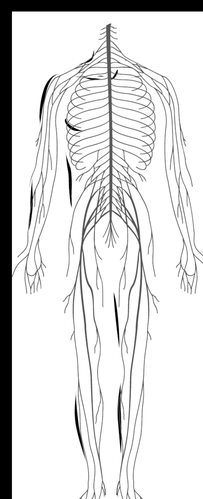
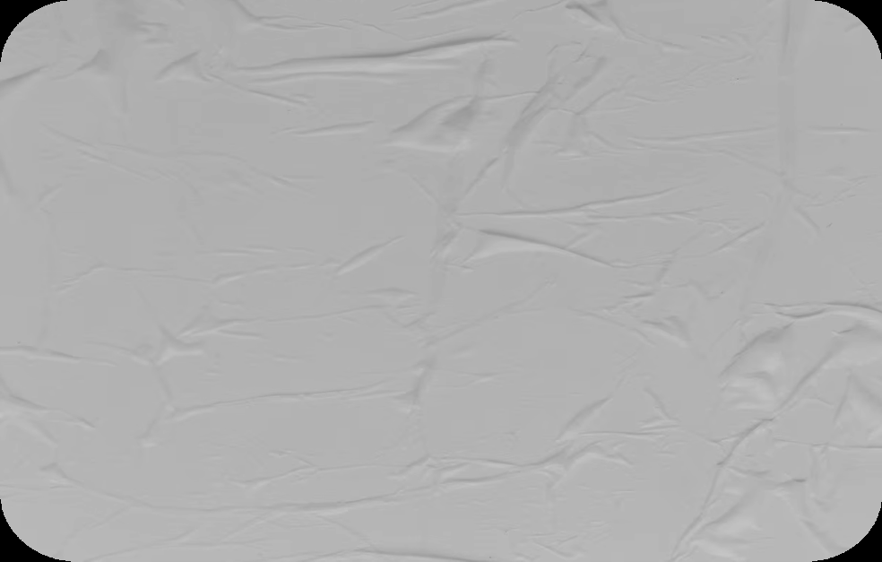

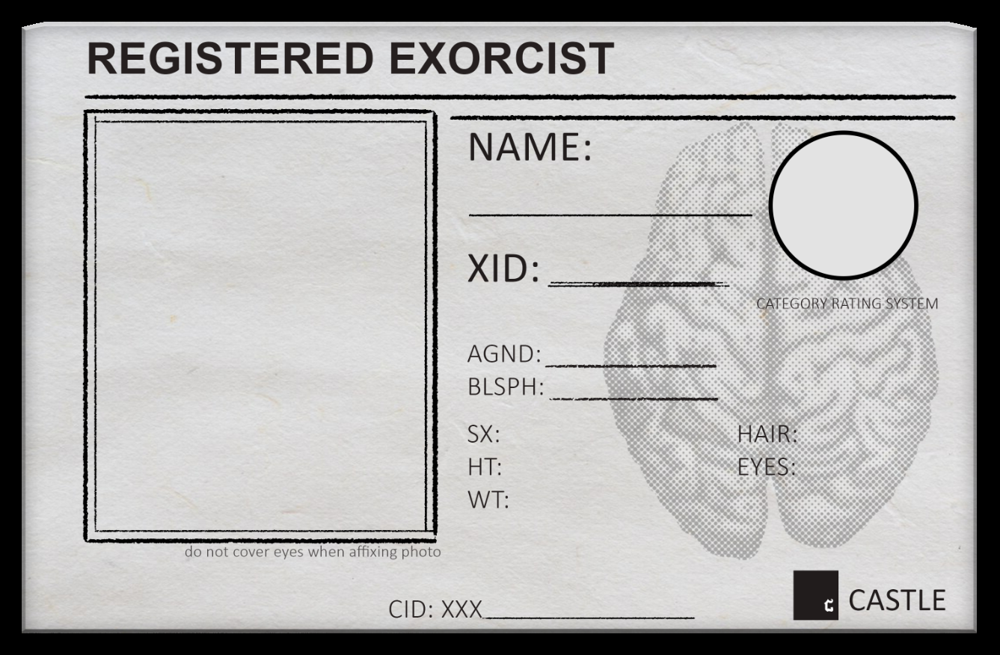

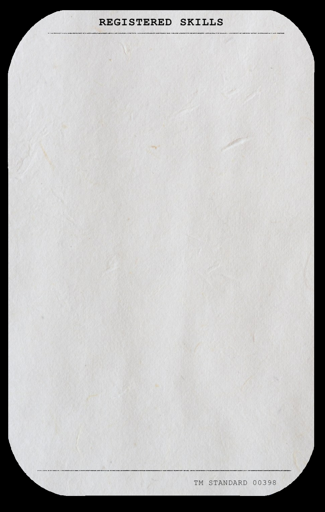

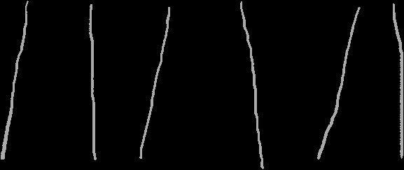
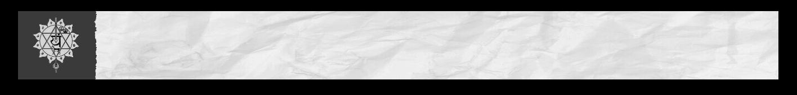

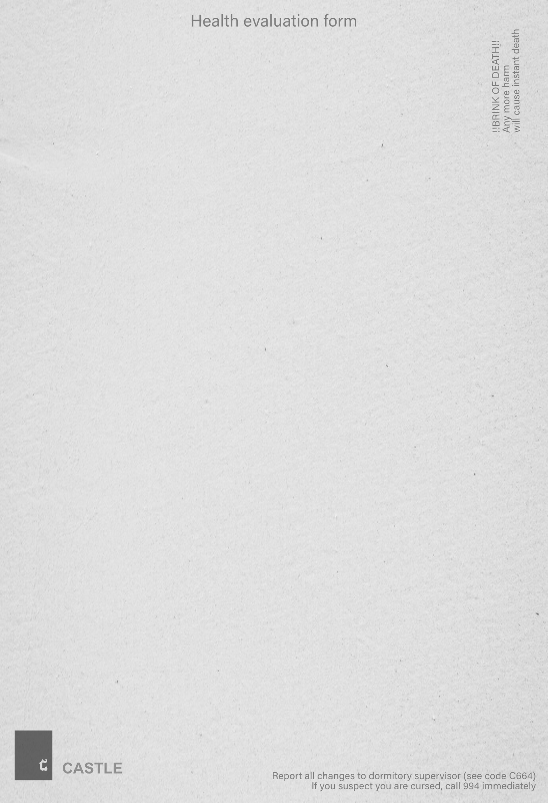

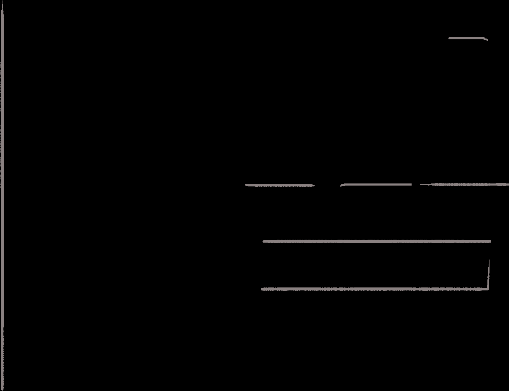

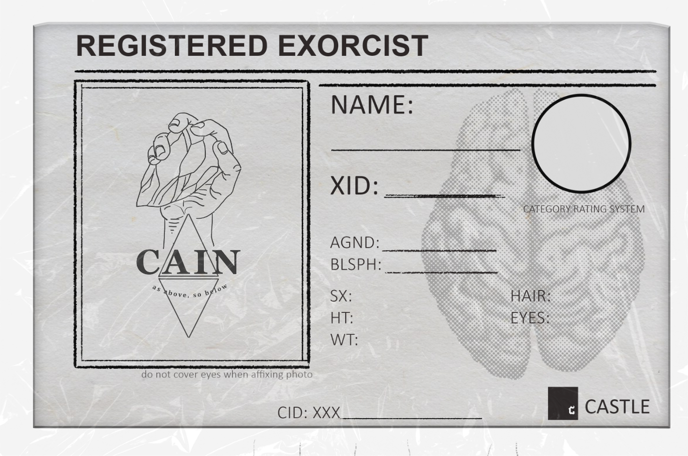

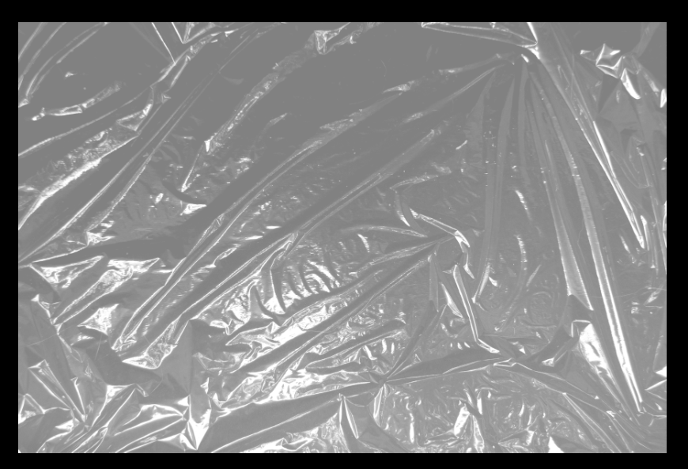
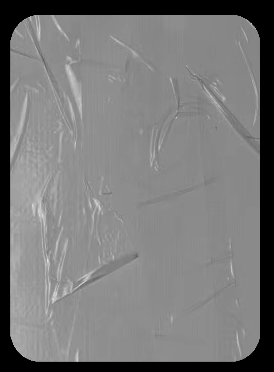

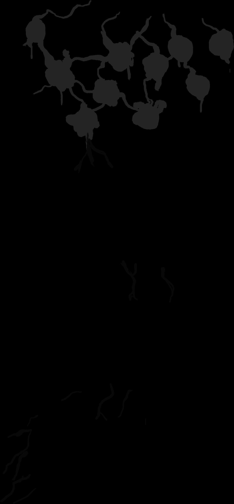
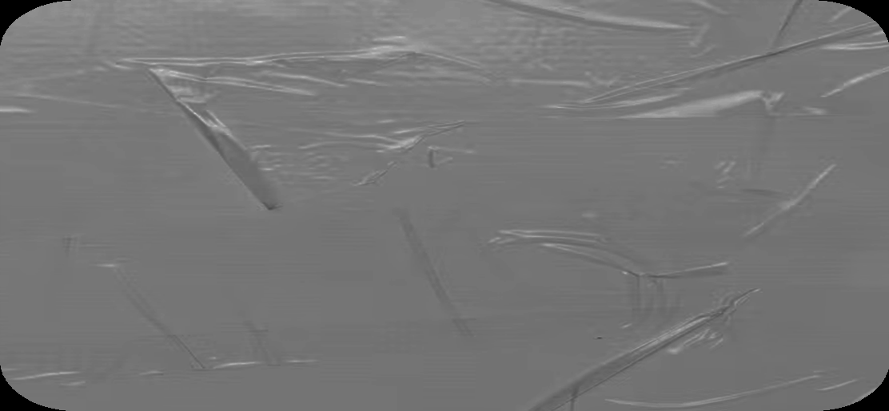

---
### Page 80 Source Content

**REGISTERED ABILITIES** 

**CAI N** 

<!-- Start of picture text -->
AGENDA AGENDA ABILITIES <!-- End of picture text -->

<!-- Start of picture text -->
Describe registered agenda here. Swap agendas between missions. Keep any  bolded  items. Spend an Advance to gain a new ability. 5 abilities max. AGENDA ITEMS BLAST: Spend a  psyche burst  and roll PSYCHE  to produce a weaponized form of BLASPHEMY: concentrated psychic energy in melee or short range. The specific look and feel of this basic exorcist skill varies between exorcists. The Describe registered pychic phenomena. Keep sticker attached at all times. strength of this blast scales with CAT. Spend an Advance to gain a new power. Spend an Advance to gain a new blasphemy. If you do, cross out a sin box, and increase xp to advance by +1 PASSIVE 158 159 DOCREF XX0012 DOCREF XX0015 FIRMLY AFFIX ALL STICKERS As above, so below REFER TO DOCTRINE TM451 IN CASE OF CATEGORY 5+ EVENT As above, so below OBSERVED POWER OBSERVED POWER OBSERVED POWER OBSERVED POWER OBSERVED POWER <!-- End of picture text -->

#### Extracted Visual Elements (Page 80)

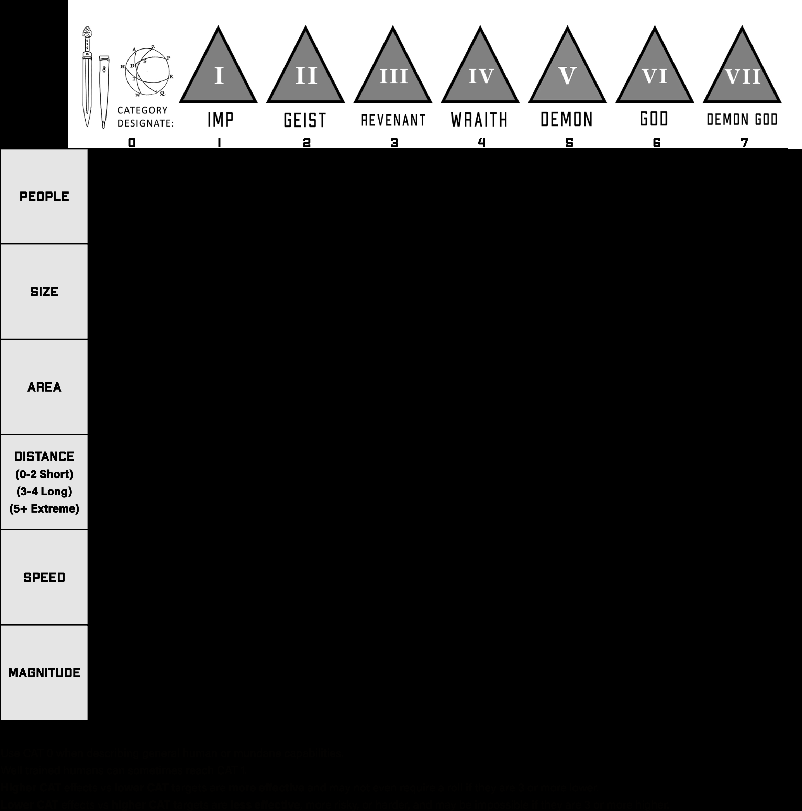

---
### Page 81 Source Content

###### ATTACH MISSION FLOW MATRIX 

- **FIND THE** 

- 1. BRIEFING **PALACE** 2. ARRIVAL **A sin creates a parasitic** 

- 3. TRACK **pocket dimension. It** 

- 4. INVESTIGATE **cannot be slain outside.** 5. PREPARE **Enter the palace and** 

- 6. CONFRONT **execute it.** 7. EXECUTE 

## **THE HUNT** 

**Exorcists are dispatched when signs of a sin appear, and must investigate. They know only its type and trauma questions. They must locate its lair and execute it before catastrophe strikes.** 

Return for debrief. RNR allowances. 

**Just think, you’re all ready to slaughter to your heart’s content.** 

Slash when a scene passes, or a ‘1’ is rolled on risk (once per scene only)l. 

**Increase pressure by 1, then clear tension. Then:** _Send minions/Ambush the exorcists/Involve authorities/ Separate someone/Force a difficult choice/ Escalate the situation/Start or progress a ticking clock/ Use a domain/Threaten or twist an NPC/ Introduce a new obstacle_ 

TENSION 

3 

FILL> 

Slash when tension fills out, degrading the situation. 

# **SIN** 

RECORDED MANIFESTATION FIELD SHEET 

_INSTRUCTIONS:_ 

- _RETREAT TO SAFE DISTANCE_ 

- _DO NOT MAINTAIN EYE CONTACT_ 

- _IMMEDIATELY CALL 994_ 

###### **RECORDED TRAUMAS** 

1. 

2. 

3. 

**I** 

###### **VITAL INFORMATION CARD** 

**_Refrain from speaking name aloud_** 

**II** 

**IV V VI VII** 

**III** 

**_Please promptly file card_** 

**FACT:** Traumas can be used to counter a sin’s reaction, reducing stress suffered by all targets by 1d3 and inflicting 1d3 slashes on the sin. 

AFFIX EXECUTION TALISMAN BELOW. SLASH WHEN TAKING HARM. 

_The situation_ **_gets out of_** FILL> **_control._** _increases in CAT by +1  The sin and things get worse._ 

6 PRESSURE 

#### REST 

###### **TALISMAN WORKSPACE** 

Characters rest as a group. **Increase pressure by 1** , and roll **2d3** . Then for each d3, gain that many **psyche burst** , **heal that much stress,** or **untick a hook** . 

**INSTRUCTIONS:** _Write what each talisman represents, write length in circle (2-short, 3/4 medium, 5/6 long), slash 1 for each success when acting. Actions that don’t fill it up represent partial progress._ 

### AFFIX TALISMANS BELOW 

###### 

**-** EXECUTE 

### EXECUTION 

- **FAIL** 

**- SPARE** _Sparing requires at least 1 trauma_ 

After 4 slashes, must retreat to palace until pressure increases and heal 1, or 2d3 if full. Cannot retreat inside palace, and instead is at the mercy of exorcists if full. 

6+CAT 

##### COMPLICATE 

##### ATTACK 

##### THREATEN 

Add a twist to the fight. Complications can: 

Threaten a worse consequence, once a round. An exorcist must immediately make an action toll to try and counter the threat. Threats can, if executed: 

**Attack with:** 

- make something **hard** 

- deal 1 **stress** a round to all exorcists 

   - **Inflict stress** : **(1):** 6 stress, **(2-3** ): 4 stress. **(4-6):** 2 stress 

- make the sin take **1 less slash** on its talisman under certain circumstances 

**Inflicts stress: (1)** 3 stress, **(2/3)** : 2 stress, **(4+)** 1 stress _Adjust up or down by +1 depending on situation._ 

   - **Separate an exorcis** t completely, or 

- make the sin deal **1 more stress** under certain circumstances 

   - **Afflict** an exorcist, or 

   - Cause **collateral damag** e, or 

- change the parameters of the fight 

- Massively change the parameters of the fight 

The same effect **cannot stack** with itself. Complications are worse and take more effort to deal with the worse the reaction die **(5-6)** : 1 action, **(2-4):** 2 talisman. **(1):** 4 talisman. Add a complication up to **three times** per conflict scene total. 

SEVERE ATTACK **!** _Only usable on a 1, once a scene. Check sin sheet for details._ 

**Or improvise** : (1) Strongest reaction, (2/3) strong reaction, (4/5) Weaker reaction, (6) Weakest reaction. 

**DOMAIN** 

**DOMAIN** 

###### **DOMAIN** 

FIRMLY AFFIX ALL STICKERS 

**160** 

**161** 

**DOCREF XX0124 As above, so below** 

**DOCREF XX0121 As above, so below**

#### Extracted Visual Elements (Page 81)

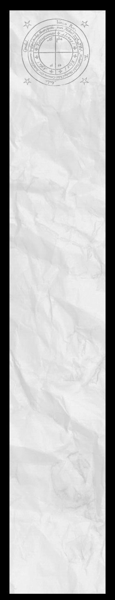
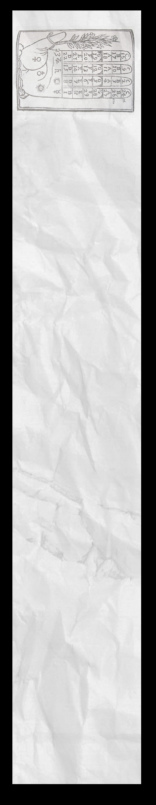
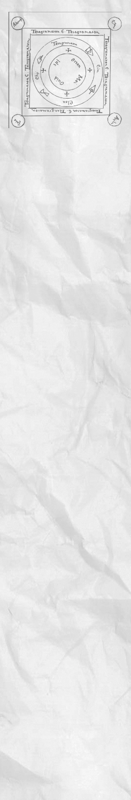

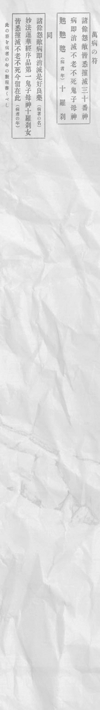

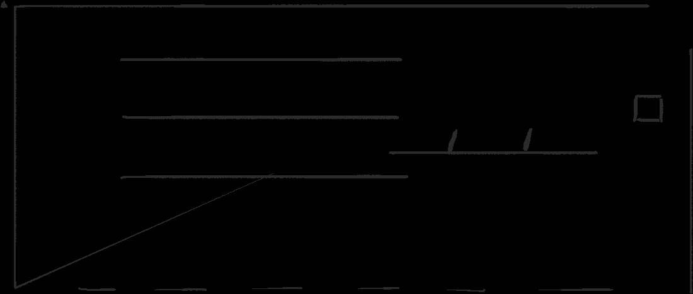

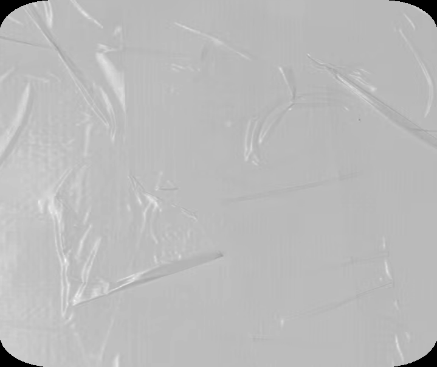

## High-Resolution Graphical Tables & Sheets

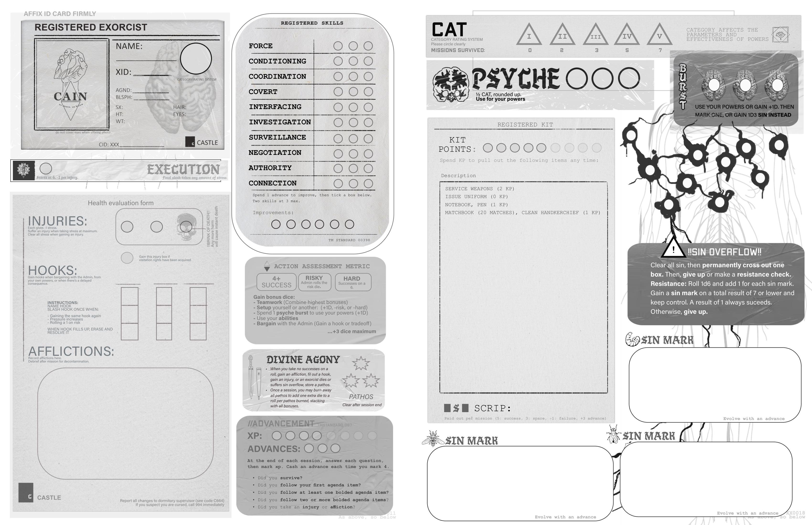

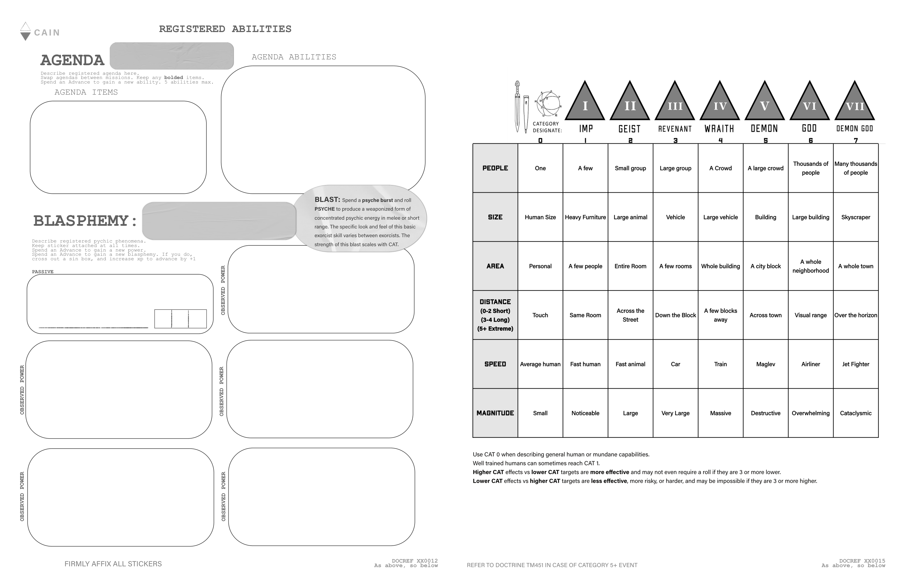

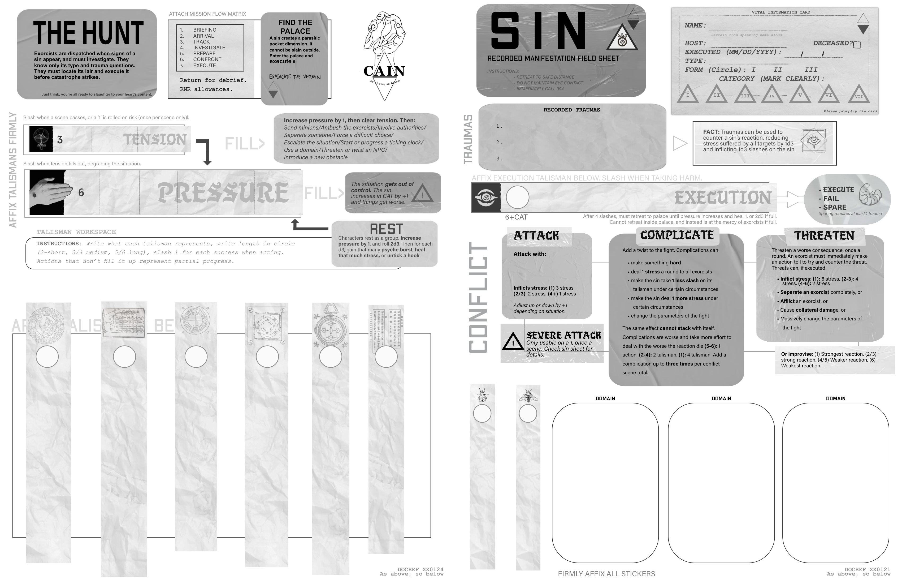

## Related Knowledge Nodes

- [[Exorcist_Overview_and_Skills]]
- [[Agendas]]
- [[The_Twelve_Blasphemies]]
- [[Divine_Agony_and_Talismans]]
