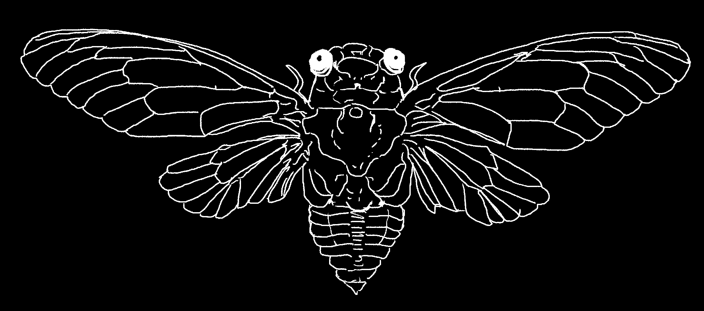
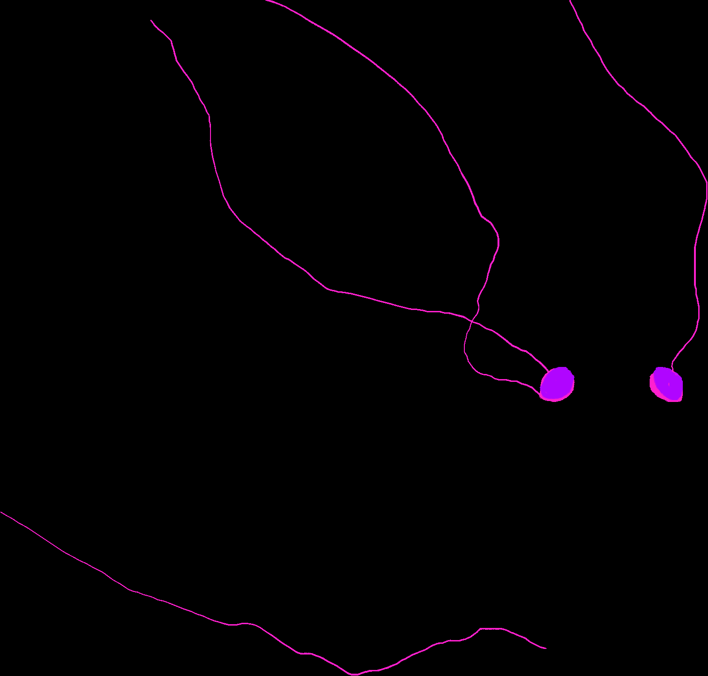
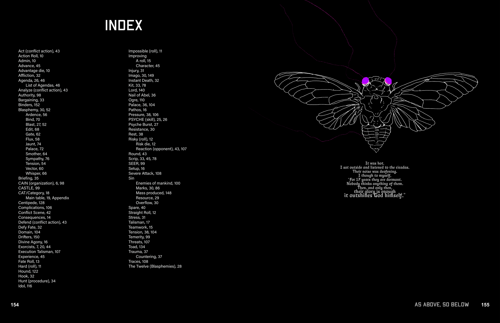

# CAIN Quick Reference Guide & Adjudication Tables

> Source: CAIN 1.0 Rulebook (Pages 78)

---
### Page 78 Source Content

Act (conflict action), 43 Action Roll, 10 Admin, 10 Advance, 45 Advantage die, 10 Affliction, 32 Agenda, 26, 46 List of Agendas, 46 Analyze (conflict action), 43 Authority, 98 Bargaining, 33 Binders, 152 Blasphemy, 30, 52 Ardence, 56 Bind, 70 Blast, 27, 52 Edit, 68 Gate, 62 Flux, 58 Jaunt, 74 Palace, 72 Smother, 64 Sympathy, 76 Tension, 54 Vector, 60 Whisper, 66 

Briefing, 35 CAIN (organization), 6, 98 CASTLE, 99 CAT/Category, 18 Main table, 19, Appendix Centipede, 128 Complications, 106 Conflict Scene, 42 Consequences, 14 Defend (conflict action), 43 Defy Fate, 32 Domain, 104 Drifters, 150 Divine Agony, 16 Exorcists, 7, 20, 44 Execution Talisman, 107 Experience, 45 Fate Roll, 13 Hard (roll), 11 Hound, 122 Hook, 32 Hunt (procedure), 34 Idol, 116 

# INDEX 

Impossible (roll), 11 Improving A roll, 15 Character, 45 Injury, 31 Imago, 30, 149 Instant Death, 32 Kit, 33, 78 Lord, 140 Nail of Abel, 36 Ogre, 110 Palace, 36, 104 Pathos, 16 Pressure, 38, 106 PSYCHE (skill), 25, 26 Psyche Burst, 27 Resistance, 30 Rest, 38 Risky (roll), 12 Risk die, 12 Reaction (opponent), 43, 107 Round, 43 Scrip, 33, 45, 78 SEER, 99 Setup, 16 Severe Attack, 108 Sin 

Enemies of mankind, 100 Marks, 30, 86 Mass produced, 148 Resource, 29 Overflow, 30 Spare, 40 Straight Roll, 12 Stress, 31 Talisman, 17 Teamwork, 15 Tension, 38, 104 Temerity, 99 Threats, 107 Toad, 134 Trauma, 37 Countering, 37 Traces, 108 The Twelve (Blasphemies), 28 

It was hot. I sat outside and listened to the cicadas. Their noise was deafening. I though to myself, “For 17 years they are dormant. Nobody thinks anything of them. Then, and only then, their glory is enough it outshines God himself.” 

**As above, so below 155** 

**154**

#### Extracted Visual Elements (Page 78)

## High-Resolution Graphical Tables & Sheets

## Related Knowledge Nodes

- [[Core_Mechanics_and_Action_Roll]]
- [[Consequences_and_Upsides]]
- [[Divine_Agony_and_Talismans]]
- [[Category_and_Mundane_vs_Supernatural]]
