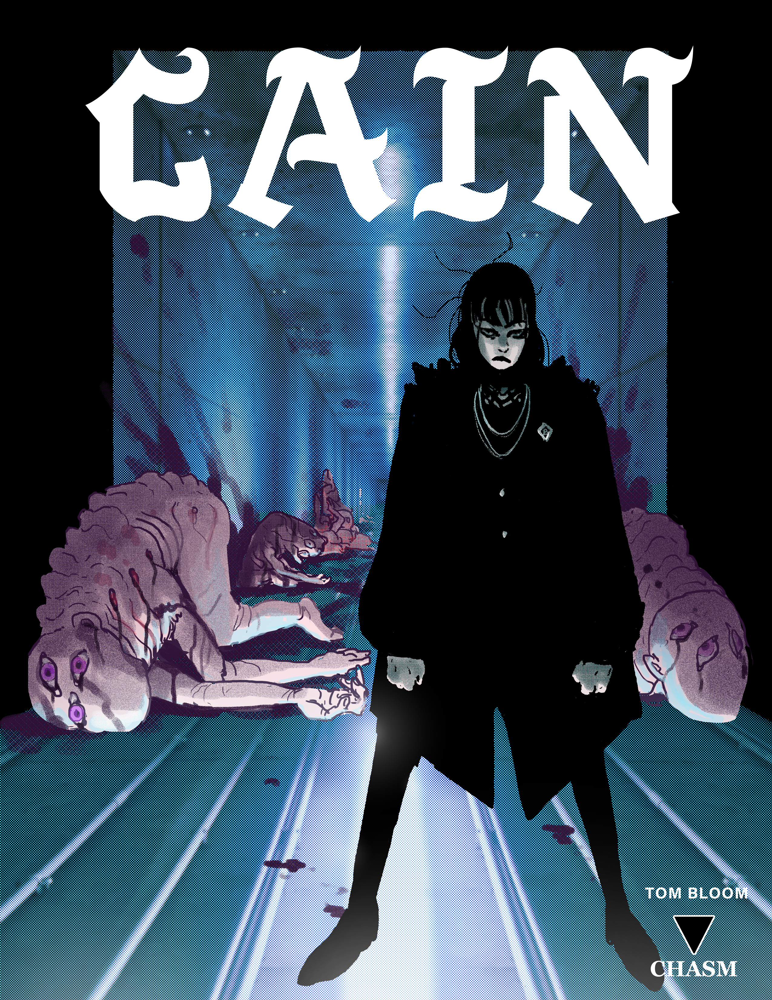
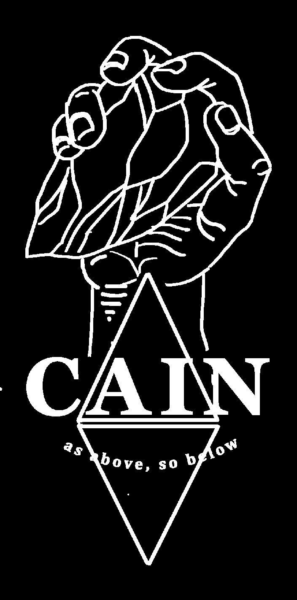
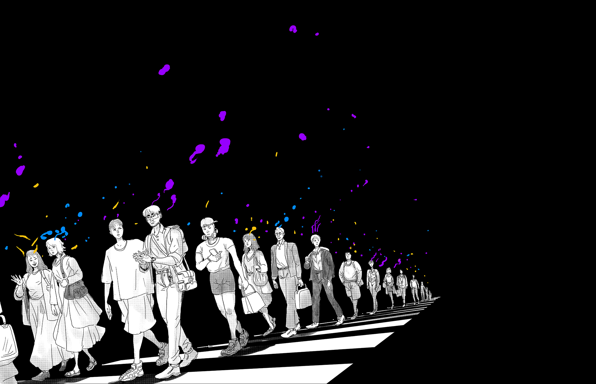
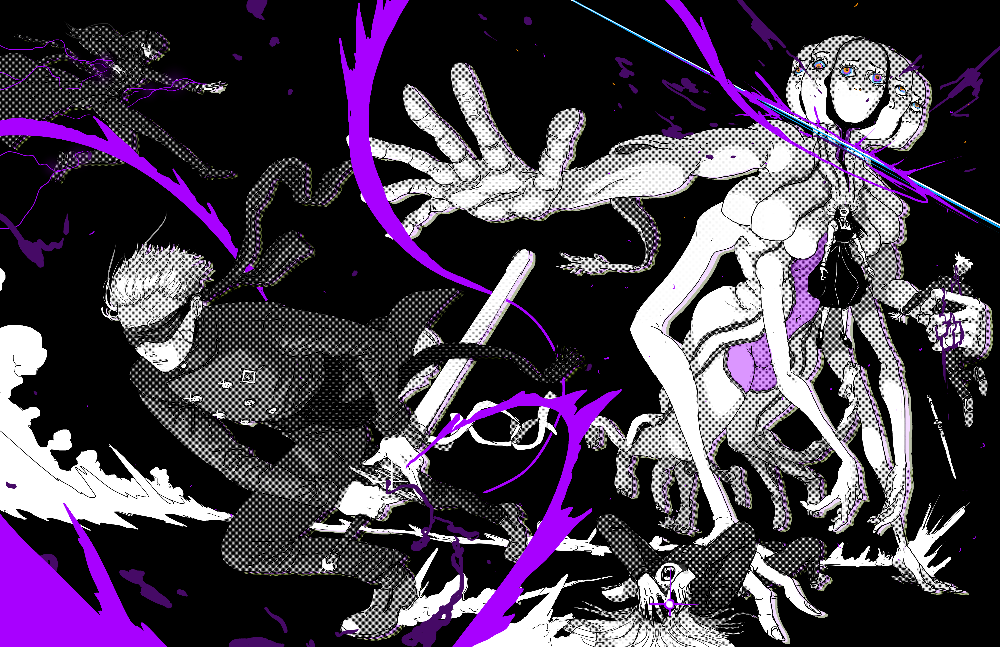

# As Above, So Below - The World of CAIN

> Source: CAIN 1.0 Rulebook (Pages 1, 2, 3, 4, 5)

---
### Page 1 Source Content

**1**

#### Extracted Visual Elements (Page 1)

---
### Page 2 Source Content

Please your honours, said he, I'm able, 

By means of a secret charm, to draw 

All creatures living beneath the sun, 

That creep, or swim, or fly, or run, 

After me so as you never saw! 

And I chiefly use my charm 

On creatures that do people harm. 

## **Art, layout and game design by Tom Bloom/CHASM ©2024** 

Do not reproduce without permission, though you may print this game for personal use only. 

Fonts used are Acumin Pro, Cuasigothic, Apex Mk2, Fanzine, and Odachi All fonts are free for commercial use. All photos used for collage, background, and texture work are public use and were sourced from Wikimedia commons, Pexels, and Freepik.com 

Poem on the across page by Robert Downing. Sin Illustration on page 100 by the excellent Francine Bridge/Witnesstheabsurd. 

If you enjoyed this game consider kicking me a subscription at **patreon.com/ killsixbilliondemons** . I’ve love to hear what you think. You can e-mail me at **ksbdabbadon@gmail.com** 

# WIPE OUT THE STAIN 

I listened to the albums Frances the Mute by the Mars Volta and To Bathe From the Throat of Cowardice by Vitriol quite often while making this album. I also listened a lot to the discography of Barber Beats artists Mabisyo and Opal Vessel, whose visual aesthetic inspired this game. Give them a listen! 

© Tom Bloom 2024

#### Extracted Visual Elements (Page 2)

---
### Page 3 Source Content

|CONTENTS|Conflict Scenes Making an Exorcist|42 44|The Shadow War 98 The Legion 98|
|---|---|---|---|
||Increasing in power|45|CAIN 98|
||Experience|45|SINS 101|
|6 THE TWELVE BLASPHEMIES 29|Advances|45|TYPE, FORM, and CATEGORY 102|
|10 Taking additional blasphemies 29|Survival|45|Powers and abilities 104|
|10 Category and Blasphemies 29|AGENDAS|46|Domains 104|
|10   SIN 29|BLASPHEMIES|52|Palace 104|
|11 Sin overflow 30|Tags|53|TENSION MOVES 105|
|11 Sin Marks 30|Advancing blasphemies|53|TRAUMAS 106|
|11 The Body 31|TENSION|54|The Execution Talisman 107|
|12 Stress 31|ARDENCE|56|1. Attacks 107|
|12 Injuries 31|FLUX |58|2. Complications 107|
|12 Instant Death 32|VECTOR|60|3. Threats 108|
|13 Dead Exorcists 32|GATE|62|4. Severe Attacks 108|
|14 Afflictions 32|SMOTHER|64|Traces 108|
|15 Hooks 32|WHISPER|66|Making a Sin 109|
|15 Bargaining 33|BIND|70|Fleshing out a sin 109|
|15 Kit 33|PALACE|72|Creating an investigation 109|
|16 THE HUNT 34|JAUNT |74 |I. OGRE 110   |
|17 1. Briefing 35|SYMPATHY |76 |II. IDOL 116   |
|18 2. Arrival 36|Kit expansion|78|III. HOUND 122|
|18 3. Tracking 36|WEAPONS |84 |IV. CENTIPEDE 128   |
|18 4a. Investigation 37|SIN MARKS |86 |V. TOAD 134   |
|20 Traumas 37|Running|88|VI. LORD 140|
|22 Countering 37|CAIN|88|Other Opponents 146|
|26 4b. Preparation 37|Safety First |89 |Writing an opponent 146   |
|26 4c. Rest 38|Principles and Tips |89 |Mundane Opponents 146   |
|26 5a. Tension 39|Talismans |93 |BINDERS 152|
|27  5b. Pressure 39   |Creating Investigations Structuring an investigation|94 95||

|AS ABOVE, SO BELOW The Game|6 10|THE TWELVE BLASPHEMIES Taking additional blasphemies|29 29|
|---|---|---|---|
|Materials|10|Category and Blasphemies|29|
|PLAY|10|SIN|29|
|Taking Action|11|Sin overflow|30|
|The Action Roll|11|Sin Marks|30|
|Hard|11|The Body|31|
|Risky|12|Stress|31|
|Straight rolls|12|Injuries|31|
|Admin Rolls|12|Instant Death|32|
|Fate Rolls|13|Dead Exorcists|32|
|Consequences|14|Afflictions|32|
|Upsides|15|Hooks|32|
|IMPROVING a Roll|15|Bargaining|33|
|Teamwork and Setup|15|Kit|33|
|Divine Agony|16|THE HUNT|34|
|Talismans|17|1. Briefing|35|
|Category|18|2. Arrival|36|
|Mundane vs supernatural|18|3. Tracking|36|
|Using Category|18|4a. Investigation|37|
|THE EXORCIST|20|Traumas|37|
|SKILLS|22|Countering|37|
|AGENDA|26|4b. Preparation|37|
|BLASPHEMIES|26|4c. Rest|38|
|PSYCHE|26|5a. Tension|39|
|PSYCHE BURST|27|5b. Pressure|39|
|BLAST|27|6. Execution|40|

---
### Page 4 Source Content

# AS ABOVE, SO BELOW 

There is a secret world, **for those with the eyes to see it.** 

The vast majority of humanity blindly swims in a potent psychic melange that suffuses us like a roiling sea of emotion and memory. All humans naturally produce this field, though some are more sensitive to it than others. They may see ‘auras’, read emotions, or see supernatural phenomena: ghosts, apparitions, or echoes of things that are not there. 

However, **for a select few** , their connection to this shadow presence goes deeper. It darkens, coalesces, and twists into something tangible and powerful. These powers feed on the deep psyche, emotion, and mental state of humans, the sunless and subconscious torrent that flows **beneath the surface of human thought.** 

Occasionally, through the course of tragedy, trauma, stress, or extreme circumstances, this psychic field can go **wild.** Ballooning like a cancerous growth, it escapes the confines of the human body, and manifests as malevolent presence, something that warps and controls reality around it, and beings to feed on the flesh and minds of others. Invisible to the psychically dull, these beings can either exist separately to a human or possess them, warping them into a monster. 

Collectively these beings are called Sins. Their continued existence, once they are birthed, will continue to twist and degrade the people and even physical location of an area, creating a pocket dimension called a palace, and growing until they reach a catastrophic apotheosis known as a Sin Event. These typically result in mass psychic veil rupture, an event that is instantly traumatic and fatal to humans in a broad area. 

You are a tool, a weapon of the the highly secretive and supra-governmental organization **CAIN** in an official capacity of an exorcist. You have **grace** , the ability to perceive sins and manifest powerful and highly honed psychic techniques called **blasphemies.** You have a single purpose in this world: **to hunt down all sins** and **execute them with extreme prejudice.** 

**6** 

**7**

#### Extracted Visual Elements (Page 4)

---
### Page 5 Source Content

# SINS 

Sins are the failures of mankind, made manifest. Brook them no quarter, for they deserve none. Don’t think too much, just go out and kill a few. It’ll clear your head. **It’s what your kind does.** 

## EXORCISTS 

**Exorcists are the tools of CAIN** . All are offered a chance at redemption through unrelenting violence. Over and over again, the **slaughter will not end until it is done.** Is your hand your hand? Do you remember the face of your mother? 

**8** 

**9**

#### Extracted Visual Elements (Page 5)

## Related Knowledge Nodes

- [[The_Shadow_War_and_The_Legion]]
- [[Sins_and_The_Flesh]]
- [[Core_Mechanics_and_Action_Roll]]
