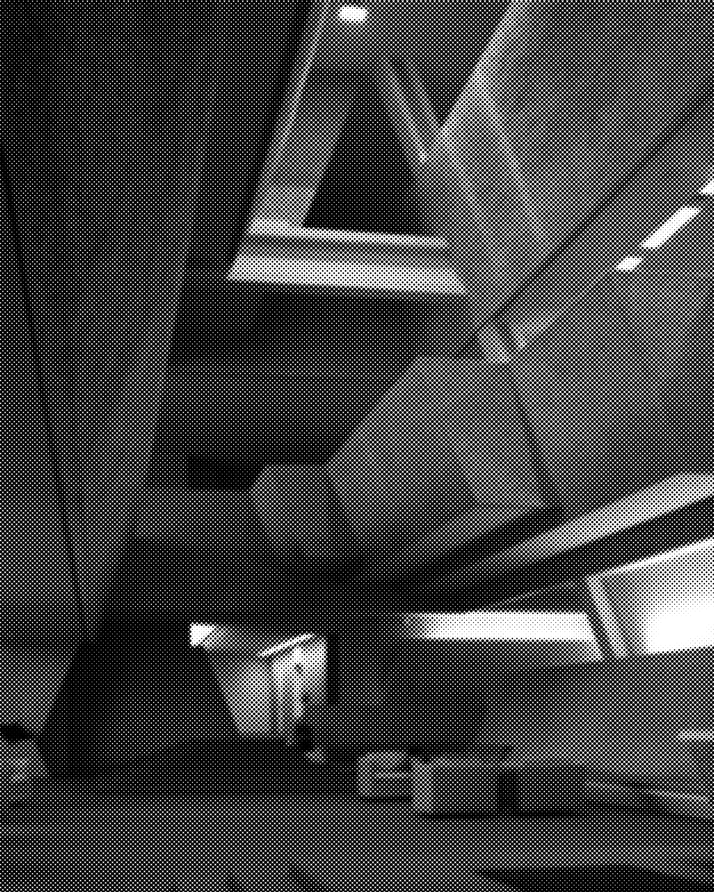
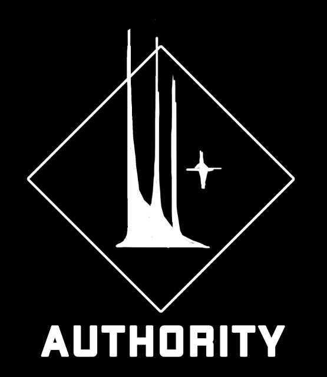
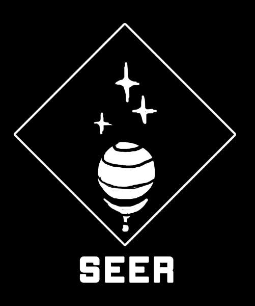
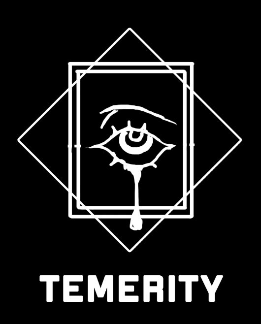
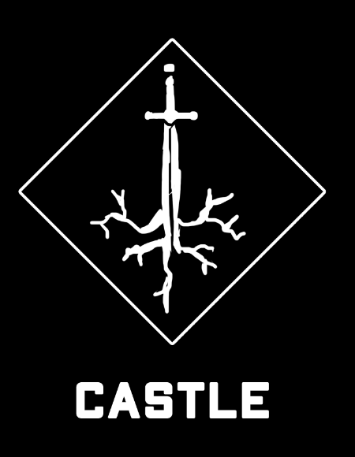

# The Shadow War, The Legion & CAIN Protocol

> Source: CAIN 1.0 Rulebook (Pages 50, 51)

---
### Page 50 Source Content

# **CAIN** 

**CAIN** is the global supranational organization for the execution and disposal of supernatural phenomena. Buried in a dozen massive subterranean facilities worldwide, it’s behemoth machinery exists for one purpose **: to wipe out the stain of humanity’s sins** . Without the organization, humanity would eventually collapse under the weight of its own evil. 

Officially, the organization’s goal is to **eradicate all sins** . Unofficially, it has many of its own goals and agendas, which often clash internally. Astute observers might note that its goal is not a long term solution, something the organization is aware of, but dogmatically denies. 

## **The Legion** 

**Exorcists are the tools of CAIN** , high potential psychic individuals who can exercise the necessary self-control to use their powers as a weapon. CAIN is responsible for their recruitment and monitoring, as well as their training, upkeep, and education, and takes this as its secondary driving purpose. 

CAIN’s human staff number in the tens of thousands and are highly trained and inducted under oath. The entire organization is broadly split into four sub-organizations, each of which sometimes finds itself at odds with the other. 

The organization is extremely well resourced and has access to many global facilities and deployment sites, including the SERAPH orbital rail and surveillance network. Despite this, it remains a relatively small organization, by necessity due to the nature of its activities. 

## **The Shadow War** 

The governing body of CAIN, responsible for the clandestine nature of the organization and covering up most Sin activity, which is often explained by ‘unexplained’ disappearances, gas leaks, industrial accidents, chemical spills, or natural disasters. CAIN has roots in most major governments, but is not subservient to any of them. 

CAIN officially does not exist and operates on a clandestine basis. Its operating charter has its basis in the old hermetic orders and was established by the Covenant of Worms in 1684. It’s headquarter building is in <mark>XXX in the XXX</mark> ocean and has extensive boarding, research, and training facilities. 

World elites and leaders are typically aware of its existence, but may scramble to grasp the true meaning of its activities. CAIN tightly regulates its research into the phenomena of grace, and therefore mundane governments are always one step behind CAIN, which has not only its technological edge, but a trained cadre of high level psychics at its disposal. 

The board is made up of eight elders chosen by succession and a secret vote. Their real identities are kept a secret even to the organization itself and they are only referred to by their titles. They rarely meet in person, and in practice while there is a ranking (upper four and lower four), none of them are in charge. The lower four are rumored to all be extremely powerful exorcists of Category 5-7 but this is unsubstantiated. 

Cain’s intelligence service, responsible for tracking sin emergences, exorcist recruitment, and the monitoring of rogue psychics. Utilizing CAIN’s orbital surveillance platform SERAPH and the Heaven Eyes, a group of specialized precognitive exorcists, they are able to not only track sin activity across the globe but also predict future activity with a small degree of variance. 

They are also responsible for, in extreme circumstances, deploying ‘veil’ blanket memory modification, as well as the defrosting and launch of extremely powerful reserve exorcists (deemed: Virtues) to critical situations. 

Cain’s research division, responsible for countermeasure production, weapon development, exorcist research, and sin or anomaly imprisonment. It is also responsible for the training of exorcists and the honing of their abilities, running the monthly category assessment tests. 

TEMERITY has, unfortunately, cultivated a poor reputation within CAIN for ruthlessness, mostly due to their hard training regimen and their secretive nature, even within the organization. 

Cain’s boarding organization, responsible for the upkeep, education, maintenance, and well being of exorcists, as well as their deployment to the field. Many psychics manifest powers in adolescence, therefore there is an extensive schooling, exercise, and nutrition program to keep them in good mental and physical shape. Exorcists are the organization’s highest value assets - they are well taken care of, providing they prove their worth. 

In a sense, CASTLE is both father and mother to the exorcists and is their closest point of contact to the organization. Most people they interact with in their day to day will be CASTLE staff. Exorcists are not allowed to reside outside of approved facilities though allowances can be made for outside trips or excursions for well being and leisure. During such trips they are tightly monitored. 

CASTLE maintains CAIN’s mundane security wing and military forces, including heavily armed and well trained ‘scramble’ teams of mundane humans with special anti-psychic training, dubbed ‘untouchables'. They are typically recruited from a pool of international convicts and  deployed in tight circumstances against sins where exorcists cannot be allocated in time. These teams have a high expected fatality rate and cultivate a certain pride in their activities. 

**98** 

**99**

#### Extracted Visual Elements (Page 50)

---
### Page 51 Source Content

# SINS 

Sins are the **failures of mankind made manifes** t. They typically appear when someone with naturally high levels of grace suffers a traumatic event, the influx of emotion rapidly expanding their psychic potential to levels that their body and mind cannot handle, as their powers warp or even rip free of their body. 

In essence, sins manifest when CAIN cannot locate a potential exorcist in time. It is CAIN’s duty to shepherd these individuals and each sin is a failure of its purpose. The manifestation of sins is very rare in society in general, though troublingly this rate, and the percent of humans affected by grace in general, is **increasing slowly but inexorably over time.** 

Most people cannot see sins, though some sins are partly visible to graceless humans, who find the information hard to process. Humans can always sense the presence of sins without sight of them, though they may describe them as ghosts, evil spirits, or malevolent presences. 

**100** 

**101**

#### Extracted Visual Elements (Page 51)

## Related Knowledge Nodes

- [[01_As_Above_So_Below]]
- [[Sins_and_The_Flesh]]
- [[Phases_of_The_Hunt]]
