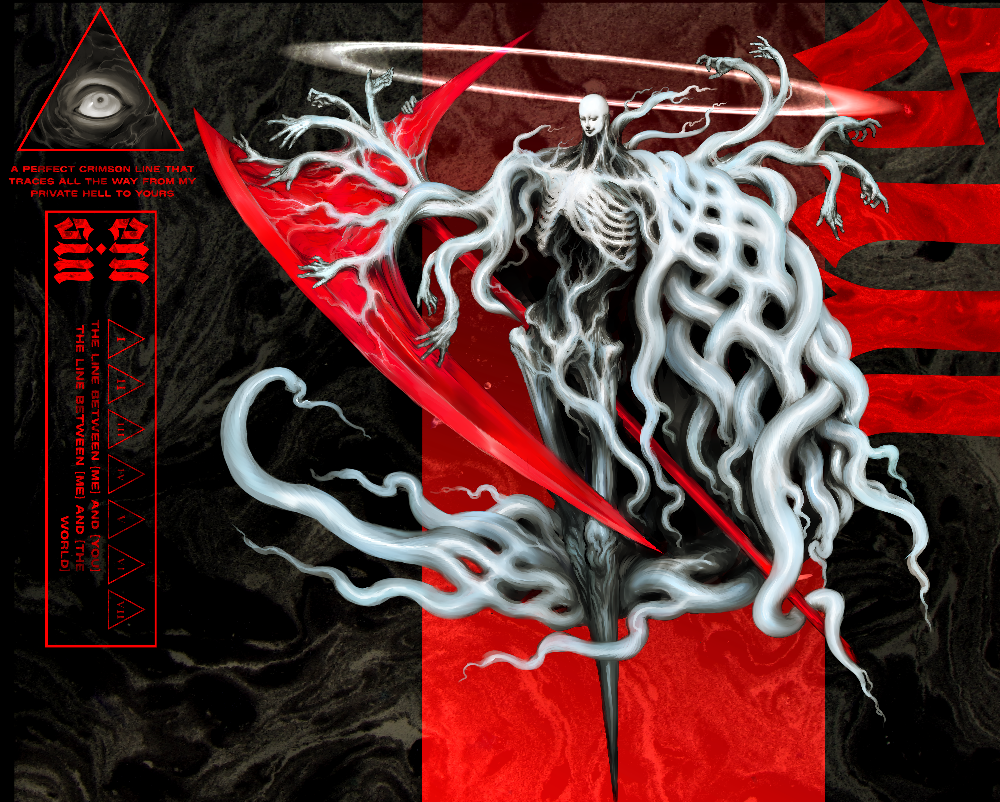
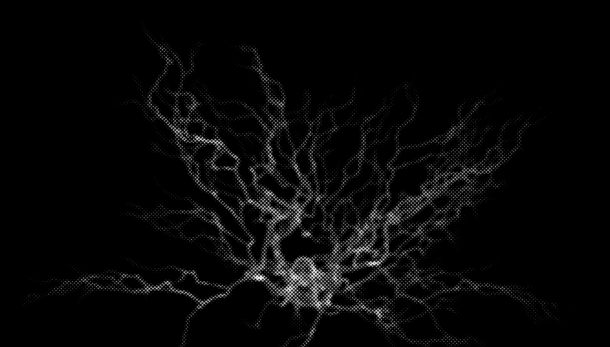
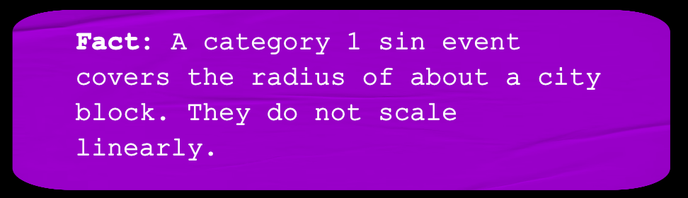
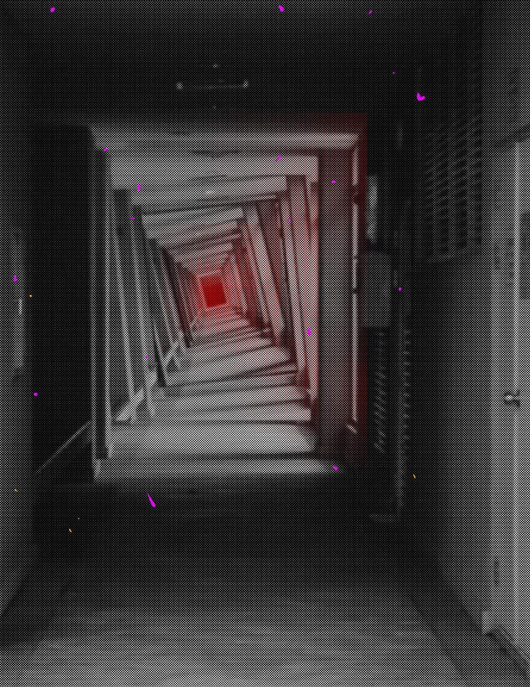
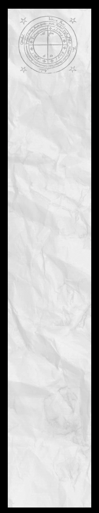
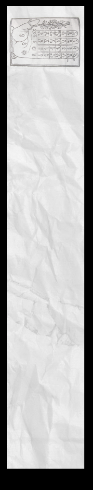
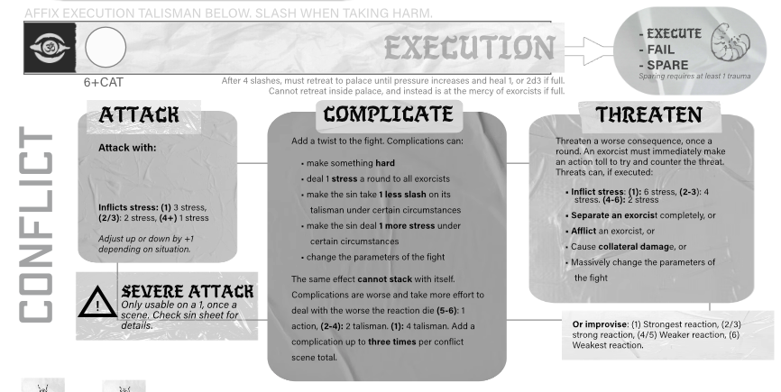

# Sins, The Psychic Sea, and The Flesh

> Source: CAIN 1.0 Rulebook (Pages 51, 52, 53, 54, 55)

---
### Page 51 Source Content

# SINS 

Sins are the **failures of mankind made manifes** t. They typically appear when someone with naturally high levels of grace suffers a traumatic event, the influx of emotion rapidly expanding their psychic potential to levels that their body and mind cannot handle, as their powers warp or even rip free of their body. 

In essence, sins manifest when CAIN cannot locate a potential exorcist in time. It is CAIN’s duty to shepherd these individuals and each sin is a failure of its purpose. The manifestation of sins is very rare in society in general, though troublingly this rate, and the percent of humans affected by grace in general, is **increasing slowly but inexorably over time.** 

Most people cannot see sins, though some sins are partly visible to graceless humans, who find the information hard to process. Humans can always sense the presence of sins without sight of them, though they may describe them as ghosts, evil spirits, or malevolent presences. 

**100** 

**101**

#### Extracted Visual Elements (Page 51)

---
### Page 52 Source Content

## **Manifestation** 

The appearance of a sin is only predictable insofar as they appear after **trauma, emotional intensity, or great suffering** . Otherwise, it is highly random. They can appear even in individuals with no previous apparent psychic potential, or even post mortem after the death of their host (a common sin manifestation event is after someone is murdered). 

Sins feed off the intense psychic experiences of their hosts and grow stronger the more intense these feelings are, whether pain, joy or pleasure. Over time they catalyze and begin to metabolize this energy faster and faster, eventually leading to a sin event. 

## **Sin Events** 

Sin Events always cause traumatic psychic veil rupture in a broad spectrum radius, which is instantly fatal to all humans and nearly all exorcists, and may be antithetical to reality as we understand it. The sin at the center will undergo apotheosis, and typically undergo an evolution of some kind, prompting this cycle to repeat, with stronger and stronger sin events each time. 

# **TYPE, FORM, and CATEGORY** 

Sins have a broad range of appearances, from the monstrous, to the animalistic, to the incomprehensible. Some even appear human, or can inhabit or fuse with the bodies of their hosts, passing for human in some circumstances. 

Sins are classified with the following: type, form, and category. 

## **Type** 

Sins each have a type. As exorcists are defined by their agendas and blasphemies, sins are defined by their type. CAIN assigns and names these types based on broad criteria. A Sin’s type determines not only the kind of opponent exorcists will be facing and its various abilities and details but also the tone of the story that the hunt tells. 

The six types of sins are: 

- **Ogre:** A massive sin that feeds off despair and summons a choking **miasma** to cloak and smother the area 

- **Idol:** A charismatic sin that manipulates and pulls strings from behind the scenes, forming a **cult** around itself. 

- **Hound:** The embodiment of rage, a hound usually manifests post-mortem - forming a **grudge** against a specific group of people and hunting them down violently. 

- **Centipede:** A vile sin drawing its power from hatred and escapism that is widely feared for its ability to infect and transform **hordes** of mundane humans. 

- **Toad:** Unusually intelligent sins that delight in material wealth, they covet what their host could not have, and steal to form a massive **hoard** from which they draw their power 

- **Lord:** Appearing after their host suffers a calamity or tragedy, a lord appeals to their sense of nostalgia and lost, restoring them to their former glory and creating a parasitic pocket reality called a **kingdom** that slowly consumes the real world. 

There are other beings that can also be classified as sins such as **imagos** , nascent sins formed from exorcists that have suffered sin overflow, or **traces,** weaker monsters that are are product of a major sin’s manifestation and infest an area after its appearance. 

## **Category** 

## **Form** 

Sins take one of three forms. The form of a Sin has no impact on its in-game capabilities. 

Like exorcists, sins are rated on a category system, from 0-7. Category 0 sins are weak comparatively, but still as strong as an average human. Category 1 and 2 sins are easily capable of overwhelming and killing a human. 

- **Form I/Severed:** The most common type, a severed sin is free acting to its host, a psychic being made manifest and acting with its own needs and desires. This form still has an innate connection to its host. It may not necessarily require its host to be alive (especially if it manifested post mortem), and may be either malicious or helpful to its host. 

Fighting a **higher category** sin may be **hard, risky,** or **impossible** depending on the category differences. 

Category determines the scale and power of a sin’s abilities. A CAT 2 sin can produce an effect that can suffuse an entire room. A CAT 5 sin can produce an effect that suffuses an entire building. 

- **Form II/Fused:** A fused sin has fused to its human hosts’ body or corpse, forming an amalgam being. The sin is typically but not always the dominant being in this arrangement. Form II sins vary in appearance, and can look very humanlike. Humans may sense something ‘off’ about the person even if they look normal. 

## **Mundane Weaponry** 

Fighting a sin with mundane abilities or tools, such as human capabilities or the swords and sidearms of exorcists, **is always hard** . It may even be even completely ineffective if the sin is many categories higher. To have a good shot at harming a sin, exorcists will need to use their blasphemies. 

PERCIEVING A FORM II SIN THAT is not humanlike will cause unconsciousness or rapid onset cranial hemmorrhage in graceless humans 

! 

DO NOT MAINTAIN EYE CONTACT WITH A SIN FOR LONGER THAN THREE SECONDS 

! 

- **Form III/Bound:** A rare form that occurs when a human or exorcist is able to control and command a type I or II sin. This sin may originate from their own body and mind, or may be bound separately. 

<!-- Start of picture text -->
Fact: <!-- End of picture text -->

**Fact:** Binders do not have any ‘of fi cial organization’. Any rumors to the contrary are unsubstantiated. **Binding is punishable by expedited execution** . Fortunately, exorcists that practice this discipline are granted an indef i nite stay by CAIN as long as they are employed. 

**102** 

**103**

#### Extracted Visual Elements (Page 52)

---
### Page 53 Source Content

# Powers and abilities 

Sins are formed of pure psychic energy, a coalesced knot of dark emotions made flesh. Their existence is anthema to established reality, and their powers can warp and bend it at will. Their very presence degrades and eats away at the world for as long as they exist. It is therefore important that exorcist **proceed with haste.** 

- Sins each have **three domains.** A domain is a core strength of the sin, granting them many powers. 

- Sins have **tension moves** that they can use each time the tension talisman fills up - things like attacking the exorcists or making the situation worse for them. 

- Sins have a **pressure** talisman. This talisman represents the degrading situation and fills up over time. 

- Sins have an **execution** talisman. This talisman informs how the Sin acts in a combat or confrontation situation, as well as directly tracking its harm and physical state. 

- Finally, sins have **traumas** . These are the tragic, intense, or painful circumstances of their birth. Investigating and unveiling these traumas can drastically weaken the sin. 

## **Domains** 

A domain is a broad description of a power that a sin has, and the abilities that it grants. When the Admin creates a sin for a hunt, they will choose **three domains** for that sin. Each Sin is therefore slightly different from another. 

Domains grant several explicit powers, but can also be referred to when an Admin decides the theming of a sin’s attacks and abilities. A sin that relies on a domain of darkness to hide itself, such as an ogre, may therefore attack more with ambush attacks or shadow constructs than an ogre that relies on manipulating rot and mud. 

## **Palace** 

A sin’s palace is a pocket dimension, a lair of sorts where it is able to retreat and take refuge. 

- If a sin takes **4 slashes** on its execution talisman outside of its palace, it retreats there until pressure increases. It slips away, skulks off, or blinks out of existence. Then it heals 1, or 2d3 if the talisman is full. **It can never be executed outside.** 

- Fighting a sin inside its palace forces an execution scene where it cannit flee. 

- Exorcists can always summon a sin into its palace if they are inside and it is outside using the Nail of Abel (pg. 36) 

Details as to the look and feel of each sin’s palace are include in each sin’s description, but the Admin is free to write their own. **A palace should represent a sin** to some degree, or the things **significant to their host.** Since it draws on the human psyche, it can often resembles a mundane location, like a hotel or abandoned hospital. 

## **TENSION MOVES** 

The Admin tracks the general passage of time and the tension of the hunt with the **tension talisman** . It fills up at 3 slashes. 

Tension increases when: 

- A scene passes 

- A 1 result is rolled on a risk die, but no more than once a scene 

When the talisman fills, the Admin can empty the talisman, then pick one of the following **tension move** s to activate, or improvise based on the ones provided. Tension moves add complications or twists to the narrative and keep the exorcists on their toes. Domains will often add new tension moves to the list or provide hints as to what kind of actions the Admin should take. **Don’t regard these lists as proscriptiv** e - rather as a guideline or spread of easily available choices. 

The basic moves are: 

_Send minions/Ambush the exorcists/Involve authorities/Separate someone/Force a difficult choice/Escalate the situation/Start or progress a ticking clock/Use a domain/Threaten or twist an NPC/Introduce a new obstacle_ 

### **1. Send minions** 

Self explanatory - send minions after the exorcists. Sins often have traces - lesser sins, or humans that follow their command, listed in each sin description. The Admin can use this tension move to have them show up in a scene unexpectedly - even when the exorcists are otherwise preoccupied! 

### **2. Ambush the exorcists** 

The sin attacks the exorcists directly, often with the element of surprise. If fought this way, it is banished back to its palace if it takes enough harm. It must remain there until pressure increases. 

### **3. Involve authorities** 

CAIN is a clandestine organization that must operate below official notice. Whether through the actions of the exorcists themselves attracting attention or through intervention by the Sin or its forces, get the authorities involved - alert police or security, or even the military (if the scale is high enough). 

### **4. Separate someone** 

Send an exorcist or important NPC somewhere dangerous or separated - like the Sin’s palace, enemy territory, have them fall through a floor in a ruined building - force the exorcists to split up or sidetrack. 

### **5. Force a difficult choice** 

Make the exorcists choose between two things they want or need, and take the other thing away once they have made their choice. For example, kill all the civilians trapped in the subway if they choose to chase after the sin’s host now, or let the sin’s host get away if they choose to save the civilians. 

### **6. Escalate the situation** 

Very simply, punch up the tension of the situation. If it’s a calm conversation with local authorities, it becomes a potential arrest. If it’s a simple car ride, the exorcists are suddenly being tailed (by who?). Show the exorcists they are not alone in the abandoned building. Start asking hard questions. Light a fire. 

**104** 

**105**

#### Extracted Visual Elements (Page 53)

---
### Page 54 Source Content

### **10. Introduce a new obstacle** 

# 4 CIVILIAN DEATHS 

#### 

### **7. Start or progress a ticking clock** 

Write a talisman for what it represents: air left in the room, time until the poison takes hold, number of innocents left alive, time until the bomb goes off. Write a talisman with 2/3 segments for short, 4+ for long, the shorter the harder. Then fill it up, slashing it ether each time pressure increases (for a bigger situation) or each time a scene passes (for a smaller situation) or each time an action is taken by the exorcists (for an immediate situation). It happens if the talisman is full and would be slashed again. Exorcists should be able to take action to ameliorate the situation, perhaps by filling up a competing talisman, or removing slashes on the current one. 

### **8. Use a domain** 

Many sins have domains that give them specific tension moves, and can be easily referred to. 

### **9. Threaten or twist an NPC** 

Put crosshairs on an NPC, and pull the trigger if the exorcists don’t react. Sins are supernatural forces with tremendous reach, and exorcists strange, ill-socialized, and secretive investigators that are easy to dislike. Threaten to kill, steal, or warp an NPC. Change their attitude or show the effect of some corruption or supernatural force on them. Threaten to have them consumed by the forces beyond their control. 

Put something in the path of the exorcists - an unexpected police presence, a security system, a locked door, a broken bridge, a bevy of teeth gnashing monsters. Then let them figure it out. 

### **PRESSURE** 

Pressure is the counterpart to tension. It represents the overall degrading situation, in a way unique to each sin. The nature of each sin’s pressure mechanic informs the tone of the game, and makes it so that exorcists must choose how to spend their time wisely. 

Pressure increases when the tension talisman is full and is slashed again. It goes from 0-6. At 6+, pressure goes **out of control.** The sin gains +1 CAT, increasing its power and strength and likely making most actions harder against it. Each sin has a specific, secondary effect of the situation going out of control. This doesn’t prevent the exorcists from fighting the sin, but makes it much harder. 

The Admin can always refer to the pressure talisman for the general state of emergency in the investigation. A situation at 2 pressure looks very different from a situation at 5. 

## **TRAUMAS** 

Finally, each sin has **3 trauma questions** that precipitated its birth. The questions are different for each sin type, but generally relate to the traumatic event that created the current situation. 

Exorcists will be looking for these questions, since they can be used once to deal and reduce harm. The investigation will be formed around these three questions, so the Admin should make their answers information that is available within the investigation itself (perhaps with some legwork) and has tangible answers. 

_2_ 

_1_ 

_4_ 

# The Execution Talisman 

During conflicts with a Sin, the Sin’s execution talisman is used when fighting the Sin directly. 

The execution talisman is the direct lifeblood of the Sin, and must be filled up in order for it to be defeated. 

- When dealing direct harm to the Sin, slash its talisman. 

- The Talisman equals 6+CAT. 

- If a sin takes 4 slashes, or is reduced to 0 outside its palace, it retreats and must remain there until pressure increases. Then, it heals 1, or 2d3 if the talisman is full. 

- When the talisman fills up inside its palace, the Sin is at the mercy of the exorcists and can no longer fight. It may be dealt with or executed in any way they please. 

When a sin is fought in a conflict scene, the Sin uses the risk die rolled by an opponent as a **reaction die.** 

## **1. Attacks** 

_3_ 

_See pg xx_ 

## **2. Complications** 

Reactions can also create new obstacles, hazards, or change the parameters of the fight, making a change in the conditions until dealt with through the actions of the exorcists. These are called complications. Complications can: 

- make something **hard** 

- deal 1 **stress** at the end of the round to all exorcists 

- make the sin take **1 less slash** on its talisman under certain circumstances 

- make the sin deal **1 more stress** under certain circumstances 

- change the parameters of the fight 

The same effect **cannot stack** with itself. 

Complications are worse and take more effort to deal with the worse the reaction die **(5-6)** : 1 action, **(2-4):** 2 talisman. **(1):** 4 talisman. A sin can add a complication up to **three times** per conflict scene total. 

Direct harm to the opponents, with straightforward parameters (1: 3 slashes , 2-4: 2 slashes, 5-6: 1 slashes). The Admin can improvise the descriptions on these based on the suggestions. They can also split the stress inflicted up amongst any number of targets in range. 

**106** 

**107**

#### Extracted Visual Elements (Page 54)

---
### Page 55 Source Content

When using a complication, a sin might, for example: 

- start moving incredibly fast, making it hard to harm without immobilizing it or pinning it down 

- Create a cloud of choking smog, dealing 1 stress a round to all exorcists 

- **Afflict** an exorcist, or 

- Cause **collateral damag** e, or 

- Massively change the parameters of the fight 

For example, a sin can threaten to: 

Like sins themselves, traces don’t have an action and only act i **n reaction** to player rolls. When reacting, the Admin can only pick one entity to react with - the sin and any of its minions present can’t react at the same time. 

# Making a Sin 

      - What does it enjoy or go out of its way to experience? 

      - What does it avoid or hate? What thing will send it into a rage if mentioned? 

      - How does it treat the exorcists: as a nuisance, foes, or with pity? 

   - Crush an exorcist in claws ( **stress)** 

- Create a thickened carapace (take 1 less slash until dealt with) 

- Spew thick black sludge over an exorcist, dealing +1 stress to them until dealt with 

- move the fight into moving traffic 

- move the fight into a crowd of mundane humans 

Complications can represent a slowly worsening situation, in which case set out a talisman of either 2 (short) or 4 (long) length and slash it every round, with some outcome if it isn’t dealt with. Get rid of the talisman if the complication is dealt with. 

## **3. Threats** 

The Admin may have a sin threaten to do something more severe than an immediate reaction, giving the exorcists a chance to react. 

- A sin can **threaten** exorcists once a round. 

- Threats can deal more severe consequences than simple reactions 

When a threat is deployed, one exorcist immediately has a chance to make an **action roll** to negate the threat. This doesn’t take their action for the round, and any exorcist can act, even one that has already acted. The action roll has no other result other than negating the threat, and negates it on at least one success. This roll is otherwise a normal roll (it can incur consequences, be set up, or gain bonus dice as normal). 

Threats can, if executed: 

- **Inflict stress** : (1): 6 stress, (2-3) 4 stress. (4-6) 2 stress 

- **Separate an exorcis** t completely, or 

- Psychically **afflict** an exorcist 

- Collapse a building (change the fight, cause collateral damage, deal stress to all exorcists) 

- massacre bystanders 

- trap an exorcist behind a psychic wall ( **separate** an exorcist) 

- hurl an exorcist into traffic ( **stress** , **separate** exorcist) 

As always, the admin can refer to the risk die for the severity of these outcomes. 

## **4. Severe Attacks** 

A severe attack is a limited but much more powerful attack that typically inflicts more harm, conditions, or even injuries or hooks on exorcists. When a sin makes a severe attack, it immediately initiates a challenge that anyone can participate in, interrupting the normal round order. The challenge is described in the attack. **It can only be used once a hunt!** 

### **Other reactions** 

Sins don’t necessarily have to take the above two reactions, but could take any other action that the Admin deems appropriate, using the result of the risk die as a guide: (1/2: Strongest reaction, 3/4/5: medium reaction, 6: Weak reaction). 

## **Traces** 

Some sins create traces: echoes or reflections of a sin - in effect lesser Sins themselves. Traces also have an execution talisman, but they are typically much weaker than a sin. 

Making a sin is a pretty straightforward process. 

1. The Admin picks the sin’s **type** from the six available 

2. The Admin chooses the **form** of the sin (1, 2, or 3). This is purely for theme. 

3. The Admin picks a **category** for the sin, from 0-7. Typically exorcists are dispatched to fight sins of **equal or lesser** category, and are rarely dispatched to fight higher category sins unless the situation is dire. 

4. Figure out who the sin’s **host** is, what the basic hook for the investigation is, and answer the sin’s **three trauma questions.** 

5. Figure out the location and appearance of the sin’s **palace.** It should always be in the investigation area and accessible to exorcists. In essence, the exorcists are looking for these to end the hunt - it is their primary goal. 

6. Pick **three domains** for the sin. 

7. Review the sins’ abilities and name the sin. 

For all these steps, the Admin can refer to the hunt sheet and the info sheet for each sin, where there are numerous suggestions and thematic details. 

## **Fleshing out a sin** 

Outside of the rules presented, the Admin can flesh out the sin with theming and details,  based on the suggestions on the sin’s sheet provided. An Admin doesn’t have to follow these to the letter and can write their own attacks, complications, threats, etc or improvise on the fly. Some good questions to ask: 

- How does it fight? 

- How does it speak? 

- What is it’s relationship like with its host? 

Sins all have a basic level of theming and were always created with strong negative emotions. An Admin can use these as a jumping off point. 

## **Creating an investigation** 

Working off the details of the sin the admin should create an investigation (see pg. 94 for details) for the exorcists. The key points of the investigation are: 

- The **inciting incident** where the sin was created 

- The **basic situation** at present 

- The sin’s **host** and their state and location 

- The location of the sin’s **palace** 

- The sin’s **three trauma questions** 

### **Fighting multiple sins** 

The Admin may want to make an investigation where multiple sins are present. Normally one sin is complicated enough to run, but an Admin can run an investigation with two sins if they are feeling like adding a twist. If they do, do the following: 

- Halve all execution talismans 

- The palace of the two sins is shared - a fused reality. It may reflect the natures of both of the sins and their hosts combined. Exorcists therefore still only have one palace to track down, and when they fight the sins inside the palace will fight both at once. 

- In an conflict scene, the Admin still only takes one reaction at once. 

- The Admin can only activate one tension move at once between both sins 

**108** 

**109**

#### Extracted Visual Elements (Page 55)

## Related Knowledge Nodes

- [[Category_and_Mundane_vs_Supernatural]]
- [[The_Twelve_Blasphemies]]
- [[Investigation_and_Traumas]]
- [[The_Sins_and_Bestiary]]
