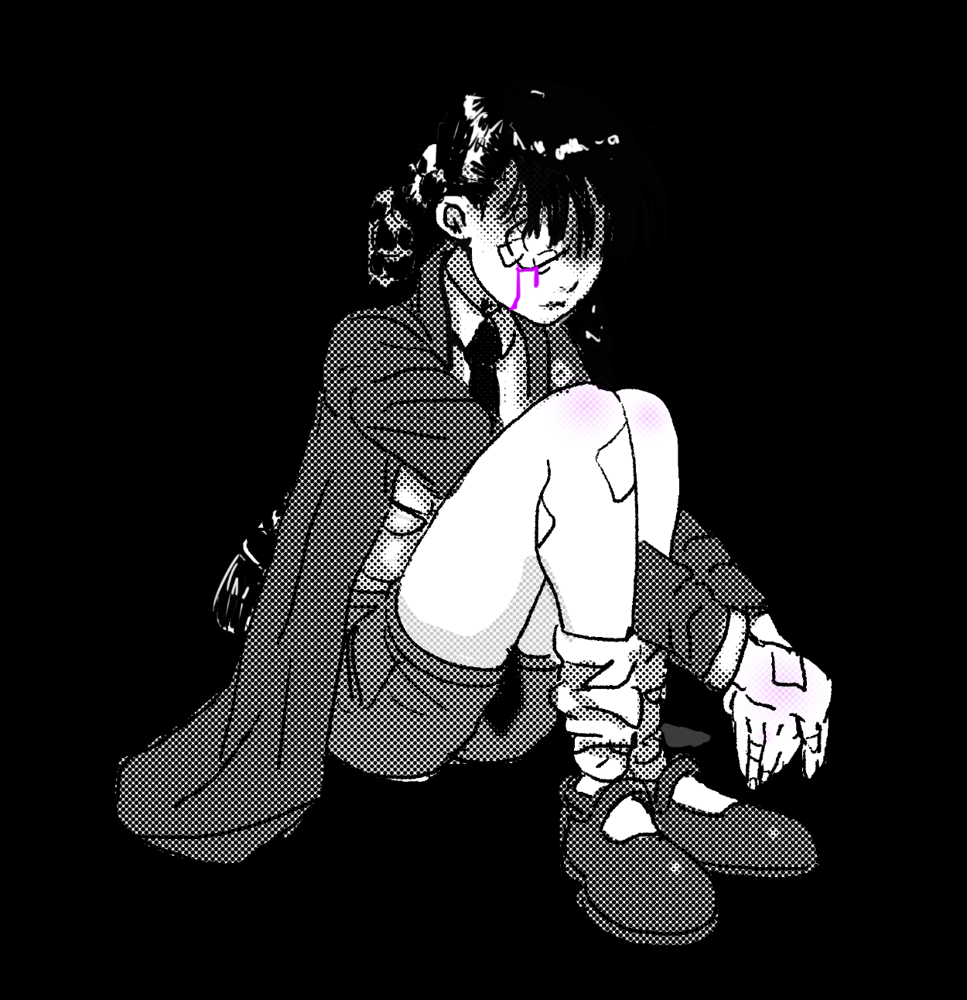
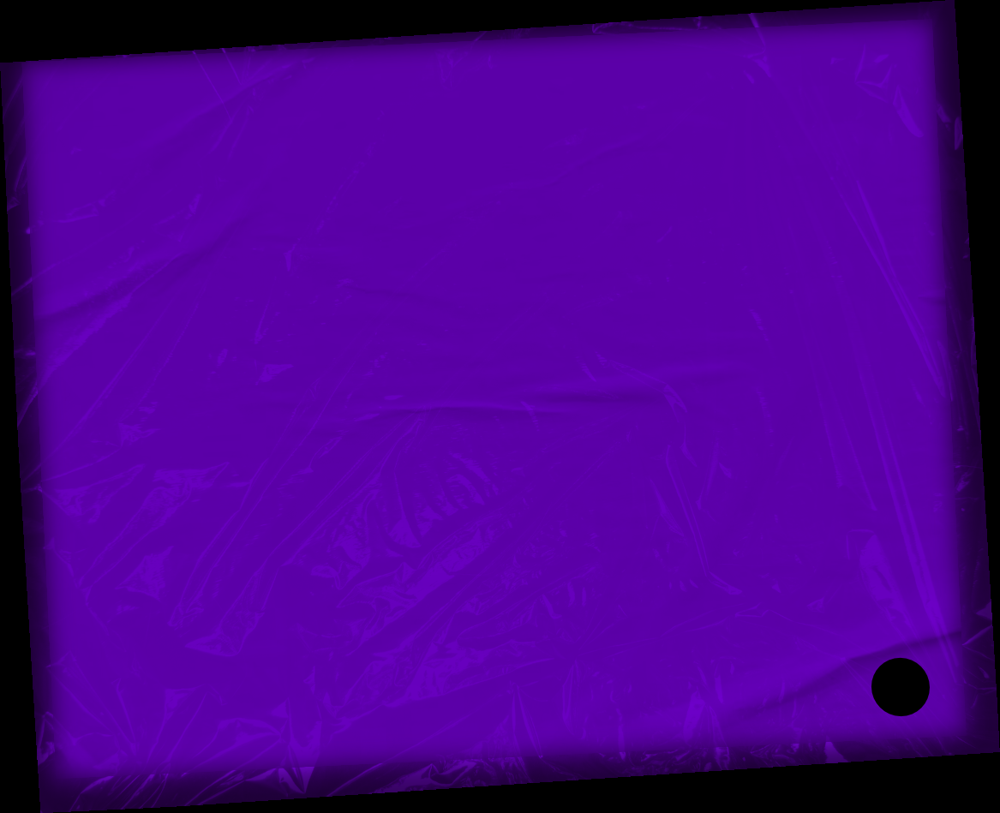
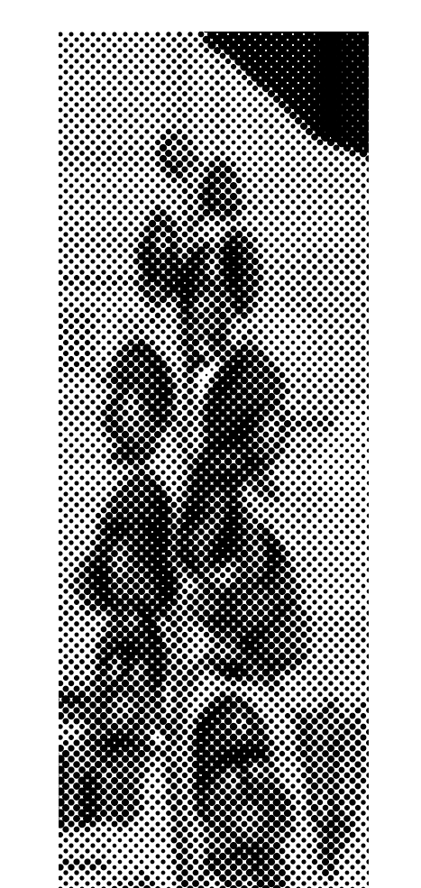
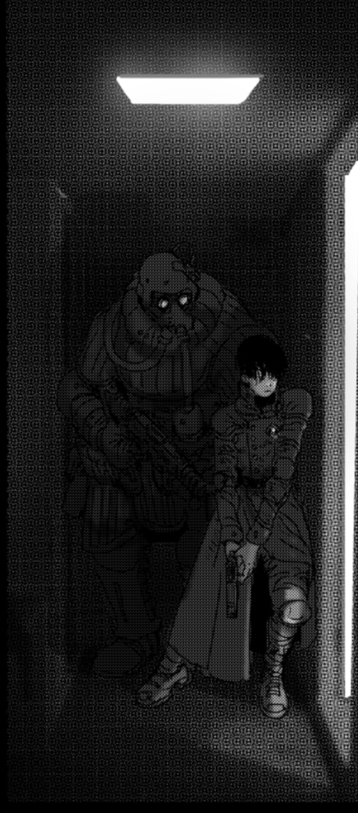
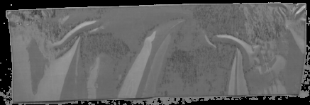
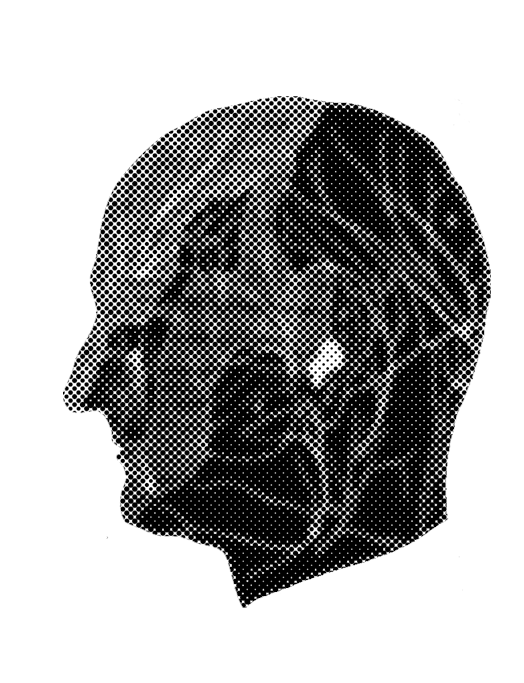

# Core Mechanics & The Action Roll

> Source: CAIN 1.0 Rulebook (Pages 6, 7)

---
### Page 6 Source Content

# **ThE Game** 

This is an investigative role playing game focused chasing rumors or traces of a supernatural monster, a **sin,** then tracking down and confronting it in a climactic and violent scene. 

Player characters, called exorcists, go on a **hunt.** 

- One player will be the the **Administrator (Admin)** , who will set up the story and location of the hunts, play all the NPCs, decide the location and set the scenes, and play the antagonist, the Sin. 

- **Sins** are extremely dangerous and violent beings easily capable of pulverizing a human with their numerous supernatural abilities. However, they are born out of human traumas and uncovering and **unraveling the mysteries surrounding their birth** can help to weaken them. 

- Exorcists have limited time to locate and execute a sin before its growing power causes the situation to spiral out of control 

- After a session is over, players reflect on the session and their characters may gain experience and improve. 

- After a hunt is over, exorcists (if they survived) will get paid and have a chance to increase in rank. 

**So it goes.** 

## Materials 

If playing in person, players will need **character sheets** , some paper and pencils for tracking information, and a number of 6 sided dice (d6s). They may also need small note cards or post it notes for note taking or tracking effects. The Admin will need one or two d6s, post it notes or notecards, and a **hunt sheet. You can find these sheets at the end of this book.** 

Sometimes this game will ask you to roll **1d3** . This is just a d6 with the numbers halved and rounded up (1-2: 1, 3-4: 2, 5-6: 3) 

## PLAY 

CAIN is played, like many other role playing games, as a **collaborative story** told between the players: the exorcists and the Admin. The exorcists play the main characters and choose their course of action, while the admin plays and describes the world, non-player characters (NPCs), and adversaries. 

The basic flow of the game should go like this: 

- The Admin sets the scene and describes details. Then, they turn the action over to the players. **What do the players do?** 

- The players describe or role-play their course of action, **answering that question,** and moving the story forward. 

- The Admin responds to their course of action, then turns things back over to the players. **What do you do?** 

# **Taking Action** 

To do most things in this game **, just do it.** Most actions in this game won’t require rolling dice However, if the outcome of a character’s action is **risky** , **contested** , or **unclear** , a character states their intent and makes an **action roll.** 

## The Action Roll 

To make an action roll, a player rolls a number of **d6** s (six sided dice, also written as **D** , lke **+2D** ), assembled the following way: 

• Add up to 3d6 for a character’s **skill** in an action. Skills describe how good a character is in general at a type of activity, like physical fitness or investigation. They go from 0-3, with level 3 skills being exceptionally rare. 

• Add up to 3d6 for **advantages.** This could come from aid from an ally, situational bonuses, or a character’s abilities 

• If a dice pool is 0 dice, you instead roll 2d6 and pick the lowest result instead. Dice pools can’t go below 0 for any reason. 

Then roll all dice. **Any die rolled of 4+ is a success** . Action rolls with at least one success **accomplish their goal.** You may be able to cash in extra successes in certain circumstances. 

If you don’t get at least one success, you **fail,** and **suffer the consequences.** 

###### 

### **Judging a Roll** 

When a character states their intention with an action roll, the Admin must judge if that action is **hard** or **risky.** This is up to the Admin and the character is always able to ‘back out’ of a roll and renegotiate based on the situation. 

#### **Hard** 

Hard is very simple. If an action is judged to be **hard,** a character **only scores successes on a 6.** 

The Admin may judge a task to be hard if it the approach is **beyond a character’s typical capabilitie** s, if they are **under duress** or in a **bad situation** , or they don’t have the **appropriate resources** (tools, information, etc) to tackle a task. 

Situations that might be hard: 

- trying to fight blind 

- rushing someone with a gun and trying to disarm them unarmed 

- jumping an especially large gap between buildings 

- trying to talk your way out of an active arrest 

- sneaking past a security guard in broad daylight 

- conducting research on a blood sample without appropriate tools 

- trying to fight while hanging off the side of a building 

##### **Impossible** 

The Admin is always able to say a roll is impossible given the circumstances. Players can always change this by changing these circumstances - using tools, abilities, or resources they have available to them. Exorcist capabilities are about that of an average well trained human - but **their powers are not** , and can push far beyond what is possible for a person to accomplish. 

**10** 

**11**

#### Extracted Visual Elements (Page 6)

---
### Page 7 Source Content

# **Risky** 

An action is **risky** if the situation is **tense** and there is some **significant and clear consequence, complication,** or **danger** that could result from a character’s action. On a risky action, the Admin **also makes a roll,** called the **risk roll.** 

This is a 1d6 roll, made at the same time as the action roll. The Admin makes the risk roll then checks the result of the risk die, **using the result to determine the consequences or outcomes for a character’s actions,** with the **lower the result** , **the worse the outcome** , and vice versa. 

- On a 4/5, the outcome or consequence is **about as expected** , success or failure, with no further complications. 

- On a 2/3, it’s **worse than expected.** Consequences might be a little worse, actions a little less effective or more complicated, **even on a success.** 

- On a 6, it’s **better than expected** - the action is more effective, has lighter consequences, or reveals a sudden opportunity. 

- On a 1, it’s **much worse than expected** - the worst thing that could happen happens. 

Here’s a simple table: 

- **1** : Much Worse 

- **2/3:** Worse 

- **4/5:** Expected 

- **6** : Better 

This happens regardless of the action’s success or failure, and means that on a 1-3, characters can take consequences or complications from a risky roll **even if their action is successful.** 

This is generally the only time the Admin should roll other than a fate roll (see the next page)/ 

# **Straight rolls** 

Not all action rolls are risky. If there is **no clear and present consequence** or **danger** , there’s no risk involved and the roll is a **straight roll** without the risk die being rolled at all. A player might make straight rolls when: 

- making general tests of ability, knowledge, or skill 

- investigating, surveying, or exploring 

- persuading someone who has a receptive attitude 

- working on a project 

- taking action where the result is unclear but the outcome isn’t necessarily dangerous, like trying to hotwire a car or pick a lock. 

# **Admin Rolls** 

The Admin **almost never rolls in this game** - instead they respond to player rolls with straightforward outcomes in each situation based on the players’ actions, approach, and the situation of the story. 

Initiative in CAIN is usually with the players, with the Admin playing reactively and always turning the story back to the players to ask them **what they do next.** 

However, the Admin **doesn’t always have to play off of failures** , and can move situations forward even if players are rolling successes. They can **always** present exorcists with a new opportunity or situation, for example by: 

- progressing a situation or moving time forward 

- introducing a complication or changing up the situation 

- presenting exorcists with a choice 

- threatening exorcists with something 

# **Fate Rolls** 

If the Admin does want to leave something up to chance, they can make a fate roll, rolling a 1d6. 

- **1:** Poorest result 

- **2-3:** Poor result 

- **4-5:** Good result 

- **6:** Best result 

For example: 

- Is this cultist armed? 

- Is this person alive when the players reach the scene? 

• How much time is left before the fire collapses the building supports? 

- What’s this person’s attitude towards the exorcists? 

• Will the cultists’ morale break and will they flee? 

And so on. 

## **Circumstances matter** 

Risk and dif fi culty, or whether a roll is even possible, are mostly circumstantial. A roll that might be hard or impossible might become much easier, or not even be a roll at all if characters have a tool, use an ability, or use teamwork. 

**12** 

**13** 

**only the dead receive flowers**

#### Extracted Visual Elements (Page 7)

## Related Knowledge Nodes

- [[Consequences_and_Upsides]]
- [[Divine_Agony_and_Talismans]]
- [[Category_and_Mundane_vs_Supernatural]]
