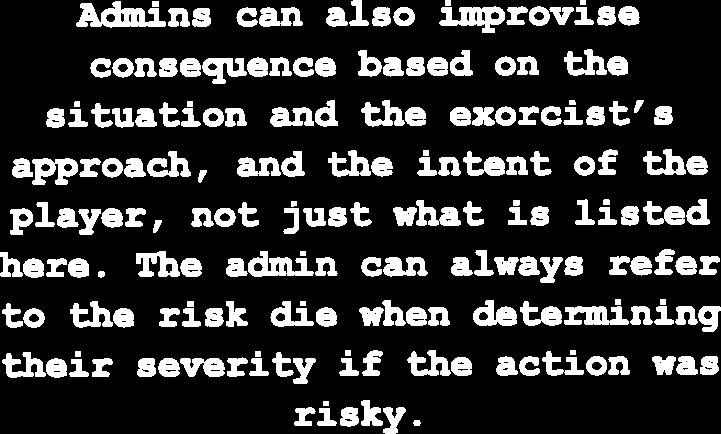
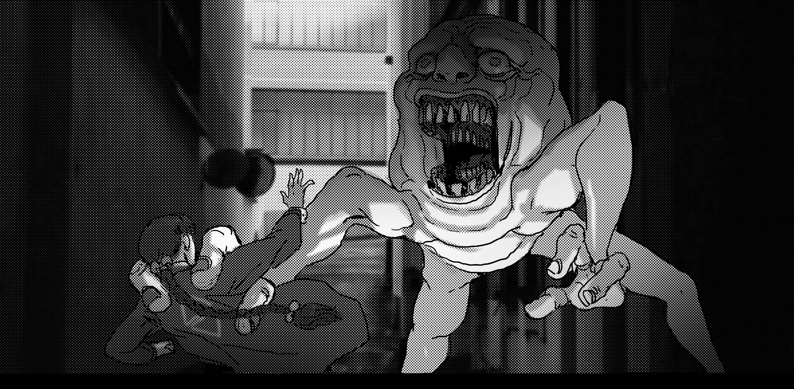
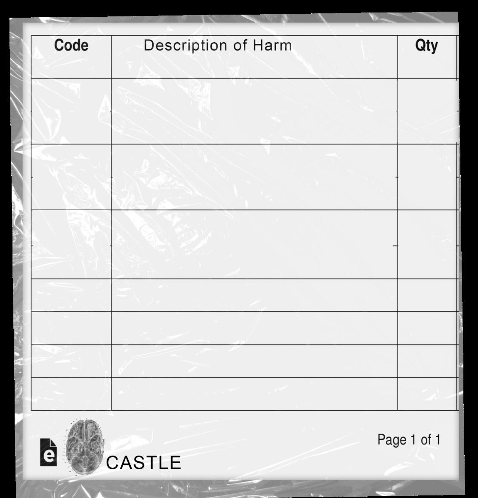
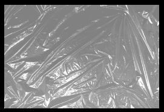

# Consequences, Complications & Upsides

> Source: CAIN 1.0 Rulebook (Pages 8)

---
### Page 8 Source Content

# **Consequences** 

###### **• Separate an exorcist** 

- **Force an exorcist to make a hard choice** (dropping their ally off a building or saving their own skin). 

When player characters **fail a roll** or take a **risky action** the Admin can impose **consequences** or **complications** . These can never take away success (for example, rolling low on the risk die if the action was a success), but can add complications or costs to an otherwise successful roll. Admins can: 

      - **Hinder an exorcist** - make something harder for them until they can change the situation 

      - **Give a hook** : Give a hook to an exorcist (see pg. 32) 

      - **Start a ticking clock** - Set out a talisman (see pg. 17) with negative consequences, or slash an existing talisman this way. 

- **Force the the exorcists to pay a cost** : 

   - in attention (an exorcist is preoccupied for a while, or misses something important) 

**• Look to the characters, the Sin, or the hunt.** Many of them have existing abilities or details on their sheets that can be used as inspiration to inflict consequences. Sins even have a reaction list they can use in conflict scenes that give explicit outcomes (see Sins starting pg. 100). 

- effectiveness (someone else needs to follow up to finish the job, slash a talisman (see pg. 17) one less time) 

- gear (tools or weapons break or jam, supplies or ammo are used up) 

- safety (the situation gets more risky) 

   - time (miss opportunities, degrade situations) 

- **Threaten** an exorcist with more severe consequences unless further action is taken 

- **Cut off an opportunity** : a door closes, an NPC isn’t cooperative, someone gets away 

- **Hurt the exorcists, as established:** Inflict **stress** , inflict a **hook** , see pg. 32. Harming the exorcists should always be established, ie exorcists should never take harm unless harm was already established as a clear and present consequence. Generally exorcists are only hurt when an activity is risky or there is clear danger. The amount of stress an exorcist takes depends on the situation and what is threatening them. 

**Pain, strain, tiredness, suf f ering, minor injury** 1 

**Crippling or even fatal to most humans, injury, gunshots, exhaustion,** 2/3 **bleeding, deprivation, poison, etc. Instantly and messily fatal** 4+ **to humans** 

#### **Upsides** 

Sometimes exorcists will roll a 6 on a risk roll, giving them a small chance to swing the situation back in their favor, **even on a failure** . This can be as simple as: 

- Their action is **more effective** , or has an effect even if they fail. If it’s on a talisman (see pg 17), slash it an extra time. 

- **They gain insight, an opening or a better position** with their action, making their next action less risky, less hard, or giving it +1 advantage die. 

## IMPROVING a Roll 

Generally the dice you roll come from skills. However **advantage dice** are very useful as they are ‘free’ and can most commonly be gained from the following sources: 

- **Psyche burst** : A character can spend a psyche burst, a limited resource, to use their powers and grant +1D on any roll if they can explain how they are using their powers in a creative way to help the situation. 

- **Setup:** A character may set up themselves or another character (see below) for +1D 

- **Abilities** : Many character abilities give +1D in certain circumstances. 

- **Circumstance:** The Admin is free to give out +1D for any circumstantial bonus they see fit. 

No matter how many dice a character gains from these sources, **they can’t gain more than +3D in advantages.** 

These same situations can also be used by the Admin to determine whether a roll is hard, risky, or even necessary, so it’s up to the Admin where to apply these bonuses. 

### **Teamwork and Setup** 

Characters can work together in two main ways, **teamwork** and **setup.** 

##### **Teamwork** 

When rolling, if multiple characters are able and willing to work together, you can choose a leader, then combine the **highest of advantages, skills, kit and abilities among those characters.** The leader then makes the roll, and the consequences and outcomes of the roll then apply to all characters involved. 

<!-- Start of picture text -->
1 of 11 C CASTLE <!-- End of picture text -->

**14** 

**15**

#### Extracted Visual Elements (Page 8)

## Related Knowledge Nodes

- [[Core_Mechanics_and_Action_Roll]]
- [[Divine_Agony_and_Talismans]]
- [[The_Body_Stress_and_Injuries]]
