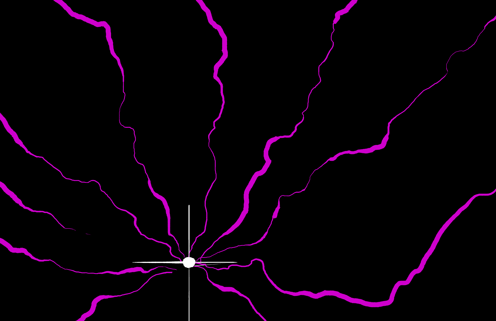
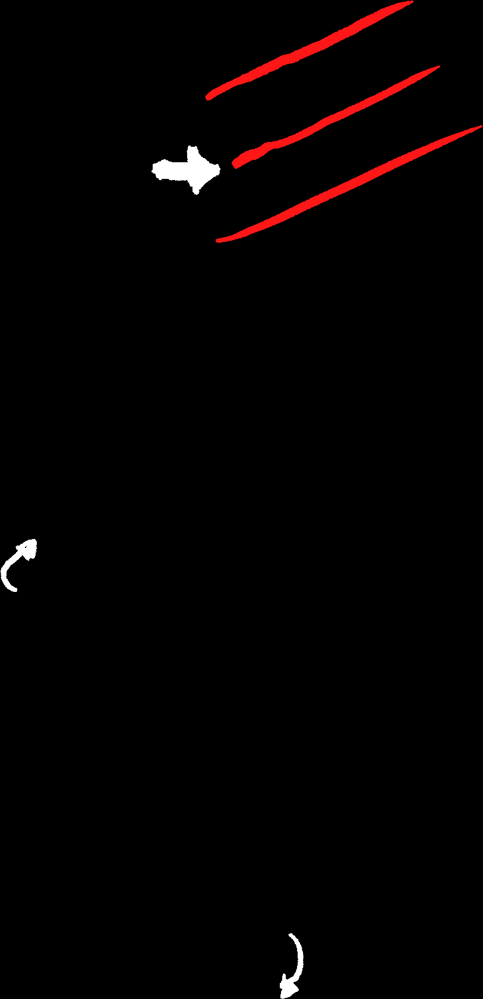

# Divine Agony & Talismans (Clocks & Seals)

> Source: CAIN 1.0 Rulebook (Pages 9)

---
### Page 9 Source Content

**For example** : three characters are trying to climb a wall. One character has 3 in conditioning, and another has only 1 in conditioning but owns a grappling hook. The combined dice pool would be 3, and the grappling hook could help bring the roll down from a hard roll to a regular roll, or perhaps make it so there’s no roll at all! 

Teamwork allows characters to pool their resources and make one roll or take one action to move a large number of people through a situation without having each individually roll. However, everyone takes the same consequences from an action (including stress suffered) which could make teamwork rolls a risky venture. 

### **Setup** 

A character can always **take action to set up another characte** r, including themselves. Examples of this: 

- causing a distraction so another exorcist can slip by a guard 

- giving a character a boost to get to a high vantage point 

- carefully preparing a ritual site for your own use 

- providing covering fire 

Setup rolls can be hard or risky as normal. The action must always be taken with the intent and outcome of setting up another character, and has **no other effec** t by itself. Characters can still suffer consequences from it. 

On success, setup can give one of the following on the target’s next action that follows the opening made for them: 

- **+1D** 

- **Decrease difficulty** (hard > normal) 

- **Decrease risk** (risky > straight) 

A character can only benefit from setup **once** per action. 

## Divine Agony 

There is one final way to improve a roll. Exorcists naturally accrue **pathos** , powerful negative energy that builds up from failure, regret, and physical suffering. 

In any scene, an exorcist **gains pathos** whenever: 

- they make a roll with no successes 

- they take an injury or affliction 

- they fill out a hook 

- another exorcist dies or suffers sin overflow 

Pathos can be stocked up to 3.  More details on hooks, injuries, death, and sin overflow can be found in the section on pg. 30 

Pathos can be spent to perform Divine Agony. This can only be performed **once per session** by a character. An exorcist calling on this power when making a roll burns away all pathos, gaining **+1D** on that roll per pathos burned. **This can exceed and stack with any other bonuses** , allowing a roll to push past the +3 advantage die limit. 

#### **Erase all pathos at the end of a session.** 

# **Talismans** 

Sometimes actions are more complicated and can’t be solved in one roll. In this case, this game makes use of **talismans** , simple trackers that represent these more complex challenges. 

When rolling on a talisman, make action rolls with the same parameters (dice pool, consequences, risky/hard), but then **cash in all successes, making 1 slash on the talisman for each success.** 

- For example, a character rolls 2d6 for their action and gets a 4, 6. They would get two slashes. If the action was hard, they would only get one. 

Talismans fill up and resolve when a certain number of slashes are completed. The longer a talisman, the longer the complexity of the task involved. You usually write this at the top of the talisman. 

- **simple** talismans are typically 1 or 2 segments 

- **medium** are 3-4 

- **complex** are 5-6 

When a talisman fills up, **whatever it represents its resolved** . Rolls that don’t fill up a talisman represent **partial progress** on a task. “ _You’ve taken out a few guards, but there’s a few left_ ”. “ _You’ve decrypted half the files, but there’s still a lot left, and the self-destruct timer is ticking_ .” 

- Not all talismans track tasks. Some talismans can fill up by rolling, some fill up on their own, some track success states, and some track failure states. There’s more on talismans in the Running CAIN section starting on pg. 88 

- Talismans should typically be set out as needed - in other words, when approaching a complicated task, don’t make a talisman for it until the characters are able to describe their actions and approach. Circumstances can make talismans much shorter or longer! 

- Talismans shouldn’t be proscriptive but descriptive. It’s better to set out a talisman named ‘Shuddering Horrors’ than ‘Evade the Shuddering Horrors’. 

- Characters might make more or less slashes on on a talisman due to the situation. Slashes can be reduced to 0. 

5 SHUDDERING HORRORS 

You can write talismans any which way your heart desires, even horizontally. You can also write them like a simple tally, like this 

You can use a plain tracker, or a clock if you come from other games. But I think slashing the talisman set the tone. 

**16** 

**17** 

SLASH AND SLASH AND SLASH! UNTIL IT IS DONE!

#### Extracted Visual Elements (Page 9)

## Related Knowledge Nodes

- [[Core_Mechanics_and_Action_Roll]]
- [[The_Body_Stress_and_Injuries]]
- [[Conflict_Scenes]]
