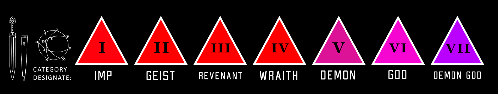
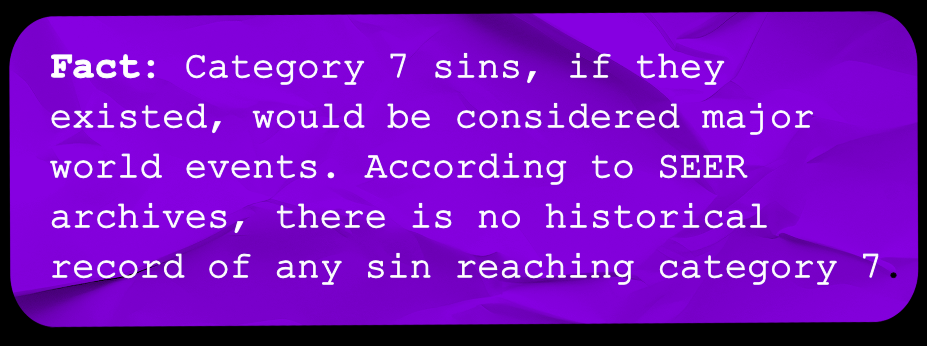

# Category Scales & Mundane vs Supernatural Disparity

> Source: CAIN 1.0 Rulebook (Pages 10)

---
### Page 10 Source Content

# **Category** 

Sins are powerful supernatural forces, and Exorcists the weapons used to combat them. Sins may easily surpass human limits. Unfortunately, exorcists are limited by the general limits of human capabilities. 

However their powers, Blasphemies, are not 

Much like natural disasters, both sins and exorcists are rated by **Category** , generally indicating their power, usually written as **CAT.** As each increase in category, the **speed, scale,** and **strength** of their capabilities increase drastically. 

- Category goes from 0-7, with Category 0 being **general human capabilities** . Anything mundane an exorcist does is usually at CAT 0. 

- Exorcists’ themselves are rated from category 1 to 5, but can sometimes push past CAT 5. This describers the capabilities of their powers. 

**Fact:** 40% of exorcists do not survive long enough to be rated category 3. 

## **Mundane vs supernatural** 

Anything mundae an exorcist does to try and harm or subdue a supernatural force such as a sin is **hard by default** . Their capabilities are the general capabilities of a (well trained) human, usually rated at CAT 0. 

However, **their supernatural powers are able to surpass this limit** : an exorcists’s blasphemies **increase in category with them.** 

<!-- Start of picture text -->
Using Category Category determines the general size, strength, and scale of things in fictional terms. For example: • A car versus a 16 wheeler freight truck • A couple humans versus a whole crowd of  0 1 2 3 4 5 6 7 humans Many Thousands of • A shack versus a skyscraper People One A few Small group Large group A Crowd A huge crowd thousands of people people • A handgun versus a bazooka The Admin can use the category of something to figure out whether: Heavy SIZE Human Size Large animal Vehicle Large vehicle Building Large building Skyscraper Furniture • a roll is hard or risky for a character . A roll is typically hard or risky if the target of a power is higher category. Conversely, a roll can be less risky or hard if the target of a power is of a lower category. AREA Personal A few people Entire Room A few rooms Whole building A city block A whole  A whole town neighborhood • a roll is impossible for a character  given their current capabilities. For example, a character that can lift objects with their powers and is DISTANCE Category 4 could easily lift a car (CAT 3), but (0-2 Short) Across the  A few blocks  Over the would probably find it impossible to lift a  Touch Same Room Down the Block Across town Visual range (3-4 Long) Street away horizon skyscraper (CAT 7). Generally tasks that are (5+ Extreme) three or more categories higher  than an actor are impossible for them • A roll is even required for a task , typically if it’s  three or more categories lower.  For  Speed Average human Fast human Fast animal Car Train Maglev Airliner Jet Fighter example, an exorcist throwing a building at a single mundane human probably wouldn’t have to roll at all to crush them like an insect. • a character can do something beyond human capabilities,  and to what extent Magnitude Small Noticeable Large Very Large Massive Destructive Overwhelming Cataclysmic These capabilities are usually listed out in short <!-- End of picture text -->

Category determines the general size, strength, and scale of things in fictional terms. For example: 

- The Admin can use the category of something to figure out whether: 

These capabilities are usually listed out in short form in each power entry. 

Use CAT 0 when describing general human or mundane capabilities. Well trained humans can sometimes reach CAT 1. 

**Higher CAT** effects vs **lower CAT** targets are **more effective** and may not even require a roll if they are 3 or more lower. **Lower CAT** effects vs **higher CAT** targets are **less effective** , more risky, or harder, and may be impossible if they are 3 or more higher. 

<!-- Start of picture text -->
IS IT CRUEL TO DAMN THE RIVER THAT FLOODS IN THE RAINY SEASON AND DROWNS THOUSANDS? -ADMIN XXX0955 8:21am As above, so below <!-- End of picture text -->

<!-- Start of picture text -->
19 <!-- End of picture text -->

**18**

#### Extracted Visual Elements (Page 10)

## Related Knowledge Nodes

- [[Core_Mechanics_and_Action_Roll]]
- [[The_Twelve_Blasphemies]]
- [[Sins_and_The_Flesh]]
