# The Exorcist & The Nine Skills

> Source: CAIN 1.0 Rulebook (Pages 11, 12, 13)

---
### Page 11 Source Content

# **THE EXORCIST** 

Untrained, you have the potential for these powers to run wild and develop into a **sin** . Therefore, perhaps unwillingly, you have come to the attention of the intelligence and boarding services of CAIN, who have determined your p **otential as a weapon offsets the risk of keeping you alive** and has offered you **employment** , of a sort. 

Your **exorcist** is someone who has been born with a high concentration of **grace** , a mysterious phenomena that allows humans to manifest psychic powers, drawing primarily from the well of dark, subconscious thoughts and emotions buried deep in the human psyche. 

All humans innately have a small amount of grace, but in your body, it suffuses your flesh like a potent toxin. Your high levels of grace have given you the ability to both **see sins** and manifest **blasphemies** , powerful psychic phenomena. 

**This is your story.** 

<!-- Start of picture text -->
3 1 2 4 5 6 <!-- End of picture text -->

**7** 

<!-- Start of picture text -->
8 9 11 10 1 2 13 <!-- End of picture text -->

## **Getting Started** 

Here’s a quick overview of what’s on the exorcist sheet. You can find a printable version of the sheet at the very end of this book, so grab it and follow along - it will help when going through the next section. 

Agendas and blasphemies are kept on their own separate page. You can find it with the above sheet. 

You can print and use this sheet during play and mark it with pencil, or alternately use note cards or post-its to track your powers, afflictions, etc. 

1. Exorcist ID and personal details 

2. Execution Talisman 

3. Skills 

4. Health tracker (Injuries, Hooks, Afflictions) 

5. Skill assessment card 

6. Divine Agony/Pathos 

7. Advancement tracker 

8. Category tracker 

9. PSYCHE skill 

10. Kit and kit points 

11. Psyche burst 

12. Sin and Sin Overflow 

13. Sin Marks 

**20** 

**21**

#### Extracted Visual Elements (Page 11)

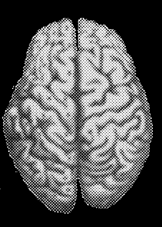
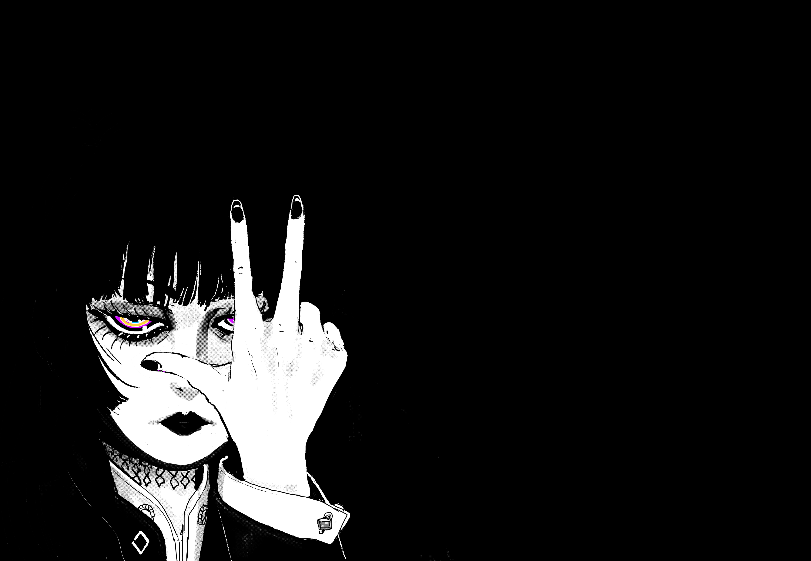

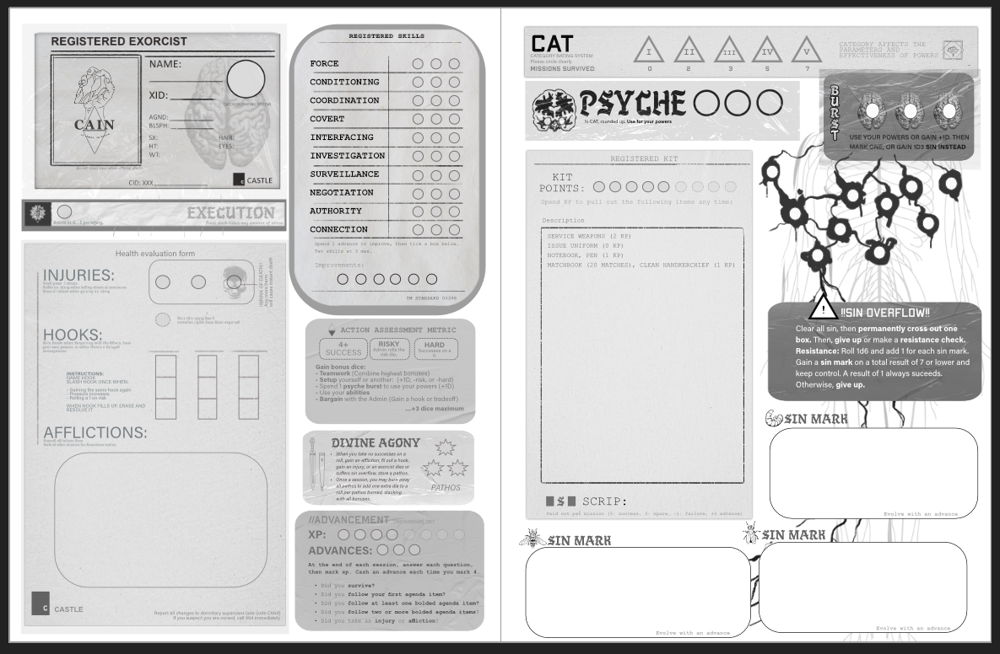

---
### Page 12 Source Content

## Part by Part 

Your exorcist is made up of three parts: 

- your **skills** 

- your **agenda** 

- your **blasphemies.** 

Your general capabilities are rated by **category** and tightly monitored by CAIN. You also have the things you bring with you on a mission - your tools, your flesh, and your psyche. 

- Your body has **stress, injuries,** and **psyche burst.** 

- You might also have **hooks** or **afflictions** that you pick up during a hunt. 

- You also may gain **sin.** Do not let it build up. 

Finally, you have a standard **kit** of things you can bring with you on missions that you can tweak or modify. 

That’s all you get. Let’s discuss each in detail. 

## SKILLS 

Your skills give you dice when taking actions that fall under their purview. Skills are rated from 0-3. Characters will have at most two skills at level 3. 

- There are ten basic skills: **Force, Conditioning, Coordination, Covert, Interfacing, Surveillance, Investigation, Authority, Negotiation,** and **Connection** 

- There is one special skill, PSYCHE. This skill goes up on its own, and governs the use of your psychic powers. You only roll it when using these powers. 

A player can decide which skill to use when taking an action. **However, the Admin is free to tell them if using that skill would be risky or hard** , or **not effective** given the circumstances. 

You can apply only one skill at a time to an action, but you probably have the choice of multiple skills for the same situation. For example: 

• you could open a door by **forcing** it open or use your **coordination** to shoot the lock off, using **covert** to pick it, or **interfacing** if the lock is electronic 

- getting through a dangerous area could be **conditioning** (it’s on fire) or **covert** (it’s occupied) depending on your approach 

- looking up informationon someone could be **investigation** using town records **,** but could also be **connection** if are looking by knocking on doors. 

Using different skills or approaches slightly changes the **context** , **consequences** , and **outcome** of the action and may change whether something is risky, hard, or even requires rolling. 

### **Skill Descriptions** 

Here’s a brief, further description of each skill. Think about each as a flexible category describing your exorcists’ **general capabilities** rather than a series of proscribed activities. 

# **FORCE** 

_Apply direct and close force or violence. Smash, fight, cut, grapple._ 

**Force** is used when fighting in melee combat, but also when breaking or smashing something, like a door or someone’s skull. It can describe both trained, controlled approaches, and wild or violent approaches. If your exorcist is notable for their strength or skill in hand to combat, they probably have good Force. It’s typically direct and to the point. You might use it when: 

- tipping over a burning car 

- expertly wielding a sword 

- tackling a fleeing creature to the ground 

- violently intimidating someone (but authority might be a better fit) 

# **COORDINATION** 

_Use your hand-eye coordination. Shoot, throw, catch._ 

**Coordination** is for performing tasks of manual skill and accuracy. Its primary use is for firearms, but could also be used for throwing and catching. If your exorcist is a good shot or is good with their hands, they probably have good coordination. You might use it when: 

- shooting a gun or a bow 

- catching or throwing a vial of forbidden substance 

- flicking a cigarette 

- playing sports (but conditioning might also work) 

# **CONDITIONING** 

_Get around on foot. Sprint, climb, swim, balance._ 

**Conditioning** is used with movement on foot, when your exorcist is showing off their athleticism or training. If your exorcist is fast, athletic, or agile, they probably have good conditioning.  You might use it when: 

- jumping over an electric fence 

- climbing the side of a building 

- outrunning the police 

- carrying a body while sprinting (but force could also apply here) 

# **COVERT** 

_Move with stealth and act with sleight of hand. Sneak, lock pick, steal_ 

**Covert** is used when doing something silently or unseen, or undertaking activities usually associated with covert action, like pick pocketing or breaking locks. It’s not particularly fast and can’t be done in a hurry. If your exorcist is quiet, stealthy, or light on their feet, they probably have good covert. You might use it when: 

- avoiding the attention of a flesh eating monster 

- lifting the keys off a security guard 

- carefully avoiding alerting the web of fibrous nerve matter on the floor 

- hacking into a computer (but interfacing is probably better) 

**22** 

**23**

#### Extracted Visual Elements (Page 12)

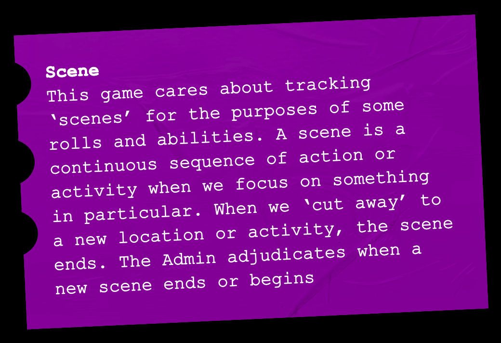
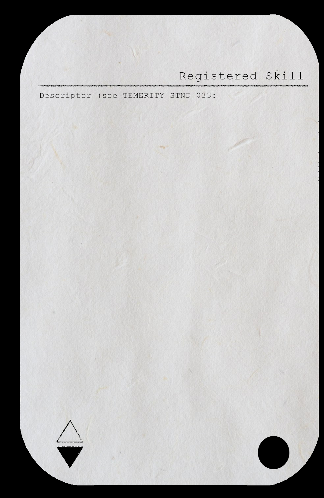
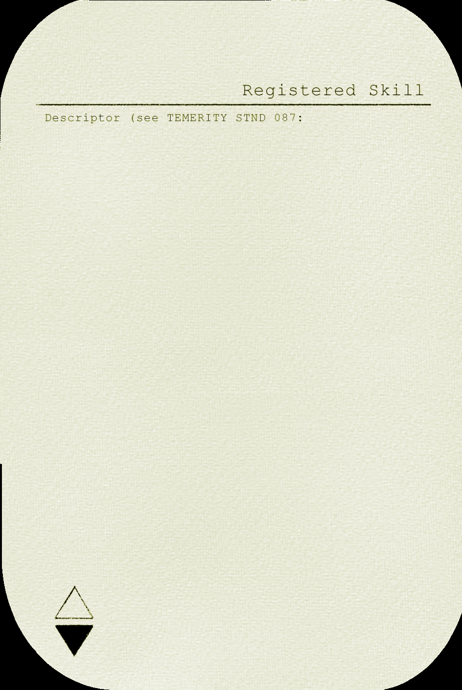
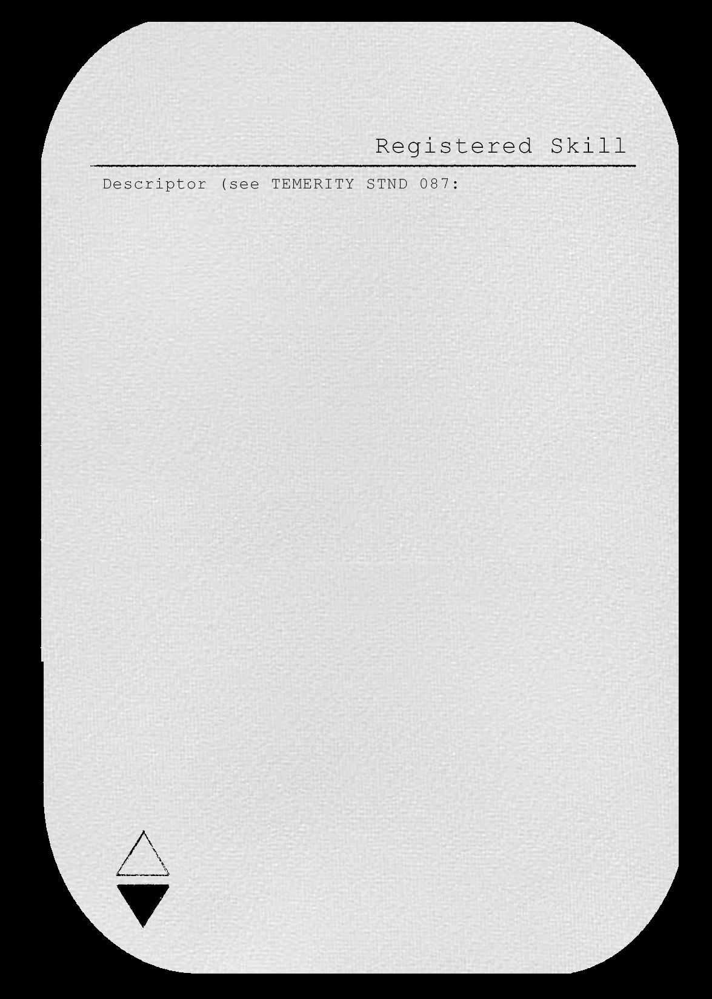
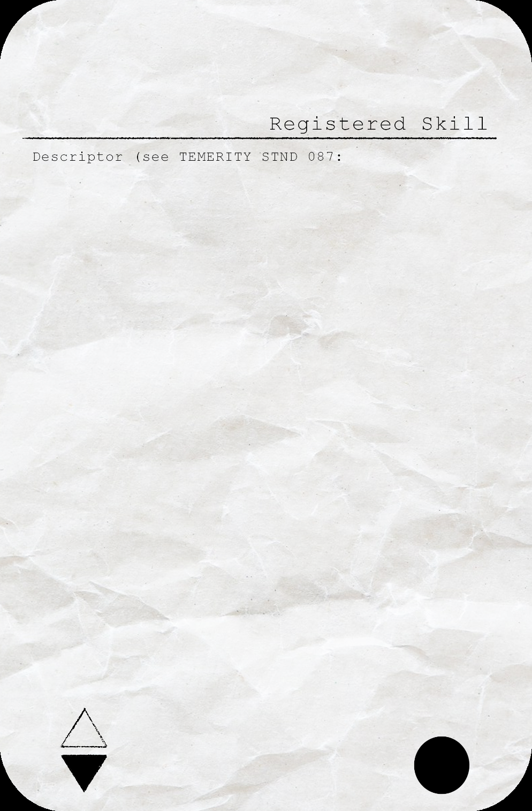

---
### Page 13 Source Content

## **INTERFACING** 

_Use, understand, build, or fix technology, vehicles, or devices. Drive, hack, repair._ 

**Interfacing** is used when using technology or vehicles. You use it when driving a car or when fixing or hot-wiring electronics. If your exorcist has an affinity with machines or computers, they probably have good interfacing. You might use it when: 

- turning off an execution chair and releasing the electronic clamps on its occupant 

- not flipping a car while performing a u-turn at 50 mph 

- modifying a firearm to shoot phosphorous bursts 

- Searching for information on a computer subnet (but investigation might also work) 

## **INVESTIGATION** 

_Examine something in detail, or uncover information about it. Research, study, sleuth._ 

**Investigation** is the counterpart to surveillance, but rather than a broad sweep, it concerns itself with detail, research, and decoding the information present. If your exorcist is erudite, knowledgeable, or well educated, you probably have good Investigation. You might use it when: 

- decoding psychically engraved occult symbols 

- determine the origins and properties of a mysterious slimy substance 

- Calculating the trajectory of a bullet fired as a murder weapon based on blood spatters and skull fragments 

• Figuring out the speed and direction of a fleeing vehicle based on its tire tracks (surveillance might also be a good fit) 

## **AUTHORITY** 

_Wield your leadership and force of will. Lead, organize, order, intimidate._ 

**Authority** is the ability to both lead and enforce your will on others. This could be through professional demeanor, rank or force of will. If your exorcist is professional, composed, or intimidating, they probably have good authority. You might use it when 

- leading a squad of cleanup troopers to clean out a tunnel of sin remnants 

- ordering humans to avert their gaze 

- intimidating a fleeing suspect into turning around 

- talking someone down with a gun barrel pressed to your forehead (though negotiation might also apply) 

# PSYCHE 

_Wield your supernatural powers._ 

**Psyche** is a special skill that only increases with your exorcist’s CAT (1/2 CAT, rounded up). 

You use it when called for by your **blasphemies** , or for any creative use of your powers not covered by the rules. 

You can always use psyche for minor efects such f as: 

- producing a faint light or aura around something or someone 

## **SURVEILLANCE** 

## **NEGOTIATION** 

## **CONNECTION** 

- producing minor force at a distance (like a gust of wind) 

- making electrical lights or appliances flicker 

- warm or cool the surface of your body 

_Connect to others, and draw on those_ 

_Use your power of observation. Survey, track, spot._ 

**Surveillance** is the skill used when taking stock of a situation, tracking or tailing a target, or looking for hidden clues. It doesn’t necessarily provide additional information about its target - for example you could find a file in a cluttered office with Surveillance, but would likely need to use another skill to decode it. If your exorcist is observant, sharp, or artistic, you probably have good Surveillance. You might use it when: 

- tracking a sin host through the freezing cold forest 

- looking for safe exits from a burning building 

- finding the location of a buried femur bone in the rain-wet earth 

- tailing a man with a suspicious briefcase through midday traffic (though covert might also apply here) 

_Rely on your words to influence others. Sway, lie, bargain._ 

**Negotiation** is your ability to sway others based on your force of personality and charm alone, by making appeals to someone receptive. It’s never forceful and not always applicable if someone isn’t already at least partly on your side. If your exorcist is charming, sociable, or diplomatic, they probably have good negotiation. You might use it when: 

- talking down a hostage situation 

- bribing the chief of police with the smallest bribe possible 

- convincingly posing as private security at a secret society gala event 

- talking up a club host to get some juicy information (though connection works too) 

_connections. Intuit, empathize, network._ 

**Connection** is the understanding and use of the ties that bring people together. It is used both when calling on your own connections to other people to call in favors and information, and when understanding the connections and emotions of others. If your exorcist is empathetic, well connected, or good at figuring people out, they probably have good connection. You might it use when: 

- intuiting someone’s, schedule, sleeping habits, or emotional state from just a glance 

- calling on someone to bail you out of jail 

- figuring out how someone feels about a topic or person 

- looking up or locating someone’s contacts or family (but investigation might also be a good fit) 

**24** 

**25**

#### Extracted Visual Elements (Page 13)

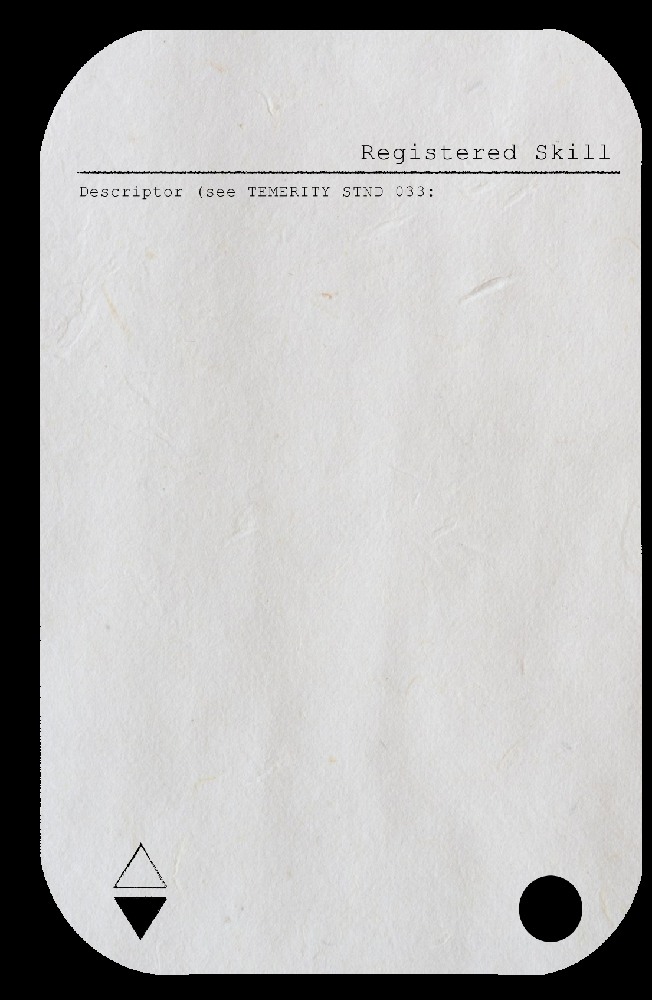
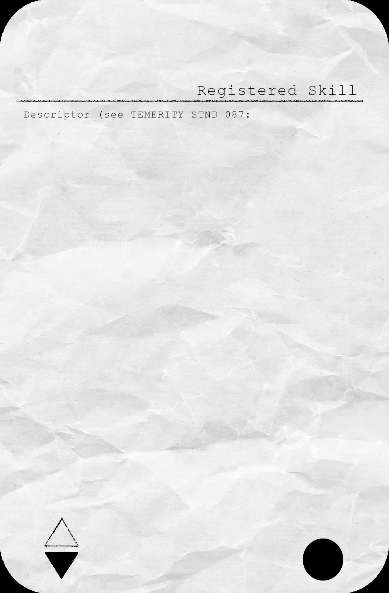
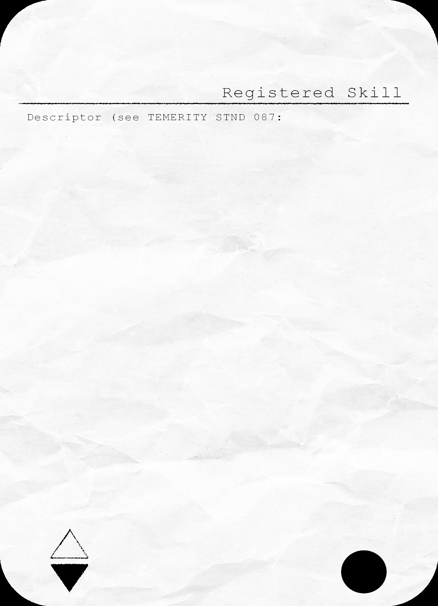
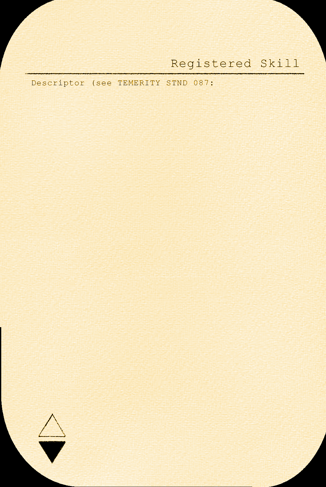

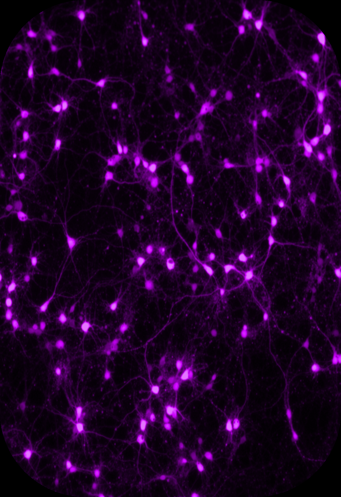

## Related Knowledge Nodes

- [[Agendas]]
- [[The_Twelve_Blasphemies]]
- [[The_Body_Stress_and_Injuries]]
- [[Character_Creation_and_Advances]]
