# Agendas, Roles & Trigger Mechanics

> Source: CAIN 1.0 Rulebook (Pages 14, 24, 25, 26)

---
### Page 14 Source Content

## **AGENDA** 

Your **agenda** describes your character’s motivations, role in the group, and way they approach the world. It has a couple roles: 

- Your agenda allows you to **gain experience** . At the end of a session, you will check if you followed the regular agenda items or any **bolded** agenda items, which are harder to fulfill, then gain experience based on the answer. 

- Your agenda gives you a suite of **abilities** . You can gain more abilities from your agenda by spending experience 

- Your agenda may give you a few ways to regain resources 

Between missions you can actually **swap agendas** if you feel like a new agenda would fit your character. This could be due an experience within the mission, another character moment, or just because you feel like your current agenda isn’t fitting your character. 

- You can carry over abilities or **bolded** agenda items from your old agenda to your new agenda. 

- If you swap agendas again, you can keep carrying over abilities gained from any source, though you **can’t have more than five agenda abilities** at any given time, and must choose which to keep and which to discard. 

Your agenda **can also be modified mid hunt** , depending on mission parameters. The main way for this to happen is through fighting sins, which may add agenda items. The Admin is also free to write new agenda elements and offer them as rewards or for completing certain story beats. 

**Any modified or bolded part of your agenda travels with you** , even if you swap agendas in the future. 

## BLASPHEMIES 

Your **blasphemies** are the psychic phenomena that you have been blessed with (or cursed with, depending on your point of view). 

Blasphemy manifestation is spontaneous and follows no real pattern other than tending to appear in late adolescence, but the phenomena that manifest can be broadly classified into a number of types. They are extremely powerful supernatural abilities that allow their users to surpass human limits. 

These powers are created by a high concentration of **grace,** an unknown force that causes a sinseed, a tiny tumor like growth in the shape of a tiny angel or devil like figure to manifest in the brain (or rarely, the heart), theorized to be the source of these powers. 

### PSYCHE 

An exorcist’s general skill with their psychic powers is rated by the special PSYCHE skill. This is a special skill equal to half your total category, rounded up (so a CAT 4 exorcist would have 2 PSYCHE). It does not increase any other way, though you can still gain advantage dice on it through aid, setup, etc. 

Whenever you would do something that requires rolling with your blasphemies, you roll PSYCHE. This includes any creative use of your powers that are not included in the rules text. The Admin is free to adjudicate these uses as normal (deeming them hard, risky, impossible, effective or ineffective, etc). 

### PSYCHE BURST 

All exorcists have the following basic blasphemy: 

Using blasphemies builds up residual energy in your internal psychic sea, built of raw and powerful emotion. Without outlets, this energy will overflow and cause your power to grow wild. Fortunately, you are a trained exorcist and can control this power into a form called Psyche Burst. 

# BLAST 

Spend a psyche burst and roll PSYCHE to produce a weaponized form of concentrated psychic energy in melee or short range. The specific look and feel of this basic exorcist skill varies between exorcists. The strength of this blast scales with CAT. 

**Using any blasphemy power requires a psyche burst.** Some can spend multiple for extra benefit. 

- You can always spend a **psyche burst** to add +1 advantage die to any roll (yours or an ally’s) by using your blasphemies in a creative way. 

- You always start a mission with **three psyche bursts** 

When your exorcist produces a blast, they might: 

- You can recover them by resting during a hunt (see pg. 38) or through the uses of abilities. 

- Imbue a slash of a blade or a shot with a ranged weapon with psychic energy 

- Shoot an invisible ball of force from their fingers 

- Fire scathing lightning 

- Shoot a bead of ghostly, frigid fire. 

Unlike your mundane service weapons, blast is a supernatural weapon and therefore doesn’t become hard by default when used against sins. 

**26** 

**27**

#### Extracted Visual Elements (Page 14)

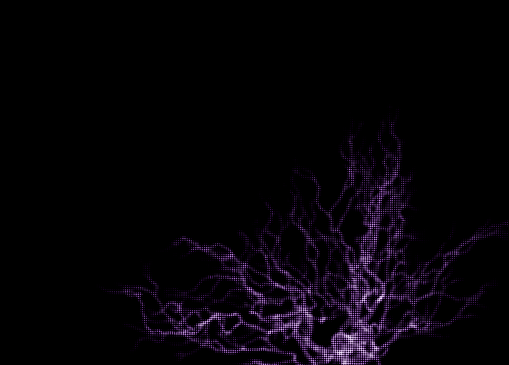
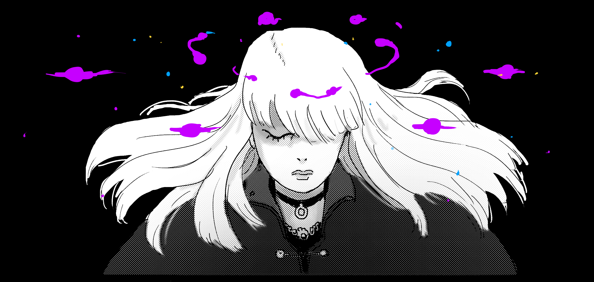

---
### Page 24 Source Content

# **AGENDAS** 

Pick an agenda when creating your exorcist, then pick an **ability** from that agenda. You can gain a new ability from your active agenda by spending an **advance.** 

Agendas have two agenda items, normal and **bolded** . If you fulfill your normal agenda item, at the end of a session, you get 1 xp. If you fulfill at least one of your bolded items, you also get 1xp, or again for two or more. Often these require a different approach than your agenda would otherwise encourage. 

## 

► Get into a f i ght **► Hold Back** 

- **Insects!!!:** You have +1D when inf l icting 

harm or violence against human opponents. **► I’ll take you down with me:** Regain 1d3 psyche burst when you take an injury or af fl iction. 

**► Rule of Nature:** When you inf l ict violence with an action, if you roll 6, 6 or better the action inf l icts 1 more slash on any talismans and you regain 1 psyche burst. **► Red Muscle:** You can take 2 stress to gain +1D on any violent or forceful roll. This stress cannot inf l ict an injury on you. **► Bare Teeth:** While you have two or more injuries or af fl ictions, it is not longer hard to use human capabilities against supernatural forces. 

You are able to **swap agendas** between missions if you feel like your old agenda no longer fits your character. Swapping agendas carries over any **bolded** agenda items and abilities, though doesn’t automatically grant you a new ability. You can then take abilities from your new agenda as normal - although you can’t have more than **five abilities** total from any agenda (you can swap them out if you feel like replacing one when you spend an advance to gain a new ability). 

Agendas broadly describe your character’s **approach to problems** rather than being descriptive of your character as a whole. 

► Demonstrate your humanity **► Demonstrate your distance from humanit** y 

- **Xenof l esh:** Discard ‘1’s rolled for gaining Sin. 

- **Humanity’s Last Breath:** Pick a sin mark you have. Evolve that Sin mark. It no longer modif i es resistance rolls or sin overf l ow cap. 

- **Quickening:** When you gain 2 or more Sin as part of an action, your action also gains +1D 

**► Sympathetic Mutation:** You may take 1d3 sin to grant an ally the benef i ts of any sin mark ability you have for one scene. Their body is infected by a lesser version of it that dissipates when the scene is over. **► Metamorphosis:** Between missions or when resting, you can gain 1d3 sin to change one ability of one of your sin marks to any other ability of that sin mark. 

## 

   - Solve Problems Creatively 

   - **Take the simple solution** 

- **Jack!** : At the start of a mission, choose a skill you have at 0. You can improve it to 1 for the duration of this mission only. 

**► Always a way:** If there isn’t an entrance or exit into a place, you can f i nd one. You can always get through, but (Admin picks one): _it’s dangerous or risky, it’ll only f i t one person, you’ll have to leave something or someone behind._ 

**► Oilf i nger:** You start a mission with 1d3+1 extra Kit Points. 

- **Extra Parts:** You can mark 1 KP for +1D on any roll that involves f i xing, crafting, breaking, or modifying devices or machines. 

- **Weak Spot:** When an ally performs violent or forceful action, you can grant them +1D on their action, and +1 slash on any talismans on success. You have one use of this ability, which resets when you rest, and it can only apply once at a time. 

<!-- Start of picture text -->
►  Protect your people ►  Leave nobody behind GUARDIAN <!-- End of picture text -->

- **Iron Wall:** When you defend someone close to you in a conf l ict scene, you can choose to divert any consequences taken by your target on to you instead of its usual ef f ects. The second time or more you use this in the same scene, you take 1d3 stress f i rst. 

- **The Excessive Agony of Moving Forward:** Erase 1 stress when the hour passes if you have more than 3. 

- **Castle:** While any ally takes an injury, you erase 1 stress and gain +1D on your next 

   - Demonstrate your superior skill 

   - **► Let the mask slip** 

- **Dust to Dust:** When you take 3 or more stress from a single source in a mission, roll 1d6. On a 5 or 6, ignore it. 

- **Silent Strike:** Gain +1D on forceful actions taken against targets who are unaware of your presence. 

- **I’ll do it myself:** Once a scene, when someone fails a roll, you can step in to help them, as long as you are able. You gain 1d3+1 stress, but roll 1D and add it to the total roll, which could cause it to succeed. This stress cannot cause an injury. 

- **Rook** : When you successfully set up an ally, you can take 1 stress to set up another ally of your choice with the same action. 

- **It’s Nothing:** You can ignore taking an injury by saying ‘It’s Nothing’. Gain a hook ‘It’s Nothing’. This hook f i lls up any time you say ‘It’s Nothing’ as well as the normal ways (taking this hook again, time passing, rolling a ‘1’). Segments on the hook can’t be erased in any way. When the hook f i lls out, you collapse and suf f er _instant death,_ which you cannot ignore. If you end a mission with this hook, you gain a permanent cosmetic scar. 

action. 

**You may only pick this agenda if you have a sin mark. If it's your f i rst agenda, you may start with a sin mark of your choice.** 

- **Centerweight:** When resting, allies that spend resting dice can use the results of your resting dice (but still spend their own dice). 

- **Painkiller:** Your maximum stress is no longer reduced by taking injuries. 

分 解 

**46** 

**47**

#### Extracted Visual Elements (Page 24)

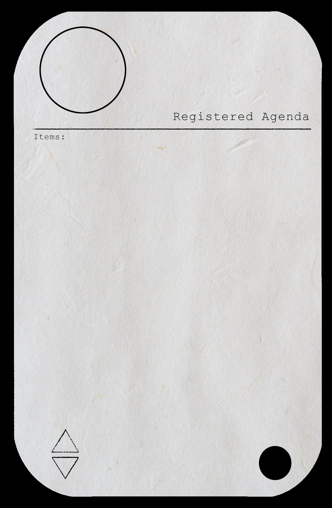

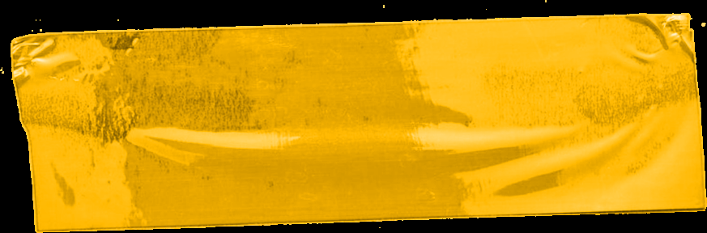
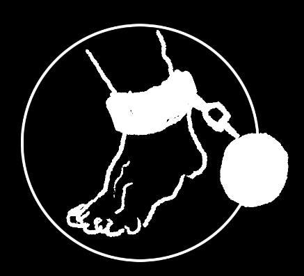
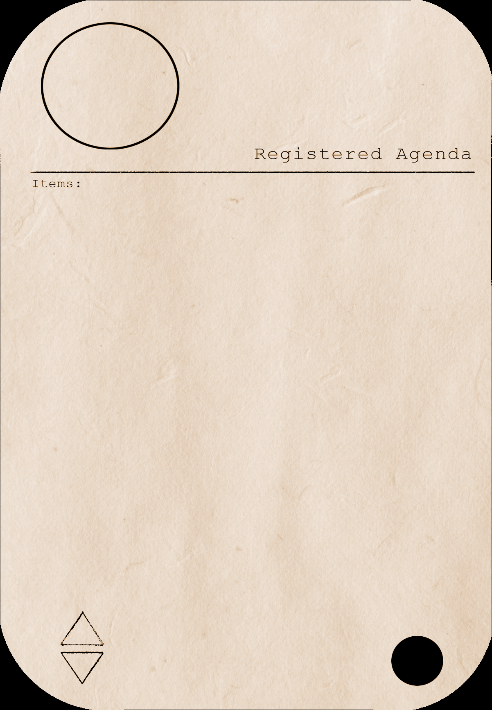

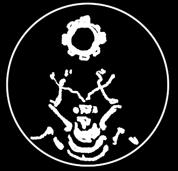
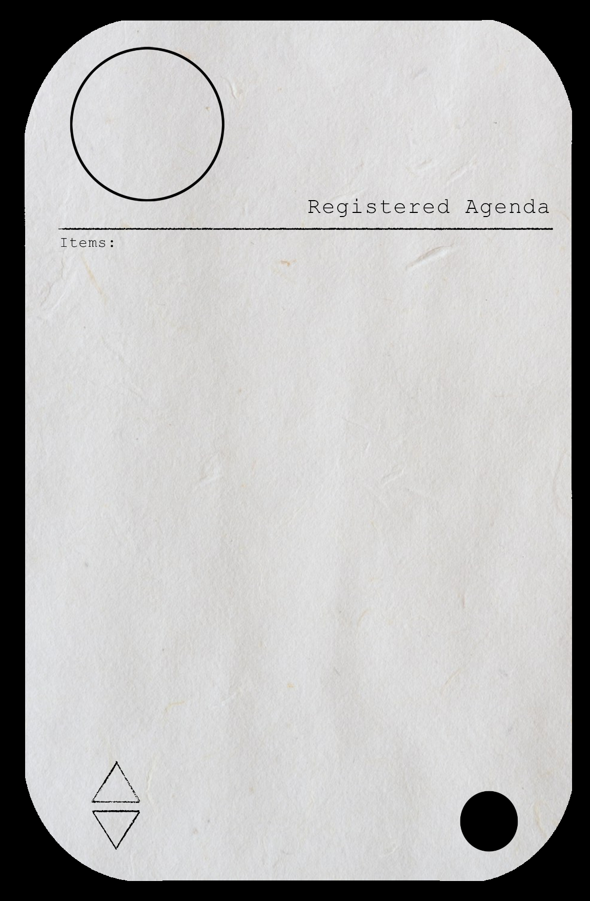
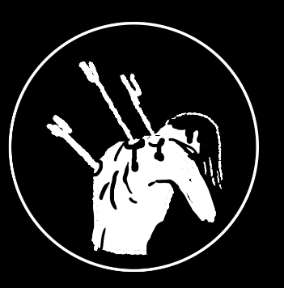

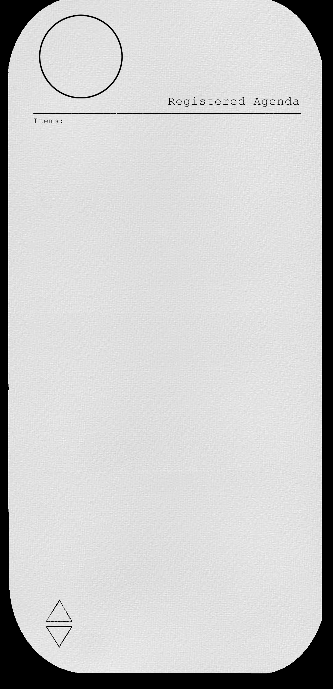

---
### Page 25 Source Content

# **HARDLINE** 

- Follow Orders 

- **Disobey Orders** 

**► Black Suit:** Gain +1D on actions to lead, intimidate, or give orders to mundane humans. 

- **Mea Culpa:** The f i rst time in a hunt you take an injury or an af fl iction, relieve 1d3+1 sin. 

- **Eliminate the Stain:** Gain +1D on all actions against sins that have half or less of their execution clock remaining. **► Single Minded:** You can only be af f ected by one af fl iction maximum (you can choose which to discard and keep). 

- **By the Book:** Once a hunt, when you witness or f i nd evidence of a sin’s Domain, you can force the Admin to show you the exact rules text of that Domain. 

<!-- Start of picture text -->
MACHINE <!-- End of picture text -->

- Put the work before your own needs 

- **Take a break** 

**► The Work:** You can choose to gain +1D on any roll. If you do, take 1 stress for each time you’ve used this ability this mission (including this one). You can’t use this ability for the remainder of the hunt if you rest. 

- **Brain Burst** : When investigating or researching something, you can take 1 stress to re-roll one die on your action roll. The re-roll is f i nal. 

- **Second Wind:** The f i rst time pressure f i lls up over half, relieve all stress. 

- **Overtime:** You can gain +1D on all actions to investigate, analyze, or gather information for the duration of a scene, but you lose the use of this ability and all other activities are hard until you rest. 

- **Neat Little Universe:** Twice a hunt, you can tick any talisman on your sheet or an ally’s up or down by 1. 

   - Uncover hidden or uncomfortable 

   - truths about the world. 

   - **Uncover hidden or uncomfortable** 

   - **truths about yourself.** 

- **Psyche Jewel:** When you or an ally answers a Sin’s trauma question, regain 1 psyche burst, recover 1 sin, and erase 1 stress. 

- **Alienation** : Your sin overf l ow cap increases by +3 

- **Rapture:** You erase 1d3 stress when 

- af fl icted. 

- **Larval:** If you end a mission at 7 or higher sin, gain 1 xp. If you suf f er sin overf l ow, gain 1 xp 

- **Unveil:** You can ask the Admin about a character present ‘What is this person afraid of?’. Gain +1D when you act on the answers for the rest of the scene, then lose the use of this ability until you rest. 

## 

   - Put people before the mission 

   - **Harm someone intentionally** 

- **Healer:** When you rest, gain an extra resting die. This die can only be spent by an ally. 

- **Focused:** You can use a blasphemy that af f ects only you or your allies without spending psyche burst, and it gains +1 CAT. Then lose the use of this ability until you rest. 

- **Savior Complex:** Gain +1D on actions to directly prevent or avoid harm to humans **► Care** : Twice a hunt, you can roll and apply a resting die to yourself or another nearby ally without resting. 

- **Gentleness:** For one scene, you may take 1 less stress when you take stress. This ability breaks if you take any forceful or harmful action. Then lose the use of this ability until you rest. 

**48** 

**49**

#### Extracted Visual Elements (Page 25)

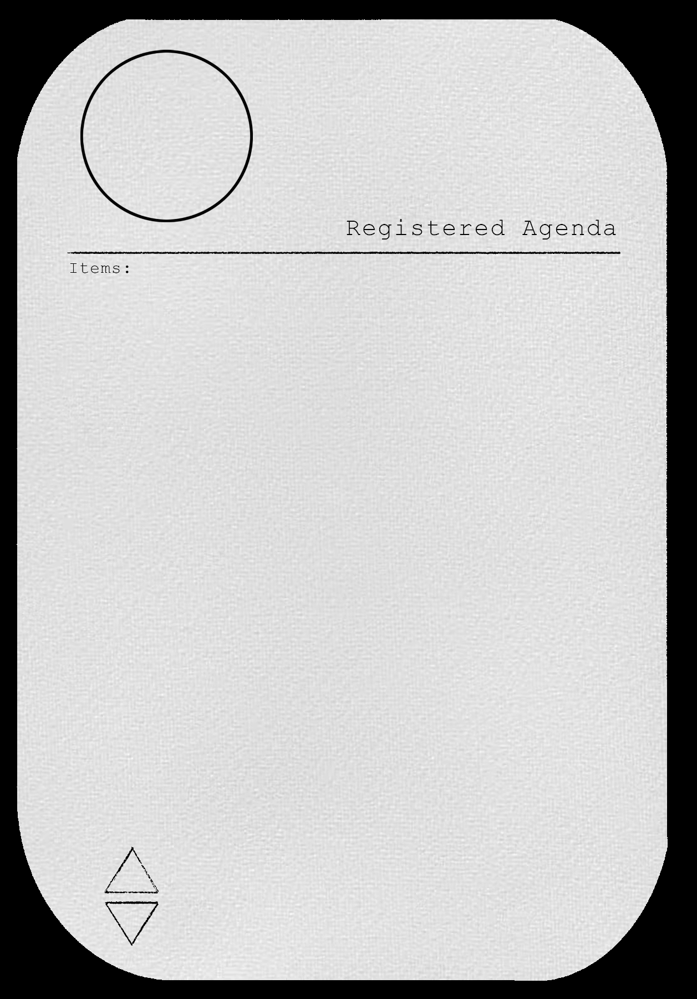

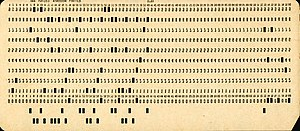
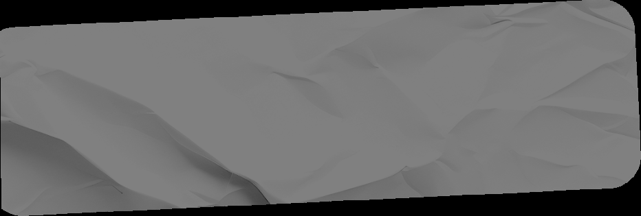

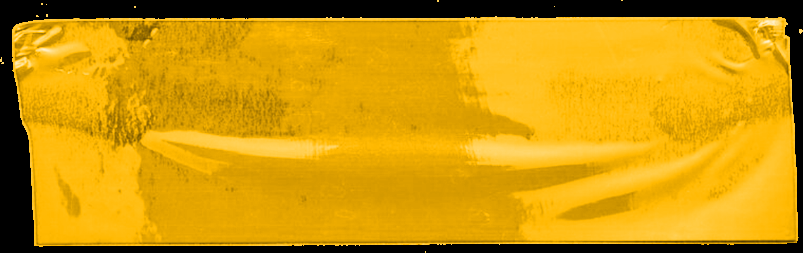

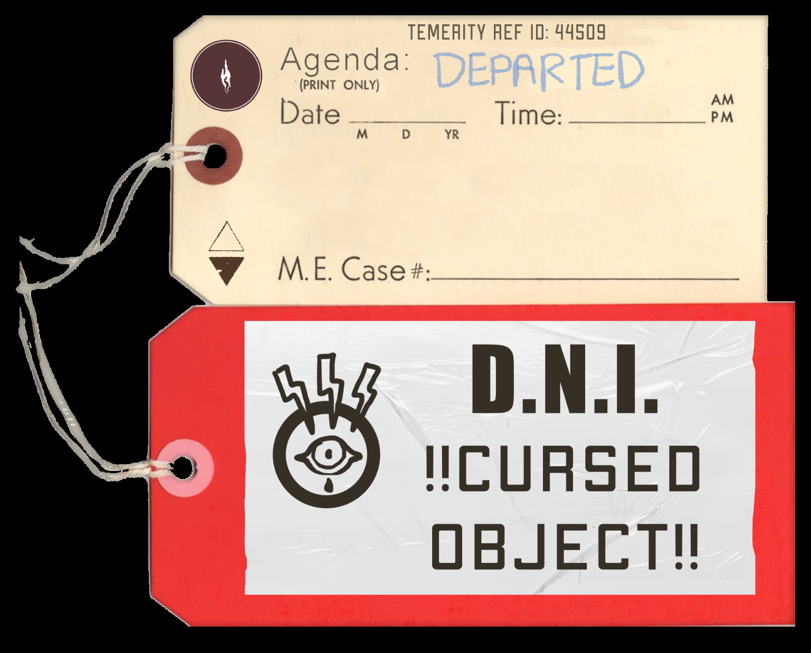

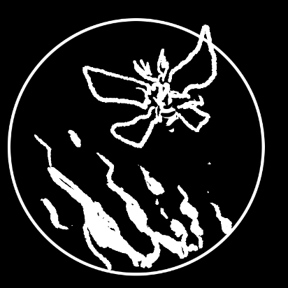

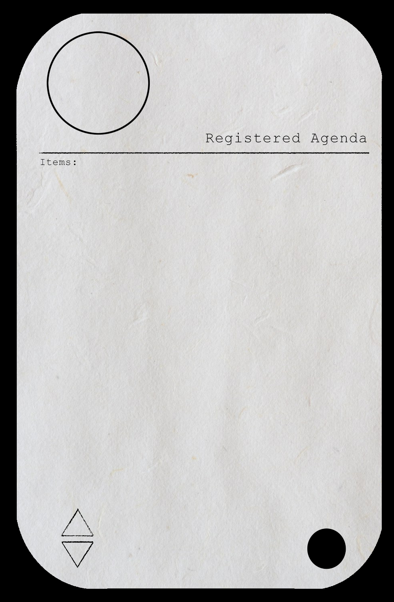

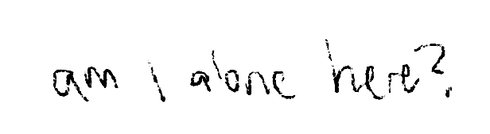
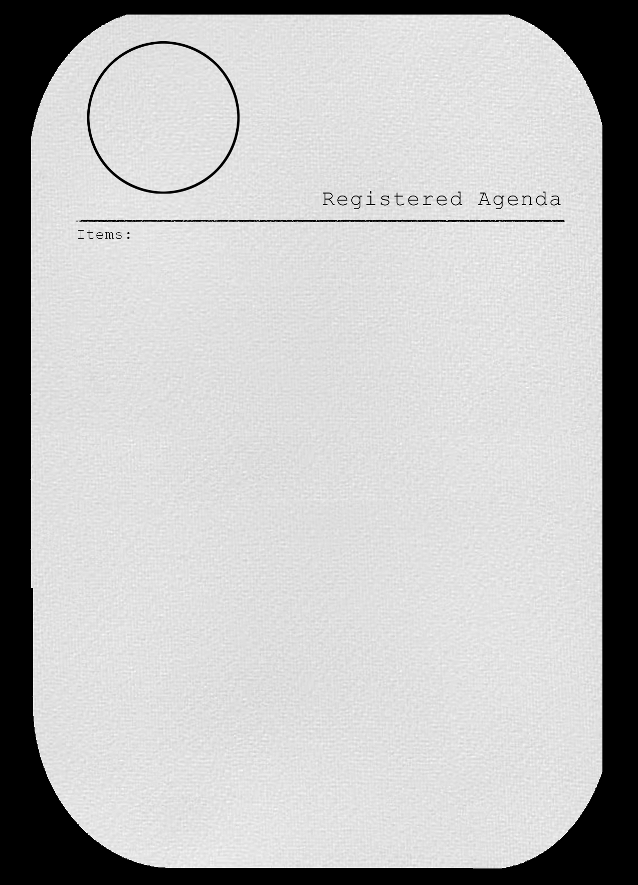
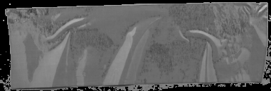

---
### Page 26 Source Content

## 

## 

► Outshine your rival 

<!-- Start of picture text -->
►  Let your rival outshine you <!-- End of picture text -->

<!-- Start of picture text -->
►  Demonstrate f l ashy displays of power ►  Invite catastrophe <!-- End of picture text -->

**► Catch Up:** If your rival has less stress than you when pressure increases, erase 1 stress. If they have more psyche bursts, regain 1 psyche burst. 

- **Perfect Technique:** Pick a blasphemy. Once a hunt, you can increase the CAT of that blasphemy by +1 temporarily for an entire scene, or for two rounds if it’s a conf l ict scene. 

**► Synchronize:** When you set up your rival, you take 1 stress and +1D on on the action to set up. 

**► You Can’t Die Now:** If your rival would take an injury or suf f er instant death, you can take 2d3 stress to allow them to ignore it. Then, lose the use of this ability **until you rest.** 

**► Cantrip:** Pick a blasphemy ability. You can use it without spending a psyche burst, but it is always used at CAT 0 if used this way. 

- **Shadow Seed:** Choose a blasphemy power your rival has. You can use that power this hunt, but only at CAT 0. 

- **Finishing Move:** Pick a blasphemy. You can willingly increase the dice and CAT of that power by +1 when you use a power from that blasphemy, but you then cannot use that blasphemy again and all actions are hard. Both these ef f ects end when you rest. **► Mimic technique:** Pick a power from any Blasphemy, without having taken that blasphemy. It doesn’t change your xp or sin overf l ow caps. 

**► Pincer Technique:** When you participate in teamwork with your rival, you take 1 stress, but can also re-roll one of the dice once, taking the second result as f i nal. 

<!-- Start of picture text -->
When you pick this agenda, pick another character to be your rival (the feeling doesn’t have to be mutual) at the start of a mission. As long as you have rival abilities from this agenda, you must choose who your rival is. <!-- End of picture text -->

**► Weave:** When you use a blasphemy, you may increase the CAT of the next blasphemy used by an ally by +1, and grant it +1D on any rolls. Then lose the use of this ability until you rest. 

<!-- Start of picture text -->
► Survive ► Will to Live:  +1 max stress. 1 in 6 chance of ignoring instant death (roll 1d6) <!-- End of picture text -->

## 

# MY 

   - Get someone to do your bidding 

   - **► Do something self l ess** 

- **Codependency:** When someone sets you up, you can trade 1 stress around (from you to them, or vice versa). 

- **Spiral:** You can always tell if someone is lying to you, though not the nature of the lie. 

- **Strings:** When you rest with a consenting partner, you can spend quality time with them (the nature of which is up to them). If they choose to do so, you both add +1 to all your resting results. However, until you next rest, you can force them to participate in teamwork with you or set you up once. 

- **White Fiber:** You can take 2 stress to gain +1D on any roll to lie or manipulate someone. This stress cannot inf l ict an injury on you. 

**► Fascination:** You can declare your fascination with another character in the group at the start of any hunt. When that character rolls a 6 on risk, you lose 1 stress. When they roll a 1, you gain 1 stress. This stress cannot cause you an injury. 

**50** 

**51**

#### Extracted Visual Elements (Page 26)

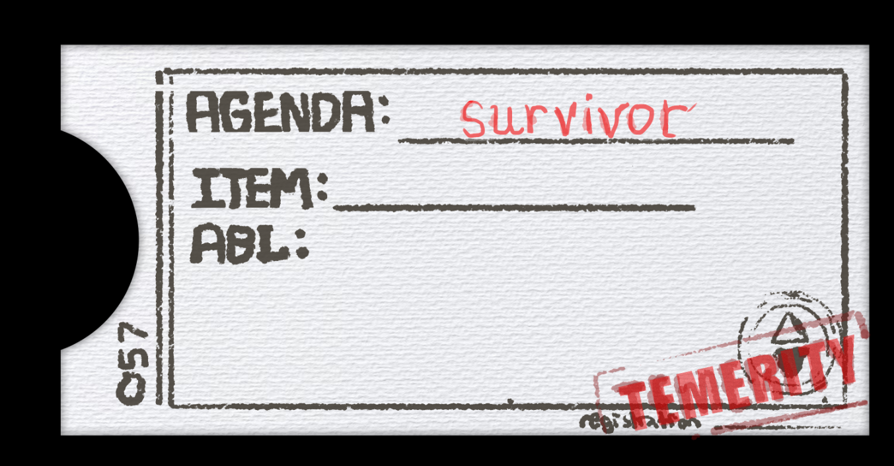
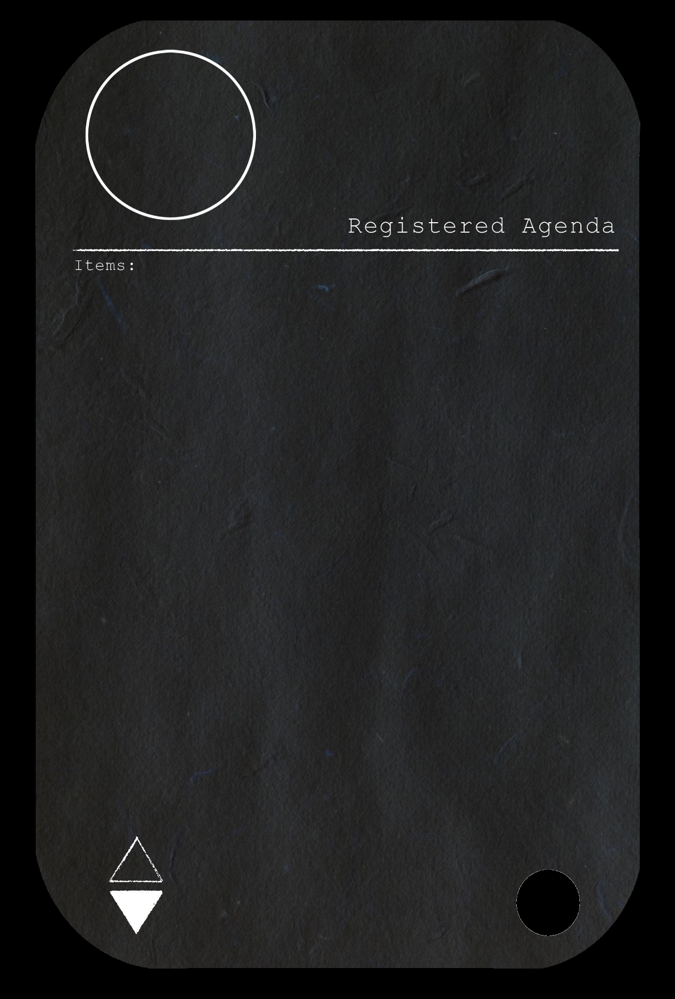

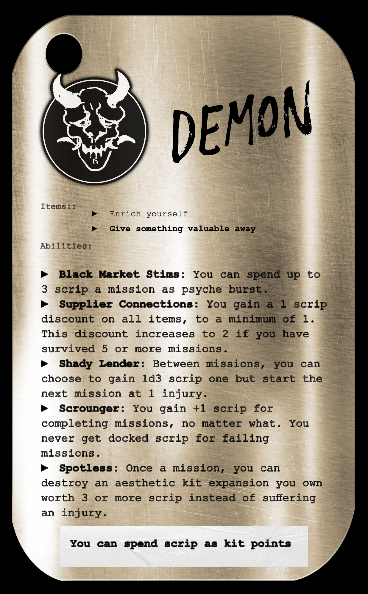
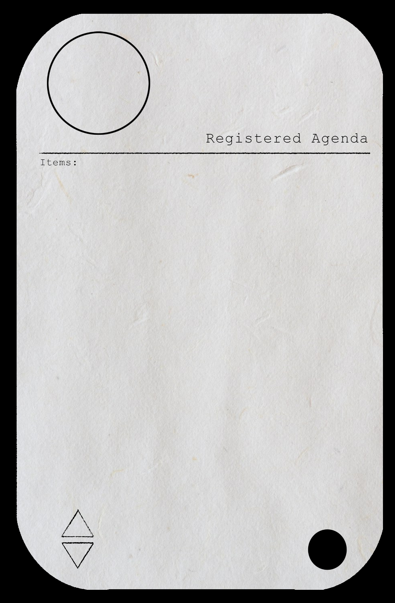

## Related Knowledge Nodes

- [[Exorcist_Overview_and_Skills]]
- [[Character_Creation_and_Advances]]
