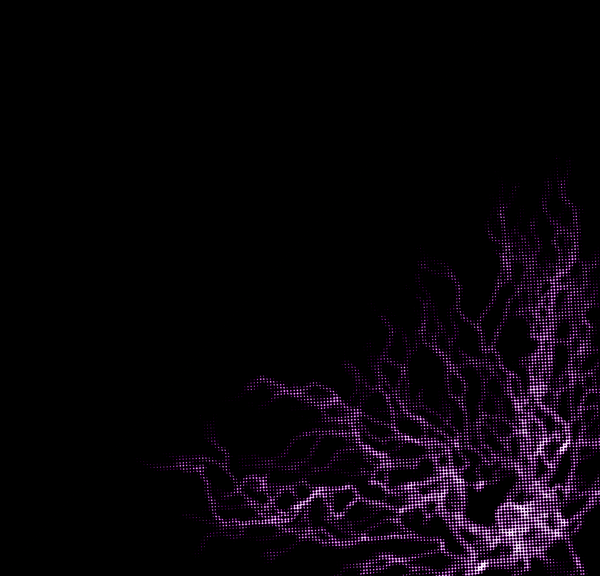
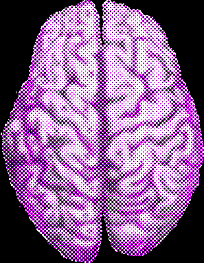
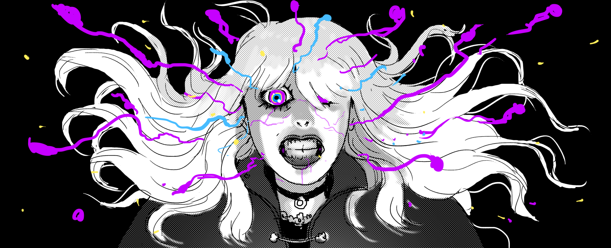
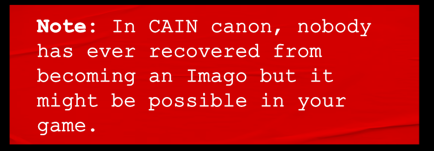
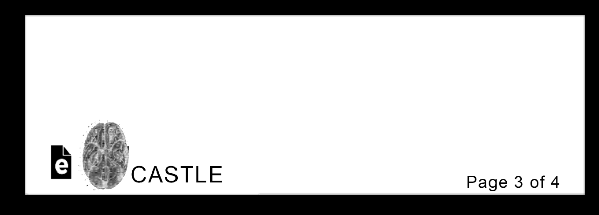
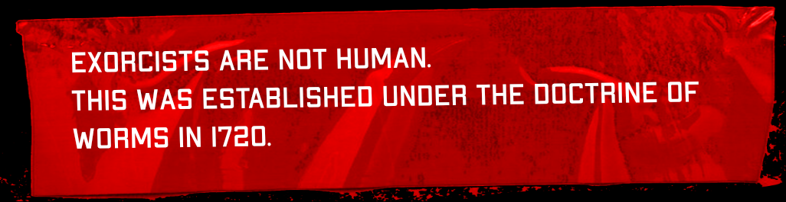
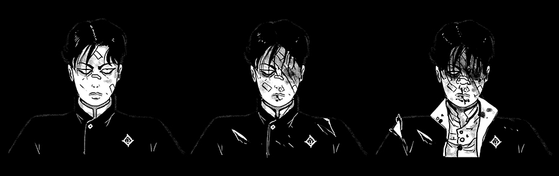

# The Body: Stress, Injuries, Death & Afflictions

> Source: CAIN 1.0 Rulebook (Pages 16, 17)

---
### Page 16 Source Content

## **The Body** 

This allows even **one slash** left on your talisman to take any amount of punishment for you. 

You have a few more things that are (very) important to track. 

# Sin overflow 

If an exorcist would exceed their **sin overflow limit** , which is normally 10, they go into **sin overflow** at the end of the scene. They lose control of the psychic energies in their body, which start to run wild and begin their transformation into a **new sin.** A character in Sin Overflow has two choices: **give up** or **resist.** 

##### **Give Up** 

A character that gives up effectively ceases to be a player character and may work with the Admin to determine the Sin they become. They become an antagonist and control is handed over to the Admin. 

They make one final choice, which is to **flee** or **fight** . Fighting immediately forces a conflict scene with an **Imago** (see page 148). The new Sin may become a target of a later hunt, or a greater antagonist. 

If the group feels like it is a good time to break and reassess the situation, CAIN may also call the mission, ending it early. An emergence of a new Sin is a disaster that drastically changes the parameters of the mission. 

##### **Resist** 

A character that makes this choice must make a resistance check. 

- this check is automatically passed if a character has no sin marks. With at least one sin mark, they must roll a d6, adding their number of sin marks (see below). 

- on a total result of 6 or less, they **pass** and can keep control 

- on a total result of 7 or higher, the **y fail** and **must give up.** 

- a result of ‘1’ on the die always passes. 

A character that keeps control **clears all sin** and gains a **sin mark.** 

#### Sin Marks 

A **sin mark** is a physical manifestation of wild power overflow on your body, evidence of your partial transformation into a sin. You can find a list of sin marks, their effects, and their table, on pg. 86. A sin mark is a new, permenant part of your character. It grants new, beneficial power, and grants you new abilities. 

**FACT:** Exorcists with sin marks have limited lifespans. They are indelibly stained. C **CASTLE** 3 of 4 

Fact: Taking care of your body is correlated with high levels of mission success. Therefore CASTLE encourages you to take advantage of facility health, recrea�on, and rehabilita�on services. 

### Stress 

It is inevitable that exorcists put themselves in harm’s way during a mission - not only physical injury, but also exhaustion, fatigue, illness, or mental strain. These kinds of challenges usually would massively impair or incapacitate a regular human. 

Fortunately, **you are an exorcist** and always take harm by taking **stress.** When you would take mental or physical harm, **you slash your exorcists’s execution talisman with stress instead** . 

- **1 slash:** Pain, strain, tiredness, suffering, minor injury 

- **2/3 slashes:** Crippling or even fatal to most humans, injury, exhaustion, bleeding, deprivation, poison, etc. 

- **4+ slashes:** Instantly and messily fatal to humans 

Your talisman has capacity for **6 slashes** . You **always start every hunt without any slashes on the talisman** , fresh and ready to go. 

if you would take stress that puts you **past your maximum capacity** for slashes, it remains at capacity and the remainder does not ‘spill over’. 

###### 

6 

**An exorcist about to be in a lot of pain** 

If your talisman is full and you would take slashes again, you instead take an **injury** and clear all slashes. Taking stress represents avoiding or mitigating incoming harm. Taking injuries does not. 

### Injuries 

Injuries represent direct physical or mental harm to your being, such as: 

- a twisted ankle 

- a bleeding gunshot 

- poison taking hold of your body 

- deep mental distress 

- exhaustion 

Exorcists can fight and act normally through taking an injury. Taking an injury clears all stress, but then **reduces your maximum stress by 1** while you have it. This **stacks for each injury you have.** 

Injuries have the following additional rules: 

- You heal all injuries after a mission is over, and always start missions with no injuries. 

- You also heal all injuries if you **defy your fate** instead of dying instantly (see below) 

- If have three injuries, you are **on the brink of death** . If you take any more harm, even if it’s mitigated by stress, you will suffer **instant death.** 

**30** 

**31**

#### Extracted Visual Elements (Page 16)

---
### Page 17 Source Content

## **Instant Death** 

# Afflictions 

An exorcist that takes any harm when on the brink of death is **killed instantly** and **can describe in what manner to the Admin.** 

Fighting a sin is mentally and physically taxing, and often supernaturally corrupting. Many sin abilities, including those that inflict hooks (see below), inflict **afflictions.** An affliction is an ongoing, usually negative effect on your exorcist, such as an infection or something more supernatural, such as psychic trauma, corruption, or influence. Afflictions are **permanent for the duration of the hunt once acquire** d, but can be cleared after the mission is over. 

- Other abilities (from sins, etc) may also inflict instant death. 

- If an exorcist would take 7 or more slashes on stress from a single event, after reductions, they also suffer instant death. 

- An exorcist that suffers instant death may **defy their fate** and **suffer sin overflow** instead of dying. Doing so heals all their injuries and afflictions. 

Each sin has a list of unique afflictions it can inflict, or the admin can improvise based on simple parameters. 

## **Dead Exorcists** 

# Hooks 

CAIN pays out for the cremation of dead exorcists and allows for a grievance period. Recovering the (even partial) remains of a dead exorcist grants everyone 1 xp and 1 scrip per recovery after the mission is over. 

During your missions you will be forced to make hard choices or trade offs, or be exposed to situations or harm that will come back to bite you later (sometimes literally). 

As complications or consequences of your actions, the Admin can choose to give you a **hook** instead of immediately applying consequences. A hook is a very simple 3 slash talisman that starts empty. You track them on your sheet. 

**Fact:** Instant death is quick and preferable to most other forms of C expiration. 

You slash a hook under the following situations: 

GRIEVANCE PERIOD NOT TO EXCEED PERMISSABLE STANDARDS - ADMIN. XXX0934 10:34am As above, so below 

- the tension talisman fills out during a hunt 

- When you roll a ‘1’ on the risk die. 

- If you would gain that hook again 

Whenever **you would slash a hook a 3rd time and fill it up** , the Admin may ‘ **cash it in** ’ at any time to erase it and apply its consequences, which are always worse than they would be up front. 

When you create a hook, **write it as its consequence** s, for example: 

- an exorcist is fighting a sin, and takes a nasty hit. The Admin decides to give them a hook instead of filling up their stress, giving them a ‘festering wound’ hook. 

- an exorcist decides to steal a key from a hotel owner, but rolls badly on the risk die. Rather than apply consequences right away, the Admin writes ‘wanted by police’ as a hook. 

• an exorcist decides to push themselves while performing a seance. The Admin writes ‘pass out from exhaustion’ as a hook. 

Additionally: 

- a character’s own abilities can also give them hooks. 

- hooks **always inflict more severe consequences** than the alternative 

To deal with hooks, abide by the following rules: 

- **hooks reset after each mission** , so a character should start a mission with no hooks 

- when an exorcist **rests** during a hunt, they can remove slashes on a hook (see pg. 38) 

## **Bargaining** 

Characters are always free to **suggest hooks** to the Admin as consequences for their own or another’s actions. They are even able to suggest hooks as a payment or tradeoff for the following: 

- +1D advantage 

- make an action less hard or risky 

- use a free psyche burst as part of the action 

- Slash a talisman an extra time 

They can only try for these bargains when they or one of their allies is taking action, and it’s up to the Admin whether to take them or not, and whether to modify the consequences or severity of the hook. Either way, the terms of the bargain must be clear before rolling. 

# Kit 

Exorcists are equipped with a standard issue CAIN-issued kit to bring on a mission. You deploy with 5 **kit points,** which represent your capacity and inventory of items. This is an abstract and you don’t have to decide what you are bringing with you when you embark on a mission - you can pull something out from your listed kit items when it’s needed, as long as you have points left. 

You can spend the listed number of points to pull out any of the following choices, at any time (each choice gives you all items listed). 

- **0:** Standard issue uniform, collar, shoes, button pin. 

- **1:** Notebook and pen. 

- **1:** Matchbook (20 matches). Clean handkerchief. 

- **2:** Your service weapons: A firearm and and ammunition and melee weapon. 

**That’s all you get.** However, you can expand what is available to you in your kit by spending **scrip** , which you get from completing missions. Scrip must be spent between missions, and you can see a list of items on pg. 78. These items are always available for you. Many of them are useful during a mission. Many of them are not. 

### **Picking up items** 

You can pick up anything you can find during a mission and use it with no issues. However, you cannot keep it between missions. 

#### 

**32** 

**33**

#### Extracted Visual Elements (Page 17)

## Related Knowledge Nodes

- [[Divine_Agony_and_Talismans]]
- [[Sin_Marks]]
- [[Conflict_Scenes]]
