# Kit, Weapons, Armor & Expansion

> Source: CAIN 1.0 Rulebook (Pages 17, 40, 41, 42, 43)

---
### Page 17 Source Content

## **Instant Death** 

# Afflictions 

An exorcist that takes any harm when on the brink of death is **killed instantly** and **can describe in what manner to the Admin.** 

Fighting a sin is mentally and physically taxing, and often supernaturally corrupting. Many sin abilities, including those that inflict hooks (see below), inflict **afflictions.** An affliction is an ongoing, usually negative effect on your exorcist, such as an infection or something more supernatural, such as psychic trauma, corruption, or influence. Afflictions are **permanent for the duration of the hunt once acquire** d, but can be cleared after the mission is over. 

- Other abilities (from sins, etc) may also inflict instant death. 

- If an exorcist would take 7 or more slashes on stress from a single event, after reductions, they also suffer instant death. 

- An exorcist that suffers instant death may **defy their fate** and **suffer sin overflow** instead of dying. Doing so heals all their injuries and afflictions. 

Each sin has a list of unique afflictions it can inflict, or the admin can improvise based on simple parameters. 

## **Dead Exorcists** 

# Hooks 

CAIN pays out for the cremation of dead exorcists and allows for a grievance period. Recovering the (even partial) remains of a dead exorcist grants everyone 1 xp and 1 scrip per recovery after the mission is over. 

During your missions you will be forced to make hard choices or trade offs, or be exposed to situations or harm that will come back to bite you later (sometimes literally). 

As complications or consequences of your actions, the Admin can choose to give you a **hook** instead of immediately applying consequences. A hook is a very simple 3 slash talisman that starts empty. You track them on your sheet. 

**Fact:** Instant death is quick and preferable to most other forms of C expiration. 

You slash a hook under the following situations: 

GRIEVANCE PERIOD NOT TO EXCEED PERMISSABLE STANDARDS - ADMIN. XXX0934 10:34am As above, so below 

- the tension talisman fills out during a hunt 

- When you roll a ‘1’ on the risk die. 

- If you would gain that hook again 

Whenever **you would slash a hook a 3rd time and fill it up** , the Admin may ‘ **cash it in** ’ at any time to erase it and apply its consequences, which are always worse than they would be up front. 

When you create a hook, **write it as its consequence** s, for example: 

- an exorcist is fighting a sin, and takes a nasty hit. The Admin decides to give them a hook instead of filling up their stress, giving them a ‘festering wound’ hook. 

- an exorcist decides to steal a key from a hotel owner, but rolls badly on the risk die. Rather than apply consequences right away, the Admin writes ‘wanted by police’ as a hook. 

• an exorcist decides to push themselves while performing a seance. The Admin writes ‘pass out from exhaustion’ as a hook. 

Additionally: 

- a character’s own abilities can also give them hooks. 

- hooks **always inflict more severe consequences** than the alternative 

To deal with hooks, abide by the following rules: 

- **hooks reset after each mission** , so a character should start a mission with no hooks 

- when an exorcist **rests** during a hunt, they can remove slashes on a hook (see pg. 38) 

## **Bargaining** 

Characters are always free to **suggest hooks** to the Admin as consequences for their own or another’s actions. They are even able to suggest hooks as a payment or tradeoff for the following: 

- +1D advantage 

- make an action less hard or risky 

- use a free psyche burst as part of the action 

- Slash a talisman an extra time 

They can only try for these bargains when they or one of their allies is taking action, and it’s up to the Admin whether to take them or not, and whether to modify the consequences or severity of the hook. Either way, the terms of the bargain must be clear before rolling. 

# Kit 

Exorcists are equipped with a standard issue CAIN-issued kit to bring on a mission. You deploy with 5 **kit points,** which represent your capacity and inventory of items. This is an abstract and you don’t have to decide what you are bringing with you when you embark on a mission - you can pull something out from your listed kit items when it’s needed, as long as you have points left. 

You can spend the listed number of points to pull out any of the following choices, at any time (each choice gives you all items listed). 

- **0:** Standard issue uniform, collar, shoes, button pin. 

- **1:** Notebook and pen. 

- **1:** Matchbook (20 matches). Clean handkerchief. 

- **2:** Your service weapons: A firearm and and ammunition and melee weapon. 

**That’s all you get.** However, you can expand what is available to you in your kit by spending **scrip** , which you get from completing missions. Scrip must be spent between missions, and you can see a list of items on pg. 78. These items are always available for you. Many of them are useful during a mission. Many of them are not. 

### **Picking up items** 

You can pick up anything you can find during a mission and use it with no issues. However, you cannot keep it between missions. 

#### 

**32** 

**33**

#### Extracted Visual Elements (Page 17)

---
### Page 40 Source Content

# **Kit expansion** 

The following section contains items all 

   - Items also have tags: 

- **0:** Very small items or personal effects that could fit in a coat pocket, like a pen or wallet 

exorcists are licensed to purchase with CAIN **scrip** (S). 

- **Consumable:** Once used, this item is gone forever. Multiple copies of it can be bought. 

Purchased items are permanently available for an exorcist’s kit during deployment on a mission, and can be pulled out by spending k **it points.** 

- **1:** Small item that could fit in a hand 

   - **Conspicuous** : This item is obvious 

- **2** : Item that requires storage or both hands, such as a firearm, melee weapon, etc 

- **Focus** : Using these items requires focus to use. It can’t be used while performing any other activity or if under duress. 

Scrip can only be spent between missions. Unless an item is consumable, it can only be purchased once at a time. 

- **3:** Very large item that is heavy, has to be carried, etc, such as a full backpack, two handed weapon (rifle, sledgehammer, etc), portable generator, medical bag, etc 

- Items may also have range tags (adjacent, short, long, extreme). An item can only be used within the listed range. 

You can use the following guide when estimating or improvising the kit cost of items or objects: 

- **5:** Human body 

**78** 

**79**

#### Extracted Visual Elements (Page 40)

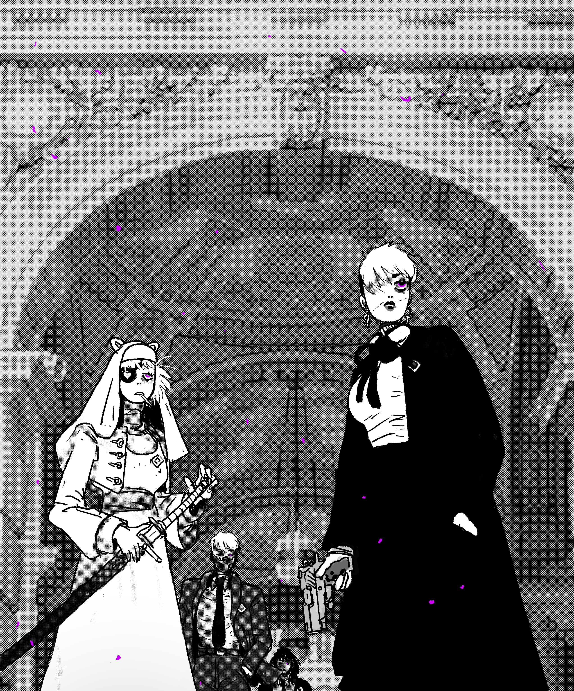
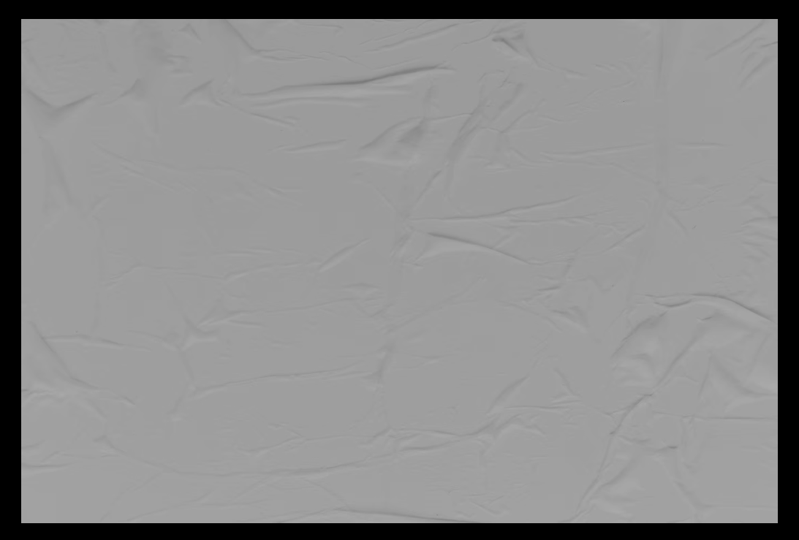
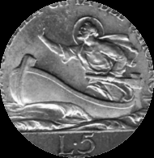
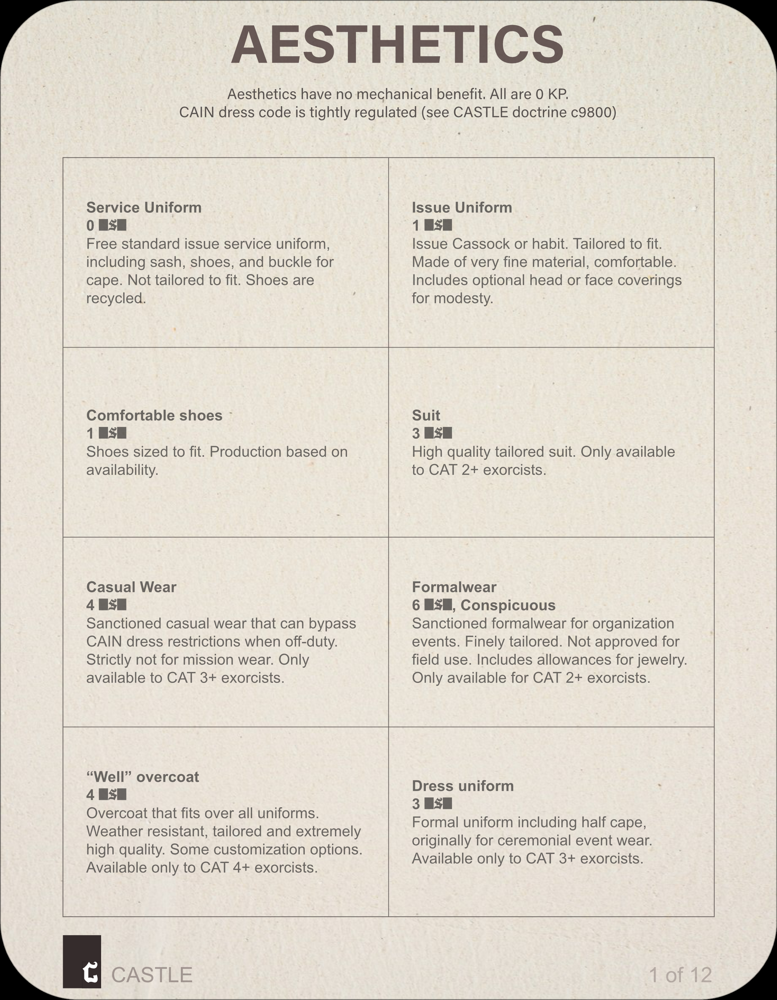

---
### Page 41 Source Content

**81** 

Availability may affect choices. 

<!-- Start of picture text -->
C CASTLE <!-- End of picture text -->

> See manual for codes. Page 1 

**80**

#### Extracted Visual Elements (Page 41)

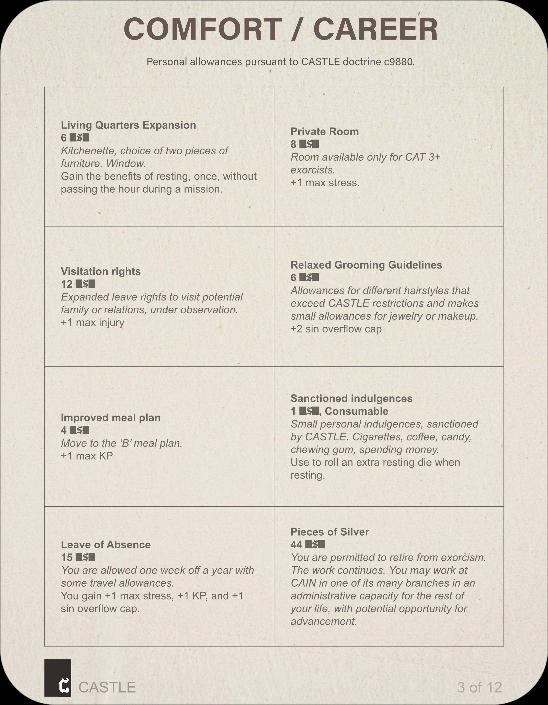

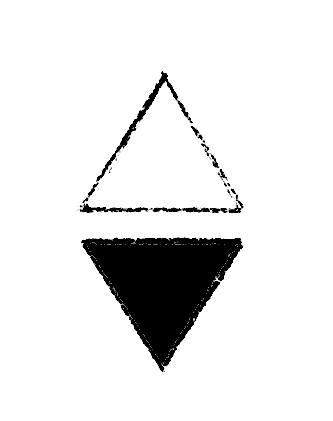
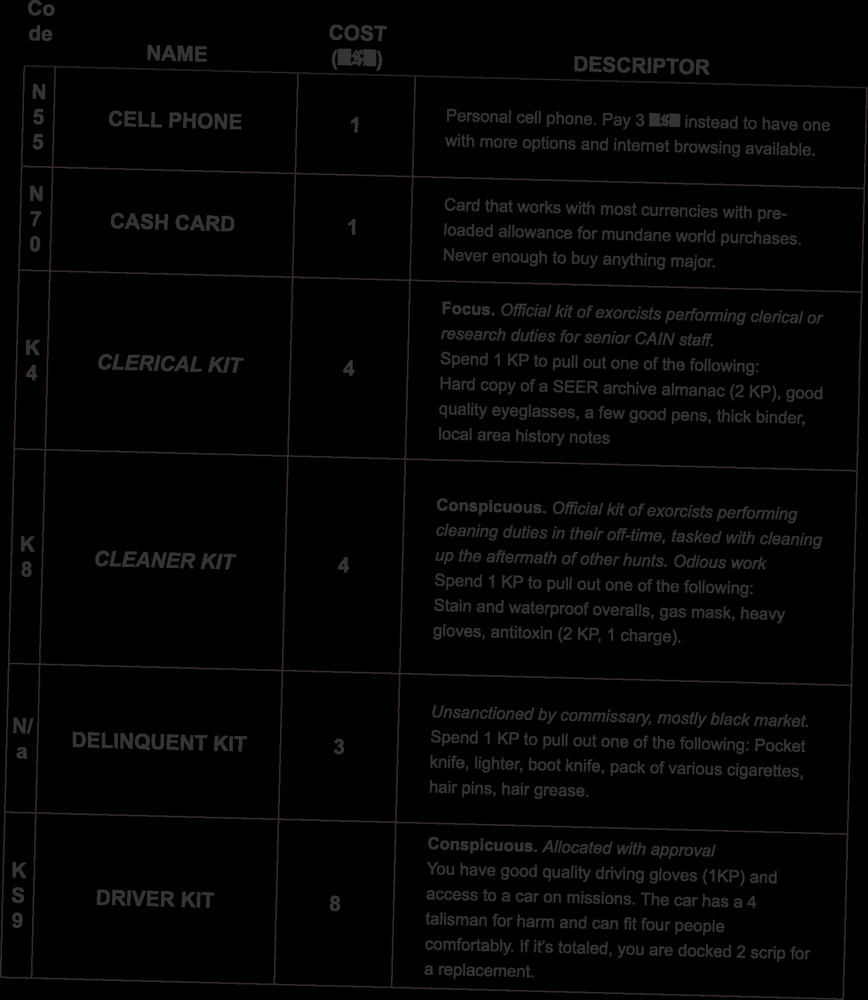

---
### Page 42 Source Content

**83** 

<!-- Start of picture text -->
Page 2 C CASTLE See manual for codes. <!-- End of picture text -->

<!-- Start of picture text -->
Ref 0994 As above, so below <!-- End of picture text -->

<!-- Start of picture text -->
!!APPROVAL REQUIRED OBJECTS MAY BE CURSED!! <!-- End of picture text -->

**82**

#### Extracted Visual Elements (Page 42)

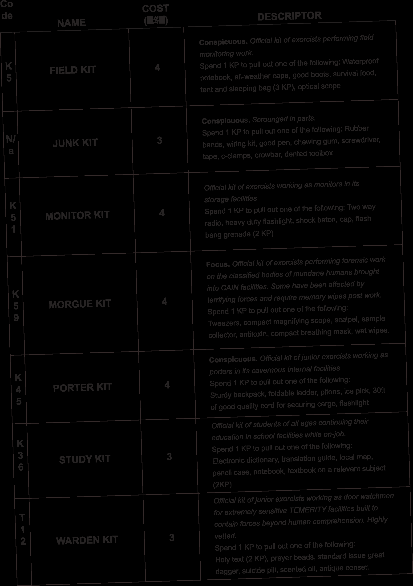
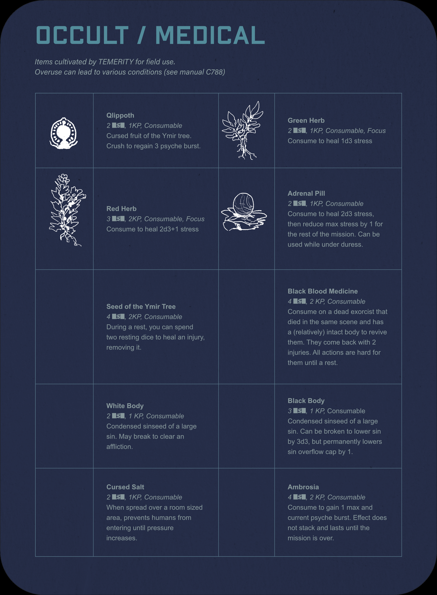
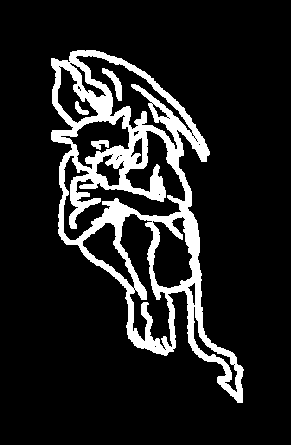
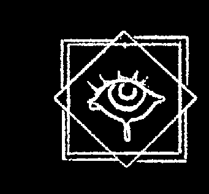

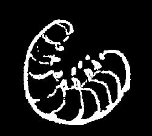
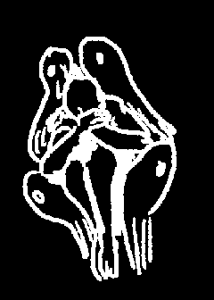
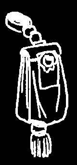

---
### Page 43 Source Content

# WEAPONS 

Arsenal of weaponry machined and maintained by CASTLE armory services. Some improvised in the field. Your service weapons are purely aesthetic. All these weapons have been lovingly used to kill sins. 

<!-- Start of picture text -->
THE HUNTER LOVES NOTHING <!-- End of picture text -->

**84** 

**85** 

SLASH AND SLASH AND SLASH! UNTIL IT IS DONE!

#### Extracted Visual Elements (Page 43)

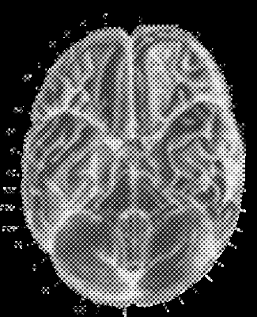
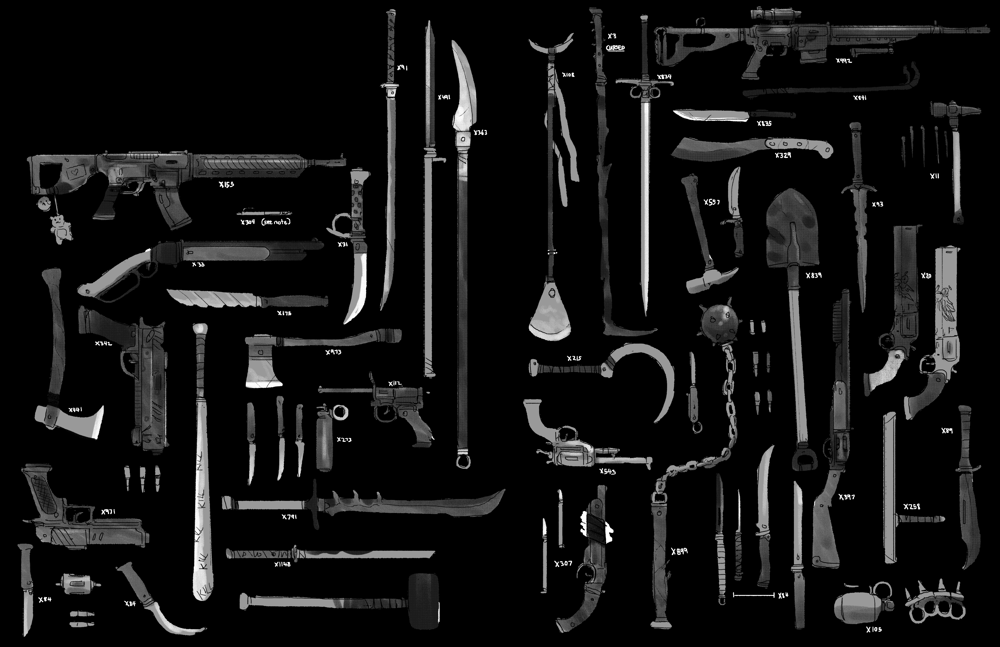

## High-Resolution Graphical Tables & Sheets

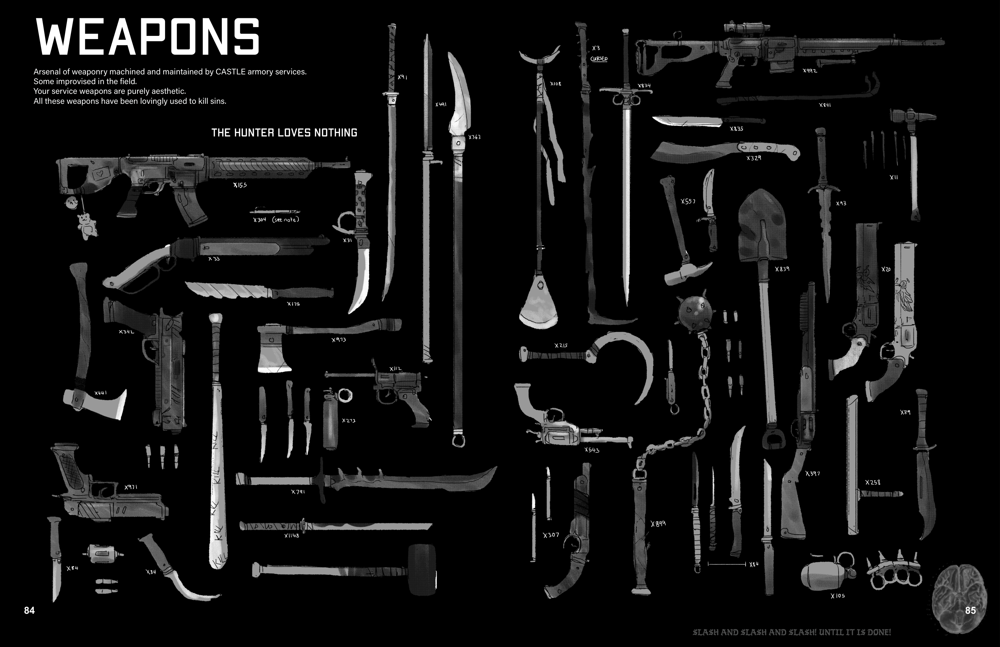

## Related Knowledge Nodes

- [[Exorcist_Overview_and_Skills]]
- [[Category_and_Mundane_vs_Supernatural]]
- [[Conflict_Scenes]]
