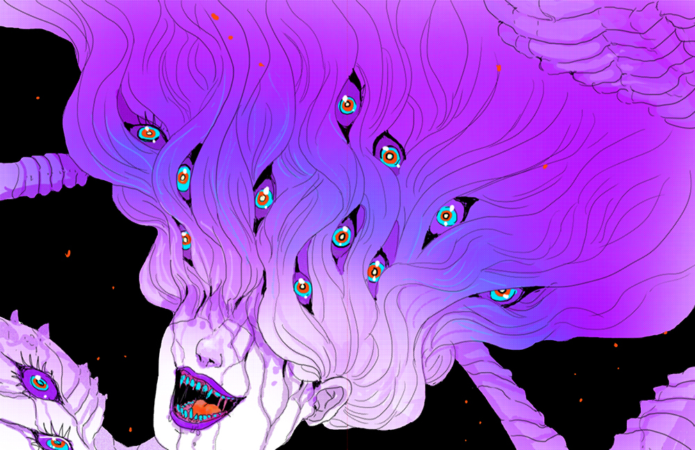
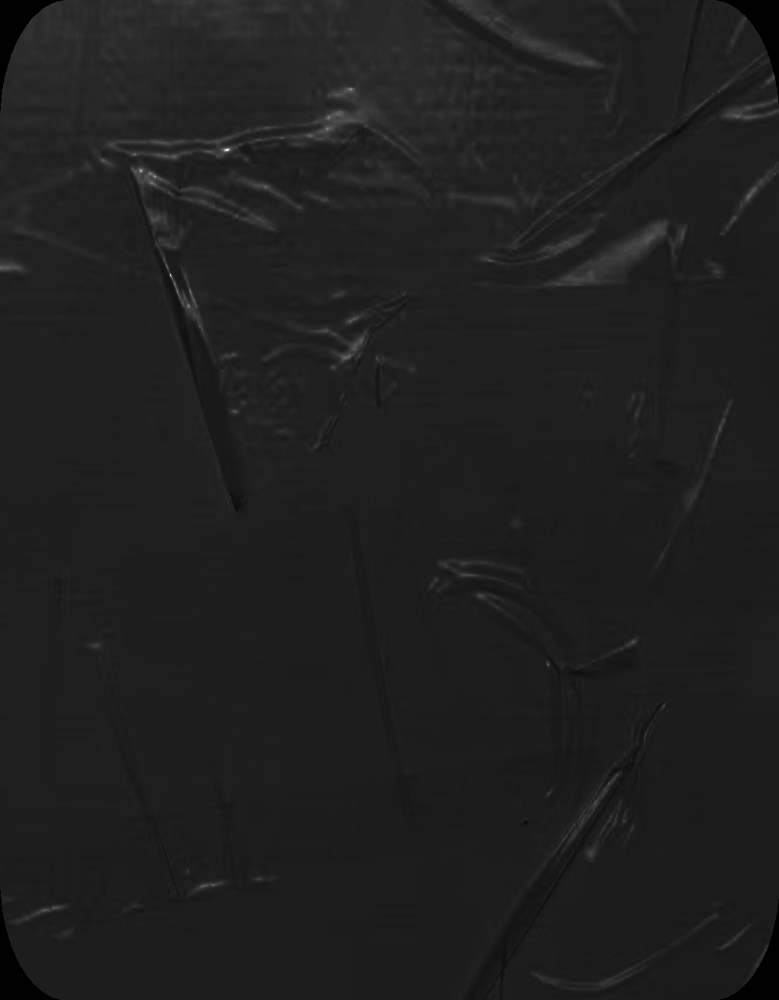
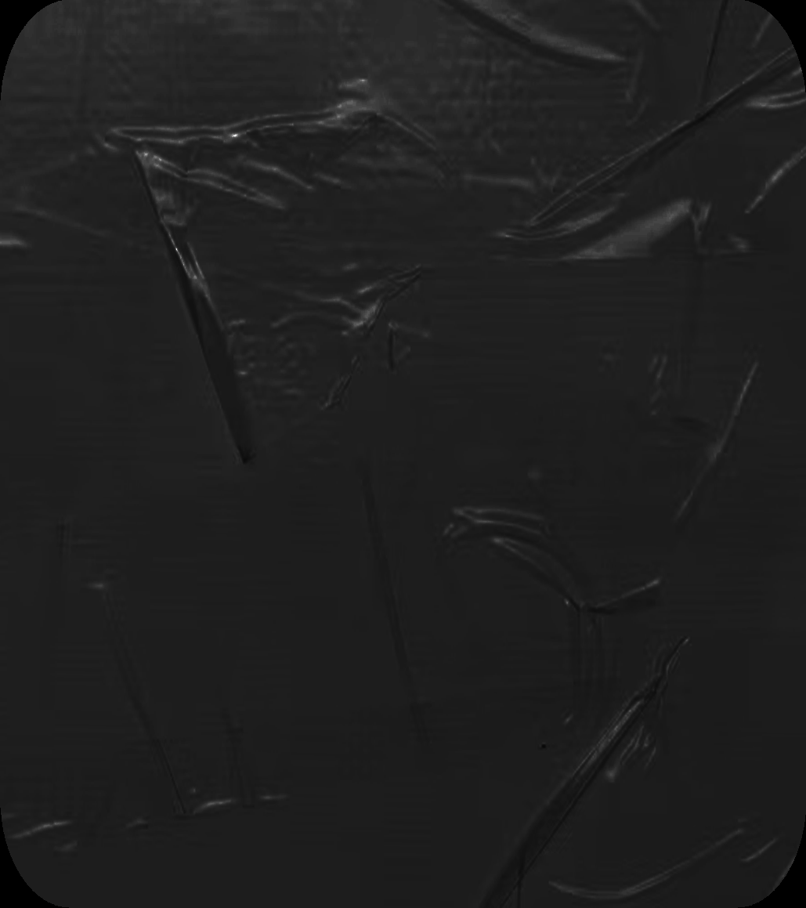
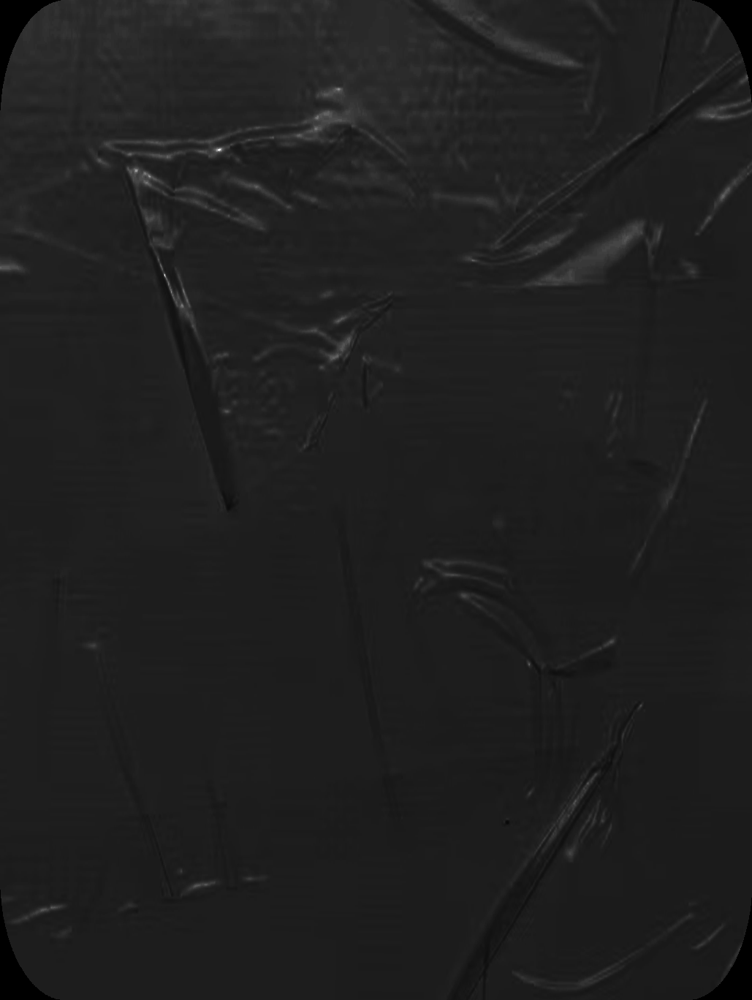
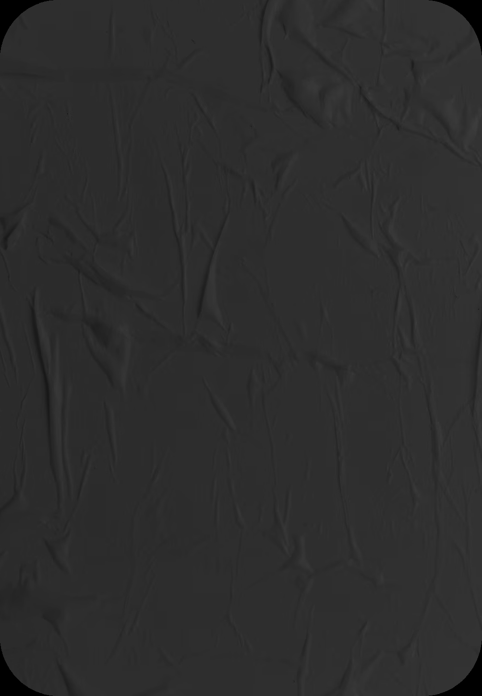
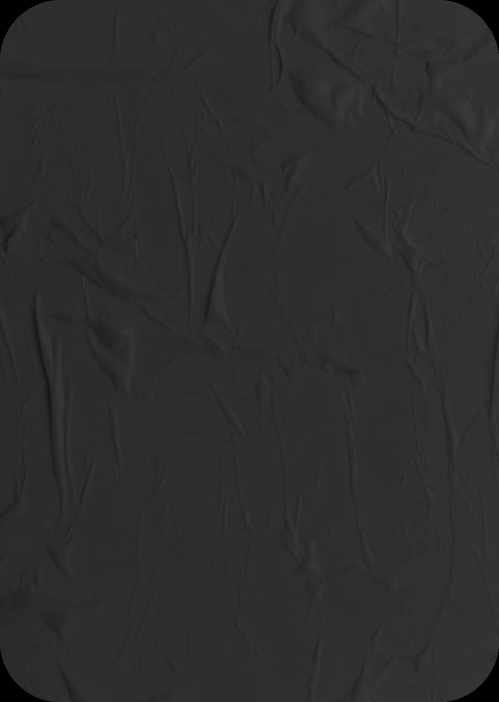
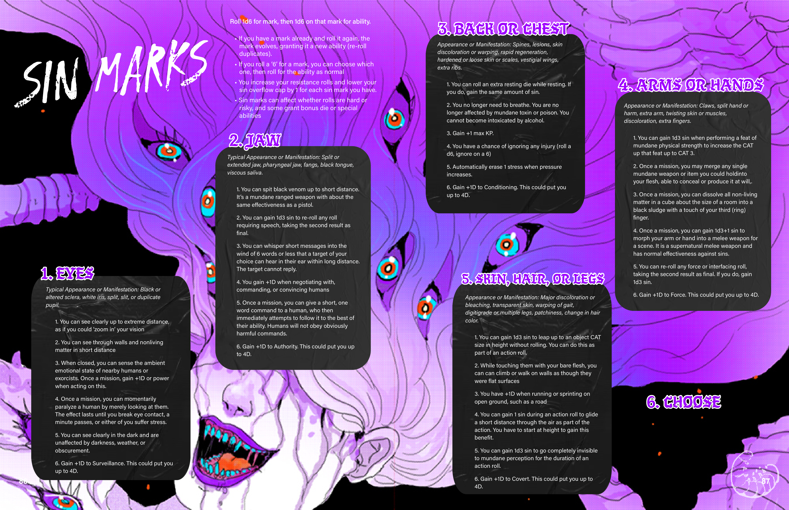

# Sin Marks & Flesh Mutations (D66 Table)

> Source: CAIN 1.0 Rulebook (Pages 16, 44)

---
### Page 16 Source Content

## **The Body** 

This allows even **one slash** left on your talisman to take any amount of punishment for you. 

You have a few more things that are (very) important to track. 

# Sin overflow 

If an exorcist would exceed their **sin overflow limit** , which is normally 10, they go into **sin overflow** at the end of the scene. They lose control of the psychic energies in their body, which start to run wild and begin their transformation into a **new sin.** A character in Sin Overflow has two choices: **give up** or **resist.** 

##### **Give Up** 

A character that gives up effectively ceases to be a player character and may work with the Admin to determine the Sin they become. They become an antagonist and control is handed over to the Admin. 

They make one final choice, which is to **flee** or **fight** . Fighting immediately forces a conflict scene with an **Imago** (see page 148). The new Sin may become a target of a later hunt, or a greater antagonist. 

If the group feels like it is a good time to break and reassess the situation, CAIN may also call the mission, ending it early. An emergence of a new Sin is a disaster that drastically changes the parameters of the mission. 

##### **Resist** 

A character that makes this choice must make a resistance check. 

- this check is automatically passed if a character has no sin marks. With at least one sin mark, they must roll a d6, adding their number of sin marks (see below). 

- on a total result of 6 or less, they **pass** and can keep control 

- on a total result of 7 or higher, the **y fail** and **must give up.** 

- a result of ‘1’ on the die always passes. 

A character that keeps control **clears all sin** and gains a **sin mark.** 

#### Sin Marks 

A **sin mark** is a physical manifestation of wild power overflow on your body, evidence of your partial transformation into a sin. You can find a list of sin marks, their effects, and their table, on pg. 86. A sin mark is a new, permenant part of your character. It grants new, beneficial power, and grants you new abilities. 

**FACT:** Exorcists with sin marks have limited lifespans. They are indelibly stained. C **CASTLE** 3 of 4 

Fact: Taking care of your body is correlated with high levels of mission success. Therefore CASTLE encourages you to take advantage of facility health, recrea�on, and rehabilita�on services. 

### Stress 

It is inevitable that exorcists put themselves in harm’s way during a mission - not only physical injury, but also exhaustion, fatigue, illness, or mental strain. These kinds of challenges usually would massively impair or incapacitate a regular human. 

Fortunately, **you are an exorcist** and always take harm by taking **stress.** When you would take mental or physical harm, **you slash your exorcists’s execution talisman with stress instead** . 

- **1 slash:** Pain, strain, tiredness, suffering, minor injury 

- **2/3 slashes:** Crippling or even fatal to most humans, injury, exhaustion, bleeding, deprivation, poison, etc. 

- **4+ slashes:** Instantly and messily fatal to humans 

Your talisman has capacity for **6 slashes** . You **always start every hunt without any slashes on the talisman** , fresh and ready to go. 

if you would take stress that puts you **past your maximum capacity** for slashes, it remains at capacity and the remainder does not ‘spill over’. 

###### 

6 

**An exorcist about to be in a lot of pain** 

If your talisman is full and you would take slashes again, you instead take an **injury** and clear all slashes. Taking stress represents avoiding or mitigating incoming harm. Taking injuries does not. 

### Injuries 

Injuries represent direct physical or mental harm to your being, such as: 

- a twisted ankle 

- a bleeding gunshot 

- poison taking hold of your body 

- deep mental distress 

- exhaustion 

Exorcists can fight and act normally through taking an injury. Taking an injury clears all stress, but then **reduces your maximum stress by 1** while you have it. This **stacks for each injury you have.** 

Injuries have the following additional rules: 

- You heal all injuries after a mission is over, and always start missions with no injuries. 

- You also heal all injuries if you **defy your fate** instead of dying instantly (see below) 

- If have three injuries, you are **on the brink of death** . If you take any more harm, even if it’s mitigated by stress, you will suffer **instant death.** 

**30** 

**31**

#### Extracted Visual Elements (Page 16)

---
### Page 44 Source Content

### 

# 1. EYES 

_Typical Appearance or Manifestation: Black or altered sclera, white iris, split, slit, or duplicate pupil._ 

1. You can see clearly up to extreme distance, as if you could ‘zoom in’ your vision 

2. You can see through walls and nonliving matter in short distance 

3. When closed, you can sense the ambient emotional state of nearby humans or exorcists. Once a mission, gain +1D or power when acting on this. 

4. Once a mission, you can momentarily paralyze a human by merely looking at them. The effect lasts until you break eye contact, a minute passes, or either of you suffer stress. 

5. You can see clearly in the dark and are unaffected by darkness, weather, or obscurement. 

6. Gain +1D to Surveillance. This could put you up to 4D. 

Roll 1d6 for mark, then 1d6 on that mark for ability. 

- If you have a mark already and roll it again, the mark evolves, granting it a new ability (re-roll duplicates). 

- If you roll a ‘6’ for a mark, you can choose which one, then roll for the ability as normal 

- You increase your resistance rolls and lower your sin overflow cap by 1 for each sin mark you have. 

- Sin marks can affect whether rolls are hard or risky, and some grant bonus die or special abilities 

# 2. JAW 

_Typical Appearance or Manifestation: Split or extended jaw, pharyngeal jaw, fangs, black tongue, viscous saliva_ . 

1. You can spit black venom up to short distance. It’s a mundane ranged weapon with about the same effectiveness as a pistol. 

2. You can gain 1d3 sin to re-roll any roll requiring speech, taking the second result as final. 

3. You can whisper short messages into the wind of 6 words or less that a target of your choice can hear in their ear within long distance. The target cannot reply. 

4. You gain +1D when negotiating with, commanding, or convincing humans 

5. Once a mission, you can give a short, one word command to a human, who then immediately attempts to follow it to the best of their ability. Humans will not obey obviously harmful commands. 

6. Gain +1D to Authority. This could put you up to 4D. 

# 3. BACK OR CHEST 

_Appearance or Manifestation: Spines, lesions, skin discoloration or warping, rapid regeneration, hardened or loose skin or scales, vestigial wings, extra ribs._ 

1. You can roll an extra resting die while resting. If you do, gain the same amount of sin. 

2. You no longer need to breathe. You are no longer affected by mundane toxin or poison. You cannot become intoxicated by alcohol. 

3. Gain +1 max KP. 

4. You have a chance of ignoring any injury (roll a d6, ignore on a 6) 

5. Automatically erase 1 stress when pressure increases. 

6. Gain +1D to Conditioning. This could put you up to 4D. 

## 5. SKIN, HAIR, OR LEGS 

_Appearance or Manifestation: Major discoloration or bleaching, transparent skin, warping of gait, digitigrade or multiple legs, patchiness, change in hair color._ 

1. You can gain 1d3 sin to leap up to an object CAT size in height without rolling. You can do this as part of an action roll. 

2. While touching them with your bare flesh, you can can climb or walk on walls as though they were flat surfaces 

3. You have +1D when running or sprinting on open ground, such as a road 

4. You can gain 1 sin during an action roll to glide a short distance through the air as part of the action. You have to start at height to gain this benefit. 

5. You can gain 1d3 sin to go completely invisible to mundane perception for the duration of an action roll. 

# 4. ARMS OR HANDS 

_Appearance or Manifestation: Claws, split hand or harm, extra arm, twisting skin or muscles, discoloration, extra fingers._ 

1. You can gain 1d3 sin when performing a feat of mundane physical strength to increase the CAT up that feat up to CAT 3. 

2. Once a mission, you may merge any single mundane weapon or item you could holdinto your flesh, able to conceal or produce it at will,. 

3. Once a mission, you can dissolve all non-living matter in a cube about the size of a room into a black sludge with a touch of your third (ring) finger. 

4. Once a mission, you can gain 1d3+1 sin to morph your arm or hand into a melee weapon for a scene. It is a supernatural melee weapon and has normal effectiveness against sins. 

5. You can re-roll any force or interfacing roll, taking the second result as final. If you do, gain 1d3 sin. 

6. Gain +1D to Force. This could put you up to 4D. 

# 6. CHOOSE 

6. Gain +1D to Covert. This could put you up to 4D. 

**86** 

**87**

#### Extracted Visual Elements (Page 44)

## High-Resolution Graphical Tables & Sheets

## Related Knowledge Nodes

- [[The_Body_Stress_and_Injuries]]
- [[Sins_and_The_Flesh]]
- [[The_Twelve_Blasphemies]]
