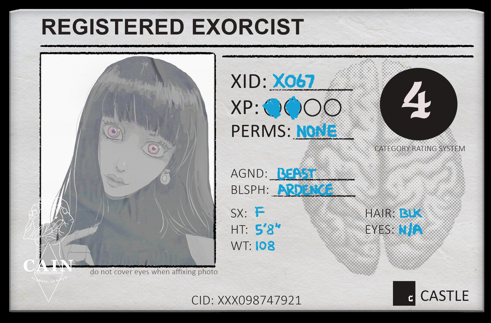

# Character Creation, Advances & XP Progression

> Source: CAIN 1.0 Rulebook (Pages 23)

---
### Page 23 Source Content

# **Making an Exorcist** 

You can share the answers to these questions with the group if you like. 

**Name** your exorcist now or later if you like and decide on a look for them. Write down your exorcist’s internal id number and fill out details. 

To make an exorcist, grab an **exorcist shee** t and a **piece of paper.** Answer the following questions, then write them on the paper and give them to the Admin (or via message, if playing digitally): 

Then, in order: 

   - **Set all your skills at 1.** Then, increase **two skills to 2,** and reduce **three skills to 0.** 

- How did you first manifest your **powers** ? 

   - Pick an **agenda** and **one ability** from that agenda. 

- Is your sin-seed in your **brain** or in your **heart** ? 

- What do you hide in the **deepest** parts of you? 

   - Pick a **blasphemy** and two **powers** from that blasphemy 

- **Is your hand your hand?** 

- **Do you remember the face of your mother?** 

**You’re done** and ready to embark on your first hunt. 

### **Survival** 

## Increasing in power 

If you **survive** enough missions, you qualify for an **advance in category rating.** You only needed to have participated in a mission and survived - the experience and training from fieldwork is usually enough to hone your powers. Each category rating requires a number of total missions survived. 

Your exorcist increases in power two ways: by gaining and spending experience, and by surviving missions. 

### **Experience** 

You earn experience at the **end of a session** by answering the checklist questions on your sheet. At the end of a session, exorcists gain experience. Go down the checklist and for every ‘yes’ answer, **gain 1 xp.** 

   - **Category 2:** 1 mission survived. 

   - **Category 3:** 2 total missions survived. 

   - **Category 4:** 4 total missions survived. 

   - **Category 5:** 7 total missions survived. 

- Did you **survive?** 

Increasing in category ups the general capabilities of your powers. 

- Did you **follow your first agenda item?** 

- Did you **follow at least one bolded agenda item?** 

- Did you follow **two or more bolded agenda items?** 

- Did you take an **injury** or **affliction?** 

When an exorcists’s experience bar is full (4 segments) they can empty it and cash it out for an **advance.** 

Some hunts may take more or less sessions - meaning exorcists may have more or less opportunities to earn experience during each hunt. 

### **Advances** 

Any time your experience bar is full (4 segments), you cash it out for an **advance** . You can bank these advances and spend an advance after a session in the following ways: 

- Gain a **new agenda ability** 

- Gain a **new blasphemy power** or a **new blasphemy.** 

- **Evolve a sin mark** and roll for a new ability for that sin mark. On duplicate, choose. 

- Gain **3 scrip** 

- **Improve a skill by 1** . You can do this six times, total, and have **only two skills at 3 maximum.** 

**44** 

**45**

#### Extracted Visual Elements (Page 23)

## Related Knowledge Nodes

- [[Exorcist_Overview_and_Skills]]
- [[Agendas]]
- [[The_Twelve_Blasphemies]]
- [[Character_and_Sin_Sheets]]
