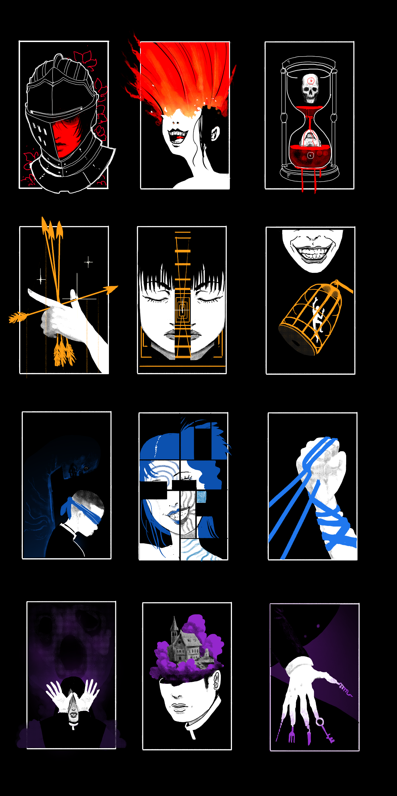
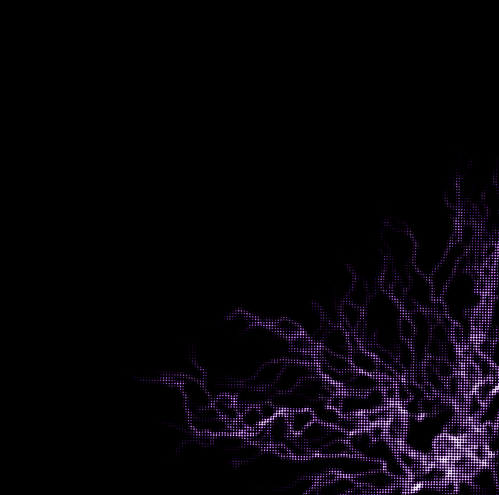
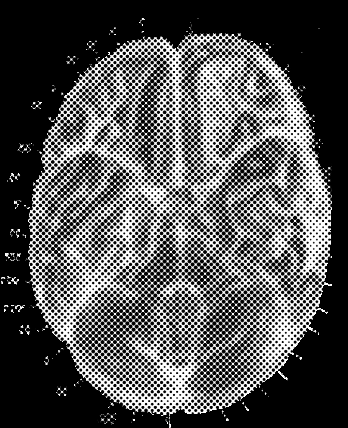

# Blasphemies System: Psyche, Psyche Burst, Blast & Tags

> Source: CAIN 1.0 Rulebook (Pages 14, 15, 27)

---
### Page 14 Source Content

## **AGENDA** 

Your **agenda** describes your character’s motivations, role in the group, and way they approach the world. It has a couple roles: 

- Your agenda allows you to **gain experience** . At the end of a session, you will check if you followed the regular agenda items or any **bolded** agenda items, which are harder to fulfill, then gain experience based on the answer. 

- Your agenda gives you a suite of **abilities** . You can gain more abilities from your agenda by spending experience 

- Your agenda may give you a few ways to regain resources 

Between missions you can actually **swap agendas** if you feel like a new agenda would fit your character. This could be due an experience within the mission, another character moment, or just because you feel like your current agenda isn’t fitting your character. 

- You can carry over abilities or **bolded** agenda items from your old agenda to your new agenda. 

- If you swap agendas again, you can keep carrying over abilities gained from any source, though you **can’t have more than five agenda abilities** at any given time, and must choose which to keep and which to discard. 

Your agenda **can also be modified mid hunt** , depending on mission parameters. The main way for this to happen is through fighting sins, which may add agenda items. The Admin is also free to write new agenda elements and offer them as rewards or for completing certain story beats. 

**Any modified or bolded part of your agenda travels with you** , even if you swap agendas in the future. 

## BLASPHEMIES 

Your **blasphemies** are the psychic phenomena that you have been blessed with (or cursed with, depending on your point of view). 

Blasphemy manifestation is spontaneous and follows no real pattern other than tending to appear in late adolescence, but the phenomena that manifest can be broadly classified into a number of types. They are extremely powerful supernatural abilities that allow their users to surpass human limits. 

These powers are created by a high concentration of **grace,** an unknown force that causes a sinseed, a tiny tumor like growth in the shape of a tiny angel or devil like figure to manifest in the brain (or rarely, the heart), theorized to be the source of these powers. 

### PSYCHE 

An exorcist’s general skill with their psychic powers is rated by the special PSYCHE skill. This is a special skill equal to half your total category, rounded up (so a CAT 4 exorcist would have 2 PSYCHE). It does not increase any other way, though you can still gain advantage dice on it through aid, setup, etc. 

Whenever you would do something that requires rolling with your blasphemies, you roll PSYCHE. This includes any creative use of your powers that are not included in the rules text. The Admin is free to adjudicate these uses as normal (deeming them hard, risky, impossible, effective or ineffective, etc). 

### PSYCHE BURST 

All exorcists have the following basic blasphemy: 

Using blasphemies builds up residual energy in your internal psychic sea, built of raw and powerful emotion. Without outlets, this energy will overflow and cause your power to grow wild. Fortunately, you are a trained exorcist and can control this power into a form called Psyche Burst. 

# BLAST 

Spend a psyche burst and roll PSYCHE to produce a weaponized form of concentrated psychic energy in melee or short range. The specific look and feel of this basic exorcist skill varies between exorcists. The strength of this blast scales with CAT. 

**Using any blasphemy power requires a psyche burst.** Some can spend multiple for extra benefit. 

- You can always spend a **psyche burst** to add +1 advantage die to any roll (yours or an ally’s) by using your blasphemies in a creative way. 

- You always start a mission with **three psyche bursts** 

When your exorcist produces a blast, they might: 

- You can recover them by resting during a hunt (see pg. 38) or through the uses of abilities. 

- Imbue a slash of a blade or a shot with a ranged weapon with psychic energy 

- Shoot an invisible ball of force from their fingers 

- Fire scathing lightning 

- Shoot a bead of ghostly, frigid fire. 

Unlike your mundane service weapons, blast is a supernatural weapon and therefore doesn’t become hard by default when used against sins. 

**26** 

**27**

#### Extracted Visual Elements (Page 14)

---
### Page 15 Source Content

## THE TWELVE BLASPHEMIES 

When you create an exorcist, you’ll **pick from one of the twelve blasphemies available** , pick two **powers** from that blasphemy and **decide how you first manifested your powers** . You can see a list of these on pg. 52. 

- Blasphemies all grant a **passive ability** and a number of other abilities that can be trained with experience. 

- When using your blasphemy to take action, you usually spend a **psyche burst** , then immediately gain the blasphemy’s effects. Sometimes you will roll and only spend a psyche burst on success, and sometimes you can spend multiple at once. 

- Blasphemies often grant you advantage dice 

Unlike your regular, human abilities, your blasphemy’s abilities also **scale up with your exorcist’s category,** allowing you to perform unbelievable feats of supernatural force. The specific way they scale up is listed in each blasphemy. 

### **Taking additional blasphemies** 

You start with one primary blasphemy, but can acquire extra blasphemies through training. Doing so is extremely stressful and manifests additional sinseeds, so it is closely monitored by CAIN. 

You can spend an **advance** to gain a new blasphemy instead of gaining a new blasphemy power. You gain that blasphemy’s **passive ability** , gain **one power** from it and can gain additional powers in that blasphemy moving forward. However: 

- reduce your cap for sin overflow by 1 per extra blasphemy taken. You do this by crossing out a sin box on your sheet 

### **Category and Blasphemies** 

Your exorcist is rated by **category** (1-5) and will improve in category rating by simply surviving missions. 

Category broadly represents your skill in both **dealing** and **avoiding harm** as well as increasing the **speed** , **reach,** and **scale** of your blasphemies. When comparing an exorcist to an opponent, use their category when generally measuring the strength of their powers. 

There’s broad examples of category scaling on pg. 18. 

# SIN 

An exorcist is a limited being. **The targets of their hunts are not** . An exorcist’s reserves of power are limited unless they take time to recover their strength - a luxury they may not have. 

There are ways to **push beyond your limits** . Doing so is not sanctioned by CAIN but is sometimes necessary during the course of a mission. 

Instead of spending a psyche burst, you can gain **1d3 sin.** This includes any use of psyche burst, such as spending psyche burst for +1D on rolls or using a psyche blast. If you’d spend multiple psyche bursts, roll all these d3s at the same time. 

**Exceeding 10 sin** at any point during a mission will put you into **sin overflow** - but only at the end of a scene. This means an exorcist can gain **limitless sin** and **tap an incredible source of power if they are already over 10.** 

Sin is **not reset per hun** t, but is instead **halved, rounding up,** after a mission is over (providing you survived). 

- Your xp cap for advances increases by +1 per extra blasphemy taken 

EVERY TOOL A WEAPON, EVERY WEAPON A PROMISE 

**28** 

**29**

#### Extracted Visual Elements (Page 15)

---
### Page 27 Source Content

# BLASPHEMIES 

Blasphemies are the psychic manifestations of a person’s inner turmoil, honed to a razor’s edge. Only those with **sinseed** s, blessed by **grace** , are capable of manifesting them. They draw on a wielder’s subconscious, the roiling emotional sea underneath the facade of humanity. Therefore, only those touched by darkness or turmoil are able to truly wield their full potential. 

When making your exorcist, **pick a blasphemy** , then **pick two powers** . 

Your blasphemy can be used in the following ways: 

- You gain a **passive** benefit from (most) blasphemies simply for having them 

- You can use your blasphemy creatively any time by activating a **psyche burst to give +1D on a rol** l, as long as your blasphemy power would help that roll. 

- You can spend a **psyche** burst to activate a specific **power** you have acquired from a blasphemy 

- Some powers require you to roll PSYCHE. You can also roll PYSCHE when you want to use a power in a creative way but are unsure of the outcome. Roll dice equal to half your CAT, rounded up (so 1 die for CAT 1/2, 2 for cat 3/4, and 3 for CAT 5). You can gain advantage dice on this like normal. 

- All powers have **tag** s that describe how they function. 

- Blasphemies sometimes specify that they can target humans, sins, or exorcists. Each are a different category. **Exorcists are not humans.** 

All exorcists start with the BLAST blasphemy. 

# BLAST 

Spend a psyche burst and roll PSYCHE to produce a weaponized form of concentrated psychic energy in melee or short range. The specific look and feel of this basic exorcist skill varies between exorcists. The strength of this blast scales with CAT. 

- When your exorcist produces a blast, they might: 

- Imbue a slash of a blade or a shot with a ranged weapon with psychic energy 

- Shoot an invisible ball of force from their fingers 

- Fire scathing lightning 

- Shoot a bead of ghostly, frigid fire. 

Unlike your mundane service weapons, blast is a supernatural weapon and therefore doesn’t become hard by default when used against sins. 

### **The Twelve** 

Blasphemies have been categorized into twelve typical types by TEMERITY researchers. The look and feel of each blasphemy might vary widely between user. A flux user (one that manipulates time), might use simple motions hands to perform their rituals, or might rely on a physical implement like a knife or an hourglass. 

The blasphemies are the following: 

- **I. Tension:** Project powerful fields of force to block, cut, or entrap. 

- **II. Ardence** : Manipulate potential energy into furious destruction 

**III. Flux:** Tap into the ebb and flow of time. 

**V. Gate:** Manipulate space as a sculptor works with clay 

**VI. Smother** : Suppress innate properties of things, like friction, sound, or light. 

**VII. Whisper:** Your shadow talks to you. It knows the future. 

**VIII. Edit:** Change yourself , the world, or others by pulling from different possible realities 

**IX. Bind:** Bind weak sins to your service and use them as servants or weapons. 

**X. Jaunt:** Separate body and soul, perception and flesh 

**XI. Palace** : The contents of your mind are a tangible place you can visit 

**XII. Sympathy:** Pull on the innate connections to human tools or objects 

## **Tags** 

**Duration tags** describe how long a power lasts before its effects expire. 

- **Instant:** Lasts only a few moments, then expires 

- **Until rest** : Lasts until rest 

- **1 scene:** Lasts until the scene passes. 

- **All mission:** Lasts all hunt 

Powers can always be **willingly dismissed** unless specified otherwise. 

**Range tags** describe how close a target must be for the power to be effective. This is a narrative range, so the tags are kept loose for a reason. 

- **Self:** Yourself 

- **Adjacent:** Right next to you 

- **Short:** Across the street 

- **Long:** A few blocks away 

- **Extreme:** Half a mile away or more 

**Effect type tag** s describe advanced effect or powers you can create with a blasphemy. Effects with the same tag **do not stack** with each other - the most recently used power replaces the last one. Not all powers have effect tags. 

- **Curse:** A power affecting another person, usually negatively 

- **Charm:** A power affecting yourself or another person, usually positively 

- **Transmute:** An effect that affects or alters the physical world in some way 

- **Summon:** An effect that creates a psychic construction or entity 

## **Advancing blasphemies** 

You may spend an **advance** to gain an extra power inside your own blasphemies. 

You can take additional blasphemies outside of the first one chosen. Each one reduces your cap for sin overflow by 1 and increases your xp advancement cap by +1. 

You can only have **five powers** from any blasphemies at once, in any combination. You can replace a power when taking a new one. 

### **CATEGORY** 

Blasphemies advance in CAT with your exorcist. Effects that draw on CAT therefore scale up with your exorcist - only those effects listed. You can find a list of Category effects on page 18. 

**IV. Vector:** Imbue anything you touch with a strong burst of velocity. 

**52** 

**53**

#### Extracted Visual Elements (Page 27)

## Related Knowledge Nodes

- [[Category_and_Mundane_vs_Supernatural]]
- [[Divine_Agony_and_Talismans]]
- [[02_Tension]]
- [[03_Ardence]]
