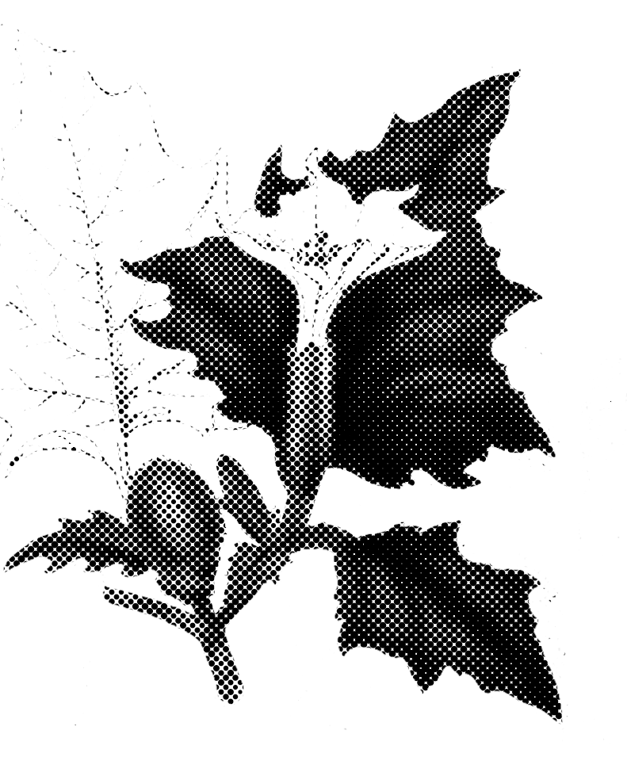
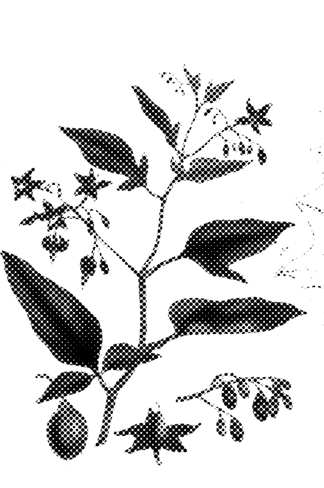
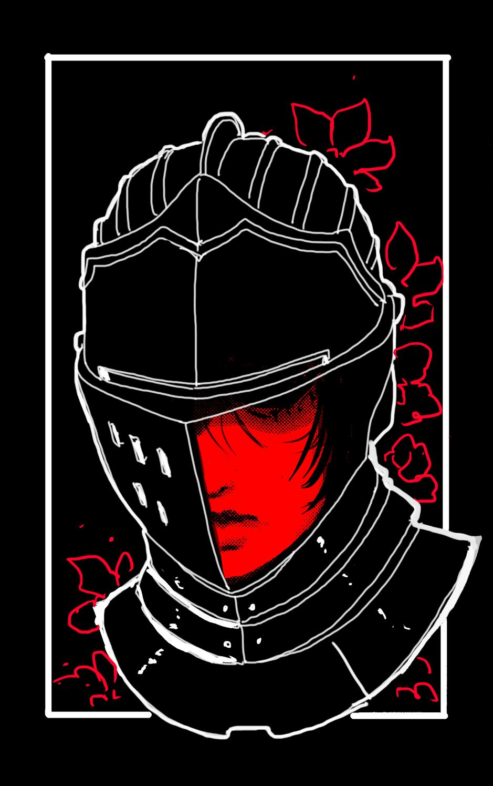
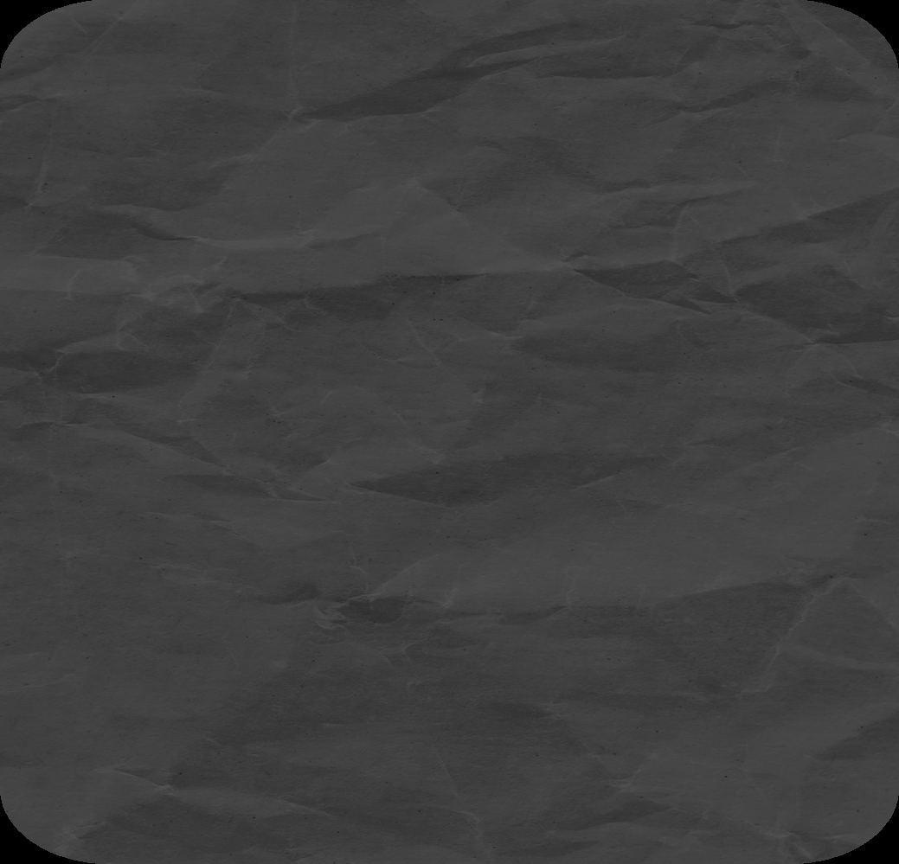
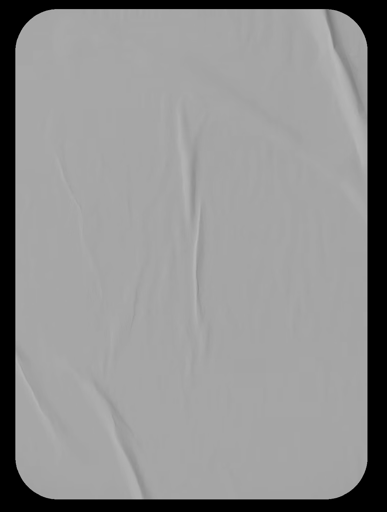
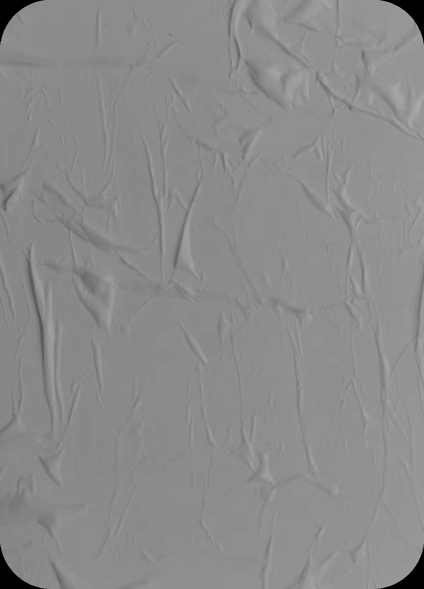
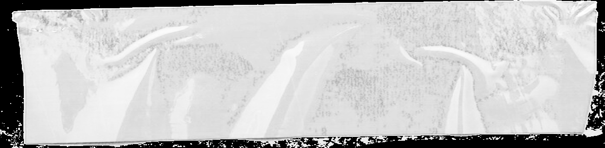
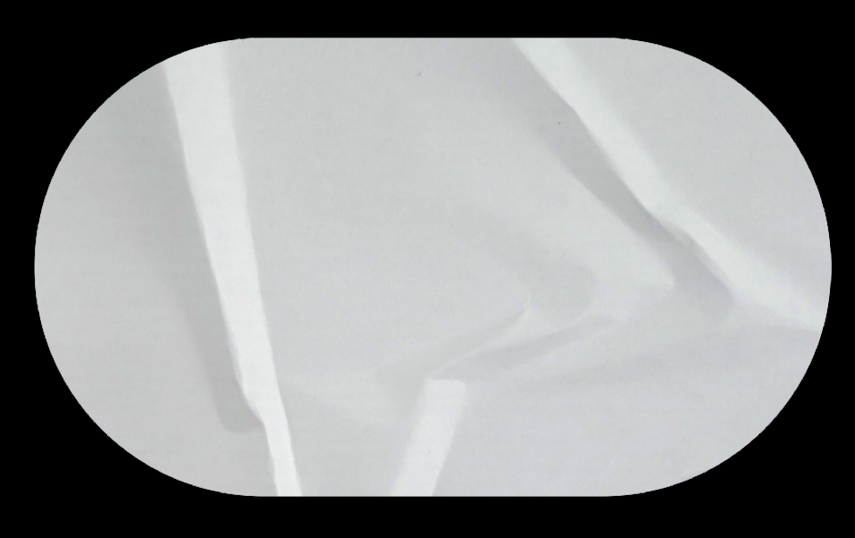
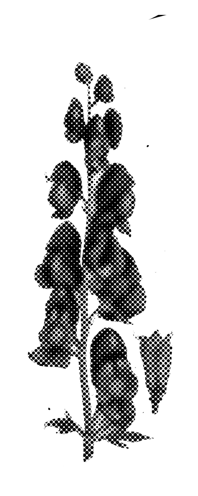

# Blasphemy 01: Tension (Wires, Cords & Kinetic Pull)

> Source: CAIN 1.0 Rulebook (Pages 28)

---
### Page 28 Source Content

## AEGIS 

_Instant, Short_ 

**Once a scene** , when you or a visible ally in short range of you would mark stress from external harm, you can intervene by answering the following questions: 

- Can you reach your target in time? 

- Is there any part of the environment you can use to shield your target? 

- Is your heart in this? 

You create a flash tension force of incredible strength, blocking damage. For each ‘yes’ answer, roll 1d6. For every 2+ rolled reduce stress sufered by 1, and for every 6 rolled f reduce it by 2. This could reduce stress sufered f to 0. 

If you or an ally gain an injury in the same scene, regain the use of this power. 

# TENSION 

_Project a spot psychic field of incredible density and durability. This often takes the form of a metallic shimmering surface, visible only to the psychically sensitive._ 

**Fact:** Tension users are highly likely to experience ‘locked in’ syndrome episodes at least semi-regularly until they are able to master their powers. See field manual. 

### IRON SOUL 

**Passive:** When you would lose your last point of stress, roll 1d6. On a 4+, you don’t lose any stress and instead remain at 1 stress. 

## STASIS 

_Curse, 1 scene, Adjacent_ 

With a touch, you can lock yourself, a human, or a willing ally in a tension cage that covers them like a second skin, paralyzing them. If a human is hostile or unwilling, roll **PSYCHE** , and only spend the burst on success. 

Once trapped, your target is locked in, unable to move or act for the scene, and is immune to all harm and efects from the outside. The ef f ect only f ends once the scene passes and you cannot end it earlier. They can be moved around normally like an object. 

## MALLEATE 

## SEVERANCE 

_Transmute, Until rest, Adjacent_ 

_Instant, Short_ 

You can invert and infuse a tension field to make an area of nonliving matter incredibly pliable and soft. The size of this block of matter you can afect is af f ected by CAT. Choose one of the f following efects, then you may gain or grant +1D f when you or any ally next acts to take advantage of this power: 

You can project a tension force of incredible strength over any edge, as obvious as a blade and as subtle as a fingernail, and use it as a cutting implement. Rol **l PSYCHE** to cut an object or opponent up to CAT size with a clean and decisive blow, only spending a psyche burst on success. 

   - **Rubber** : The matter becomes bouncy and springy 

- Gain +1D if you are striking to protect another person 

   - **Mud:** The matter melts into a thick mud. It becomes pliable and sticky and difficult to move through 

- Gain +1D against immobile objects or opponents 

- **Liquid:** The matter melts into liquid 

This power may easily efect the parameters of f rolls, such as dif f iculty and risk. When the efect f expires, the matter slowly reverts to its original state and form. 

## FORTRESS 

_Summon, Until rest, Short_ 

**Once a scene** , you can create a spot tension field with a size determined by CAT that appears as a large plane of shimmering force, invisible to humans. It can only exist as a flat plane (no bends or curves), and intersect or overlap any nonliving material, but otherwise is as hard as a solid object and prevents all living and nonliving matter and energy from crossing it. It has a **3 talisman** for its durability, which can take damage and be ticked up like an execution talisman by opponents. The field lasts until used again or until rest. 

**54** 

**55**

#### Extracted Visual Elements (Page 28)

## Related Knowledge Nodes

- [[01_Blasphemies_System]]
- [[Conflict_Scenes]]
