# Blasphemy 02: Ardence (Psychic Fire & Solar Pyre)

> Source: CAIN 1.0 Rulebook (Pages 29)

---
### Page 29 Source Content

## FURY 

# ARDENCE 

_Manipulate potential energy to create flashes of extreme heat or cold. The most potent, and most dangerous of blasphemies - to others and its user._ 

Fact: Ardence use would be considered inhumane against human soldiers. 

### INNER FURNACE 

**Passive:** You can take an Unstable Power hook as part of using any Ardence power to increase the CAT of the power up to +2. When the hook fills up, you burn up from the inside, gaining an injury and ending the hook. If this injury would kill you, you explode in an area equal to your CAT, annihilating yourself and everything inside in a massive explosion. Nothing can survive this. 

## VOID 

## HELL 

## SABRE 

_Transmute, Adjacent, Until Rest_ 

#### _Instant, CAT range_ 

You may dump energy into the ground and anything touching the ground in an area determined by CAT+2, choosing hot or cold. Choose one of the following effects, which lasts until you rest. You may gain or grant +1D when you or any ally next acts to take advantage of this power: 

Release a blast of energy in a highly destructive beam. The beam goes in a straight line a range equal to CAT, piercing through walls, doors, and obstructions effortlessly. It is extremely loud and bright. Roll **PSYCHE** for its effects, only spending a psyche burst on success. 

- **Simmer:** Discomfort for humans, lowered or raised temperature, hot or cold surfaces, etc. 

The very first time you use this power in a mission, it gains +1D for every tick on the pressure clock (it still cannot exceed +3 advantage die). For every ‘6’ result you roll, this ability inflicts 1 extra slash on a talisman, but you also take 1 stress, which could kill you or cause you an injury. This stress cannot be reduced or ignored in any way. 

- **Poach** : Major discomfort for humans, who cannot remain in the area, and discomfort for sins and exorcists. Freeze or boil water, pipes, crack glass, etc. 

- **Boil:** Deadly to humans, sins and exorcists take 2 stress if they remain in the area for longer than a scene. Light fires or freeze the air in rooms, melt windows or burn doors, or freeze objects. 

This power may effect the parameters of rolls, such as difficulty and risk. 

## STORM 

_Instant, Short_ 

_Instant, Long_ 

You can create a fierce blast of destructive energy at a location in range with a blast area up to CAT. When you use this power, roll **PSYCHE** and answer the following questions, gaining +1D for each ‘yes’ answer, only spending a Psyche Burst on success. 

- Are you willing to cause indiscriminate harm, not caring what you destroy, burn, or incinerate? 

- Are you willing to let your anger control the outcome? 

Whatever question you answer ‘yes’ on, it affects the outcome of the action - no matter the roll. 

You create a flash vacuum by burning the air away. The void creates a loud thunderclap, affecting an area up to CAT. It affects everyone in the area except you. Choose one of the following effects, then you may gain or grant +1D when you or any ally next acts to take advantage of this power: 

- **Weak** : Sucks in loose objects not held, worn, or bolted down. 

- **Medium** : All humans and exorcists in the area are thrown off their feet and pulled in, excluding you. 

- **Strong** : Sins and vehicles up to CAT size are thrown off balance or pulled depending on their size. Glass is shattered. The thunderclap is momentarily deafening. 

This power may effect the parameters of rolls, such as difficulty and risk. 

_Transmute, Extreme, Whole Mission_ 

You can spend **any number of psyche bursts** to send potential energy into the atmosphere, afecting the a microclimate in an f area equal to CAT+2, with a maximum of CAT 7. Choose one of the below, plus one more per psyche burst spent. The chosen efects last for the whole mission or until dismissed. You may f gain or grant +1D when you or any ally next acts to take advantage of this power: 

- **Clear:** Clear the skies in the area, canceling any weather (including the below). 

- **Rain** : Rain drenches the area for the duration of an intensity you choose (drizzle, pouring, torrential). 

- **Cold** : The air freezes, freezing water and icing over roads and paths. Any precipitation becomes snow. 

- **Fog** : Thick fog rolls in, limiting visibility. 

- **Gale** : Whipping wind rolls through the area, blowing away fog, smoke, or dust, and making it hard to hear or be outside. 

This power may easily effect the parameters of rolls, such as difficulty and risk. 

**56** 

**57**

#### Extracted Visual Elements (Page 29)

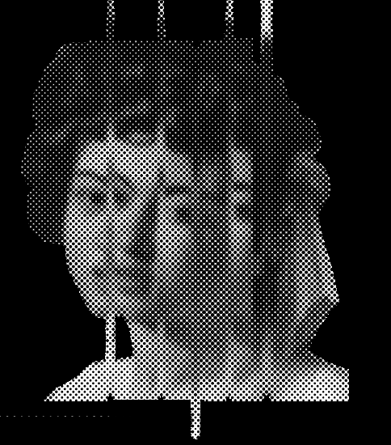
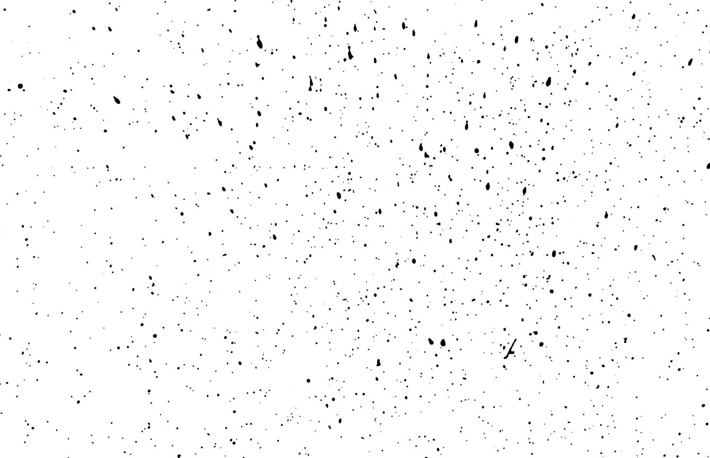
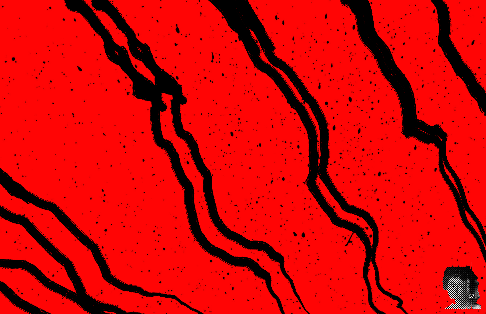
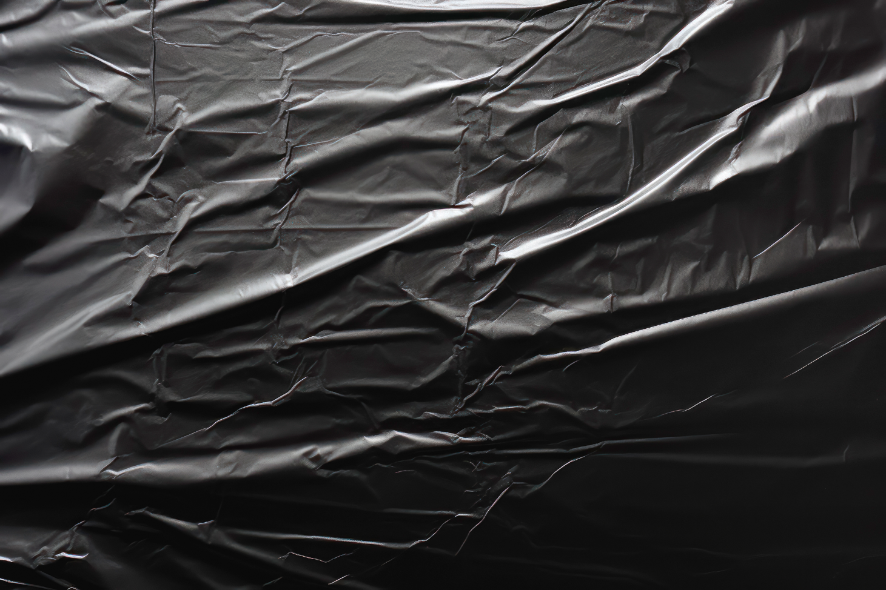
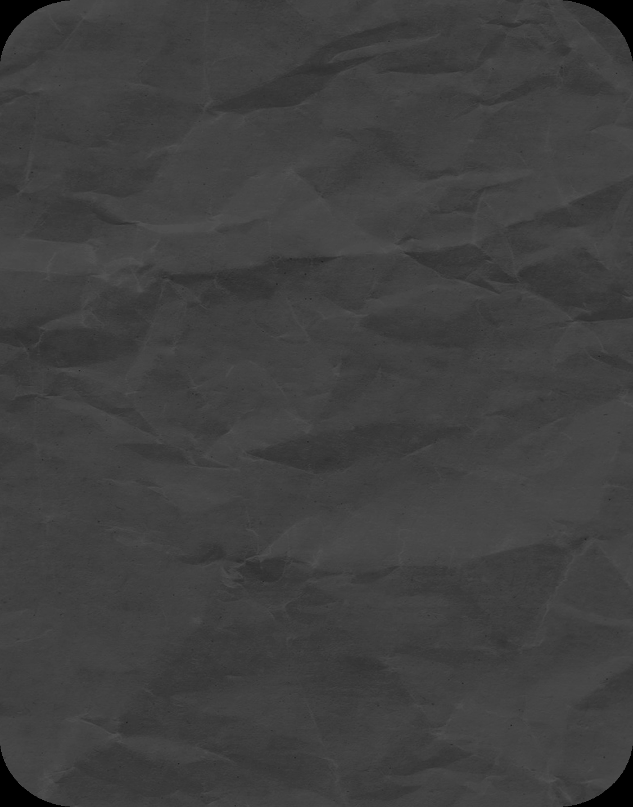
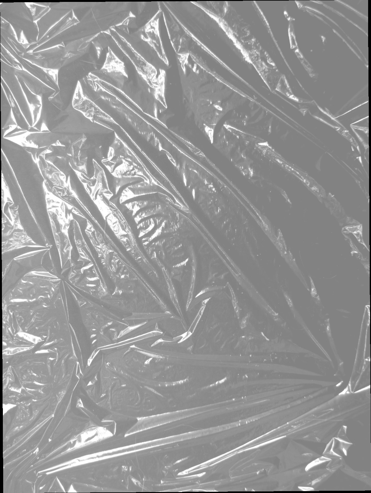
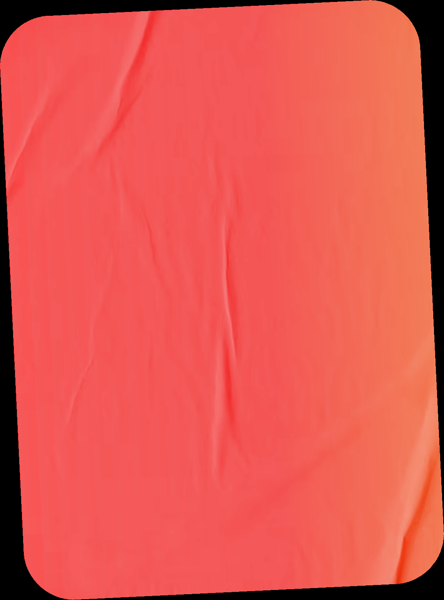
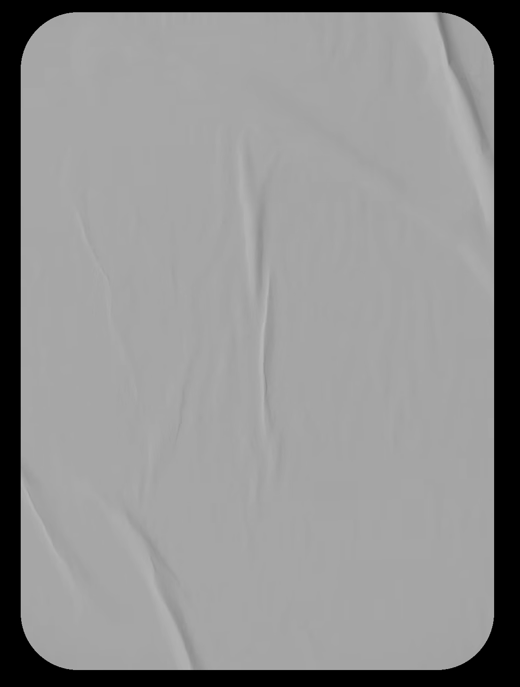
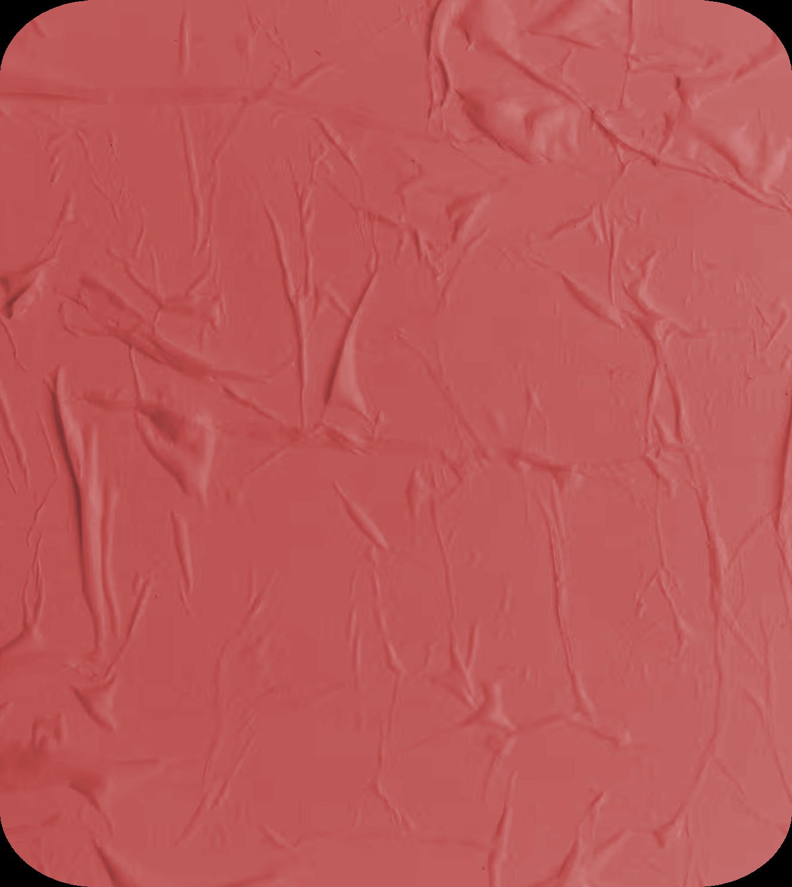
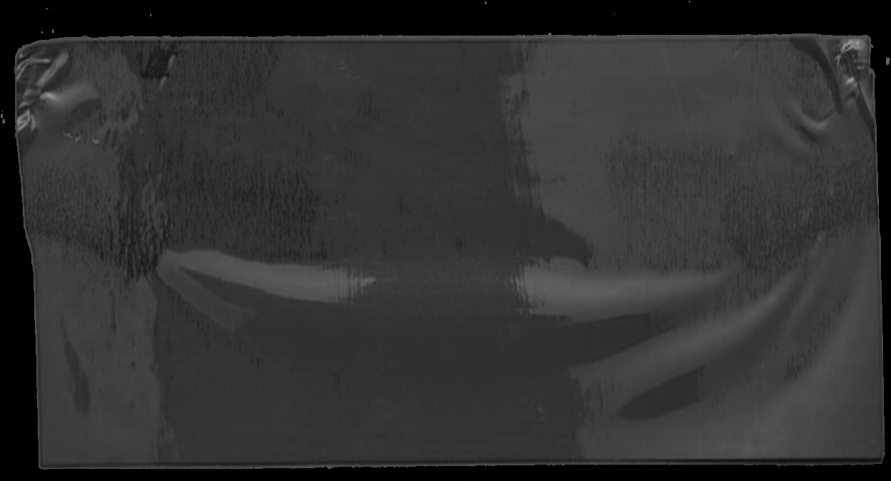
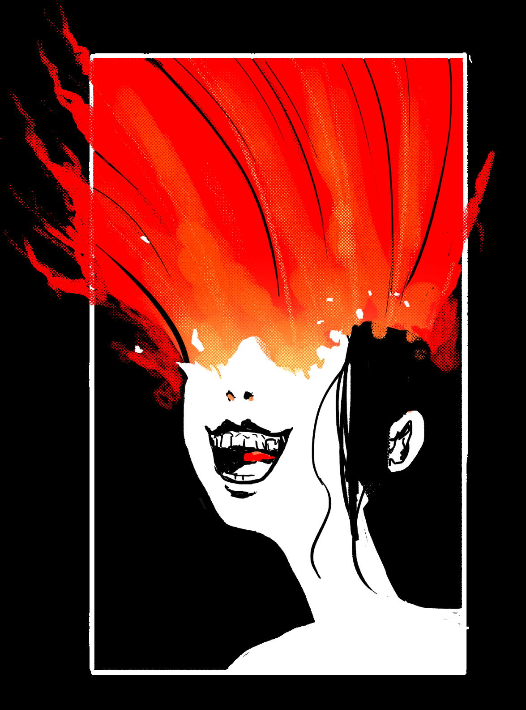

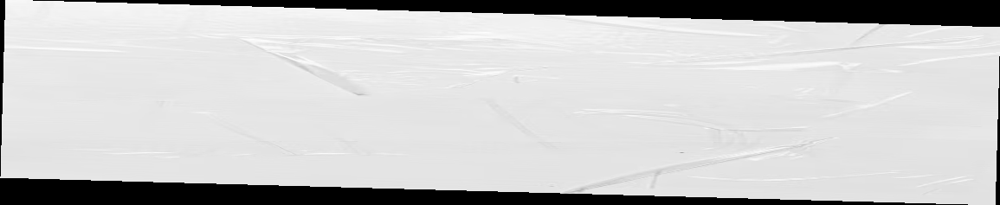

## Related Knowledge Nodes

- [[01_Blasphemies_System]]
- [[Conflict_Scenes]]
