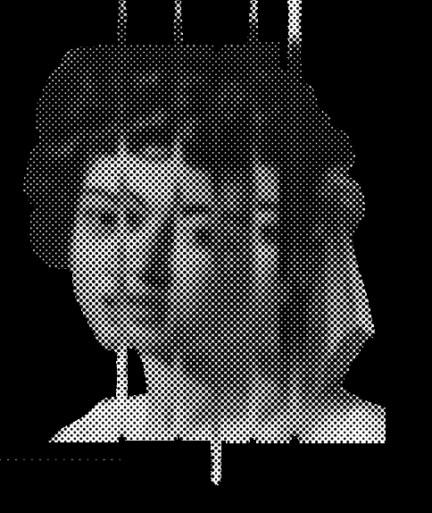
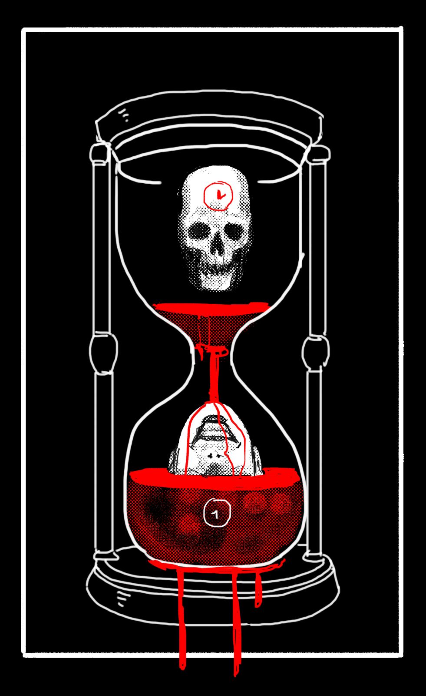
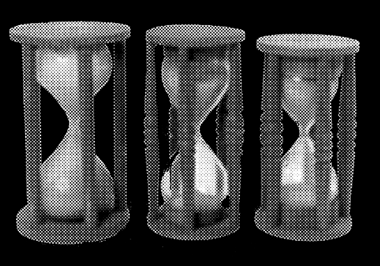
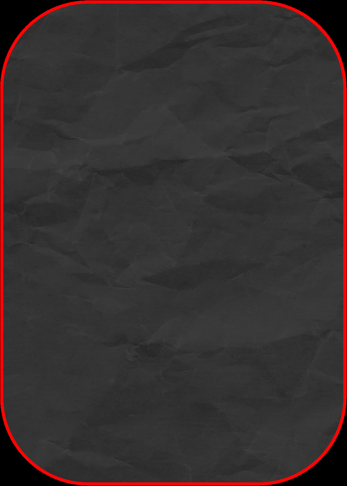
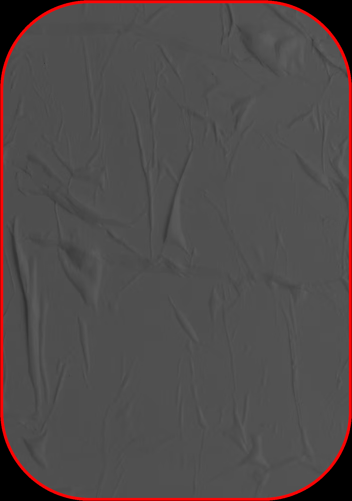
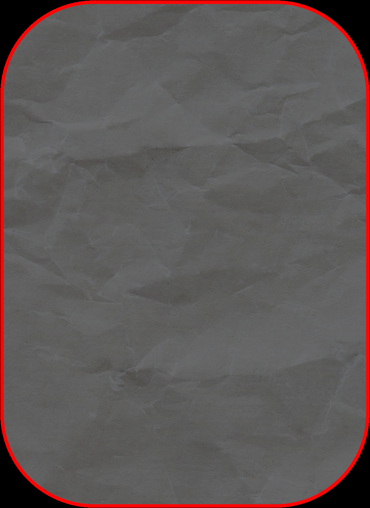
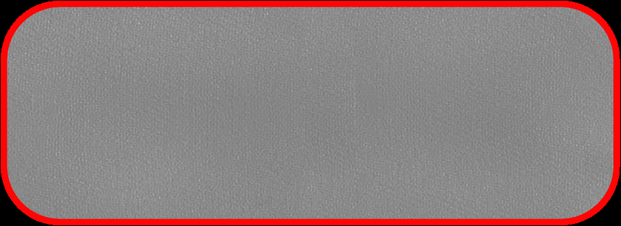
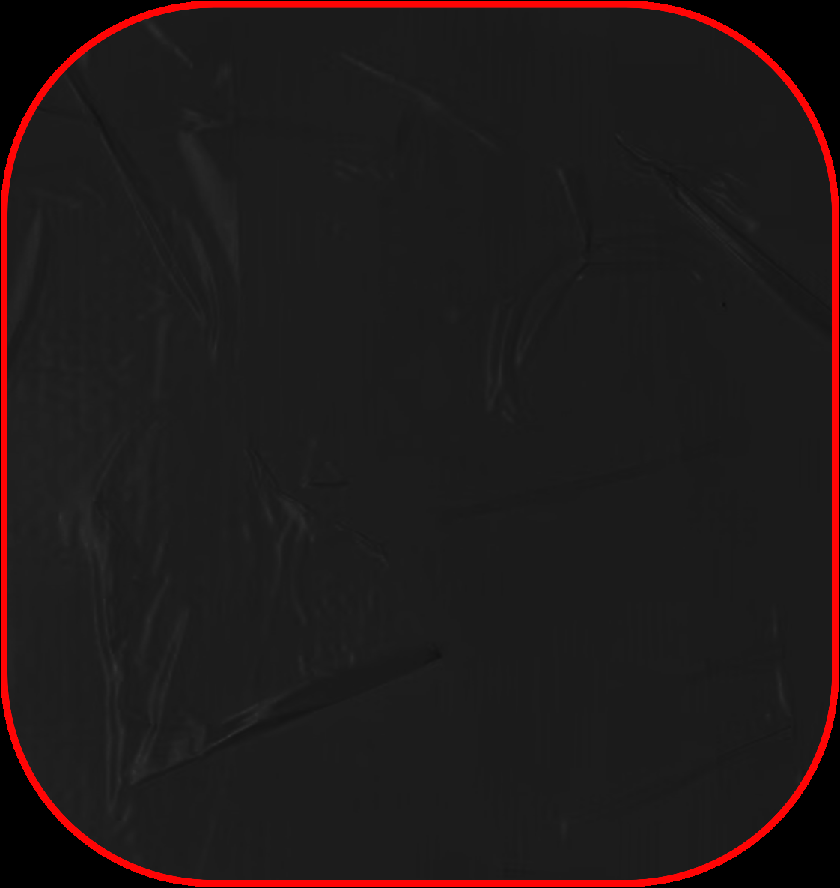

# Blasphemy 03: Flux (Liquefaction & Blood Transmutation)

> Source: CAIN 1.0 Rulebook (Pages 30)

---
### Page 30 Source Content

**Temporal Instability** : Many of your powers give you this hook. When you gain this hook, roll 1d6. On a 1, also slash the hook out once. When the hook resolves, roll 1d6: 

1. Permanently add to your agenda ‘Prove that you are the real you.” If you gain this result again, you immediately suffer sin overflow. 

2. Mysterious injuries open up. You go unconscious from pain, putting you out of the current scene, and take an injury. 

3. You disappear until rest. You return if there’s a conflict scene. You have no memory of where you were. When you return, you take 2 stress. 

4. You find you are wearing someone else’s clothes. Erase your entire kit this mission, but regain any spent kit points. 

5. Your body is different. For the remainder of this mission, pick a skill you have 1 or more dice in. It now rolls 0d. After the mission, you have time to train and get used to this, reverting this effect, though keeping any physical changes. 

6. Your face looks a little different. The changes are permanent. 

# FLUX 

_Manipulate the direction and flow of time itself._ 

Fact: This power is relatively new and, as it stands, is barely understood. Fortunately temporal events are tightly regulated by TEMERITY through a captive Sin called the Spindle. 

### STEAL TIME 

**Passive:** Once a mission, you can reroll all your resting dice for yourself or an ally, taking the second result as final. 

## REVERSAL 

_Adjacent, Instant_ 

By touching an object up to CAT size, you can reverse its passage through time for the last hour. 

- This could physically move the object, revert damage on an object, etc. 

- It can still affect the physical world, so anything in a reversing object’s way would get hit, and anything placed on it will move with it. 

- If it would cause damage or impact, roll PSYCHE for it 

- It cannot reverse life on non-living matter, such as corpses, but can move them and revert damage. 

You can stop this effect by willing it, but to resume it requires using this power again. 

## STOP 

#### _Transmute, Instant, Self_ 

You spend **up to three psyche bursts** to stop local time in an area around you equal to CAT. Roll 1d6 per psyche burst spent and add them together - that is how many seconds you have. Anything that enters this area is immediately affected (including anything put into or out of the area), but time flows normally outside the area. In this stopped time, you are unaffected and: 

- you cannot use psychic powers, but neither can you be affected by them. Any power currently active from you or affecting you other than this one dissipates. 

- you can perform one activity or course of action that fits in the duration. After you would make an action roll for anything, the effect ends no matter what. 

**Then, gain temporal instability.** 

## SCHISM 

_Transmute, Instant, 1 scene_ 

You can create a bubble of altered time equal to CAT area. Inside the bubble, you open a window into one day in the past or future from the moment the bubble was created. Gain or grant +1D when you or any ally next acts to take advantage of this power: 

- The state of the area inside the bubble is confined only to the bubble and includes objects or people inside. You and allies can enter or exit the bubble at will. 

- Supernatural beings, including exorcists, in the present timeline caught in the bubble when it is created are unaffected. Humans and the ‘present’ timeline world caught in the bubble  are ‘paused’, cease existing for its duration, and have no memory of the incident. 

- Things removed from the bubble from the past or future timeline, including living beings, simply disappear until they move back into the bubble. 

The bubble represents an ‘alternate’ timeline, so anything altered inside of it will not show up in the present or future timeline (ie leaving an object in a past timeline will not have it show up in the present). 

## QUICKENING 

Instant, Adjacent 

You can accelerate the natural healing of your body or those of others, giving you the following benefits: 

- Immediately heal 1d3 stress on yourself or another target 

- You may heal another dying human or exorcist on the brink of death. Injured humans are stabilized and no longer in danger of expiring and exorcists are brought off the brink of death until they take stress again, even if they have three injuries. 

#### **Then, gain temporal instability** 

## STUTTER 

_Instant, Short_ 

You can briefly reverse time in order to alter causality for any event that happened as a result of an action roll made by you or an ally, instantly after you see the result. Re-roll the action roll completely, taking the second result as final. 

When you use this power, **gain temporal instability** . If you use it again in the same scene, **gain 1d3 temporal instability instead.** 

**58** 

**59**

#### Extracted Visual Elements (Page 30)

## Related Knowledge Nodes

- [[01_Blasphemies_System]]
- [[Conflict_Scenes]]
