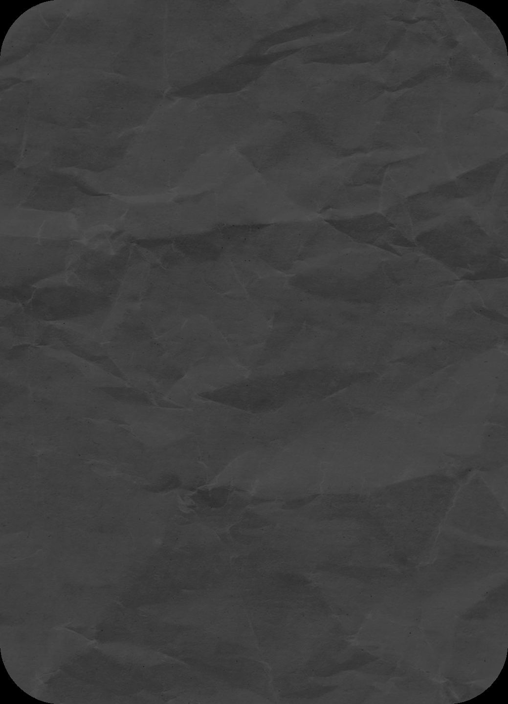
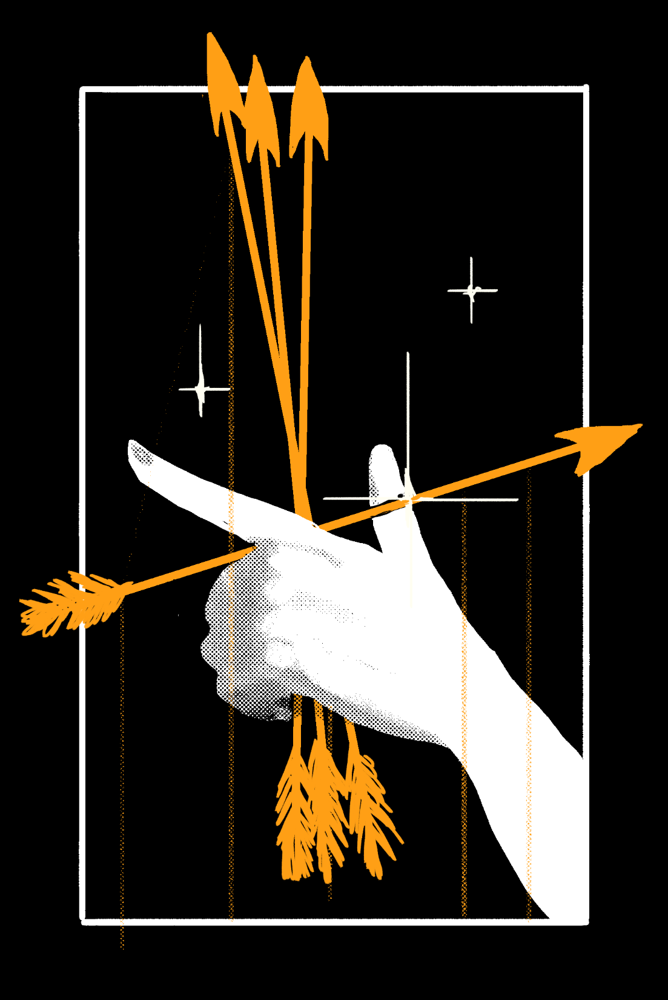
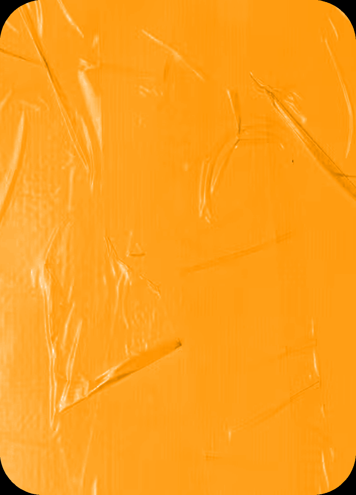
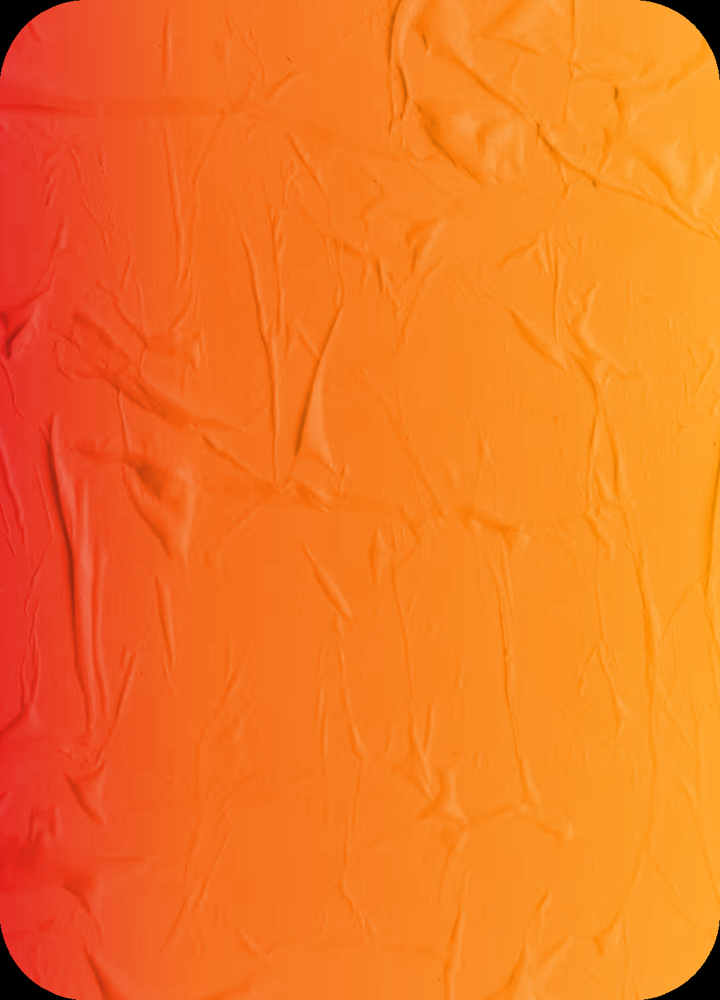
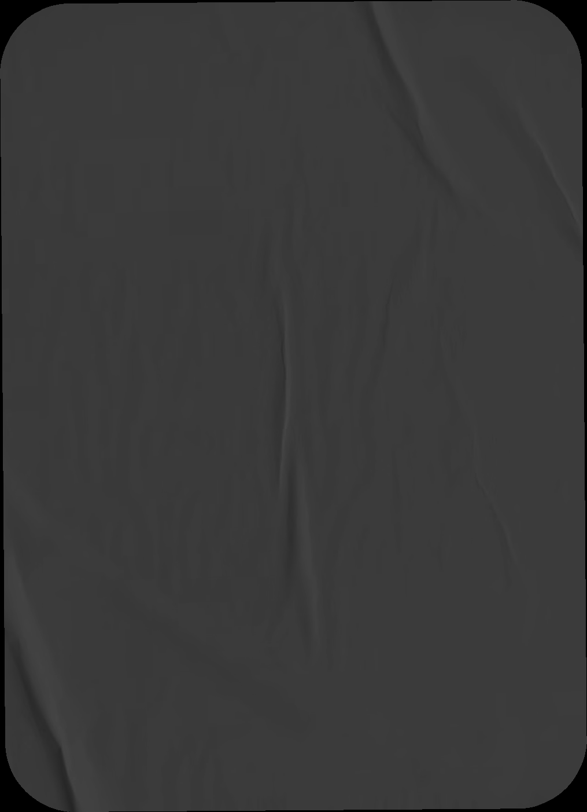
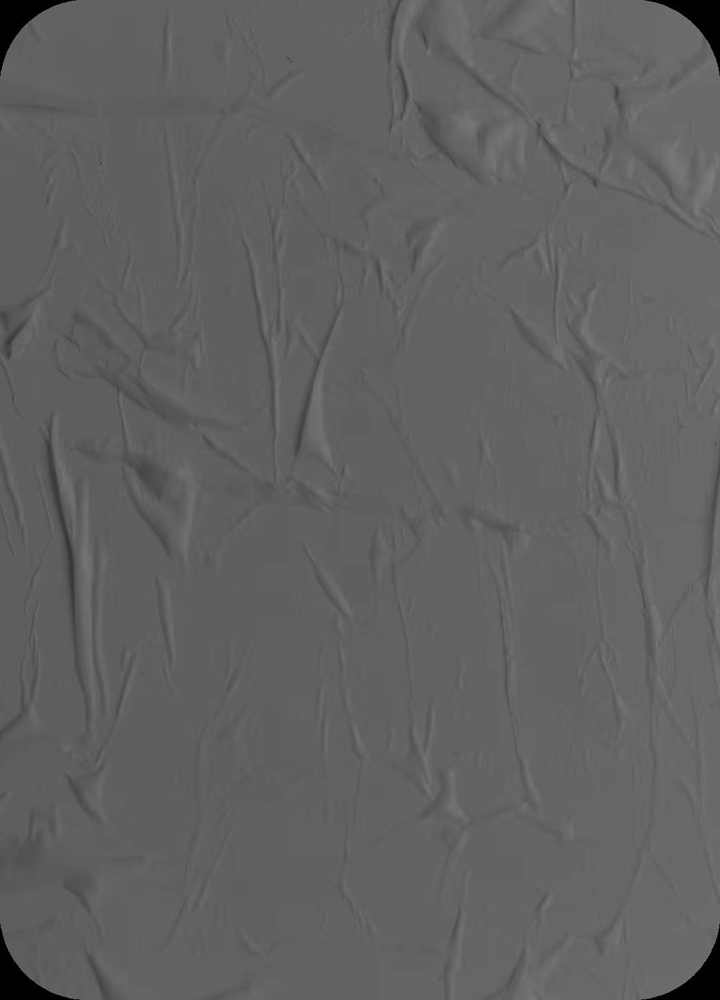
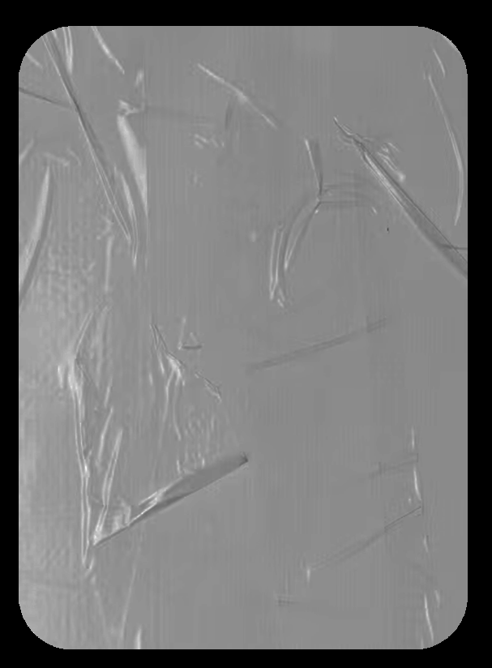
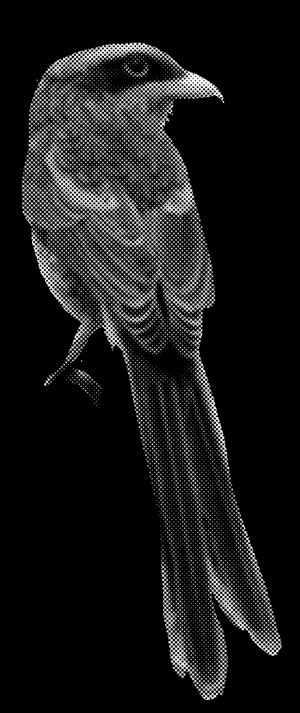

# Blasphemy 04: Vector (Directional Force & Acceleration)

> Source: CAIN 1.0 Rulebook (Pages 31)

---
### Page 31 Source Content

## FLING 

_Adjacent, Instant_ 

With a touch, you can imbue velocity into yourself or another object or living being and send it flying. The combined size of the object or being and the range you send them must equal your CAT+1 or less. Once sent flying, the direction of your target cannot be changed. Roll PSYCHE for its efects, including any harm f inflicted, and only spend a psyche burst on at least one success. 

# VECTOR 

_Imbue objects or living beings with sudden and sharp burst of velocity._ 

## BRAKE 

**Passive:** Automatically remove velocity from all projectiles that would hit you, taking -1 stress from them. 

## LIFT 

_Charm, Self, 1 scene_ 

You reverse gravity’s effect on yourself with a low but constant Vector effect. For this scene, you gain the following benefits: 

- you can run, walk, or climb up vertical surfaces. 

- you can slow your fall at will, and you cannot take harm from falling 

- you can glide a distance equal to CAT range. you must start at height to gain this benefit 

This power may easily effect the parameters of rolls, such as difficulty and risk. 

## CURRENT 

## BULLET 

_Transmute, Until rest, CAT range_ 

_Instant, CAT+1 range_ 

You create a weaker, but persistent Vector force in an area that lasts until you rest. It creates a line that goes about CAT range in length and covers about the width of a street. It pushes constantly in one direction (including up or down) like a strong wind. Allies moving in that direction gain +1D on actions to move with the current. Anything moving against that direction struggles. It becomes hard for allies, and actions taken against anyone trying to struggle against the current gain +1D. You can dismiss this efect f at will. 

You can imbue strong bursts of velocity into the air at your fingertips, creating pressurized air bullets that hit with extreme force. Roll PSYCHE for its effects, only spending a psyche burst on success. 

- Gain +1D when making shots from a elevated position 

- Gain +1D when making shots to disarm, distract, or disable 

## FINESSE 

_Instant, CAT range_ 

You may use this power to finely manipulate threads of force to perform fine motor skills you could perform with your hands at CAT range, such as opening doors, picking up objects, or even skills like typing on a keyboard, etc. Roll PSYCHE for this, only spending a psyche burst on success, and gain +1D on the action. 

- You have to be able to see your target, even if it’s far away. However, you can perform this manipulation even if your path to the target is blocked, such as if you could see it through a window, etc. 

- You can pick up objects and move them around through the air but they cannot be any bigger or heavier than a laptop or a full briefcase. 

**60** 

**61**

#### Extracted Visual Elements (Page 31)

## Related Knowledge Nodes

- [[01_Blasphemies_System]]
- [[Conflict_Scenes]]
