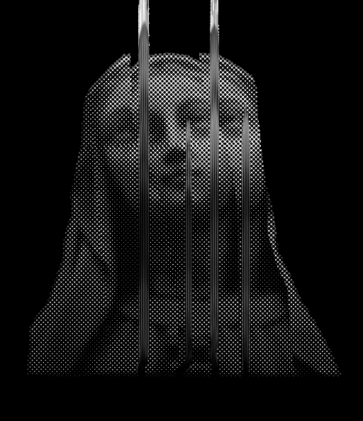
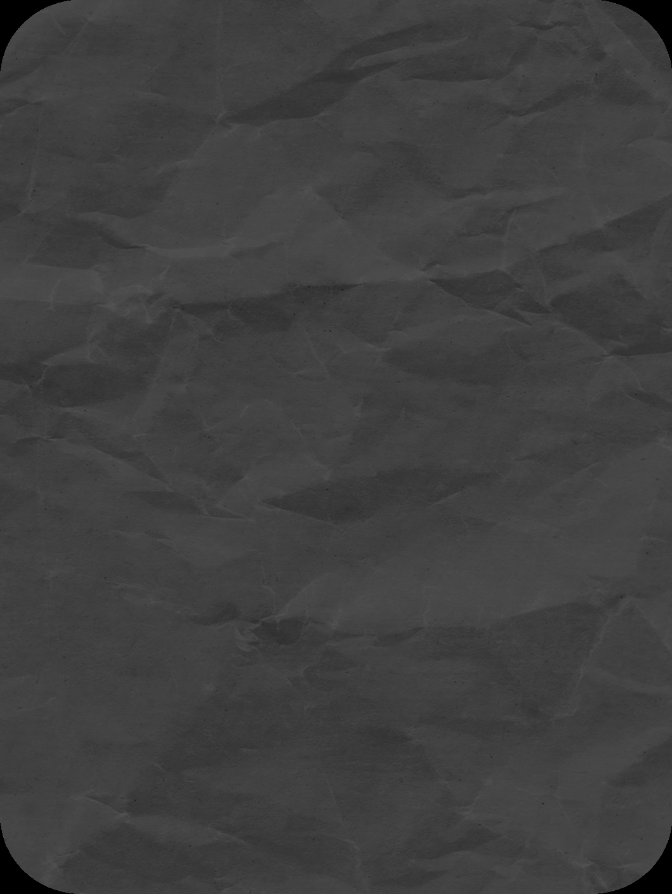
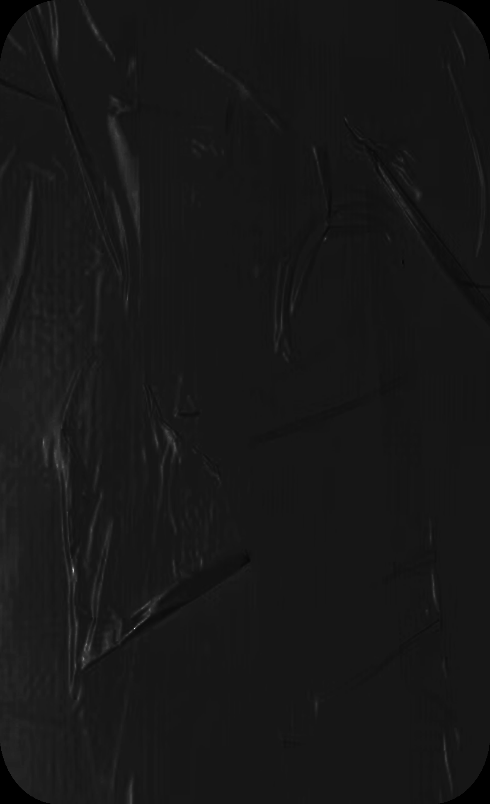
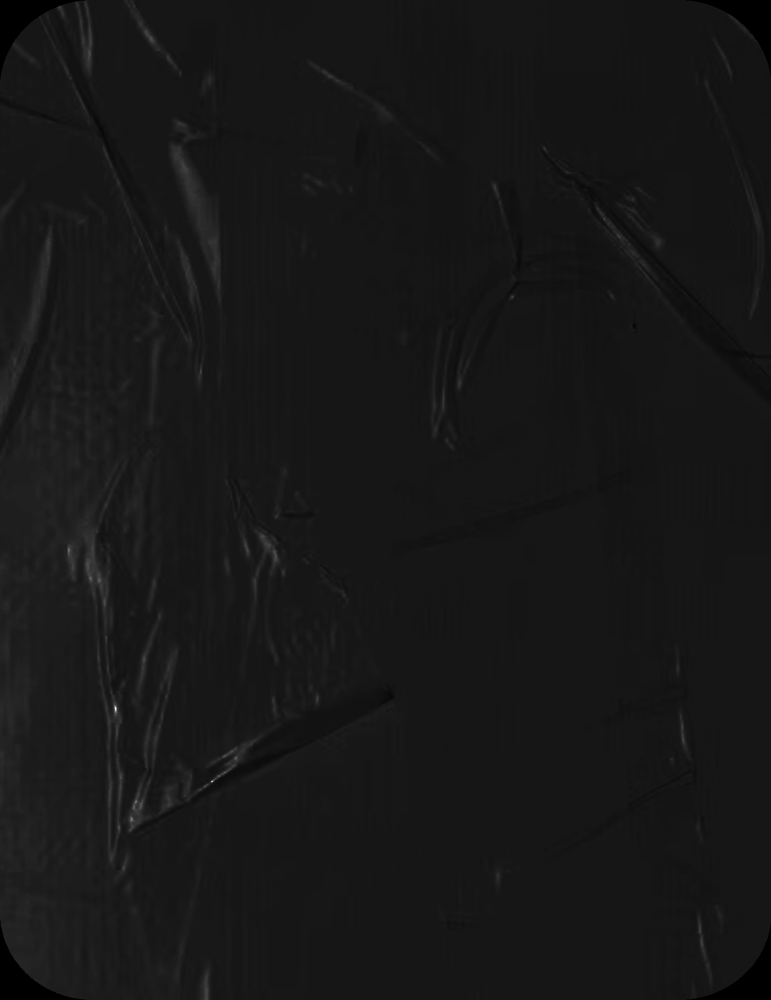
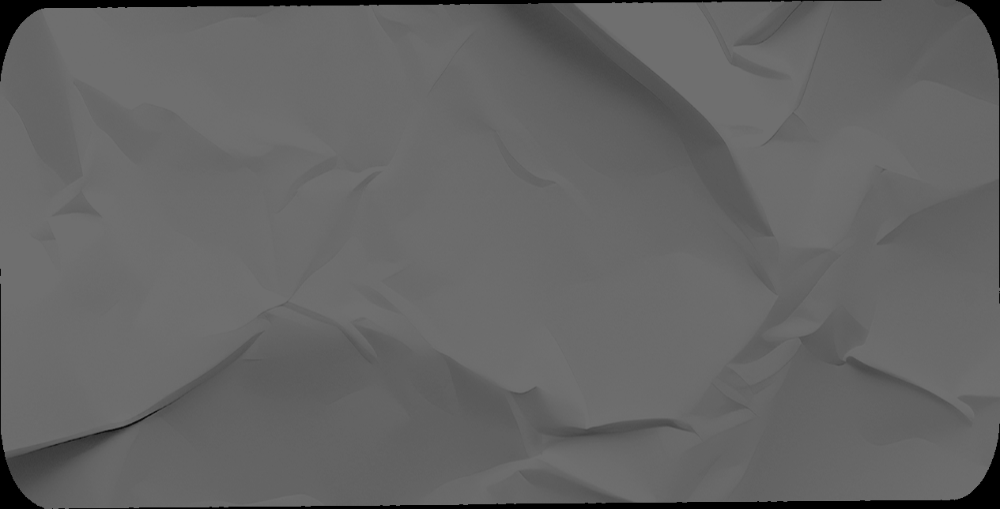
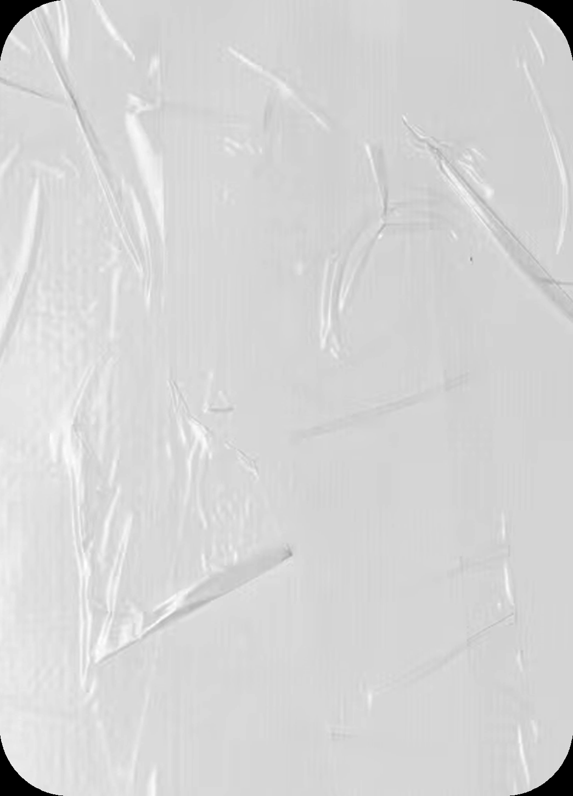
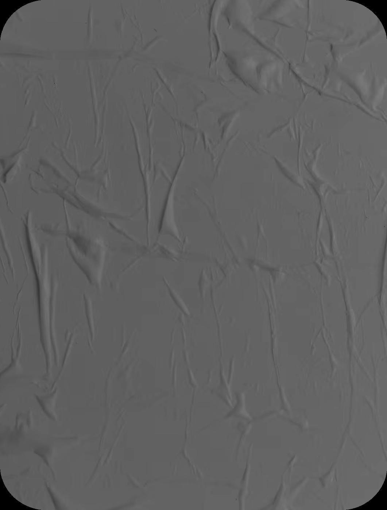
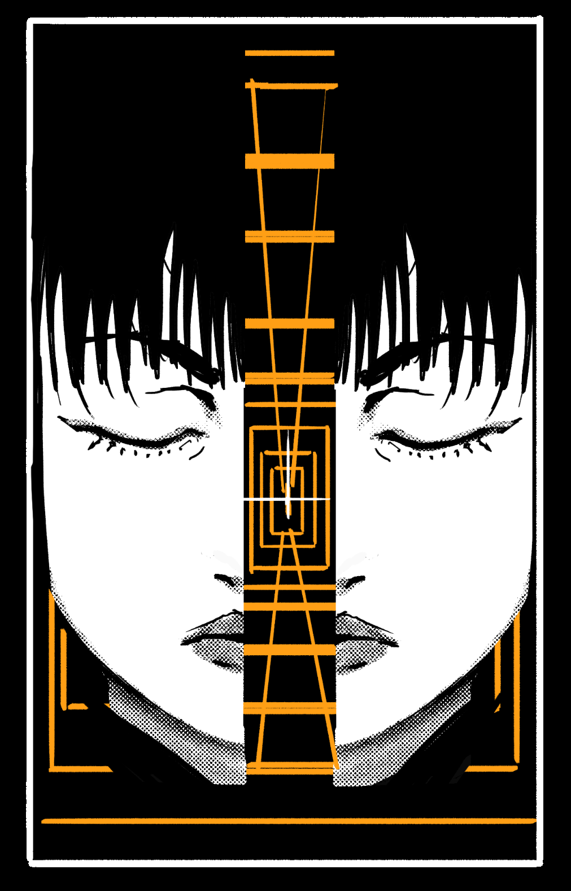

# Blasphemy 05: Gate (Spatial Rifts & Portal Punctures)

> Source: CAIN 1.0 Rulebook (Pages 32)

---
### Page 32 Source Content

## TEAR 

_Summon, Until rest_ 

You create a point in CAT range, and another point within the same range, though you have to be able to see both points when you use this ability. The two points are connected by a slash in the fabric of reality, a portal that can be moved through and connects the two points as though they were right next to each other. Human size objects, beings, and forces can freely move through the tear for the duration, and momentum is preserved. 

# GATE 

_Manipulate space as a sculptor works with clay._ 

! 

ALERT: Abuse can lead to extreme personnel loss. Use with caution. 

### POCKET 

**Passive:** You can fit a compressed tear in space into a piece of clothing that you are wearing. 

- You gain +1 KP 

- You can stow or retrieve items inside your pocket, which can hold a combined total of items worth up to 3 KP. Once inside, the items are stored in an extra dimensional space and hidden and safe, no matter their size. The pocket is attached to your clothes and if they are destroyed, items inside pop out. 

## PINCH 

_Instant, CAT range_ 

You can choose a single living being or object in CAT range of human size or less. Roll PSYCHE if your target is unwilling, only spending a psyche burst on success. As long as you can see your target, on at least one success, you can pinch space between the two of you to move your target right next to you. From the targets perspective, they don’t appear to move at all, but the world smears around them. They ignore all physical obstructions between them and you - as long as you can see your target, they simply appear next to you. 

You may gain or grant +1D when you or any ally next acts to take advantage of this power. 

## BLOOM 

_Summon, Short, 1 scene_ 

By splitting space in creative ways, you create three controllable duplicates of any of your limbs or hands on any surfaces in short range from you, emerging from a tear in space. They are stuck in place and cannot move. Gain or grant +1D when you or any ally next acts to take advantage of this power: 

- You can control them like your normal limbs, making action rolls through them and you have normal sensation with them. 

- They can be placed on any surface, including moving surfaces or living beings. 

- You take any stress they would take from your actions made through them. 

### TRANSMISSION 

_Instant, CAT+2 range_ 

Instantly move to any other area in CAT+2 range. However, the Admin asks you the following questions and rolls 1d6 per ‘no’ answer. 

- Are you familiar with your destination? 

- Can you see where you are going? 

- Are you calm and concentrated? 

On at least one ‘1’, you end up in a different location nearby your destination, but the Admin chooses where. On a double 1, you end up somewhere else briefly before arriving. Not only are you off target, but you also take 2d3 stress. 

## MAZE 

#### _Transmute, Self, CAT area_ 

You rearrange an area equal to CAT around you, causing the rearrangement of human built structures in the area. Pick any of the following, then gain or grant +1D when you or any ally next acts to take advantage of this power:: 

- Create or remove doors and windows, or change the existing arrangement of doors and windows 

- Add corridors, or rearrange the floor plan of rooms 

- Change the direction of gravity inside of a room. For example, you could make a wall the ‘floor’ 

- make a room larger or smaller 

- Arrange or remove the furniture inside a room any way you like 

You cannot remove rooms entirely, make any room smaller than a closet or larger than a ballroom, or add anything that does not already exist in a building other than corridors. This could cause a structure to be bigger on the inside than outside. 

For each choice, the Admin rolls 1d6. If they roll at least one ‘1’ the Admin gains one use of this power against you at your current CAT and can activate it any time they like. 

**62** 

**63**

#### Extracted Visual Elements (Page 32)

## Related Knowledge Nodes

- [[01_Blasphemies_System]]
- [[Conflict_Scenes]]
