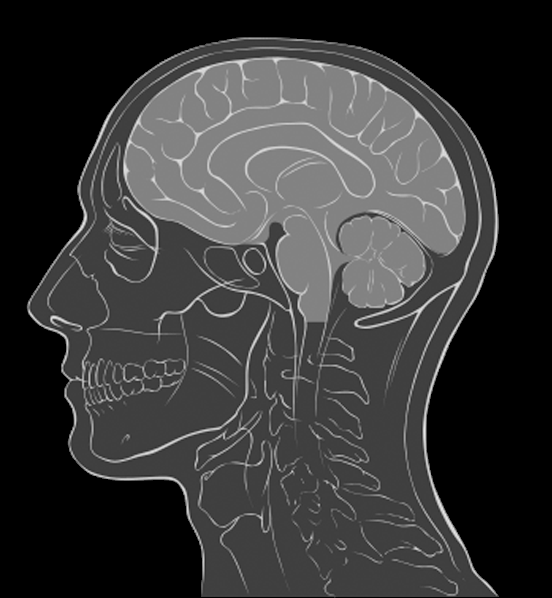
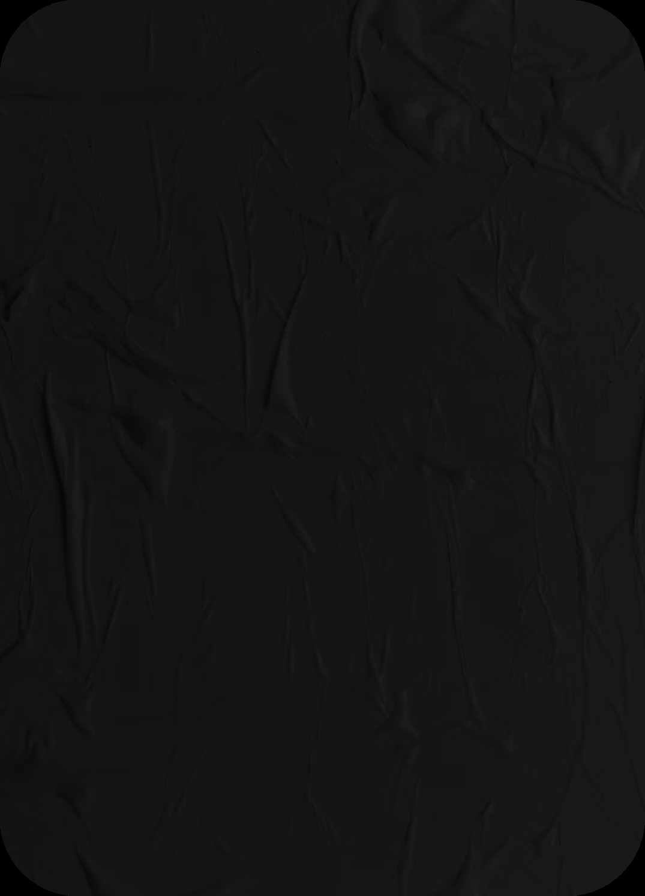
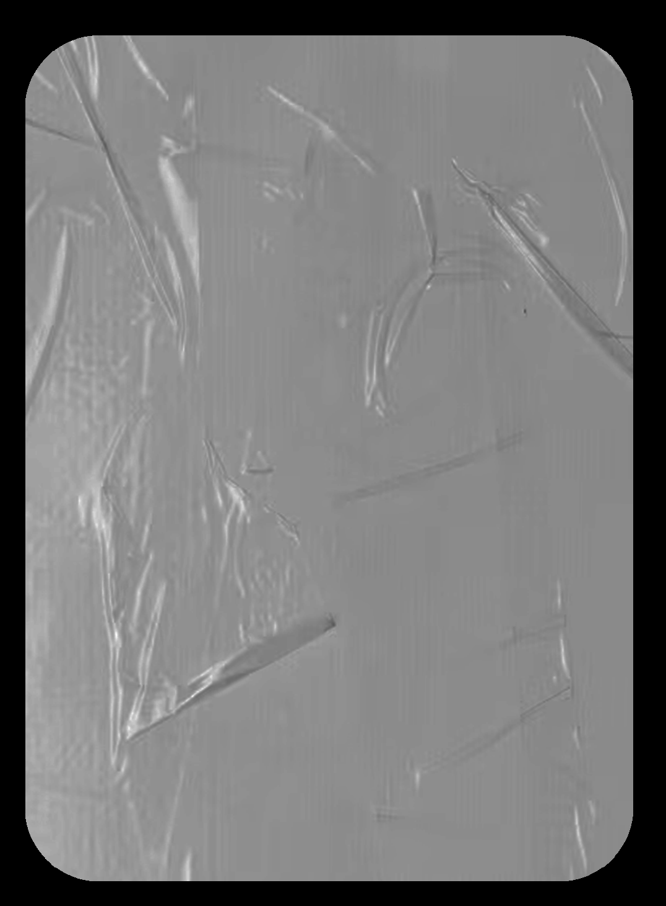
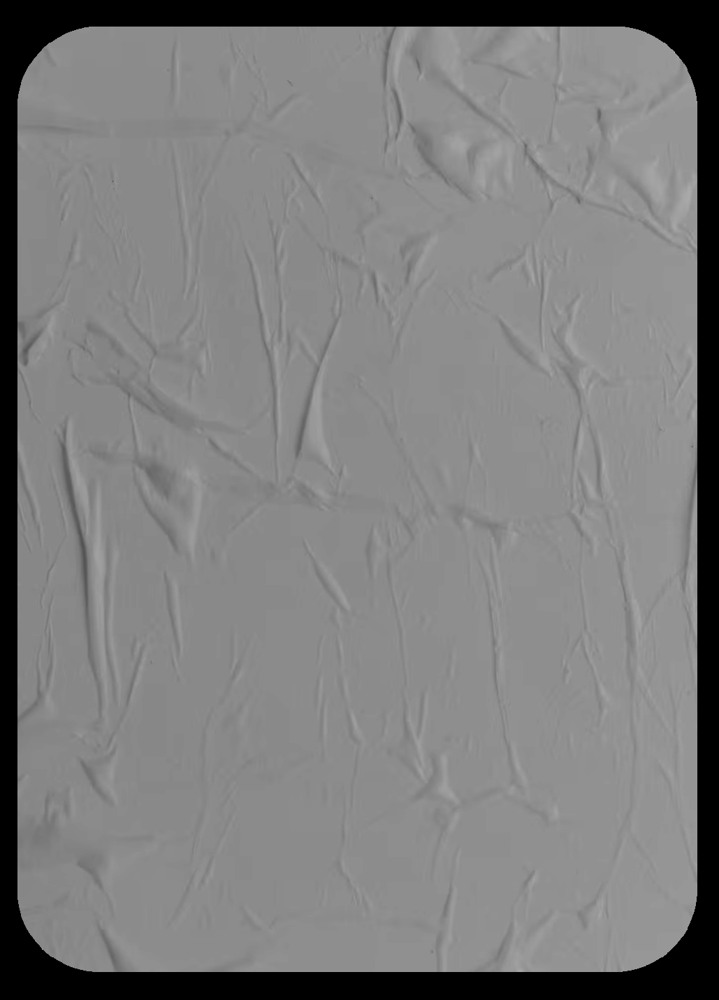
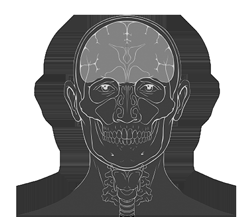
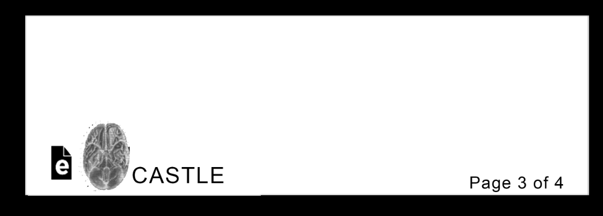
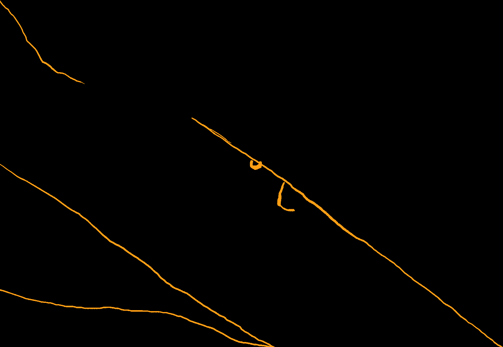
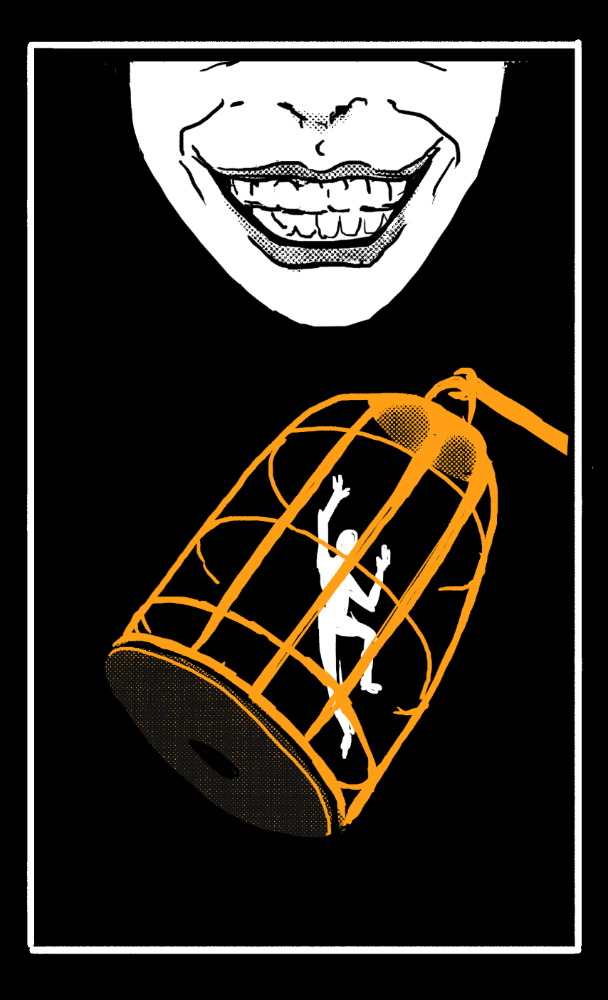

# Blasphemy 06: Smother (Acoustic Silence & Void Dampening)

> Source: CAIN 1.0 Rulebook (Pages 33)

---
### Page 33 Source Content

**Absentia:** You can gain this hook with your passive. If this hook fills up, you take an injury and black out for a few moments. When you wake up, you are missing a body part (roll 1d6). It simply disappears (cleanly) as though it had never existed, leaving a stump or hole. If you have no body part left to lose (when you roll), reduce the result by 1. If the result is 0, you lose your head and suffer (gruesome) instant death instead. Missing body parts might make some rolls hard or risky, dependent on the situation. You adjust to any disability after the mission, and it has no further effect. 

1. Eye 

2. Nose 

3. Ear 

4. Finger 

5. Toe 

6. Nothing 

# SMOTHER 

_Surpress the innate properties of the universe. Lie to God._ 

long term survival prospects are poor but are outweighed by u�lity, therefore users of this blasphemy are good candidates for organ transplanta�on (see TM ref 4456). 

### ABSENTIA 

Passive: You can improve the combined CAT of any of your Smother powers by +2 when you use them (to a max CAT of 7 for individual parts). However, when you do, gain the Absentia Hook. 

## HOLLOW 

_Charm, Adjacent, Until rest_ 

You temporarily remove weight from an object, human, or exorcist, giving them the total weight of 1 lb if heavier. The size of the object must be CAT or lower, and you can end this modification any time, though you must use this power again to regain its effects. Roll PSYCHE for any creative uses of this power. 

- Gain or grant +1D when you or any ally next acts to take advantage of this power 

- This power ends on its previous target if used again. 

This power may easily effect the parameters of rolls, such as difficulty and risk. 

## ABSTRACT 

_Transmute, Short, 1 scene_ 

With a gesture, you remove recognizable properties of CAT+1 tools, vehicles, windows, doors, or any other objects that can be held or worn. The chosen objects can no longer be used for their intended purpose and no human, sin, or exorcist (including you!) can recognize them - staring at them for too long causes extreme discomfort, even for exorcists. For example, weapons can no longer fire, doors can no longer open, or windows can no longer be looked through. 

Gain or grant +1D when you or any ally next acts to take advantage of this power. It may also affect the parameters of rolls while active. 

## DARK AGE 

_Charm, Self, Until Rest_ 

You produce a strong field from your body disabling even the simplest human advancements from working in CAT area. The effect moves with you. You can choose up to three of the following to suppress, ceasing their operation, then gain or grant +1D when you or any ally next acts to take advantage of this power: 

- Electricity 

- Internet 

- Combustion engines 

- Running Water 

- Door handles, window latches, zippers, catches 

- Open fires 

These things stop working even if it would not make sense, ie suppressing running water would mean water pressure simply stops working. You can end this effect willingly, but must end all effects at once. 

## SMOOTH 

_Transmute, Short, 1 scene_ 

You temporarily remove almost all friction from a human, exorcist, or an area up to CAT. The area or target becomes incredibly slippery. If targeting an area, it becomes hard for anyone to stand, climb, or move normally in the area, though people are able to slide around. 

- Roll PSYCHE to affect hostile targets with this power, only spending a psyche burst on success. 

- You can sculpt this area if you wish to affect just part of it, or sculpt a path. 

Gain or grant +1D when you or any ally next acts to take advantage of this power. This power may also easily effect the parameters of rolls, such as difficulty and risk. 

## BLIND 

_Transmute, Adjacent, 1 scene._ 

An object, living being, or location you touch up ceases producing sound, reflecting light, or both for the scene. Gain or grant +1D when you or any ally next acts to take advantage of this power: 

- Targeting a persona allows the effect to move with them for the scene 

- Targeting a location affects an area about the size of a small room, removing all sound and/or light. You can ‘filter’ this effect by allowing light or sound inside the location to operate normally, but not enter or exit the area. 

This power may easily effect the parameters of rolls, such as difficulty and risk. 

**64** 

**65**

#### Extracted Visual Elements (Page 33)

## Related Knowledge Nodes

- [[01_Blasphemies_System]]
- [[Conflict_Scenes]]
