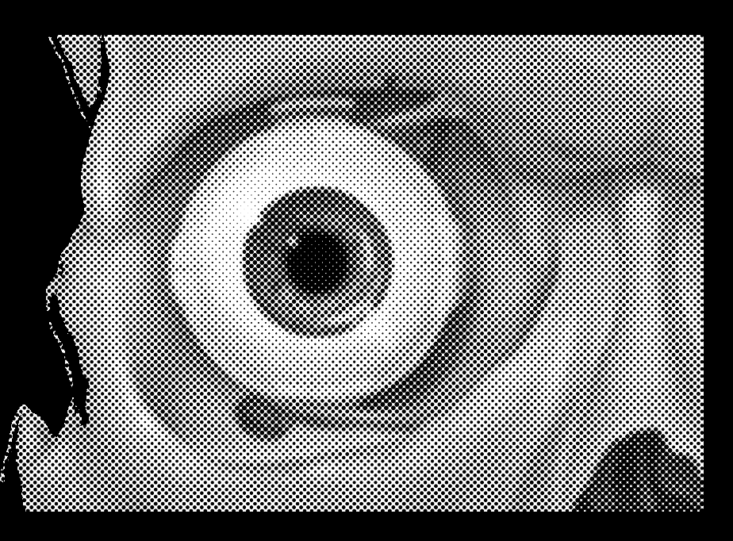
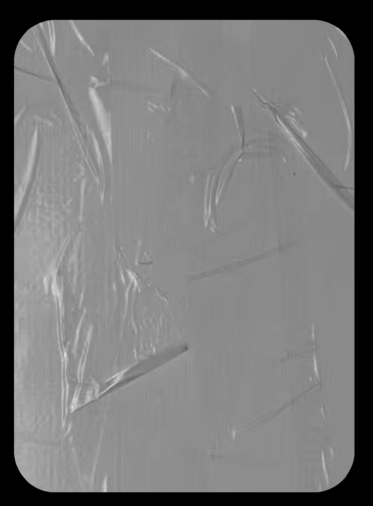
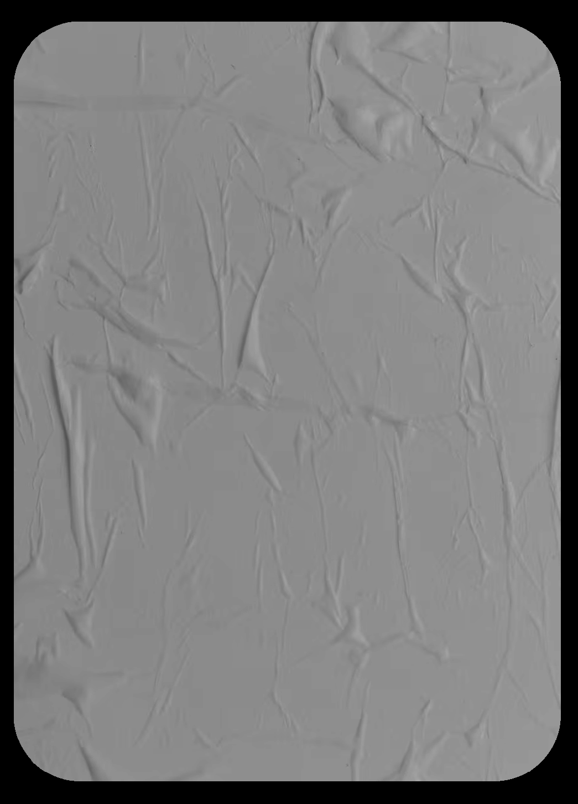
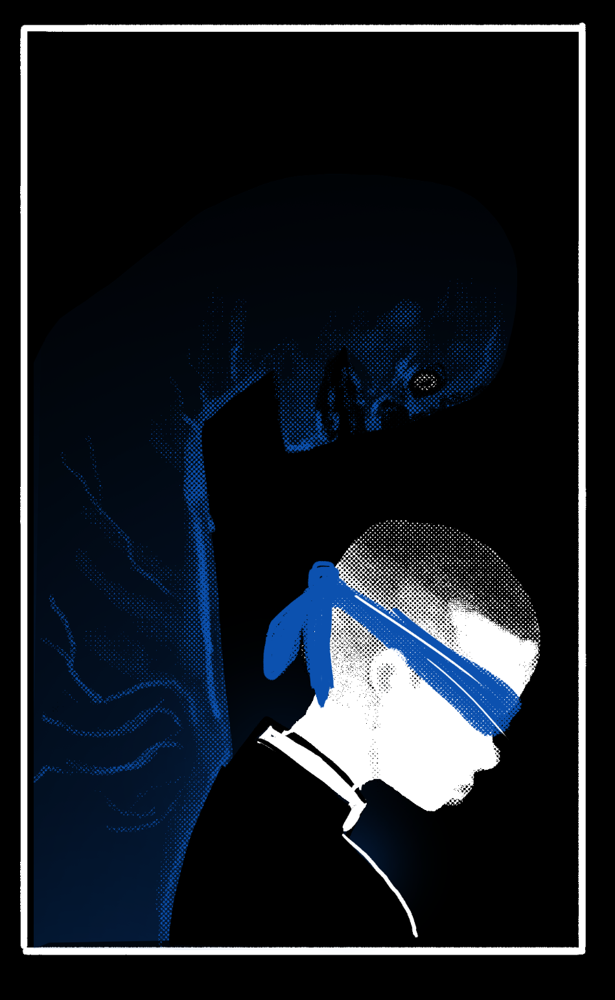
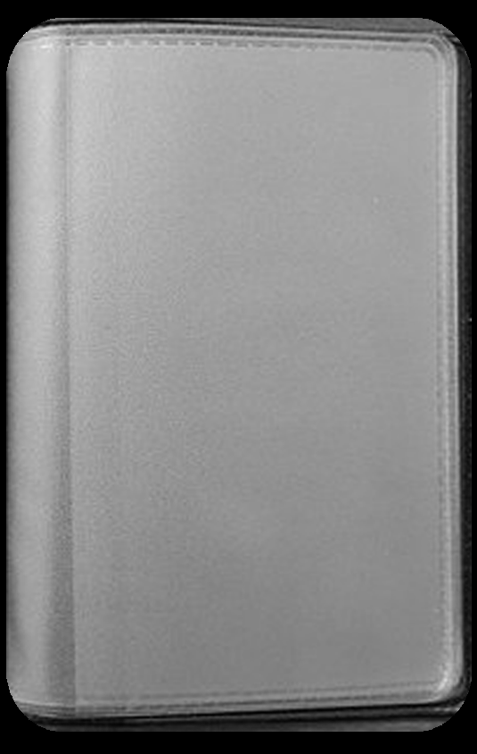
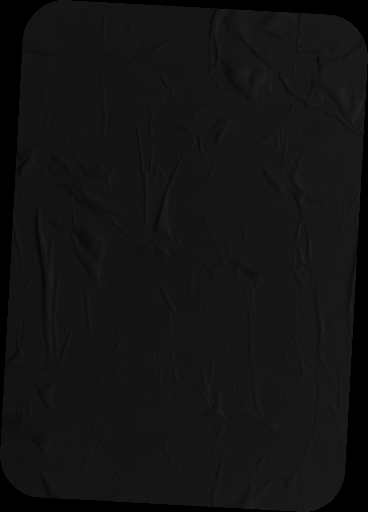
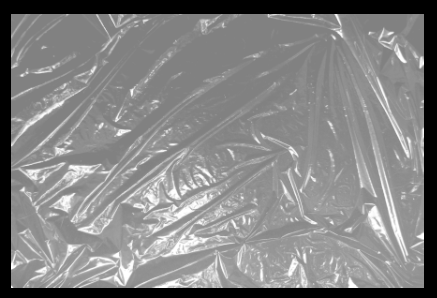
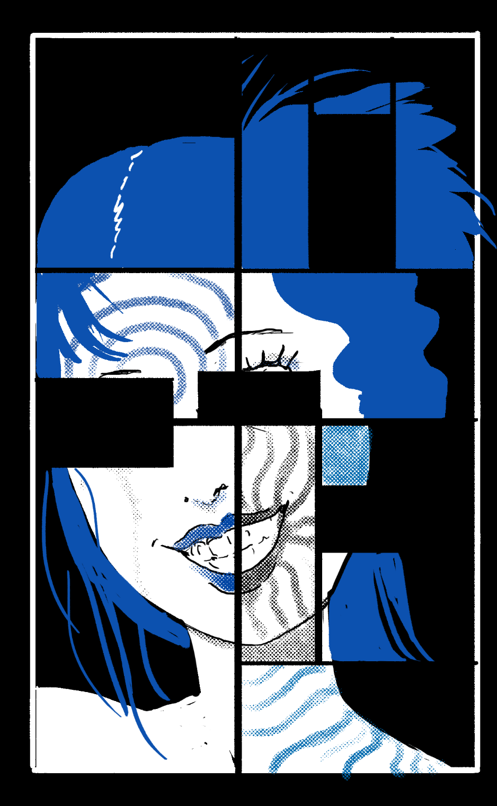

# Blasphemy 07: Whisper (Telepathy, Memetics & Hallucinations)

> Source: CAIN 1.0 Rulebook (Pages 34, 35)

---
### Page 34 Source Content

THE SHADOW is intangible and invisible to everyone, even the psychically sensitive. It can only weakly interact with the physical world and has its own mind and senses. It can range in about short range from you. It can pass through walls and surfaces easily but retreats into your body in bright light, preventing it from doing anything. 

You can talk to it telepathically, but talking to it is dangerous and causes 1 stress after any interaction ends. It has no obligation to tell you the truth unless you use your powers. 

You may talk to it safely using your abilities, and it knows the future. The Admin will answer for it. 

# WHISPER 

_Your shadow is animate and hungry. It knows the future._ 

_This alter self usually manifests in puberty and only you can see it, remaining invisible even to other exorcists. Common belief holds the ‘shadow’ seen is a component of your own future death._ 

### SHADOW 

You harbor a separate being that follows you everywhere, even when you sleep. The rules for it are in the bottom left of this sheet. 

## OMEN 

_Instant, Self_ 

Ask your shadow ‘What will happen if I X’, where X is a simple course of activity you plan to take in the next hour or so (open this door, attend the meeting, attack this person, go down this street). The shadow gives you a brief impression of the future: 

- Gain +1D when you or an ally next acts on the answer. 

- Pre-roll the risk die before you take the action. You can decide to back out of the action if you like, but if you follow the same course of activity in the future, use the prerolled risk die. 

## SHIVER 

_Charm, Self, 1 scene_ 

When you are looking for a human, sin, exorcist, location, or object, you can declare ‘I feel a shiver’. 

In this scene, if your target is close enough to be in short range from you, you feel a strong, instantly sense of cold and discomfort. You can home in on this feeling easily, and it’s never hard to track your target while this is active. 

Additionally, you gain +1D to track your target for the duration, even if they’re not nearby. 

## PRECOGNITION 

_Instant, Self_ 

When the Admin is describing a scene or you are about to take a course of action, you can ‘flash back’. Make an action roll or play a scene out in the past, where you had a vision of the present moment. This cannot completely alter the established facts of the present (you can’t have knocked someone out in the past if you just finished having a conversation with them in the present, for example), but could change the situation or alter present details, or it could set up yourself or any ally. For example you could have made preparations for the current moment (locked or unlocked a door, stowed some gear, made a phone call, etc). 

## DISSECT 

_Instant, Short_ 

Examine a human or exorcist in short range, roll PSYCHE, and ask your shadow one of the following questions, plus one more per success. They answer truthfully, but can use a maximum of three words to answer each. 

- Is this person lying? 

- What is the main emotion this person is feeling? 

- Where has this person just come from? 

- Where are they planning to go next? 

Gain or grant +1D when you or any ally next acts to take advantage of each answer. 

## OMNIPRESENCE 

Instant, CAT+2 range 

When an ally is in a scene, you are not present in that scene, and your ally is in CAT+2 range, you can use this power to walk in on the scene, having already predicted that this course of events would happen. Roll PSYCHE, and choose one of the following per success: 

- Nobody is following you 

- You are hidden 

- You are able to enter your ally’s location without distraction or harm 

- You have a useful tool or object on you for the present situation (a key, a weapon, a wrench, etc) 

You may gain or grant +1D when you or any ally next acts to take advantage of this power. 

If the situation is complicated, also take 1 stress. If it’s convoluted or far fetched, take 3 stress. 

**66** 

**67**

#### Extracted Visual Elements (Page 34)

---
### Page 35 Source Content

# UNIFORM 

_Charm, Self, Until Rest_ 

You make a brief edit of yourself. You can’t do this in public (you need privacy, no matter how tenuous). This power makes you officially part of any profession or group with more than 5 members, with any necessary uniform, equipment, id cards, memberships, etc, and alters reality to make it so. 

Even if people don’t particularly remember you being part of a group, they may get a vague sense that you were a member. 

You don’t actually gain any particular skills and any changes you may have to be to your own person and must include things you could wear or carry in one or both hands. 

Gain or grant +1D when you or any ally next acts to take advantage of this power. 

## 

_The way things are is not the way they had to be. You can choose, filtering the threads of possibilities and inviting them to meld with the real world._ 

Fact: CAIN doctrine clearly states the existence of ‘alternate’ realities is currently unproven. 

# MIMIC 

**Passive:** You can alter minor things about your appearance. You can change any of the following about yourself when resting, within a variation of your original body: 

- body features such as height and weight 

- aesthetics such as facial features, skin color, hair, gender presentation 

- • age, down to 13 and up to 88 

You always look faintly similar, like a distant relative of yourself. Your clothes always change to fit you, though you cannot alter them. This doesn’t change anything about your skills or general ability, and also cannot restore missing body parts or hide sin marks or scars. 

## 

## 

## 

## 

**68** 

**69**

#### Extracted Visual Elements (Page 35)

## Related Knowledge Nodes

- [[01_Blasphemies_System]]
- [[Investigation_and_Traumas]]
