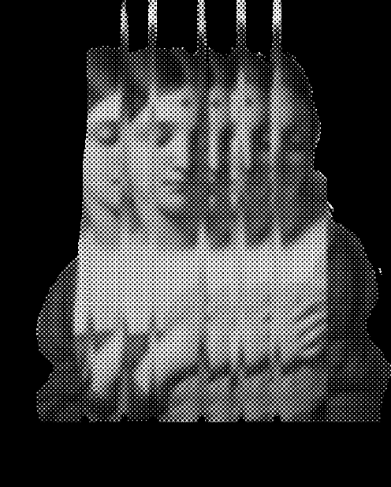
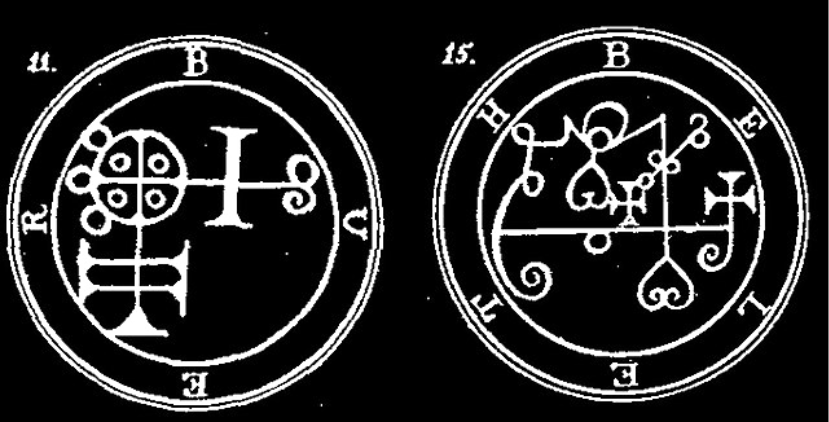
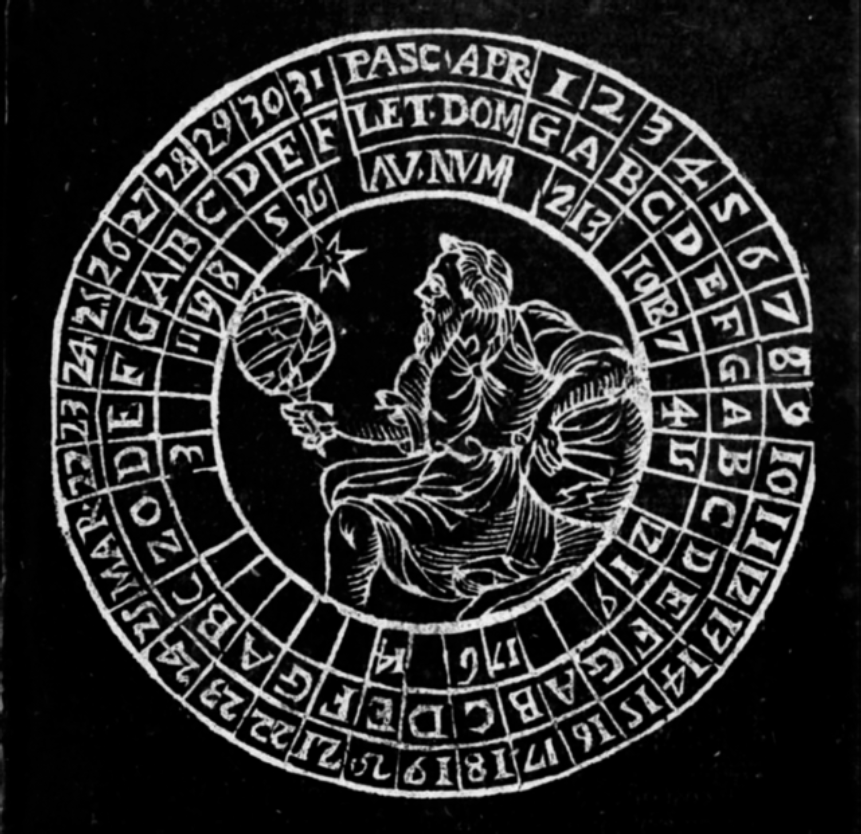
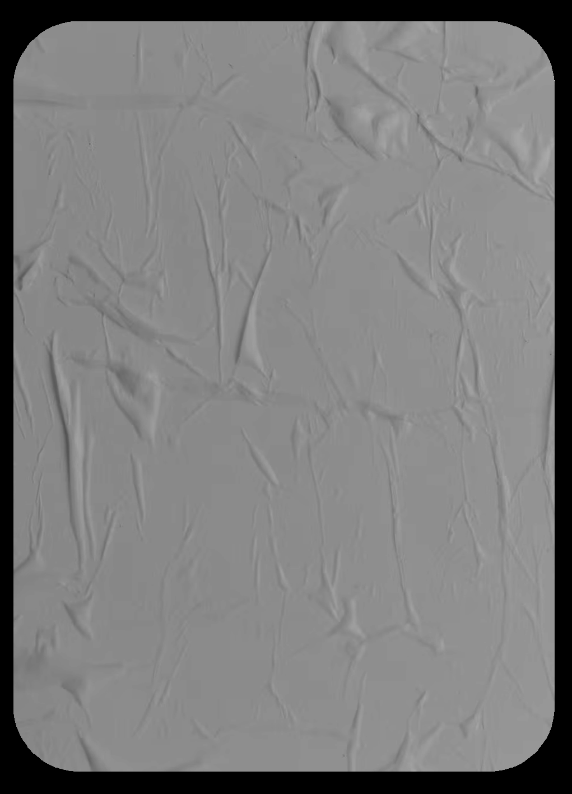
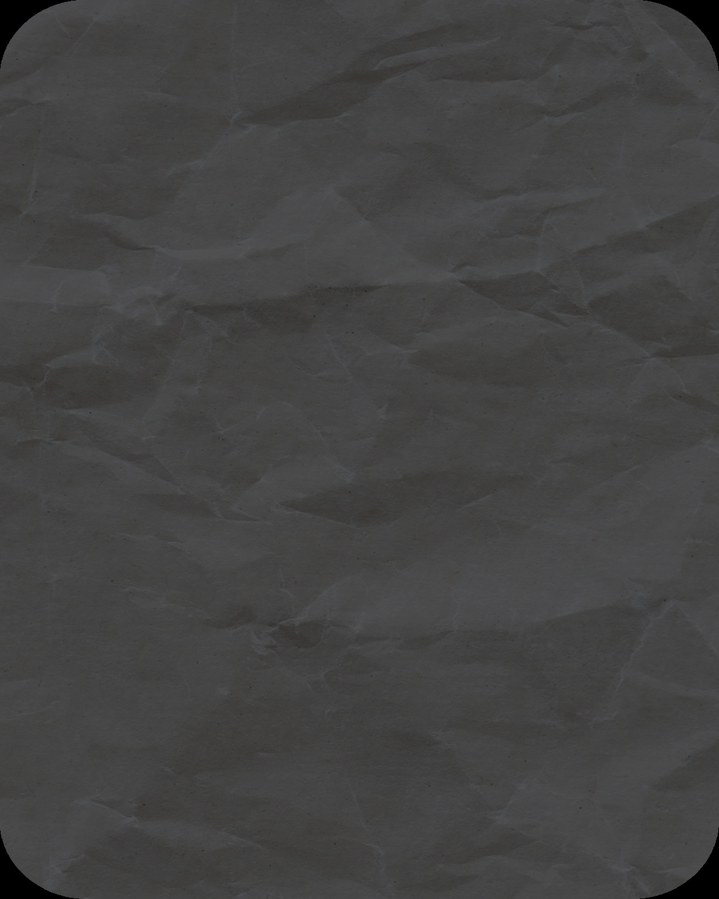
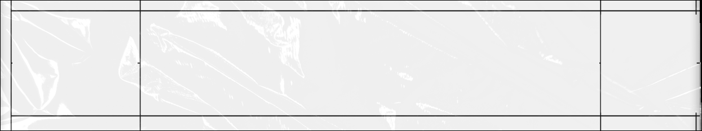
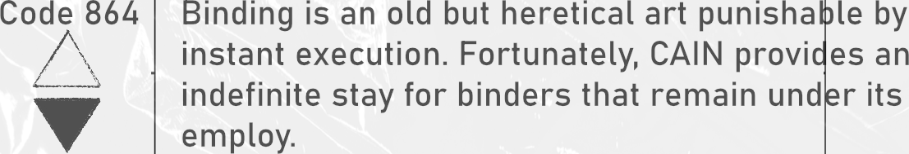
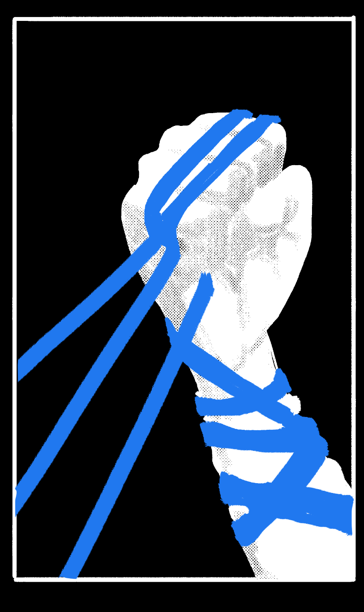
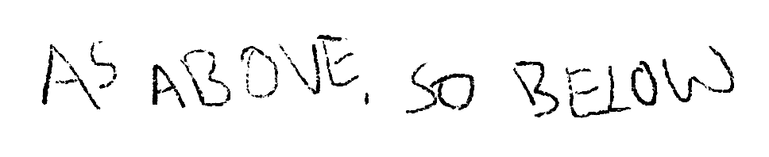

# Blasphemy 08: Bind (Psychic Chains & Gravitational Anchor)

> Source: CAIN 1.0 Rulebook (Pages 36)

---
### Page 36 Source Content

# BIND 

_With the will of a wielder, even Sins can be controlled, bound to specially prepared talismans in spirit form._ 

## SIN BINDING 

Passive: You have the forbidden ability to bind Sins. You have the obedient essence of a minor sin bound to you, under your control. The rules for it are on the bottom left of this sheet. 

## FORBIDDEN SPIRIT 

### _Self, 1 scene_ 

You can spend a psyche burst to empower your sin for one scene. The next time it takes action for violence or physical force, it gains +1D. As part of this action: 

- Once this scene, it can ignore any stress taken 

- You can lift limiters on your spirit temporarily for a scene, causing it to undergo a monstrous transformation similar to its original form. It becomes a size equal to CAT and can easily move, lift, or throw object of an equal size. 

## SURRENDER 

_Charm, Self, 1 scene_ 

You can temporarily fuse your sin to your body. Your body mutates slightly to accommodate this change, and you lose the use of your bound sin for the duration. For the scene, you may gain +1D on any roll, but gain 1d3 sin. 

If you hit sin overflow while this efect is active and f successfully resist, you can choose which sin mark you manifest (still roll for its ability). 

## PRISON 

Your Bound Sin is animalistic in form and ability - you can determine what form it takes. It can understand language but cannot speak, and is invisible to humans. 

It can follow you around at short distance, follow simple orders, and uses your action ratings to do anything. Its general capabilities are CAT 0. 

If it takes any stress, it is banished for the remainder of the scene, however you can psychically absorb all stress taken for it instead to prevent this efect. f 

In a conflict scene, you may sacrifice your ability to act on your turn to allow your sin to act instead, giving it commands. Otherwise it doesn’t act independently in these scenes. 

## HORDE SPIRIT 

_Self, 1 scene_ 

You can spend a psyche burst to empower your sin for one scene. The next time it takes action for traversal or movement, it gains +1D. As part of this action: 

You can transform it into the form of a vehicle or rideable creature for one scene. It can go about CAT speed, becomes partly visible to humans and has room for two passengers. 

It can glide a short distance while in vehicle form, with or without passengers 

## HUNTER SPIRIT 

_Self, 1 scene_ 

You can spend a psyche burst to empower your sin for one scene. The next time it takes action for tracking or observation, it gains +1D. As part of this action: 

- It can now separate from you up to extreme range when released 

- It gains the ability to fly and see and smell extremely well - it can also see in the dark and in the thermal spectrum, and clearly up to long range. 

- You can concentrate, dissociating from your body, and becoming extremely vulnerable. While concentrating this way, however, you can use your sin’s senses instead of your own. You can engage and disengage this effect at will for the scene. 

_Summon, adjacent, Until Rest_ 

You create an area drawn as a large circle, up to CAT area, choosing either to draw a regular prison or inverse prison. The prison takes a few minutes to activate and lasts until you rest 

- A regular prison makes it impossible for Sins to leave while active. An inverted prison prevents sins from entering while active. 

- Humans and exorcists can freely enter. 

The prison can be broken by a determined sin, but has a 3 talisman for durability, taking stress like an execution talisman. 

**70** 

**71**

#### Extracted Visual Elements (Page 36)

## Related Knowledge Nodes

- [[01_Blasphemies_System]]
- [[Conflict_Scenes]]
