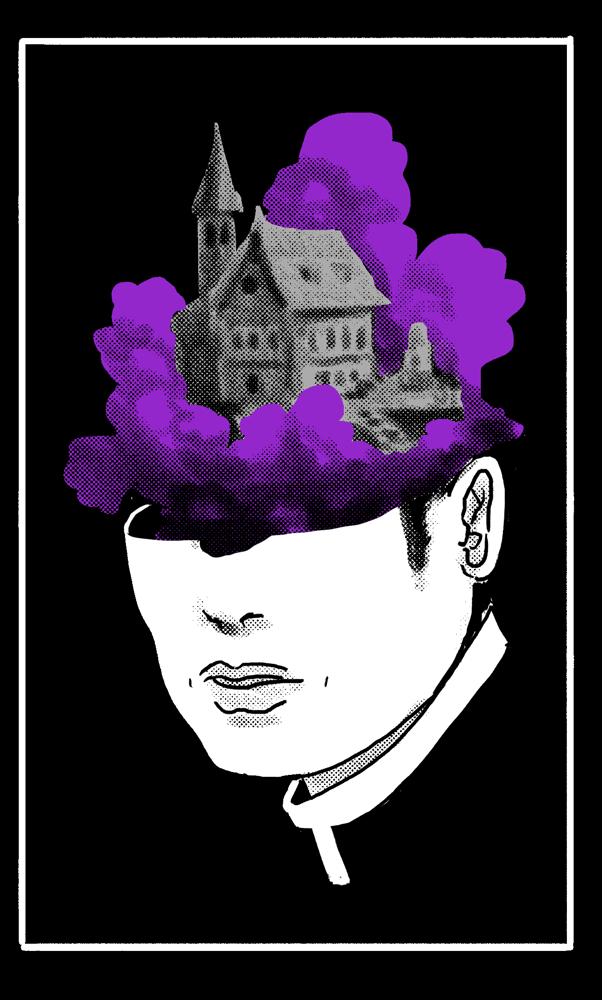
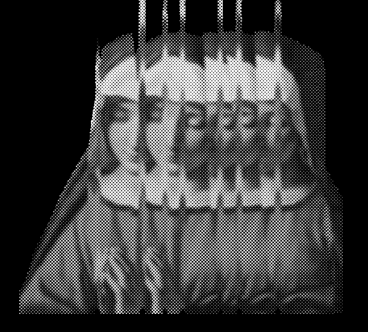
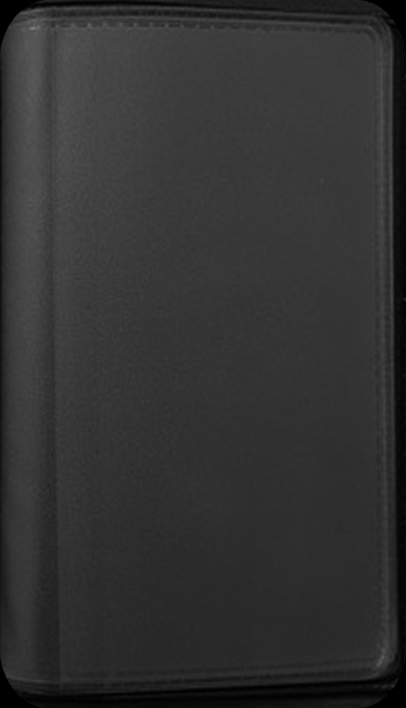
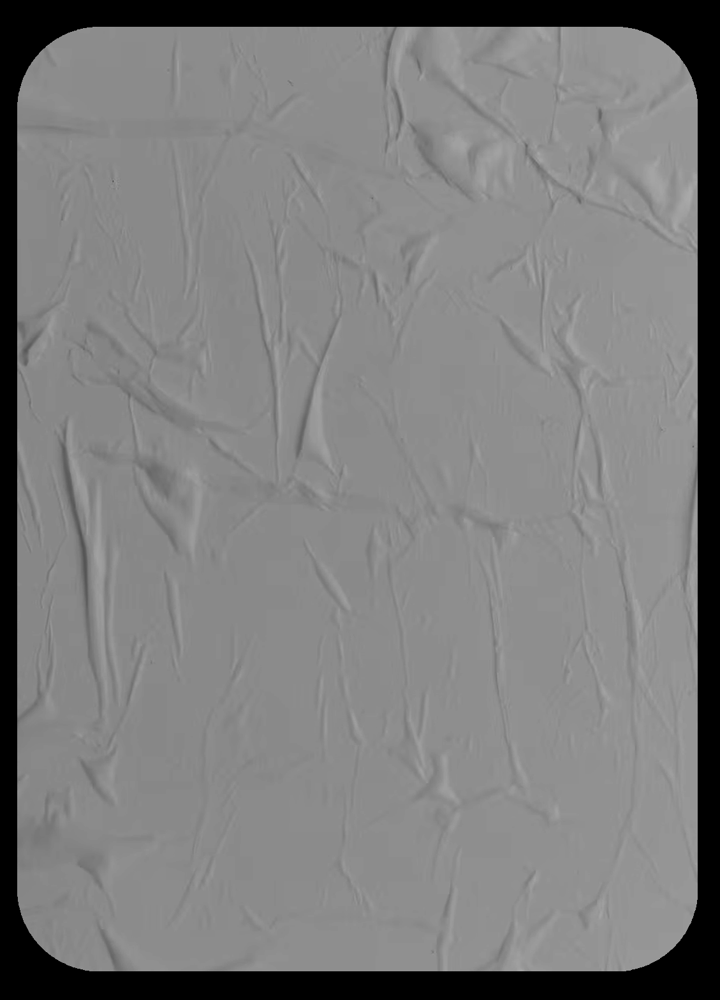
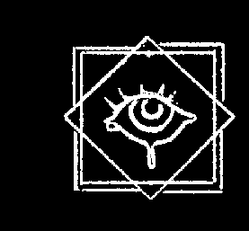

# Blasphemy 09: Palace (Pocket Dimension & Mental Sanctuary)

> Source: CAIN 1.0 Rulebook (Pages 37)

---
### Page 37 Source Content

## CELLAR 

#### _Charm, Short, Instant_ 

You can simulate situations inside your palace before putting them into practice in reality. You can use this power and roll to set up allies even if you are not physically present by describing the way in which you trained or prepared with them, or a psychic copy of them. Gain +1D on the setup roll. 

# PALACE 

_The contents of your mind are as solid to you as plain reality._ 

### SANCTUM 

_Passive:_ You and allies you rest with can enter your psychic palace while resting. This improves the resting rolls of yourself and up to one ally of your choice resting with you by +1. 

- The palace is a mental projection, a dream space that takes the form of a large home, residence, or mansion in a locale of your choosing. Walking of f the premises merely returns to you the locale, and as a purely psychic phenomena, you can control its appearance and decor. 

- Taking harm in a palace instantly shunts a person out of it, waking them up, instead of dealing them real harm. Visitors can leave any time. 

- Entering the palace mentally requires only closing your eyes and concentrating, leaving your outside body defenseless and insensate. It can be done by you any time, and by your allies by resting with you, or with your powers 

## LIBRARY 

_Instant, Self_ 

This power **does not take a psyche burst.** Your palace has a library of information from the psychic gestalt. When you wish to gather information on or investigate any subject, you can gain +1D on the roll by accessing this library. However, afterwards the Admin rolls 1d6 for each of the following: 

- Is the information rare? 

- Is the information forbidden in some way? 

- Is the information pertinent to a powerful group? 

For each ‘1’, you take 1 stress as you read something disturbing in the library. 

## FOYER 

#### _Summon_ 

Your palace has a tulpa, a psychic being that takes the form of a servant or butler. They are loyal to you, you can determine their personality and appearance. Though they are casually around the palace whenever you wish even without the use of this power, you can summon them with this power, choosing one: 

- Have your tulpa aid you on a task related to research, crafting, or investigation, granting +1D on your next roll. 

- Briefly manifest your tulpa outside your palace in short range as a real person, a mirror of their appearance inside your palace but dressed any way you like. They have roughly the capabilities of an average person (cat 0) and roll 2d for activities that a typical servant or butler could do and 0d for everything else. Any harm taken by them banishes them back to the palace. 

## BAR 

#### _Self, 1/scene_ 

This power **does not take a psyche burst.** You have expanded facilities inside your palace for resting. If you describe how you let people who are resting with you take a load off, you can roll 1d3+1, and do one of the following, spending charges of the die you have just rolled per option: 

- 1 charge: Erase 1 stress on one person 

- 2 charges: Untick 1 tick on all hooks for a person 

- 3 charges: Remove an injury 

For each, describe a drink, snack, meal, or other form of relaxation or healing you are preparing for your guest. 

## PARLOR 

_CAT range, 1 scene_ 

Choose a person in CAT range of you and speak their (real) name. You can bring yourself and their psychic shadow inside your palace, no matter where they are. 

If that person is willing, you can choose to bring their actual psychic consciousness inside your palace, making them aware and remember what is going on while inside, as though in a dream. Their real body becomes unconscious and vulnerable. They can leave willingly. 

You can instead bring a psychic double of a willing or unwilling person into your palace. They are not affected, but the double is a copy of their mind at the time of summoning. Any memories formed by the double will not transfer over. The double cannot leave until the scene ends. 

A person or double summoned this way is not obligated in any way to behave differently than their original. 

Gain or grant +1D on the next roll by yourself or an ally taking advantage of this power. 

**72** 

**73**

#### Extracted Visual Elements (Page 37)

## Related Knowledge Nodes

- [[01_Blasphemies_System]]
- [[Investigation_and_Traumas]]
