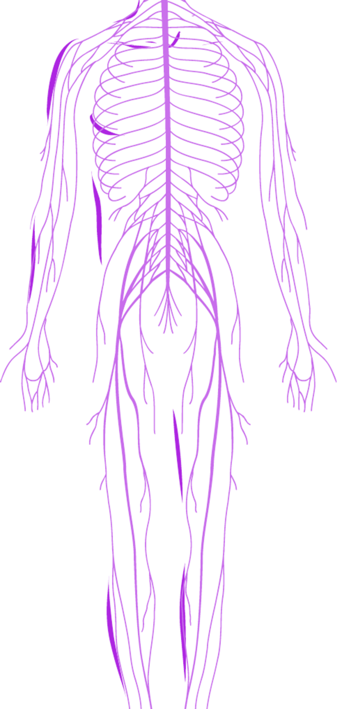
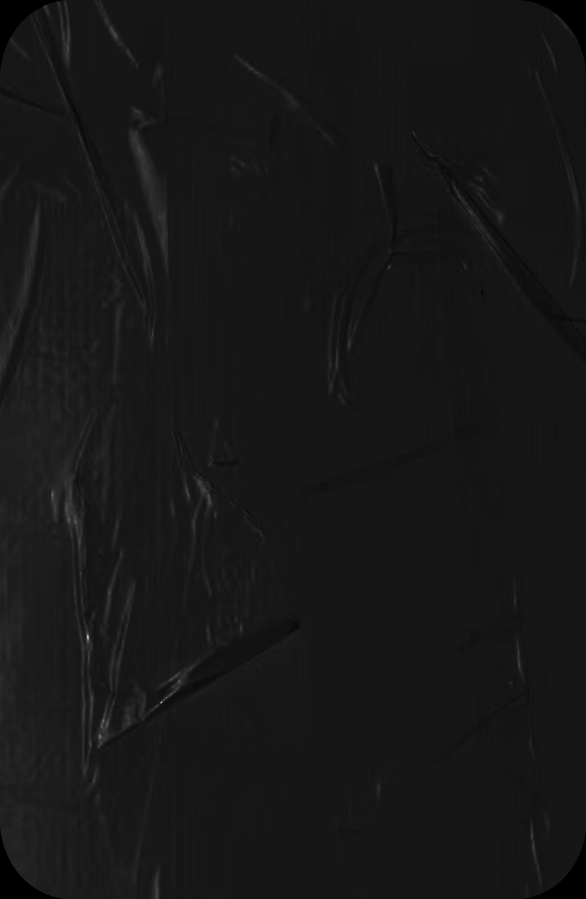
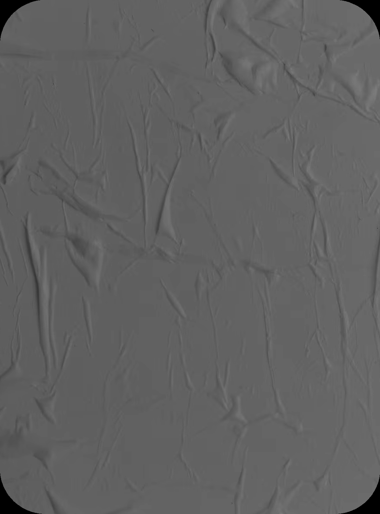
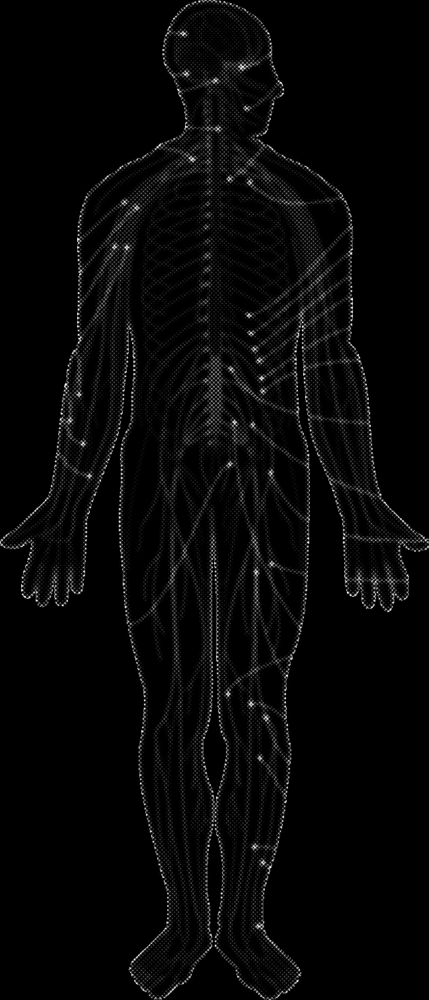
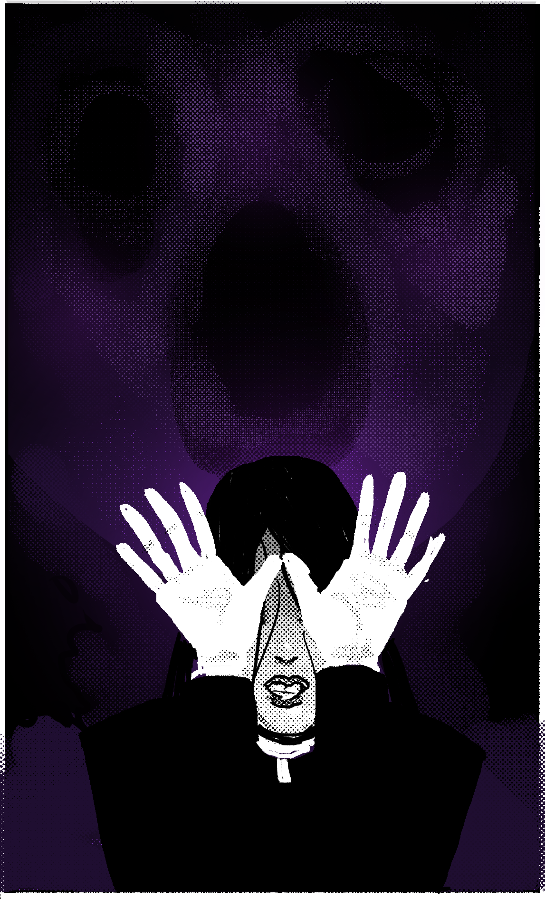
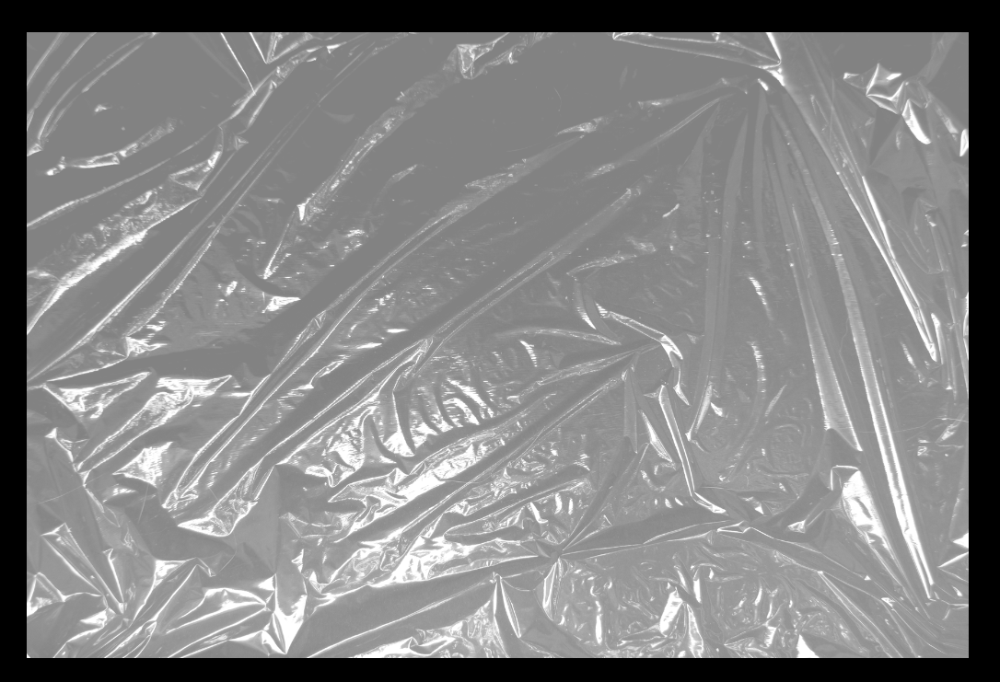

# Blasphemy 10: Jaunt (Micro-Teleportation & Dimension Stride)

> Source: CAIN 1.0 Rulebook (Pages 38)

---
### Page 38 Source Content

## POSSESSION 

_Curse, Short, 1 scene_ 

You can shunt your perception out of your body to possess a human, animal, or corpse (in good condition) you can see in range for a scene. Supernatural beings are immune this efect. f Unwilling humans might require a rolling PSYCHE to possess successfully. 

- While possessing another your real body is insensate and defenseless 

- For humans and animals, you cannot force a target to harm itself or take action that would indirectly cause it to come to harm 

- Actions that the target takes use your action ratings, but the target’s body or equipment, which might change the circumstances 

You are kicked out of the body if it takes stress 

# JAUNT 

_Slice the body and soul with a carving knife._ 

Jaunt users are the most likely of all exorcists to ‘hollow’ during sleep and leave an empty shell. This occurrence is very rare but its cause is ! unknown and it is 100% fatal. 

### GHOSTWIRE 

**Passive:** You can join your mind telepathically with one other willing person you touch. While within long distance of each other, you can talk telepathically, and sense each other’s ambient emotional state. This effect lasts until you use it again, until the other person becomes unconscious, or until you or the other person close the connection. 

## GEIST 

_Self, 1 scene_ 

You can shunt your perception out of your body and roam for CAT+1 range, becoming a being made of purely psychic energy. 

- While practicing this power, your real body is insensate and defenseless 

- You can fly slowly, are invisible to those not psychically sensitive, and may pass through walls, floors, and objects easily while in this form. 

- You cannot interact with or be affected by the physical world. You cannot use or benefit from your own psychic powers, but psychic powers or effects from others can still affect you. 

If your form is destroyed somehow (by a supernatural force), you take 1 stress, this power ends, and you can’t use this power again until the scene passes. 

This power may easily effect the parameters of rolls, such as difficulty and risk. 

## THREADS 

_Charm, Self, Until rest_ 

You can sense the unseen world of traces of grace. Upon using this power, you close your eyes and can see through your eyelids the patterns the soul leaves in the environment. 

- You gain the ability to see living beings, even through walls, for CAT range 

- You can see the traces a sin or someone strong in grace such an exorcist leaves, like a faint trail of light through the air. 

- You gain +1D on actions to track or locate living beings or traces of sins in the area. However, you cannot see any living matter (you are effectively blind) while maintaining this power, and find actions that rely on sight hard 

This power ends when you open your eyes or when you rest. 

## PASSENGER 

_Curse, CAT range, 1 scene_ 

You choose a willing target in CAT range, who must be able to either hear you (even telepathically) or see you. You pull that target’s psychic presence into your body for the duration. Their body becomes limp, vulnerable and insensate. However: 

- they now share control of your body with you, including all senses. 

- You can surrender control of your body to them to allow them to make action rolls using their skills or action ratings, but your body (gear, access, etc). 

- You can set them up as normal or aid them on these skills. 

They cannot use psychic powers while possessing you this way, and you suffer any harm or consequences from their actions. 

## DESECRATE 

Summon, Adjacent, Instant 

You can force a semblance of life into a corpse by touching it on the eyes. You may ask the corpse three questions, after which the efect ends and it f becomes dead again. It also expires if the hour passes. 

- You can’t use this power on the same corpse more than once 

- The power does not return life to the body, but accesses the body’s memories. If the head or brain is missing, or the body lacks a tongue, etc, this power will not work as well. 

- The corpse is obligated to answer truthfully, but can only speak to the realm of its knowledge and memories before it died. It may have only partial knowledge of a situation or may speak according to its own viewpoint. 

Gain or grant +1D when you or an ally next acts on the answers

#### Extracted Visual Elements (Page 38)

## Related Knowledge Nodes

- [[01_Blasphemies_System]]
- [[Conflict_Scenes]]
