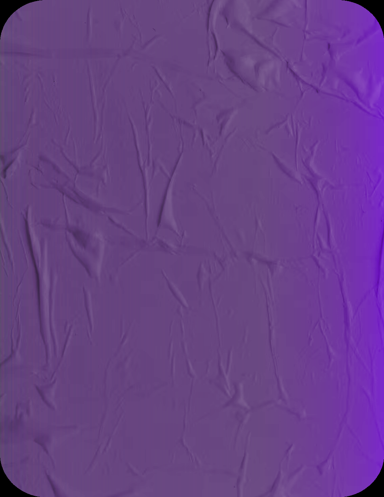
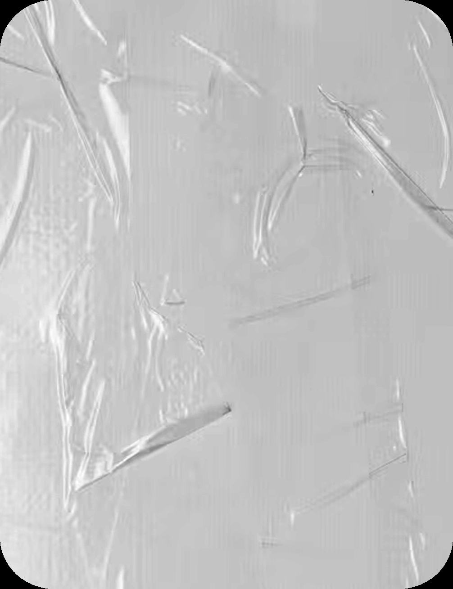
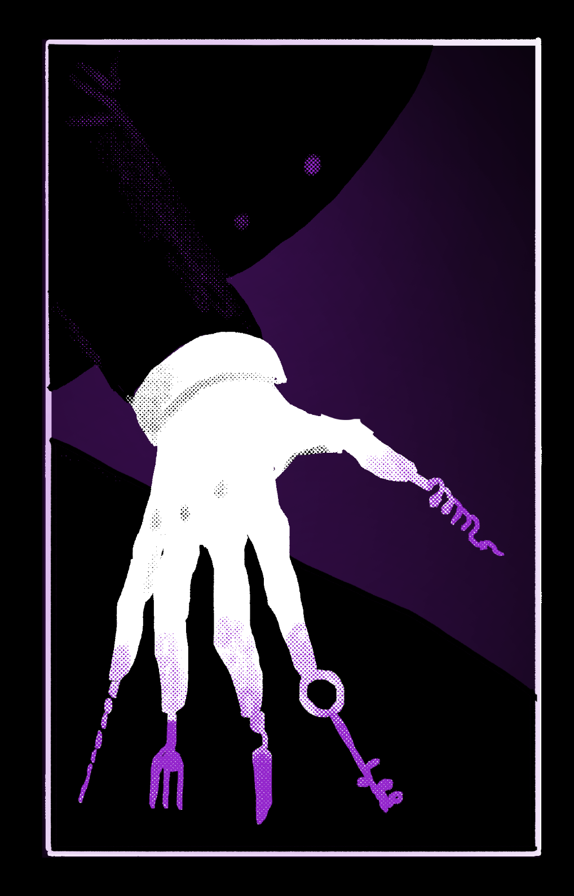
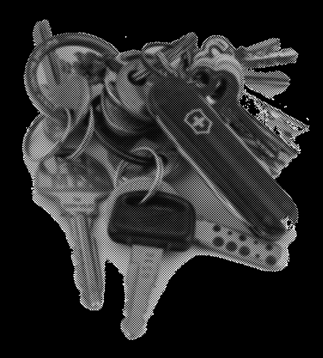
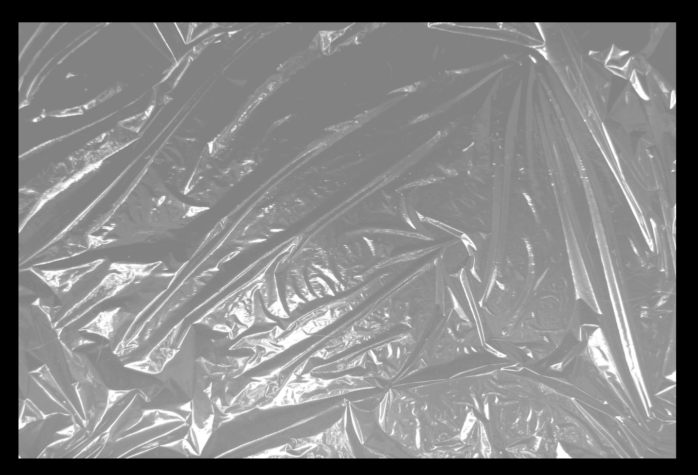

# Blasphemy 11: Sympathy (Shared Resonance & Pain Reflection)

> Source: CAIN 1.0 Rulebook (Pages 39)

---
### Page 39 Source Content

## Resonances 

Roll 1d3, then 1d6 

11  Phones 21  Balls 31  Ropes 

- 12  Lights 

- 22  Guns 

   - 32  Hammers 

- 13  Knives 

33  Cars 

   - 23  Mugs 

   - 24  Computers 

- 14  Keys 

34  Doors 

- 15  Books 

- 25  Shoes 

35  Bags 

16 Baseball Bats 26  Power Tools 36  Gloves 

# SYMPATHY 

_Humans leave impressions on everything they touch. You can do more than touch._ 

**PSYCHOMETRY IS BANNED ON CAMPUS - CASTLE REF 0094** 

### RESONANCE 

**Passive:** At the start of the mission, roll on the resonance table. When you make this roll, 1d3, then 1d6, then check the resonance tables after this blasphemy entry. When you are making an action roll and you are using an item you are resonant with, you gain a +1D bonus. You can spend a psyche burst any time to roll an additional resonance. You can keep up to three at a time, and only benefit from one at a time. 

## Amplify 

_Summon, Adjacent, 1 scene_ 

You can expand the mundane properties of a regular non-weapon item to extreme levels. You touch a mundane object up to CAT size. For the scene, you automatically have resonance with it, and its properties are enhanced to extreme levels, as if they were up to your CAT in scale. For example: 

- A car’s speed, handling, and resilience 

- A light’s brightness and intensity, and the area it illuminates 

- A door’s ability to lock and withstand force 

This can easily afect the dif f f iculty and risk of rolls. 

## Bond 

_Self, 1 scene_ 

For the scene, you can bond incredibly tightly with an item you are holding in one or both hands. 

- You are now resonant with that item 

- You can now use it as a cutting or bludgeoning weapon even if it wouldn’t normally be a weapon. It has about the power of a regular mundane melee weapon, like a bat, baton, or sword. 

- The item becomes virtually indestructible 

- You can cause the item to recall to your hand, flying through the air, from within short distance 

## Diplomacy 

_Instant, Short_ 

You make a simple request of an object as if it was a person, or ask it a simple yes or no question. 

For example, you can ask a door to open or hold shut (even if it couldn’t normally lock, or you don’t have the key), a computer to turn off or find information for you, or a car to turn on without a key or drive by itself. 

If you need to make a roll for this, roll PSYCHE or use a **social action** , such as negotiation or authority. 

You can affect objects up to CAT size with this. Objects asked questions can answer only with yes or no answers and can’t actually vocalize. 

## Psychometry 

_Instant, Adjacent_ 

You can touch objects to remotely view their memories. You can view back a number of days equal to your CAT. Roll PSYCHE, then ask a question plus an additional question per success. Gain +1D when next acting on the answers. 

- Where has this object been? 

- Who has touched this object? 

- What has this object been used for? 

- What else is this object connected to? 

Memories of an object are impressionist and and imprecise, and they are only usually ‘aware’ of their very immediate surroundings. 

## Alliance 

_Summon, Short, 1 scene_ 

An object up to CAT size in short range can now take action to set up an ally, rolling 1d6, or PSYCHE if you are resonant with that object. The object can take or cause consequences as normal from these actions. 

Allies have to be able to interact with it or use the object to gain its benefits. The object doesn’t gain the ability to actually move or animate in any way, but fortune simply bends around it. 

**76** 

**77**

#### Extracted Visual Elements (Page 39)

## Related Knowledge Nodes

- [[01_Blasphemies_System]]
- [[The_Body_Stress_and_Injuries]]
