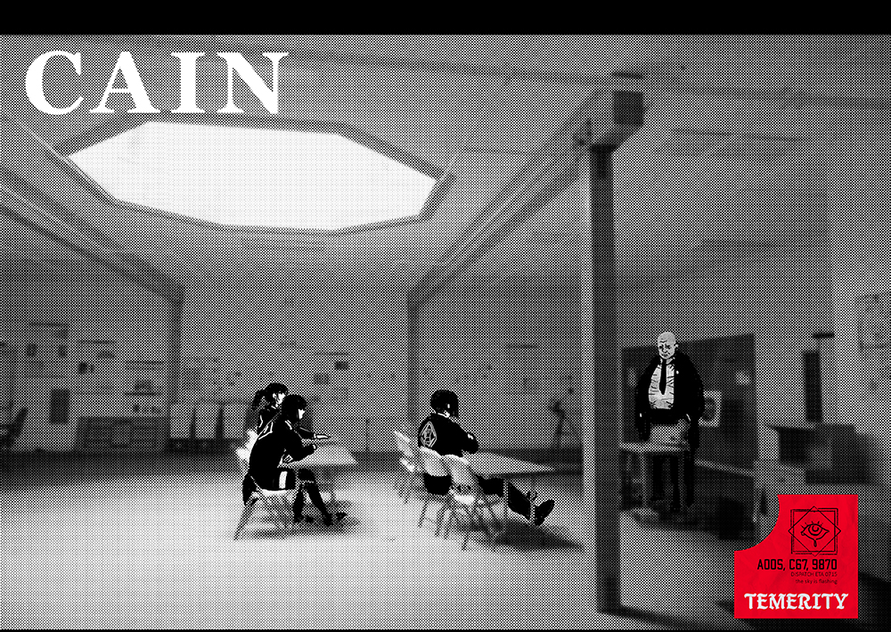
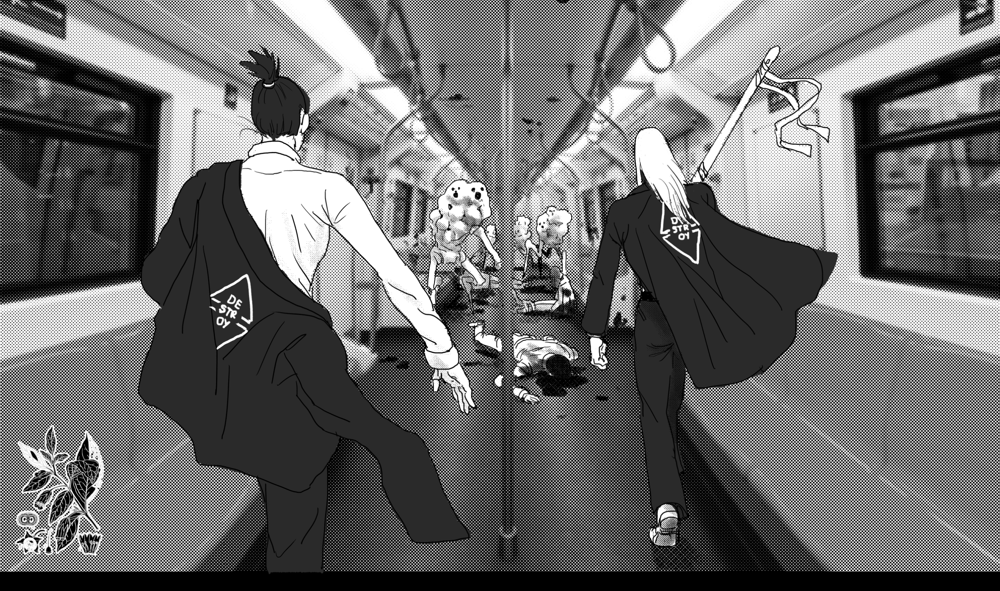
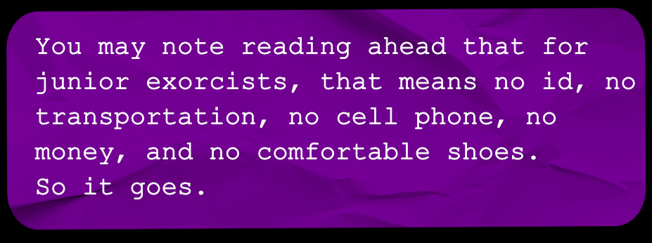

# The Six Phases of The Hunt

> Source: CAIN 1.0 Rulebook (Pages 18, 19, 20, 21)

---
### Page 18 Source Content

# **THE HUNT** 

This game is played as a series of **hunts** . Each hunt may take one or more sessions. 

Activities pursued during a hunt might require a single roll or might require a talisman to track progress. they might take a single scene or roll or might take a couple scenes - it’s up to the approach the exorcists take and the judgement of the Admin. 

Hunts have the following basic format: 

1. Exorcists have **a briefing** about the upcoming hunt. 

2. Exorcists **arrive** on the scene. They always arrive in good shape: **full stress, no injuries, no hooks, 3 psyche bursts, max kit points** . Essentially, each mission is a ‘reset’ for them. The only thing that carries over for them is agendas, sin level, sin marks, and their own abilities, experience, and scrip. 

3. The goal of every hunt is to **track** down a sin’s refuge - it’s **palace** - where it can be permanently destroyed. 

5. While exorcists are investigating and tracking the sin, the situation continues to evolve. This is tracked by the Admin with the **tension talisman** and a **pressure talisman** . The tension talisman ticks up as exorcists take action and introduces new complications or consequences. The pressure talisman ticks up whenever the tension talisman fills up and represents the overall degrading situation. If the pressure talisman fills up completely, the situation **goes out of control** and things get much worse, so the exorcists are on a timer. 

6. During a hunt, the players might get into **conflict** scenes when the stakes get high. If they fight a sin outside its palace, it may always retreat there to recuperate. Once inside a sin’s palace, the exorcists can summon it back there to cause an **execution** scene where the sin may be permanently destroyed or dealt with. 

**7. Exfiltration:** The exorcists leave the scene. If the exorcists survive, they are paid in scrip and mark a mission survived. They then halve all sin. 

At the **end of every session** , exorcists will get **experience** based on their activities and agendas. 

# **1. Briefing** 

The hunt always starts with a **briefing** . These nominally should take place in some kind of comfortable or formal location. CAIN has sanctioned office facilities all over the world but exorcists are encouraged to improvise for the sake of expediency and exorcists have been known to take briefings in train cars, private cafe booths, or even fast food restaurants. 

The person giving the briefing goes over the broad details of the case, the location, and the points of interest. This person doesn’t necessarily have to be an NPC but could be a player character going over materials received from CAIN. Due to the rapid, secretive, and extremely time sensitive nature of their activities, exorcists are **faced with multiple problems:** 

- First, the only thing exorcists know about the sin is its **basic type** and its **trauma questions** , (the first page of each sin entry). They also know basic information about the **inciting incident** that prompted their appearance, such as clues or characters involved. The rest of the Sin sheet, including its powers, history, and abilities, is unrevealed. 

- Second, CAIN is a **clandestine organization** . It **never starts with the cooperation of local authorities** , who exorcists must work around, suppress, control, or avoid, lest they reveal the true nature of their activities. 

- Third, and finally, the exorcists deploy **only with what is in their kit** . 

## **Points of Interest** 

The Admin should lay out all the **points of interest** for the investigation area. These are locations, details, and people involved in the investigation. The Admin may choose to keep some of these secret but should present at least 2- 3 to the exorcists at the start. These are typically things that kicked off the investigation in the first place - hooks like a murder scene, a sighting of something supernatural, a suspicious individual, or a mysterious disappearance. For more details on this see **running CAIN** on pg. 94. 

4. However, exorcists may want to reach their goal with all the advantages they can get. By investigating the circumstances of the sin’s birth - it’s **traumas,** they may be able to weaken it. They may want to **prepare** to give themselves advantages. Lastly, they may need to **rest** to recover their strength. 

**34** 

**35**

#### Extracted Visual Elements (Page 18)

---
### Page 19 Source Content

# **2. Arrival** 

After the briefing, the exorcists **arrive** on the scene. It is traditional for them to arrive in CAIN black helicopters or armored cars but public transit can also make an appearance. 

Exorcists that arrive have a ‘full refresh’ of sorts. They always start with **full stress, no injuries, no hooks, 3 psyche bursts,** and **all their kit points** 

The only burden an exorcist carries from mission to mission is their current level of sin (after halving at mission end). 

there when injured there to heal and recuperate - it is **impossible to slay it permanently outside** . If slain outside, the Sin retreats into its palace and regenerates, and is trapped there until pressure increases. 

If a Sin is fought inside of its palace, however, it can be fully destroyed and has nowhere to retreat to. This forces an **execution scene.** 

Exorcists that enter a sin’s palace can forcibly summon it there if it is outside. All exorcists are able to use the **Nail of Abel** , a psychic pulse that forces a Sin back into its palace. To use it, however, they need one of the following: 

# **4a. Investigation** 

Aside from tracking the sin, exorcists may want to take time to gather information. The main purpose of this is to investigate the sin’s capabilities or its traumas. 

Investigating may take only a few rolls to make progress, but depending on the exorcist’s approach, the goal of the exorcist’s activities, and the complexity of gathering information, the Admin can set out a talisman to roll on. 

Then, roll 1d3. **Reduce any stress suff ered by all targets by the amount on the die** , and the sin immediately takes **that many slashes** on its execution clock from the psychic trauma, which cannot reduce it below 1. 

Exorcists that counter a sin’s reaction may: 

- Make appeals to its humanity 

- Throw it off guard with sensitive information 

- Enrage or distract it 

- Reveal a weakness 

Each question can **only be used once!** 

# **3. Tracking** 

All sins create a warped pocket reality called a **palace** , a kind of lair where the world has twisted to accommodate it. Tracking the Sin down to its palace, and tracking down the sin’s host, is one of the main purposes of the exorcists’ mission. A palace is **always nearby** where the Sin is most active, and is **always inside the investigation area.** 

Exorcists that track a sin might: 

- use their supernatural abilities to sniff out its traces and taint 

- try to search for evidence of its palace in the environment 

- follow clues based on its victims 

- pull on social connections that its host has 

- track down its host, and whatever state they are in 

A palace is a parasitic extra-dimensional space and its inside may not conform to the rules of mundane reality. Its entrance can be invisible to mundane humans, and is often hidden in plain sight. Its appearance inside often reflects the psyche of the sin and its host. 

Tracking a sin’s palace down is important, since if fought outside of its palace, a Sin may slip away 

- The physical presence of the Sin’s host 

- An object or person precious to the Sin’s host 

- A part of the Sin’s hosts’ body, even deceased. 

Otherwise, brave exorcists can confront and fight fight a sin outside of its palace and force it there. Exorcists that successfully track down a sin’s palace may not want to rush off to fight it however, as unprepared exorcists are usually dead exorcists. 

Exorcists that investigate might 

- examine the sin’s victims 

- observe or attempt to communicate with the sin 

- examine crime scenes or traces of the sin 

- gather information from witnesses or contacts 

- perform occult rituals or research 

## **Traumas** 

All Sins have traumas, events that have precipitated their birth from their host. When making a Sin, the Admin answers the sin’s trauma questions and establishes traumas based on the answers. In essence, traumas are at the center of the human tragedy that forms the core of hunts. 

Exorcists start a hunt knowing the sin’s type, and therefore its trauma questions (but not the answers). 

## **Countering** 

If they are able to investigate and uncover traumas by discovering their answers, when exorcists fight the sin in an execution scene and the sin reacts to their actions, they can use each answer to **counter** a sin’s reaction. 

Exorcists can use a counter **after** seeing the result of the risk die but **before** the GM announces a reaction. 

# **4b. Preparation** 

Exorcists may want to make preparations to confront the sin or constructing defenses against its domains. 

Exorcists can either prepare countermeasures against sin’s powers, work on assets to help them fight or track down the sin, or they can work on any other projects that will take time to prepare. For example: 

- writing talismans to counteract against a Sin’s power 

- preparing a trap 

- crafting improvised explosives 

- trying to convince civilians to leave the area 

- drawing a protective circle around a character 

- locating a working car 

In some cases, preparing may only take a single action roll, but for more lengthy or ambitious projects, the Admin should set out a talisman to roll on. 

**36** 

**37**

#### Extracted Visual Elements (Page 19)

---
### Page 20 Source Content

<!-- Start of picture text -->
C CASTLE <!-- End of picture text -->

# **4c. Rest** 

Exorcists that rest are recovering and letting time past. 

The exorcists must decide to rest as a group. If they do, pressure always increases by 1. 

Each exorcist **rolls 2d3** , then takes each die and assigns it to an item from the following list. They are able to make the same choice twice. 

- Regain that many psyche bursts 

- Recover stress equal to the d3 

- Erase slashes on a hook equal to the d3 

Resting also ends the effects of some powers and abilities, or resets others. 

# **5a. Tension** 

At the start of the hunt, the Admin will set out a **tension talisman** , visible to everyone. Tension increases when: 

## **• A scene passes** 

- A **1 result is rolled on a risk die** , but no more than once a scene. 

Not all exorcist activities can take a scene - some can be rolled in the background of other scenes, like preparation activities. If a scene is especially short, the Admin might not count it. 

However, the general rule is whenever a scene passes, tension is ticked up. **Each time the tension talisman goes to 3 slashes** , **empty it** . Then the Admin increases the **pressure talisman** (see below) by 1 and picks a **tension move** to activate. 

Tension moves often improve a Sin’s position, impede or harm the exorcists, or have some other deleterious effect on the world (see pg 104 for a list of them). 

Tension never increases during a conflict scene (see pg 42.) 

# **5b. Pressure** 

Each sin has a unique way that it affects or warps the world around it. This effect gets **worse and worse** the longer time goes on. 

At the start of a hunt, the Admin will set out a **pressure talisman** , visible to everyone, with a capacity of 6. As the talisman fills up, **the situation degrade** s, in a way unique to each sin. 

Pressure increases by 1 when exorcists **rest** , and **when the tension talisman fills up.** 

If the pressure talisman fills up completely and would be notched further, the situation gets **out of control** . The effects of this are noted in each sin’s pressure description. 

3 TENSION 6 PRESSURE 

the early bird gets the worm the late worm gets the bird 

**38** 

**39**

#### Extracted Visual Elements (Page 20)

---
### Page 21 Source Content

# **6. Execution** 

Each sin has an **execution talisman** . Broadly speaking, the execution talisman determines how the Sin functions in a **conflict scene.** It also gives the exorcists a talisman to roll against when going up against the Sin in a conflict situation. It’s the lifeblood of the sin - when exorcists attack or otherwise attempt to take action to **harm** or **defea** t the Sin, it’s this talisman that fills up. 

#### **The talisman is equal to 6 + its category** 

The following rules apply when fighting a Sin: 

- Fighting a sin in a conflict scene is **always risky** by default. 

- Sins **react** differently to the exorcist’s actions **based on the risk roll.** They may lash out, create a threat or obstacle, or initiate a dangerous attack. There is a list of reactions for the Admin to improvise on each sin sheet. 

- Exorcists can invoke one of the sin’s traumas to counter a reaction, reducing the stress it inflicts and directly dealing damage to a sin 

- If fought outside its palace, a Sin is shunted back to its palace when it takes **4 slashes** or it’s **reduced to 0** . It regenerates either when confronted, or when pressure increases, regaining **1 notch** on its talisman, or **2d3** if it has 0. 

- If a sin is fought inside its palace, it **cannot flee** , and must fight in an execution scene until its defeat. 

### EXECUTE 

_The execution is complete; divine judgement has been passed, the world was returned to an inert state._ 

**Executing** a sin makes the mission a success and pays out **5 scrip** to each exorcist. Executing a sin is usually not immediately fatal for a living host, but is extremely traumatic, and the host is nearly always taken under custody of CAIN for monitoring, rehabilitation, or possible recruitment. 

**Fact:** In around 20% of cases, those that 

have hosted  a sin are executed anyway due to manifesting sin marks and losing control. The rest, if not recruited, usually live in CAIN custody for long periods, sometimes the rest of their lives*. 

C 

Ref manual 0098 pg 67 

### **FAIL** 

_The execution was a failure; the stain was not wiped away._ 

**Failing** an execution by perishing as a group, fleeing the investigation, or refusing to execute a vulnerable sin, immediately ends the hunt. CAIN will call in **total expurgation** of the area via orbital rail drop to prevent a sin event, and advise the exorcists to exfiltrate (if they are alive). Surviving exorcists will be appropriately disciplined and also **docked 1 scrip** . Necessary coverup, casualties, and cleanup will be extensive. 

When this happens, the host may (bit by bit, part by part) regain control. 

In such a case, the execution is still deemed a failure, but since there is no Sin detected by Cain in the area, there is no reason to order expurgation. The exorcists are recalled and **paid 3 scrip for hazard pay** . They are then debriefed, questioned, then sent to their next assignment. 

_Sparing a sin is a judgement call. Can you afford to risk the spread of the stain? Is the mercy in your heart a weakness?_ 

THE GOOD HUNTER LOVES NOTHING. XXX0357 11:52am As above, so below 

## **7. Exfiltration** 

Hunters are exfiltrated from the area, usually in CAIN black helicopters, then brought back to the nearest CAIN post or carrier vessel for debriefing. 

- If the execution was successful they are each paid **5 scrip** . If the execution was a failure they are docked **1 scrip.** If the sin was spared, they gain **3 scrip** 

- They gain **1 xp** and **1 scrip** for each dead exorcist they recover. 

- They **halve all sin.** 

#### **Unless.** 

When the talisman is filled up completely in an execution scene, the Sin is **at the mercy** of the exorcists. They have a choice: to **Execute** or **Fail.** 

Though sins usually dissipate instantly on execution, some do not and may plead for mercy, shelter, or abeyance. 

! 

- They can **mark a mission survived** and potentially rank up in category 

If at **least one trauma question** has been answered and unveiled to the Sin… 

They are then allowed a period of rest before they proceed to their next mission. **SPARE** it is rumored (in hushed whispers) a Sin may be **spared** and brought back from the brink, crushed under the weight of its own contradictions, and forced to recede back into the psyche. 

**40** 

**41**

#### Extracted Visual Elements (Page 21)

## Related Knowledge Nodes

- [[Investigation_and_Traumas]]
- [[Conflict_Scenes]]
- [[Creating_Investigations]]
