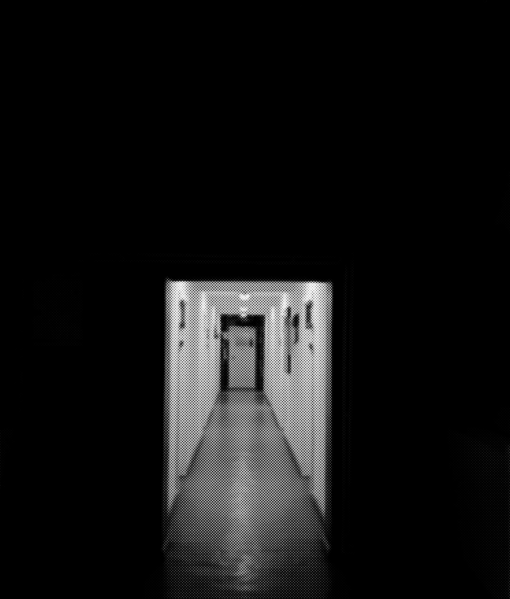
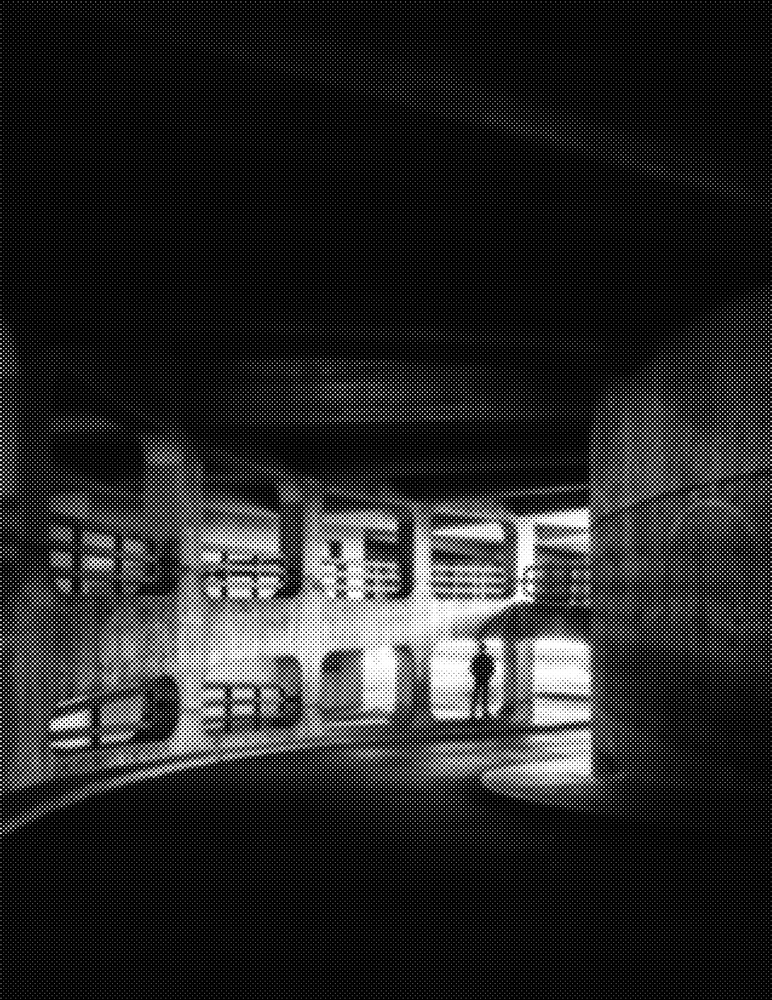
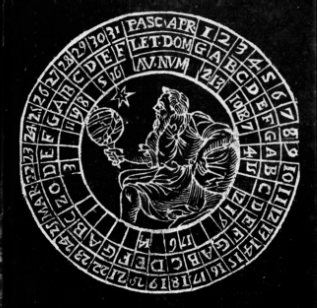
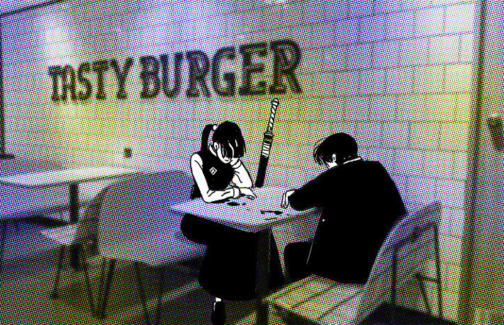
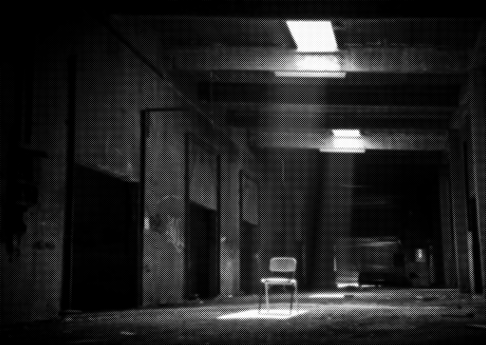
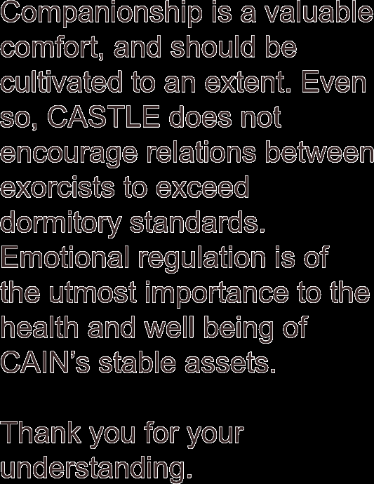
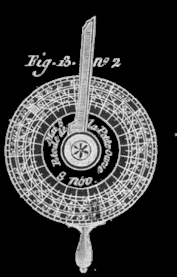
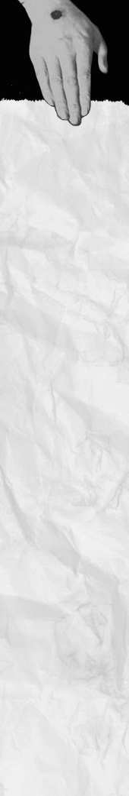
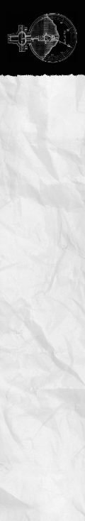

# Investigation, Traumas & Clue Unraveling

> Source: CAIN 1.0 Rulebook (Pages 19, 20)

---
### Page 19 Source Content

# **2. Arrival** 

After the briefing, the exorcists **arrive** on the scene. It is traditional for them to arrive in CAIN black helicopters or armored cars but public transit can also make an appearance. 

Exorcists that arrive have a ‘full refresh’ of sorts. They always start with **full stress, no injuries, no hooks, 3 psyche bursts,** and **all their kit points** 

The only burden an exorcist carries from mission to mission is their current level of sin (after halving at mission end). 

there when injured there to heal and recuperate - it is **impossible to slay it permanently outside** . If slain outside, the Sin retreats into its palace and regenerates, and is trapped there until pressure increases. 

If a Sin is fought inside of its palace, however, it can be fully destroyed and has nowhere to retreat to. This forces an **execution scene.** 

Exorcists that enter a sin’s palace can forcibly summon it there if it is outside. All exorcists are able to use the **Nail of Abel** , a psychic pulse that forces a Sin back into its palace. To use it, however, they need one of the following: 

# **4a. Investigation** 

Aside from tracking the sin, exorcists may want to take time to gather information. The main purpose of this is to investigate the sin’s capabilities or its traumas. 

Investigating may take only a few rolls to make progress, but depending on the exorcist’s approach, the goal of the exorcist’s activities, and the complexity of gathering information, the Admin can set out a talisman to roll on. 

Then, roll 1d3. **Reduce any stress suff ered by all targets by the amount on the die** , and the sin immediately takes **that many slashes** on its execution clock from the psychic trauma, which cannot reduce it below 1. 

Exorcists that counter a sin’s reaction may: 

- Make appeals to its humanity 

- Throw it off guard with sensitive information 

- Enrage or distract it 

- Reveal a weakness 

Each question can **only be used once!** 

# **3. Tracking** 

All sins create a warped pocket reality called a **palace** , a kind of lair where the world has twisted to accommodate it. Tracking the Sin down to its palace, and tracking down the sin’s host, is one of the main purposes of the exorcists’ mission. A palace is **always nearby** where the Sin is most active, and is **always inside the investigation area.** 

Exorcists that track a sin might: 

- use their supernatural abilities to sniff out its traces and taint 

- try to search for evidence of its palace in the environment 

- follow clues based on its victims 

- pull on social connections that its host has 

- track down its host, and whatever state they are in 

A palace is a parasitic extra-dimensional space and its inside may not conform to the rules of mundane reality. Its entrance can be invisible to mundane humans, and is often hidden in plain sight. Its appearance inside often reflects the psyche of the sin and its host. 

Tracking a sin’s palace down is important, since if fought outside of its palace, a Sin may slip away 

- The physical presence of the Sin’s host 

- An object or person precious to the Sin’s host 

- A part of the Sin’s hosts’ body, even deceased. 

Otherwise, brave exorcists can confront and fight fight a sin outside of its palace and force it there. Exorcists that successfully track down a sin’s palace may not want to rush off to fight it however, as unprepared exorcists are usually dead exorcists. 

Exorcists that investigate might 

- examine the sin’s victims 

- observe or attempt to communicate with the sin 

- examine crime scenes or traces of the sin 

- gather information from witnesses or contacts 

- perform occult rituals or research 

## **Traumas** 

All Sins have traumas, events that have precipitated their birth from their host. When making a Sin, the Admin answers the sin’s trauma questions and establishes traumas based on the answers. In essence, traumas are at the center of the human tragedy that forms the core of hunts. 

Exorcists start a hunt knowing the sin’s type, and therefore its trauma questions (but not the answers). 

## **Countering** 

If they are able to investigate and uncover traumas by discovering their answers, when exorcists fight the sin in an execution scene and the sin reacts to their actions, they can use each answer to **counter** a sin’s reaction. 

Exorcists can use a counter **after** seeing the result of the risk die but **before** the GM announces a reaction. 

# **4b. Preparation** 

Exorcists may want to make preparations to confront the sin or constructing defenses against its domains. 

Exorcists can either prepare countermeasures against sin’s powers, work on assets to help them fight or track down the sin, or they can work on any other projects that will take time to prepare. For example: 

- writing talismans to counteract against a Sin’s power 

- preparing a trap 

- crafting improvised explosives 

- trying to convince civilians to leave the area 

- drawing a protective circle around a character 

- locating a working car 

In some cases, preparing may only take a single action roll, but for more lengthy or ambitious projects, the Admin should set out a talisman to roll on. 

**36** 

**37**

#### Extracted Visual Elements (Page 19)

---
### Page 20 Source Content

<!-- Start of picture text -->
C CASTLE <!-- End of picture text -->

# **4c. Rest** 

Exorcists that rest are recovering and letting time past. 

The exorcists must decide to rest as a group. If they do, pressure always increases by 1. 

Each exorcist **rolls 2d3** , then takes each die and assigns it to an item from the following list. They are able to make the same choice twice. 

- Regain that many psyche bursts 

- Recover stress equal to the d3 

- Erase slashes on a hook equal to the d3 

Resting also ends the effects of some powers and abilities, or resets others. 

# **5a. Tension** 

At the start of the hunt, the Admin will set out a **tension talisman** , visible to everyone. Tension increases when: 

## **• A scene passes** 

- A **1 result is rolled on a risk die** , but no more than once a scene. 

Not all exorcist activities can take a scene - some can be rolled in the background of other scenes, like preparation activities. If a scene is especially short, the Admin might not count it. 

However, the general rule is whenever a scene passes, tension is ticked up. **Each time the tension talisman goes to 3 slashes** , **empty it** . Then the Admin increases the **pressure talisman** (see below) by 1 and picks a **tension move** to activate. 

Tension moves often improve a Sin’s position, impede or harm the exorcists, or have some other deleterious effect on the world (see pg 104 for a list of them). 

Tension never increases during a conflict scene (see pg 42.) 

# **5b. Pressure** 

Each sin has a unique way that it affects or warps the world around it. This effect gets **worse and worse** the longer time goes on. 

At the start of a hunt, the Admin will set out a **pressure talisman** , visible to everyone, with a capacity of 6. As the talisman fills up, **the situation degrade** s, in a way unique to each sin. 

Pressure increases by 1 when exorcists **rest** , and **when the tension talisman fills up.** 

If the pressure talisman fills up completely and would be notched further, the situation gets **out of control** . The effects of this are noted in each sin’s pressure description. 

3 TENSION 6 PRESSURE 

the early bird gets the worm the late worm gets the bird 

**38** 

**39**

#### Extracted Visual Elements (Page 20)

## Related Knowledge Nodes

- [[Phases_of_The_Hunt]]
- [[Divine_Agony_and_Talismans]]
- [[Sins_and_The_Flesh]]
