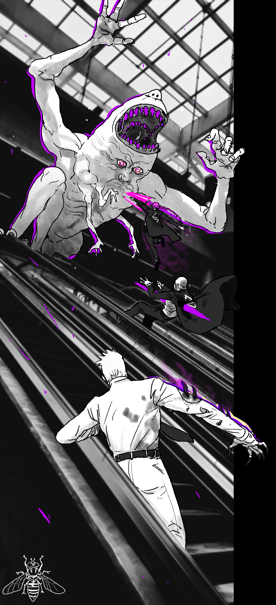
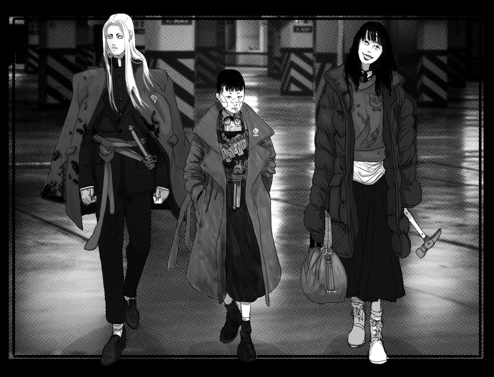

# Conflict Scenes, Rounds, Positioning & Actions

> Source: CAIN 1.0 Rulebook (Pages 21, 22)

---
### Page 21 Source Content

# **6. Execution** 

Each sin has an **execution talisman** . Broadly speaking, the execution talisman determines how the Sin functions in a **conflict scene.** It also gives the exorcists a talisman to roll against when going up against the Sin in a conflict situation. It’s the lifeblood of the sin - when exorcists attack or otherwise attempt to take action to **harm** or **defea** t the Sin, it’s this talisman that fills up. 

#### **The talisman is equal to 6 + its category** 

The following rules apply when fighting a Sin: 

- Fighting a sin in a conflict scene is **always risky** by default. 

- Sins **react** differently to the exorcist’s actions **based on the risk roll.** They may lash out, create a threat or obstacle, or initiate a dangerous attack. There is a list of reactions for the Admin to improvise on each sin sheet. 

- Exorcists can invoke one of the sin’s traumas to counter a reaction, reducing the stress it inflicts and directly dealing damage to a sin 

- If fought outside its palace, a Sin is shunted back to its palace when it takes **4 slashes** or it’s **reduced to 0** . It regenerates either when confronted, or when pressure increases, regaining **1 notch** on its talisman, or **2d3** if it has 0. 

- If a sin is fought inside its palace, it **cannot flee** , and must fight in an execution scene until its defeat. 

### EXECUTE 

_The execution is complete; divine judgement has been passed, the world was returned to an inert state._ 

**Executing** a sin makes the mission a success and pays out **5 scrip** to each exorcist. Executing a sin is usually not immediately fatal for a living host, but is extremely traumatic, and the host is nearly always taken under custody of CAIN for monitoring, rehabilitation, or possible recruitment. 

**Fact:** In around 20% of cases, those that 

have hosted  a sin are executed anyway due to manifesting sin marks and losing control. The rest, if not recruited, usually live in CAIN custody for long periods, sometimes the rest of their lives*. 

C 

Ref manual 0098 pg 67 

### **FAIL** 

_The execution was a failure; the stain was not wiped away._ 

**Failing** an execution by perishing as a group, fleeing the investigation, or refusing to execute a vulnerable sin, immediately ends the hunt. CAIN will call in **total expurgation** of the area via orbital rail drop to prevent a sin event, and advise the exorcists to exfiltrate (if they are alive). Surviving exorcists will be appropriately disciplined and also **docked 1 scrip** . Necessary coverup, casualties, and cleanup will be extensive. 

When this happens, the host may (bit by bit, part by part) regain control. 

In such a case, the execution is still deemed a failure, but since there is no Sin detected by Cain in the area, there is no reason to order expurgation. The exorcists are recalled and **paid 3 scrip for hazard pay** . They are then debriefed, questioned, then sent to their next assignment. 

_Sparing a sin is a judgement call. Can you afford to risk the spread of the stain? Is the mercy in your heart a weakness?_ 

THE GOOD HUNTER LOVES NOTHING. XXX0357 11:52am As above, so below 

## **7. Exfiltration** 

Hunters are exfiltrated from the area, usually in CAIN black helicopters, then brought back to the nearest CAIN post or carrier vessel for debriefing. 

- If the execution was successful they are each paid **5 scrip** . If the execution was a failure they are docked **1 scrip.** If the sin was spared, they gain **3 scrip** 

- They gain **1 xp** and **1 scrip** for each dead exorcist they recover. 

- They **halve all sin.** 

#### **Unless.** 

When the talisman is filled up completely in an execution scene, the Sin is **at the mercy** of the exorcists. They have a choice: to **Execute** or **Fail.** 

Though sins usually dissipate instantly on execution, some do not and may plead for mercy, shelter, or abeyance. 

! 

- They can **mark a mission survived** and potentially rank up in category 

If at **least one trauma question** has been answered and unveiled to the Sin… 

They are then allowed a period of rest before they proceed to their next mission. **SPARE** it is rumored (in hushed whispers) a Sin may be **spared** and brought back from the brink, crushed under the weight of its own contradictions, and forced to recede back into the psyche. 

**40** 

**41**

#### Extracted Visual Elements (Page 21)

---
### Page 22 Source Content

- **Tension never increase** s during a conflict scene, and tension doesn’t increase due to a conflict scene passing. 

# **Conflict Scenes** 

## **1. Establish stakes** 

The rules so far have been about freeform play. If the group feels like a situation calls for even more structured play, they can use the conflict rules. These rules are for playing out scenes that are exactly as they sound - a **conflict scene** , usually with two or more sides, such as a battle. 

At the start of a conflict scene, both sides establish what they want out of the conflict. Sometime this is very simple (I want to escape, I want you to listen to me, I want you dead). These are the **stakes** of the scene. If the opposite side is willing to budge on the stakes, then there probably isn't a conflict - or find out new stakes. You can use them as a good guide to how each side should act, and also as to when the scene should end or one side should give up. 

Conflicts are usually violent, but don’t necessarily have to be rely on violence - depending on context they could also be used to play out a chase, a stealth sequence, a friendly contest, or a trial. 

## **2. Establish the scene and set out talismans.** 

Conflict scenes have slightly different rules to regular, freeform play: 

_Where are the characters? Where are their opponents? What is the location and what resources are available?_ 

- A conflict scene can be started when the **stakes of the scene are high** and there are **two or more sides in opposition.** 

- Conflict scenes are **always risky** by default. Otherwise, they wouldn’t be conflict scenes! 

Also set out any **talismans** you expect to use during the scene. 

These talismans should represent important tasks, goals, or parameters for the scene. For a fight with a Sin, you usually use the **Execution talisman** , for example. If you’re just trying to escape it, however, you might use an ‘ _escape_ ’ talisman representing your ability to get away. You might set out talismans representing obstacles, opponents, or time limits. 

## **3. Players choose actions** 

The player characters (the exorcists) **always act first in a conflict scene** . When a player acts, they can choose one of the following courses of action. The actions are descriptive, not proscriptive. Characters should generally think about what they want to do in a scene, then try and think about what action their activities fall under. 

- **Act:** Take direct action against one of the goals, talismans, or obstacles in a fight. In very simple terms, this could just be fighting your opponent. It could also be driving a car, launching a verbal assault, neutralizing poison, healing a dying person, or sneaking in through a vent. 

- **Defend:** Prepare to defend an ally. Choose an ally. The next time that ally takes consequences while you are defending them, roll 1d6. On a 1-3, you reduce stress suffered by them by 1, but also take 1 stress. On a 4/5 you don’t take stress, and on a 6 reduce stress suffered by 2 instead. This effect does not stack from multiple defenders. 

- **Set Up or Teamwork:** Perform teamwork with an ally in another action, or take a set up action. These are identical to the activities described on pg. 15-16. 

**• Analyze:** Gather information during the scene. This can progress a talisman, create a new talisman, or reveal the capabilities of opponents. Analyze can be used to change the parameters of the scene or create an opening or opportunity, like a new route in a chase, or a gap in an opponent’s fighting style. This is a more permanent change than a set up action and is typically more powerful. Talismans created by Analyze  can grant advantage dice, make a situation less hard, or make it less risky. 

- **Flee:** Get out of the conflict scene. The Admin might require a talisman for this if it’s hard to leave. Once out, a character is **out for the rest of the scene** but is **considered safe.** 

## **4. Characters Act** 

Characters can act one at a time, in any order. Characters that are performing teamwork or defending another character don’t trigger a risk roll from an opponent. **Any other action does,** including those that don’t normally make that roll, unless someone has specifically set up that action to be less risky. When all player characters have taken their action, **a round passes** . 

Some effects from abilities rely on rounds and the Admin might set a round time limit in order to keep things concise. 

## **5. Opponents React** 

Instead of taking their own actions, NPCs or obstacles the Admin controls in the scene will use the **risk die to inform their reactions** . Each time a player takes an action, such as attack, analyze, or set up, the Admin uses the risk die and **reacts.** These reactions can often be found as a list of suggestions, such as on a sin’s sheet. The Admin can only take **one reaction** at once it they have multiple to choose from or multiple opponents are present. 

These reactions often **inflict stress** on the exorcists, change the stakes of the situation with a **complication,** or **threaten** them with worse consequences. The Admin is always free to not use a proscribed reaction, but instead to improvise an outcome as normal based on the die result, fiction, and circumstances. 

## **Concluding a conflict scene** 

Play continues until one side has accomplished their goals or settled the stakes, or other parameters such as a time limit have been reached. 

**42** 

**43**

#### Extracted Visual Elements (Page 22)

## Related Knowledge Nodes

- [[Core_Mechanics_and_Action_Roll]]
- [[Divine_Agony_and_Talismans]]
- [[The_Sins_and_Bestiary]]
