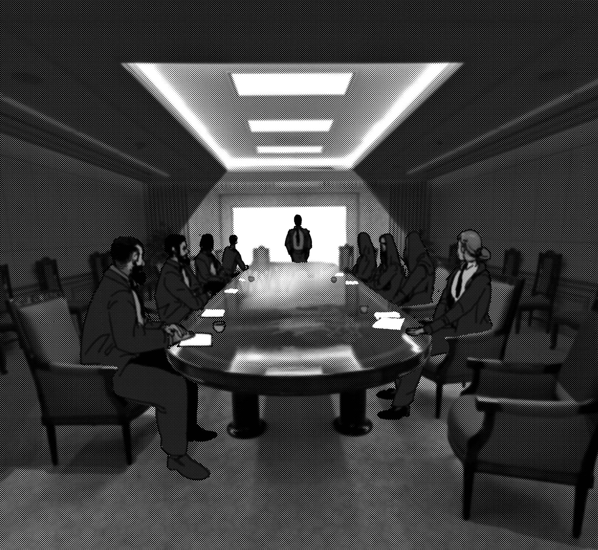
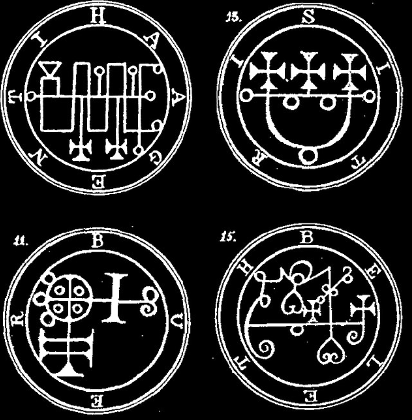
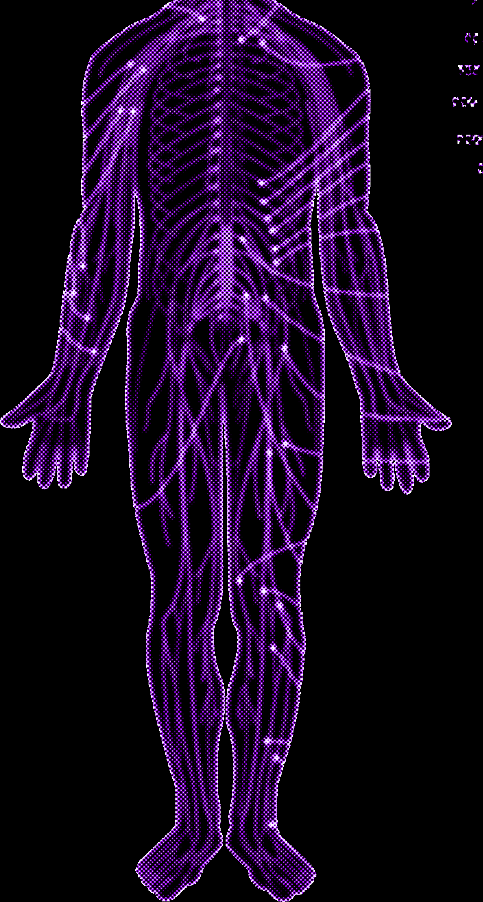

# Director Principles, Safety First & Pacing

> Source: CAIN 1.0 Rulebook (Pages 45, 46, 47)

---
### Page 45 Source Content

This section is mostly for the player acting as **Admin** who will be running the story of the game, the investigation, the Sin, and all the NPCs. Players who are not planning to act as Admin may also wish to skim through it, but should avoid the Sins section if they want to keep certain information a surprise. 

# **Running CAIN** 

## Safety First 

CAIN contains numerous references to and implications of abuse, self-harm, trauma, and mental health crises. By default the game is about untangling the **traumatic events** that have led to a sin’s birth, which requires engagement with that history. For this reason, CAIN **might not be a good fit for your table** , you, or your players. 

It is critical if you are the Admin and are planning in including any of these topics in an investigation that you handle this with care and **specifically discuss your intentions with your players** beforehand, and respect any boundaries or requests that your players make of you. There are numerous safety toolkits available online that can be helpful for running games like this, but for a simple start I recommend the following 

- Without discussing specifics, ask your players, based on their comfort level (this can be done in private), topics that should be omitted from the game. Then **respect that boundary** . 

- If a player ever is experiencing discomfort for any reason during a game, **pull back and pause.** Ask the table, without discussing specifics, whether they’d like to continue or whether they would like to skip past the current sequence of events, no questions asked. Then **respect that boundary.** 

**• Have a tone discussion with your players** before even starting a game. Ask what players want out of the game, what topics they are interesting in exploring, and what topics they are interested in avoiding - these don’t even have to be potentially objectionable topics. 

References to these topics in game are kept vague for a reason. You are free to adjust their importance and representation here as you like. 

## Principles and Tips 

Here are some basic principles I think the Admin should try to follow when running a game of CAIN that will help the game run smoother. 

**1. Put the fiction first** : CAIN is a story-forward game. The fiction (do you have a gun or bare, broken knuckles? Are you standing in the dark waiting for an ambush or out in the open?) is an important part of playing the game and helps determine the circumstances around rolls. The Admin uses these cues to adjudicate rolls, making them hard, risky, or giving them extra dice. Small details like whether you are tired or how you feel about a situation can become important! 

**2. Only roll when necessary:** Roll when the situation is tense, unclear, or contested, and let the game flow otherwise 

**3. Be a fan of the players:** The Admin should be a fan of the player characters and try to view the playing of this game as a collaborative storytelling experience - not as a competitive one. The players are the main characters of the story, and they should get the spotlight and a chance to shine. If a player failed a roll, it’s not because they were incompetent - circumstances just weren’t on their side. Take opportunities to let characters shine and show off. 

**4. Make information available:** Make information available to the player characters wherever possible, unless hiding it would create interesting tension. If a character hunts for certain information that will progress the story, just give it to them. This is especially important in an investigative game, where the tension comes from connecting the dots and not finding every little piece of the puzzle. Don’t bog down the investigation by hiding information behind rolls - reward player curiosity! 

**5. Respect player initiative:** Don’t be afraid to push things along if the story is slogging, but never do this without giving your players an opportunity to do so first. Offer them chances to change a situation, take action, or reach a desired outcome. 

**88** 

**89**

#### Extracted Visual Elements (Page 45)

---
### Page 46 Source Content

**6. Don’t be afraid to pull things back** : Pull back from in character conversations and have them out of character if things feel like they are getting stuck or a conflict is arising between players or players and the Admin that needs mediating. Feel out the situation and ask the players (and characters) what they want before diving back in. Letting mediation take place directly between players can be a more comfortable place for a conversation. Often times things can be done quickly ‘off screen’ or out of character that aren’t important to play out in game. Don’t feel the need to do everything in character - there’s no audience watching! 

**7. Put player safety first:** Always respect player safety and never cross a boundary that a player has asked to be respected. Set enforceable and consistent safety rules for your game and make sure they are clear to all players. 

# **Inter-character conflict** 

Characters might sometimes get at odds with each other, especially if their worldviews or belief systems clash. In such a case, it’s important to first make sure the conflict is **between characters** , and **not players.** Then, pause the game and pull back, then do the following negotiation: 

• Out of character, ask each player what their character wants out of the situation, and if they are willing to compromise once they’ve heard the other party’s desires. Sometimes hearing this can help players realize their characters are willing to concede or don’t want something as badly as they thought. 

- Take suggestions for offers that would help resolve the situation. 

- Then, bring it back in character and play it out. 

If characters are truly at odds, it can be helpful to remind players that the tone of the story is one where characters **have to work together** - perhaps by necessity more than desire, and whether it’s worth continuing a character whose basic desires and needs are so out of line with their group. It might not be an enjoyable experience moving forward! 

If players are still at odds and both still want to resolve a conflict, they can make a **roll off.** Importantly, they **both must agree to a contest.** 

- Each party names what they want out of the situation. Then they each roll 1d6, describing their characters actions. Exorcists of the same category are generally regarded as equally matched in skill. This roll cannot be modified in any way. 

• The winner of the die roll gets what they want out of the situation, the loser must cede it. If there’s a tie, the exorcists clash and pull back and there is no winner or loser. They must decide whether to roll again or concede to each other. 

• Exorcists **can never physically harm another in game terms.** An exorcist that gets into a fight with another may inflict pain or injury in the narrative, but it has no effect on an exorcists in game terms, such as stress, afflictions, or injuries. 

# **Setting, Tone, and Intention** 

CAIN was written mostly because I wanted a ‘monster of the week’ style investigation game married with the tone, styling, and pacing of supernatural battle shonen anime and manga. 

Here are some of its influences 

**• Anime/Manga:** Chainsaw Man, Jujutsu Kaisen, Bleach, D Gray Man, Akira, Neon Genesis Evangelion, Hellsing, Mob Psycho 100 

- **Video Games:** The Persona series, XCOM, Silent Hill, Resident Evil 

- **Music:** Vaporwave/Barber Beats, the music videos of Norbert Crowfield 

- **Movies** : Nearly any horror movie 

And here’s some of its quirks: 

- CAIN is very investigation/episodic focused - what can go on between investigations might as well (and probably should) be freeform roleplay 

- I foresee a ‘campaign’ of CAIN lasting probably ten or less sessions, at least to see a few sins or uncover some larger plot. People that develop a good game might want to push their exorcists all the way to category 5. It’s certainly not something I see people playing for years. 

• You will notice that base level exorcists deploy in uncomfortable shoes and a cassock, missing even basic necessities such as money or cell phones. This is by design. 

• By default Exorcists don’t have many uses of their powers, psyche burst being a fairly precious resource, and fighting sins hard using mundane means. They are therefore incentivized to dip into sin, an uncomfortable tension that I hope will create drama. If the Admin finds this tension too much, they can increase psyche burst to 4, or adjust sin overflow cap higher, or make it so sin is fully cleared after a mission. 

• Exorcists can choose to confront a sin right away if they find it, without uncovering the sin’s traumas. However, finding traumas both does damage to the sin and makes the fight much easier, so my intention is both investigation and combat are weighed fairly equally. 

# **Tone** 

The tone of the game by default is pretty brutal and oppressive and can be fairly lethal. The Admin by all means doesn’t have to stick to what’s in the book. CAIN operates by the following basic tonal rules: 

• The exorcists are treated as weapons, not people. They are as much prisoners as they are valuable assets. 

- The exorcists all have some kind of internal strife that drives them forward 

- Agendas will clash with each other, not everyone will agree on the path forward 

- Bodies and minds mutate, change, are twisted and affected in the course of the work 

- Confronting trauma in its most literal sense is the main work of the exorcists 

You can change these at your table as needed. 

# **Filling in the details** 

Here’s a few useful questions The Admin can ask themselves and players to fill details in in your version of CAIN: 

• Who is in charge of handling the exorcists? What does their deployment look like? Who are their points of contact? 

- What is CAIN potentially hiding from the exorcists? 

- How does CAIN style itself? What do the corridors of a CAIN facility look like? 

- What does it look like when someone manifests a sin? What do sins look like in your version of CAIN? 

- Who are the exorcists? How were they recruited? What is their history with each other? 

- What is each exorcists’s biggest fear? Their biggest desire? 

**90** 

**91**

#### Extracted Visual Elements (Page 46)

---
### Page 47 Source Content

## **Calling for rolls** 

CAIN is intended to be played, like many other narrative games, in a style where **rolls are only made when the game is in moments of uncertainty** , **elevated stake** s, or **elevated tension** . 

A good rule of thumb is to **only roll if you want to find out what happens next** - and don’t roll at all if the outcome is already clear. This includes things that might normally be tense, like getting into a fight. You can always refer to CAT or the exorcists’ abilities to judge this. For example, a CAT 5 exorcist with the Vector power can probably throw an 18 wheeler truck or a small building around. You can imagine all kinds of situations that would not be an issue for someone with that kind of power. 

When calling for a roll, the Admin doesn’t call for a specific skill to be used (though they are free to suggest one). Players choose the skill they are using and assemble the advantages they want on the roll. The Admin can adjudicate: 

- whether a roll is hard, risky, or impossible 

- whether advantages can apply to a roll 

- the consequences of a roll on a failure or mixed success 

Rolls should be creatively assembled when possible, improvising based on the situation. Players may **often gain more advantage dice than they have dice from skills** . This is by design, as it allows players to change their approach and use their abilities and creativity to get through situations. Always allow players to negotiate or even back out of rolls so rolling feels fair and on good terms. 

## **Using Category** 

CAT is a shorthand for the narrative scale of powers and supernatural forces. It serves two purposes: 

• It can be easily referred to when an exorcist wants an answer to the question ‘Can I do that?’. 

- It can also be a good reference for whether a roll should be hard, risky, impossible, or even required at all. To restate: tasks are usually hard if they are higher category, or impossible if they are three categories higher. The same goes for lower (easier if lower category, probably not a roll at all if three or more). 

General mundane capabilities of exorcists are usually CAT 0. CAT is not so strict and has some leeway for interpretation. Generally I view it as the following scale: 

- **0:** Small/human scale 

- **1:** Above average/exceptional human 

- **2** : Large/room or small group scale 

- **3:** Very large/vehicle scale 

- **4** : Massive/building scale 

- **5** : Overwhelming/block scale 

- 6: Epic/neighborhood scale 

**7** : Cataclysmic/Town scale 

Powers from blasphemies scale up in specific ways with CAT, and the powers and abilities of Sins can refer to CAT as a shorthand. When in doubt, bend these categories if it suits the tone of your game. 

# **Talismans** 

Talismans are this game’s versions of task trackers. You may have seen them in other similar narrative games in the form of clocks. They’re only talismans here because it fits the tone better. 

The general rule is to set out talismans if you want to track a **complex task,** if you want to **track a project,** or if you want to **track the progress** of something. As a shorthand, set out a talisman if you think a task or activity is going to take **more than one roll to accomplish.** 

Talismans are useful generally because they provide a clear goal and end point of an activity. Exorcists know that when they roll on a talisman, they are making concrete progress towards something, therefore talismans should always be public knowledge, and what they represent should always be resolved by filling up the talisman (positive or negative). 

Here’s a few tips about them: 

- Exorcists will usually score somewhere in the neighborhood of 0-2 successes on them. Therefore you can expect short talisman (2 segments) to take one or two rolls. Use this as a shorthand for how much rolling you expect on a task. 

• Always write talismans as descriptive, not proscriptive - let exorcists figure out how they want to make progress on them 

- Rolls on talismans that don’t fill them out all the way represent **partial progress** on a task, and can be narrated as such. ‘You get partway up the wall, but you’re out of handholds. You’ll need an extra push or a new approach to continue climbing the wall’. ‘You catch up with the fleeing man and corner him, but he still has a small chance to dart away.” 

- You shouldn’t put out talismans for every task, just the ones that look like they are going to be a little more complex. Most things should just be done in **one roll.** 

The most common talismans are execution talismans, which track the physical health and condition of both the exorcists and their opponents. There is also the tension and pressure talismans. Here’s some other ways to use talismans: 

- Set racing talismans out for a degrading situation, maybe as a complication in a fight. In this situation, exorcists are trying to fill up one talisman before another one fills up, slashing the bad one each time they take an action, or extra as a consequence for failure. For example: 

   - the house is falling apart and crumbling off of the cliff, in a few more minutes it will fall completely into the lake. Can you finish the fight in time? 

   - the survivors are under attack and being massacred one by one. Can you rescue them in time? 

   - reinforcements from the paramilitary group are about to arrive. Can you unlock the vault in time? 

- The same works for a chase scene or a stealth scene: set a talisman out for the pursuer and the pursued, or one for an alert level and a stealth goal. Fill one out when the players take action, and the other (negative one) automatically when rolls are made, or extra on failure. 

- You can set out a talisman to represent someone’s attitude towards the exorcists, with adjustments made based on their actions (higher values, better attitude and vice versa). 

- Talismans can be used to represent supplies, medicine, reinforcements, or some kind of limited resource, adjusting slashes when this resource is used up. 

- Talismans can be used to represent long form projects or investigations, maybe those that would last from hunt to hunt, or something that tracks a meta narrative. For example, a talisman could be used to track the exorcists’ status within CAIN, or their investigation into a secret organization, or their work on a hideout. 

**92** 

**93**

#### Extracted Visual Elements (Page 47)

## Related Knowledge Nodes

- [[Creating_Investigations]]
- [[Designing_Sins]]
- [[Phases_of_The_Hunt]]
