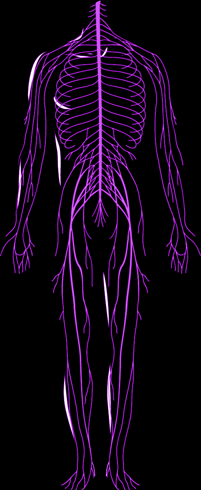
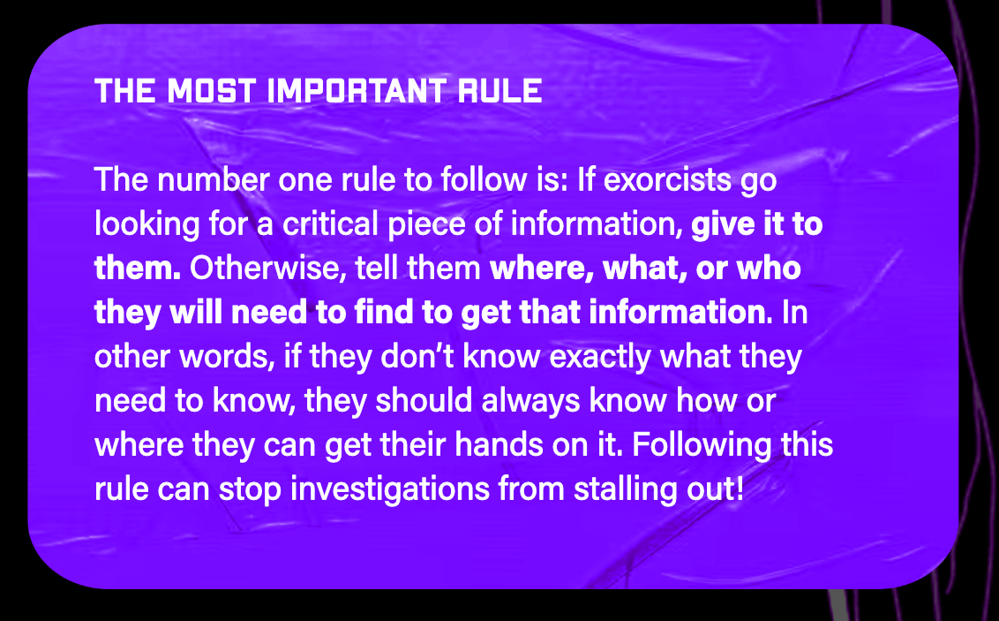
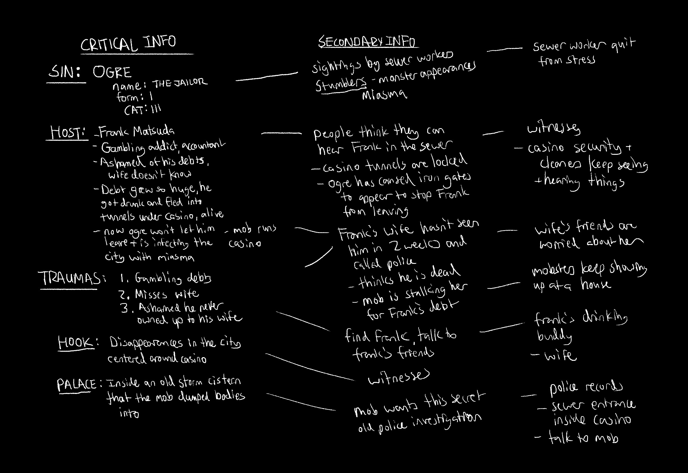
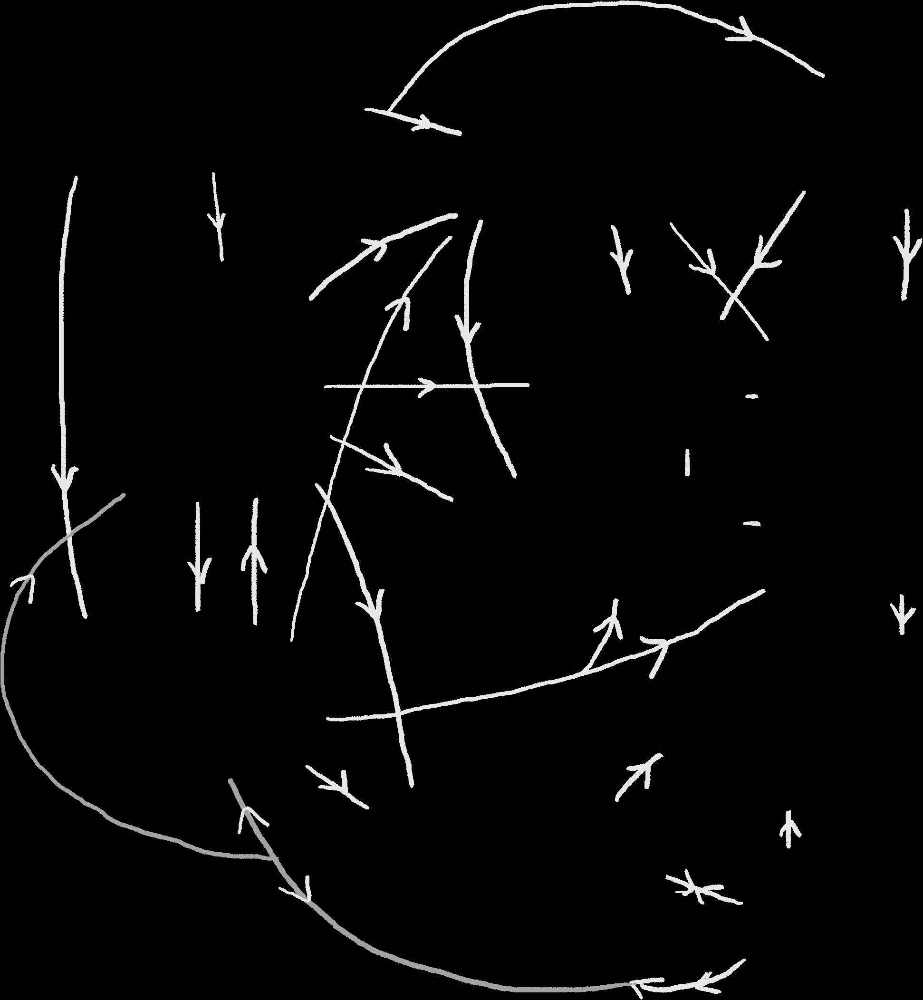

# Creating Investigations, Clue Webs & Pressure Clocks

> Source: CAIN 1.0 Rulebook (Pages 48, 49)

---
### Page 48 Source Content

Getting a feel for using progress trackers like talismans can really help control the flow and pacing of a game like CAIN. You can use them at both the very small scale of gameplay (the moment to moment action, like a fight) and the very large scale (long term projects). 

# Creating Investigations 

CAIN is centered around **investigations** , where the exorcists are dispatched to look into the emergence of a sin, unraveling the mystery of its birth along the way. Each investigation culminates in a **climactic fight** in a warped, extra-dimensional space against the sin itself: a supernatural entity made of rampant psychic power and human trauma. 

Writing an investigation is primarily the work of the Admin. An investigation can be tricky to run, unlike other role playing games, since they are typically more open rather than linear, and players are chasing clues and information that must be spread out and kept secret to maintain tension, but also has to be relatively available to players to move the story forward. 

Here are some basic tools for writing your own investigation that will help keep things moving at a core level, and let you structure investigations in a way that is clear and productive. 

### **Starting hooks** 

To start writing an investigation, the Admin can look to the following: 

First **, look to the sins themselves** . Since each investigation centers around the emergence of a sin, looking at their abilities, themes, behavior, and origins can help spark an idea. Reading through the sin sheet can also provide inspiration for inciting incidents. Look at the sin’s trauma questions and see if they create a story for you, as you’ll have to answer them anyway. 

Second **, think about something terrible that could happen to someone** . Sins are always born from trauma, and can manifest post mortem. Here’s a quick list of easy hooks, and some follow up questions: 

- The host was murdered (why? by whom?) 

- The host lost someone close to them (through sickness, accident, or something worse?) 

- The host has been suffering at the hands of another (a boss? a classmate? a partner?) 

- The host experienced a crushing loss (failing out of school, losing a home, getting fired, being romantically rejected, all the above?) 

- The host suffered a catastrophe (illness or accident, and what?) 

- The host was forced to give up on a dream (who or what?) 

Third, **the Admin can look to media for inspiratio** n. CAIN was written with the pacing of battle manga and horror movies in mind, where tension slowly builds into a climax. Check out the inspiration media or nearly any horror movie and think about how they build a story. 

Here’s some more specific **example hooks** for you to use or modify as a starting point using the above: 

• The sin host was a boring but doting father who had just bought concert tickets for his daughter. He missed a train from the city and decided to walk to the next station, was robbed and shot when he refused to give up his wallet with the tickets. The perpetrators panicked and dumped his corpse in a drainage canal, where it manifested a Hound sin, hellbent on hunting its killers (and random passers by). 

• The sin host, a successful financier, lost his wife to cancer when she was only 30 years old. She wanted children with him but he wanted to wait on his career, and feels immense guilt at delaying her decision. His grief manifested a Lord that created a kingdom at his workplace, transforming a 30 story skyscraper into a palatial tower where his many figment-children are overseen by a cadre of monstrous and overbearing nursemaids. 

• The host is an animator at an indie video game studio who is suffering from crushing amounts of work, regularly working 100+ hour work weeks and sleeping at the office. She began to dream about an accident so terrible it would save her from her brutal workload, and manifested a Centipede sin that caused an outbreak of monsters, causing a catastrophe that immediately killed dozens of people and created a five block quarantine zone in a downtown shopping district. 

• The host went to a prestigious college, but failed mid-way through the first year as she was distracted by partying. Unable to bring this news back to her distant, strict, and wealthy parents, she remained in her friend’s college dorm feigning attendance, spiraling into a deep depression, and manifesting an Ogre. 

- The host was in a random car accident that left them paralyzed below the waist, in a wheelchair, and in a long and painful process of recovery. Their only refuge during this long ordeal was online window shopping - looking at things they could not afford due to the heavy medical bills. They manifested a Toad sin masquerading as a delivery driver who began to gather the things they desired while the host 

was sleeping. 

- The host dreamed of becoming a DJ and music producer, but never made much money. When their overbearing and controlling partner landed a prestigious and well paying job, they were forced to stay home and become a homemaker instead of ‘wasting’ time and money at auditions. They manifested and fused with an Idol sin that allowed them to slip away at night, become a legend of the local nightclub scene, and gaining a cult. 

## **Structuring an investigation** 

Here’s a quick and simple way to structure an investigation. You’ll need a sheet of paper or a set of note cards and something to write with. 

First, assemble your **critical information** . This is the following: 

- The basic hook or inciting incident. What drew CAIN’s attention? Who or what called the exorcists here? 

- The sin’s host, their status and identity 

- The sin itself 

- The answers to the sin’s three trauma questions 

- Where the sin’s palace is located 

Then, assemble your **secondary information** . This is any person, place, or thing that is connected to a piece of critical information. You don’t have to go in great detail here, just write out the basic connections or details. Write in people, locations, evidence, objects, recent events, interlopers or foes, potential obstacles, etc. 

Then, you can **connect any of these pieces of information as you see fit** . Draw in the **direction** of information. You can draw this out with note cards or on a piece of paper if it helps and draw actual physical connections between them. I like to visualize it like a map. You can even make an actual map of the investigation area, drawing in locations as you go. 

**94** 

**95**

#### Extracted Visual Elements (Page 48)

---
### Page 49 Source Content

<!-- Start of picture text -->
THE HOOK The desert gambling city of  Las  THE WITNESS THE OTHER WITNESS Peligras  has had numerous disappearances centered around the Silver Star Casino. CAIN has picked  A  late night partygoer  Two sewer workers have up SIN readings of an  Ogre. saw the Ogre and passed  gone missing. One sewer out, finding herself in the  worker has quit from cistern. She’s being held  stress - he’s  seen things by the  mob  at an  offsite  he’d rather not describe. briefing briefing garage  for questioning. saw Heard frequently and investigated. saw Friends lost their THE MOB lives because of him THE JAILOR (OGRE) THE HOST Large, powerful criminal enterprise ,  Have seen, and Huge, hulking, bound runs the casino. Has a  want it gone. in iron chains.  Frank Matsuda  is a wife guy, a latent large force of  enforcers  Bloated flesh. Sees  psychic, and gambling addict who bit and  security systems,  its duty to keep  off more than he can chew, hiding his including in the  tunnels  Frank  imprisoned. debts from his wife and frequently underneath the city  visting the mob-run Silver Star Casino. where they often move  His debts caught up with him, and illicit goods. THE PALACE unable to return home, his shame catalyzed into an Ogre that manifested The Ogre’s  palace  has manifested  and trapped him in the tunnels under in an  old storm cistern  in the  the casino. Now he’s stuck there, Mob bribes police,  sewers dump bodies. The  once used by the mob to  mob  keeps it  barely surviving, and trying to escape, while the Ogre’s miasma filters up police  under lock and key. through the casino and the city. pressure mob Can tell all - providing he is alive. THE POLICE Unwilling without TRAUMAS assurances Beleaguered. Under funded. Corrupt. Maybe  one cop  here  What pushed you in this hole?  My gambling addiction. who actually wants to solve  What’s keeping you from going over the edge?  I love the case and will point the  my wife too much, even though I’ve been bad to her. exorcists in the right direction What are you most ashamed of?  I never owned up to my wife about my behavior, and hid it from her. I think she knows. FRANK’S WIFE Estranged. Exhausted. Hounded by  police about Frank’s gambling  and the  mob . Knew  know each other and frank THE DRINKING BUDDY addiction and may be able to  Good natured. Had heard about answer traumas. disappearances. Secretly a  mob informant,  but likes Frank and wants to help  locate him. May be able to answer traumas. Informant for both police and mob Investigating, halfheartedly start end protecting interrogating investigating briefing heard Trying to extort and kidnap Investigating <!-- End of picture text -->

Track the path of information that exorcists would have to follow to find the sin’s host, find the palace, find all three trauma question answers, and confront the sin. This is the **critical path** the exorcists will always follow if they’re trying to complete the investigation, so following it now will make sure it is obvious where players should go when they collect any piece of information. 

abandoned rail car a the edge of town and has been marked as a missing person. Giving them this critical information immediately might defuse tension, so instead the Admin looks at their secondary information and decides to tell the exorcists (through an NPC or an info packet) the location of the host’s best friend, who knows where the host is. When the exorcists arrive, the Admin decides the police have also arrived at the best friend’s apartment to interrogate them as a suspect about their friend’s disappearance. This creates a tense scene where the parameters and goals are clear. 

Sustaining tension comes from **putting obstacles or challenges in the path of the exorcists** and **not from hiding the information awa** y. Exorcists should **always** know where they need to go or who they need to talk to. If exorcists fail to make an uncooperative person talk, dig through some important files, or sneak into the police station morgue, then make sure to always offer them another path forward. 

# 

It can be very helpful to try to have **more than one connection** between pieces of information so that exorcists feel like there isn’t just one path forward. When you draw out connections between pieces of information at the start, try and make as many as possible. Draw in relationships, locations, objects - things that all these clues have in common that connect them. Imagine it like a simple maze that exorcists must navigate, from the edge to the center. 

The exorcists, in this case, fail to stop the friend from being arrested. The Admin can either offer a new challenge to break into the police station and rescue them, or give another piece of secondary information to move the story forward. 

For example: exorcists are trying to track down an Ogre sin’s host, who has hidden themselves in an 

**96** 

**97**

#### Extracted Visual Elements (Page 49)

## Related Knowledge Nodes

- [[Running_CAIN_and_Safety]]
- [[Designing_Sins]]
- [[Investigation_and_Traumas]]
