# Sin I: Ogre - Anatomical Ruin, Brute Carnage & Sunder

> Source: CAIN 1.0 Rulebook (Pages 56, 57, 58)

---
### Page 56 Source Content

# I. OGRE 

Enormous, misshapen, and hideously powerful, ogres are a common sin type that is nonetheless quite dangerous compared to others. 

Ogres are born out of people’s sense of **inadequacy** and **failure** , **shame,** and self-hatred, or just a deep desire for **misery.** When someone psychically sensitive falls into a deep hole of loathing and hopelessness, an ogre begins to form in their psyche and take root. 

Ogres commonly manifest in: 

- people ground down to a pulp by life - bullying, traffic, debt, overwork, etc 

- people who suffer from a deep, existential self loathing 

- people dealing with extreme grief 

**Primary emotion:** Despair 

**Appearance and Psychophysiology:** Ogres are almost always extremely large, strong, and bulky and manifest a typical malformed, monstrous appearance, often due to the low self worth of their hosts. When fused with a host, the host may appear to be a worse, ‘uglier’ version, as they judge themselves. An ogre’s mere presence sucks the energy and life out of a room, even if mundane humans cannot see it, lowering the temperature. They are associated with frost, mist, mud, and ill weather. When pressed in a fight they are enormously strong and durable, able to rapidly regenerate from their wounds, tear a human in half, and ignore even extreme punishment. 

**Behavior:** Ogres are unusual in that they are extremely anti-social, self deprecating, and conflict averse for sins, and usually just want to be left alone. It is extremely rare for ogres to manifest post mortem and they are typically very emotionally attached to their hosts. They are often co-dependent and may spend their time tormenting or comforting their host, sometimes both, preferring to push them and those around them into self destructive behavior or a deep laconic haze. 

## **ARCHIVE OGRES** 

### **THE MINOTAUR** 

### **BUCEPHALUS** 

### **BLUE OGRE** 

Subject O33, Type II, fused with CAT 4 ogre after release from her job for numerous workplace tardiness infractions due to extreme morning commute. Continued to roam highways, family called in subject of concern and exorcists <mark>XXX, XXXX,</mark> and <mark>XXX</mark> sent. Section of highway <mark>XXX</mark> 3 miles in diameter became miasma zone and was put under quarantine, exorcists were able to locate palace inside of parked car and execute around 0200, 30 hours after infiltration. 155 civilian casualties, no exorcists KIA, mission deemed largely successful. 

Possessed subject O76, post mortem, type III. O76 worked at major financial firm <mark>XXXXX a</mark> nd had been suffering from workplace hazing culture and harassment for five years and seven months. Upon manifestation the company building was converted into <mark>XXXXX</mark> trapping 153 humans inside, hunters were able to execute and exfiltrate with only <mark>a 30%</mark> casualty rate. 

Subject O167, Type I, semi-rural region in <mark>XXX. E</mark> xorcists called after murders of three high schoolers with supernatural cause suspected. Subject had failed to enter university, engage in employment, or attract any romantic relationships and had concealed these facts from his family out of shame for multiple years. Manifestation eliminated but no execution recorded, subject MIA. Exorcists were disciplined. 

TRAUMAS 

The Admin, as the ogre, answers the following questions, then establishes a trauma based on the truthful answers. 

- **Who or what pushed you into this hole?** 

- **Who or what is keeping you from going over the edge?** 

- **What are you most ashamed of?** 

_For every question the exorcists answer, they can_ **_counter_** _a sin’s reaction, rolling 1d3 after the sin acts._ **_Reduce any stress suff ered by all targets by the amount on the die_** _, and the sin immediately takes_ **_that many slashes_** _on its execution clock from the psychic trauma, which cannot reduce it below 1._ 

**110** 

**111**

#### Extracted Visual Elements (Page 56)

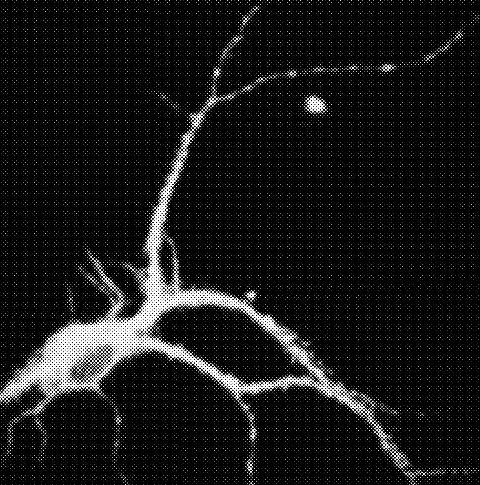

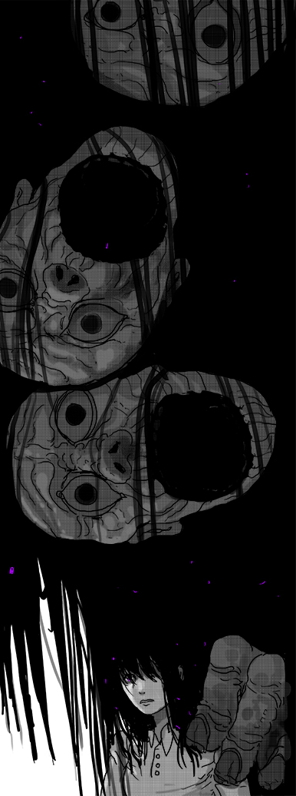
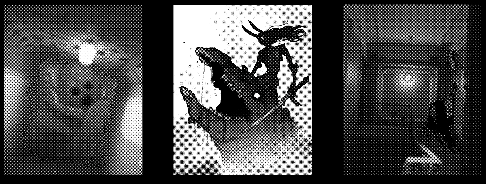

---
### Page 57 Source Content

## PALACE 

Tracking an ogre down is often a matter of finding its host, or where its host is currently residing. Once influenced by an ogre, a host usually withdraws from society and cuts off its connections, making this harder than it would usually be. 

An ogre’s palace typically resembles a mirror of a space significant to the ogre’s host, but long decayed and significantly expanded in size into a warren or maze-like space. Interspersed in the area is garbage, junk, and things the ogre has collected. The ogre typically barely fits inside and may have to painfully squeeze or crouch to move around, although this doesn’t seem to slow it down at all. 

Typical palaces resemble: 

- Abandoned or derelict buildings 

- Filthy high rise apartments 

- Closed or shuttered schools 

- Empty, dead workplaces or offices 

**Ogre palaces are:** Dark/Wet/Cold/Musty/ Reeking/Filthy 

## PRESSURE: MIASMA 

The very presence of an ogre begins to infect an area with a dark **Miasma** . When an ogre appears, the weather will typically sour in the local area over the next few days and remain that way until the ogre reaches critical mass and undergoes a sin event or is executed. This miasma typically manifests the following way: 

- buildings, objects, roads, and other constructions in the area begin to degrade as though they have suffered from poor maintenance for years 

- clouds shroud the sun and fog rolls in. Over time, the fog becomes thicker and thicker and eventually acquires a sour smell 

- a thick white mold begins to grow over surfaces 

- technology, phone lines, electricity, and internet stop working reliably, and eventually stops working all together 

- architecture stops conforming to sense and becomes maze-like or nonsensical 

- Humans spending time inside the miasmatic area begin to share in the ogre’s outlook and become more and more hostile 

When the exorcists arrive, the miasma should cover only part of the area the exorcists are trying to investigate, like a few blocks. **Each time pressure increases, the miasma spreads to a new area.** When pressure fills up completely, the situation **gets out of control. T** he Ogre increases in CAT by +1, and the **miasma covers the entire area of the investigation** - no matter where the exorcists go, the miasma follows them for the duration of the mission - even if they leave the investigation area. 

### STUMBLERSTRACES 

_Stumblers are bulbous and misshapen humanoids formed from the shame and guilt of the ogre and drawn to sources of warmth, such as humans. They start to appear in greater and greater numbers inside the miasma area and are partly visible to graceless humans, who can be driven catatonic by merely looking at one for longer than a glance. Though they don’t need to eat, they will rip apart living beings they come across and devour them._ 

**Stumblers (sins):** Execution talisman 2 (solo), 4 (group), 6 (massive group). The have the following features: 

- Disintegrate rapidly outside of the miasma. 

- Slow and uncoordinated. Actions that can take advantage of this roll +1D against them. 

- Take -1 slash from physical harm 

**Reactions:** 

**Inflict stress.** Attacks with: _misshapen body, rusted metal, spurts of fluid_ . **_(1)_** _3 stress,_ **_(2/3):_** _2 stress,_ **_(4+)_** _: 1 stress._ 

**Or:** create a complication or threat: _Grab someone, smother in flesh, infected bite, rupture and threaten to explode, fuse to wall, ear-splitting screaming, devour humans._ 

# EXECUTION 6+CAT 

**ATTACKS WITH:** T _eeth, claws, fetid water, black spew_ **_(1)_** _3 stress,_ **_(2/3):_** _2 stress,_ **_(4+)_** _: 1 stress._ 

THREATS: _Grab an exorcist and squeeze the life out of them. Hurl exorcist through a wall. Collapse architecture. Summon minions. Kill bystanders. Infect with dark pulsing veins. Cause a flash flood or freeze. Blind someone in a miasmatic cloud. Use a domain. Do something dark, crushing, or vile._ 

COMPLICATIONS: _Kill lights, summon mist, spew ceaselessly on someone, bury an exorcist in mud, slime, or vomit, pin down an exorcist, release acrid stench, smash walls, floor, or ceilings, retreat into darkness, add a bystander, use a domain._ 

## AFFLICTIONS 

## Severe Attack: Pulverize 

Usually given by a threat or a hook filling up. 

An ogre can use this ability on a ‘1’ on the risk roll, striking out with overwhelming and crushing force: a flurry of limbs, a torrent of darkness, an elephant-like foot, a cavernous jaw. They can only use it once a mission. 

**1. White Mold:** Spreading white veins and coughing indicate mold infection. Subtract 1 from all resting rolls while afflicted and cannot eat, drink, or use consumables. 

**Target an exorcist.** Any other exorcists nearby must decide to fly to their aid. Any that don’t offer aid cannot participate. Start with a pool of 5d6. Then remove one dice for each of the following. If an answer is ‘no’, you or someone aiding you can immediately make a single action roll to attempt rectify the answer, with only a few moments to act. 

   **2. Frozen Limbs:** Physical activity or fine motor skill is hard if it requires more than one limb. 

   **3. Circling the Drain** : Cannot benefit from teamwork or setup. Permanently add to your agenda: **give up on something.** 

   **4. Black Lungs:** Speaking spews out black sludge. All communication that requires speaking is hard 

- Is another person aiding you? They can describe how. 

- Can you grab on to something nearby? 

   **5. Rotting:** Black rot has taken in the body. Take 1 stress each time pressure fills up. If this inflicts an injury, it inflicts instant death. 

- Do you have a source of bright light or heat? 

- Is the ogre distracted, hindered, or under duress in some way? 

   **6. The Weight** : Permanently add to your agenda: **die.** 

- Then roll the dice. 

Or **improvise** : make a skill or activity hard or risky 

The exorcist and any aiding them take 1 stress for every die rolled, no matter the result. If at least one ‘1’ comes up, the targeted exorcist immediately takes an **injury** and the **mangled limbs** affliction: _all physical activity is hard unless set up by an ally or participating in teamwork._ 

If two or more ‘1’s come up, the exorcist has **one or more of their limbs torn off** (roll 1d3: 1: arm 2: leg 3: both legs). Roll 1d6 for left or right (left on 1-3, right on 4-6). They take an injury, pass out until the scene passes, then all physical activity is hard for them without teamwork. After the mission is over, they can adjust to their disability and this no longer has an effect on them (determine with Admin how your character heals). 

**112** 

**113**

#### Extracted Visual Elements (Page 57)

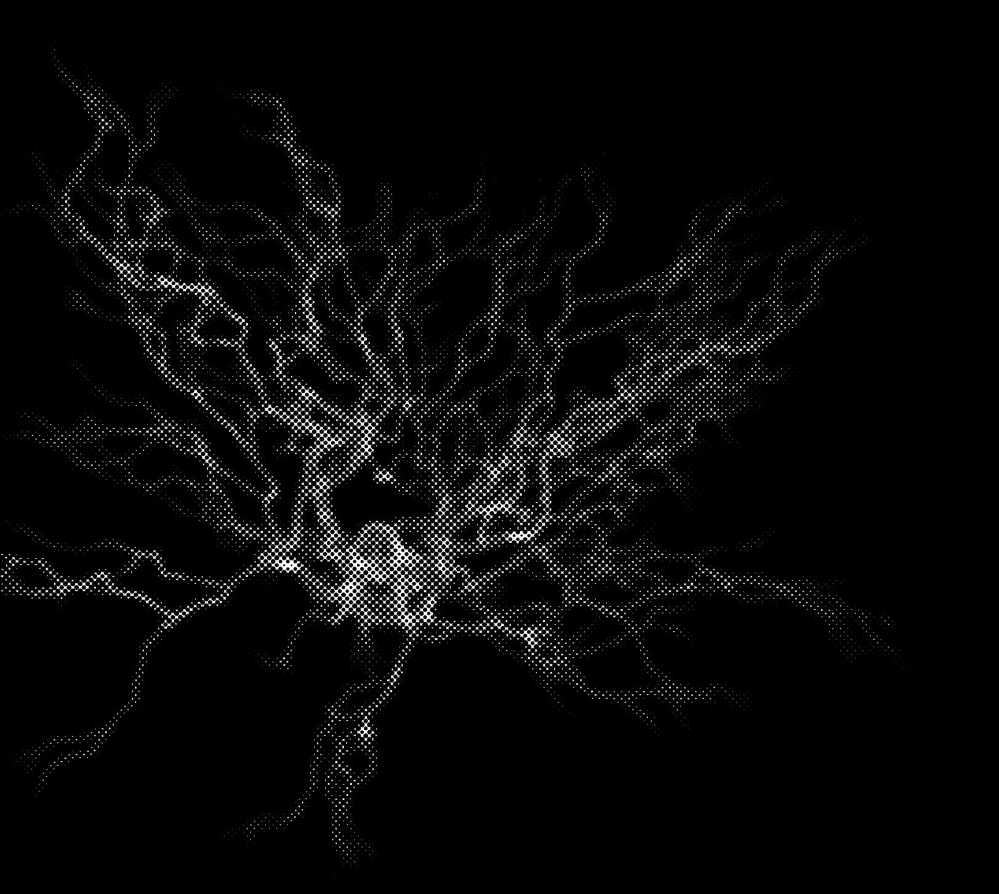
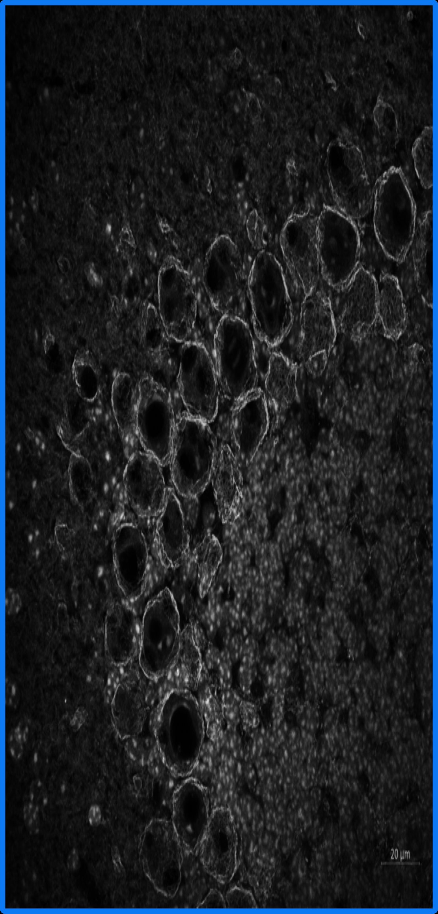
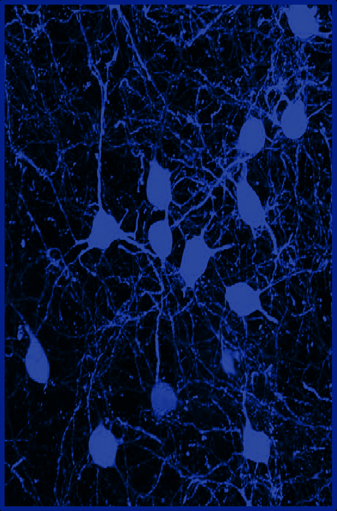

---
### Page 58 Source Content

# DOMAINS 

_Choose three._ 

### 1. Hostile Door Patterns 

The world itself begins to turn against the exorcists. As a **complication** or a **tension move** , the ogre supernaturally erases entrances, exits, roads, vehicles, or light sources in an area of about a city block. These return when the scene passes or if the complication is dealt with. 

Once a hunt, as a **tension move** , if an exorcist opens any door, the entire group suddenly finds themself in an area of twisting corridors, pitch black darkness, and distant but troubling noises. The area is both dangerous and hostile to them. Finding an exit and escaping will require playing out a scene or two, and the Admin can set out talismans as needed. 

### 2. The Unseeing of Things 

The miasma becomes permeated with an deep, cloying dark _._ The ogre is invisible in darkness. It becomes **hard** to do anything to the ogre unless it is brightly lit or an action doesn’t rely on sight. 

As a **tension move** , all electric lights not held by an exorcist sputter out and cease functioning for the next scene. The Admin picks an exorcist and asks them ‘What do you see in the dark?’. They must answer truthfully and gain 1 stress after answering. 

### 3. The Grinding of Wheels 

The ogre can force exorcists to experience some of the crushing trauma that caused its birth.As a **tension move** , the ogre can pick an exorcist. That exorcist is afflicted by the Despair affliction. 

DESPAIR: This special affliction can only affect one exorcist at once. They gain the agenda item **push people away** even if losing this affliction. At the end of the mission, roll a 1d6. On a 1 or 2, keep this agenda item, on a 3+ may get rid of it. 

Ask that exorcist the question **who in this group will let you down?** Any time the chosen person fails an action roll, the afflicted exorcist gains 1 stress. However, if this triggered at least once during a session, at the end of that session also gain 1 xp. 

### 4. That Awful Flesh 

The ogre can regenerate rapidly from injuries. 

- It regenerates 1 segment of the execution talisman every time a risk result of 1 is rolled in a conflict scene where it is present. 

- The ogre takes -1 slash on its execution talisman unless damage by fire, acid, or some other strong chemical or solvent in the same scene. 

### 5. The Inevitable Place of Meat 

The ogre can temporarily cause the miasma to accelerate its effects. 

- The touch of the ogre can rapidly rot and decay objects, plant matter, and constructions, destroying them and dissolving them into mud and slime. 

- Exorcists inside the miasma start to superficially rot if they spend scenes there - hair falling out, sunken skin, dead skin cells, nails falling out, etc. They recover from this damage after the mission. 

- As a **tension move** the ogre can cause an exorcist inside the miasma to start decaying. They gain a hook with the Rotting affliction. 

- Exorcists **subtract 1 from all their healing rolls.** 

### 6. The Lash Calls you Brother 

At the start of a mission, the Ogre chooses an exorcist and creates a creature formed from the guilt and shame of that exorcist. The Admin secretly asks the targeted exorcist the following questions: 

- Which ally are you embarrassed to be around? 

- What's the worst thing you ever did? 

- What do you hate the most about yourself? 

The creature takes a form that plays off these answers. It is a trace with the following execution talisman. 

## CRUSHER 

**Execution talisman 6.** If defeated, is destroyed permanently. It has the following features: 

- Deals +1 stress against the exorcist it is formed from 

- That exorcist’s actions are hard against it. 

- Attempts to harm only its target in a fight. 

**Reactions:** 

**Inflict stress** . Attacks with: _decaying, oversized weaponry, mutated flesh._ **_(1)_** _3 stress,_ **_(2/3):_** _2 stress,_ **_(4+)_** _: 1 stress._ 

**Or** : create a **complication** or **threat** : _Grab by the throat, Pin down someone, raise weapon to cleave, charge someone through a wall, floor, or door, swing wildly, cause collateral damage._ 

**Or: Force confession (1-3):** Force the exorcist to confess aloud the answer to one of the questions they answered, or else take 1d6 stress. Works once per question. 

### 7. Where You Belong 

The ogre can control mud, water, and ambient temperature to killing effect. 

The ogre can sink into any sufficiently large pool of mud and reappear in short distance as part of any reaction it takes. 

As a **tension move** , the ogre can change the weather in its miasma zone until the exorcists rest, making it extremely hostile (freezing cold, rain, etc). It becomes **hard** or **risky** (or both) to perform any activity outside that requires concentration, focus, or manual dexterity without sufficient protection from the weather. 

### 8. The Agony 

Once a hunt, when pressure increases, the ogre can pick an exorcist. That exorcist gains the Sunken **affliction** for the rest of the mission. 

SUNKEN: While afflicted, up to three times as mission, when you take action, the Admin may ask them the question: Is your heart really in this? 

- If you answer yes, you gain +1D on the action but also take 1d3+1 stress. 

- If the answer is no, you roll at 0D no matter what, but recover 1 psyche burst. 

**114** 

**115**

#### Extracted Visual Elements (Page 58)

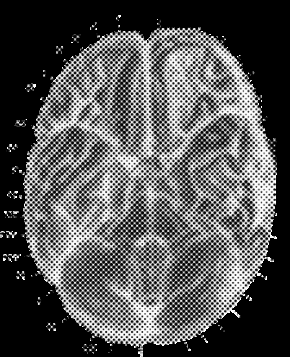
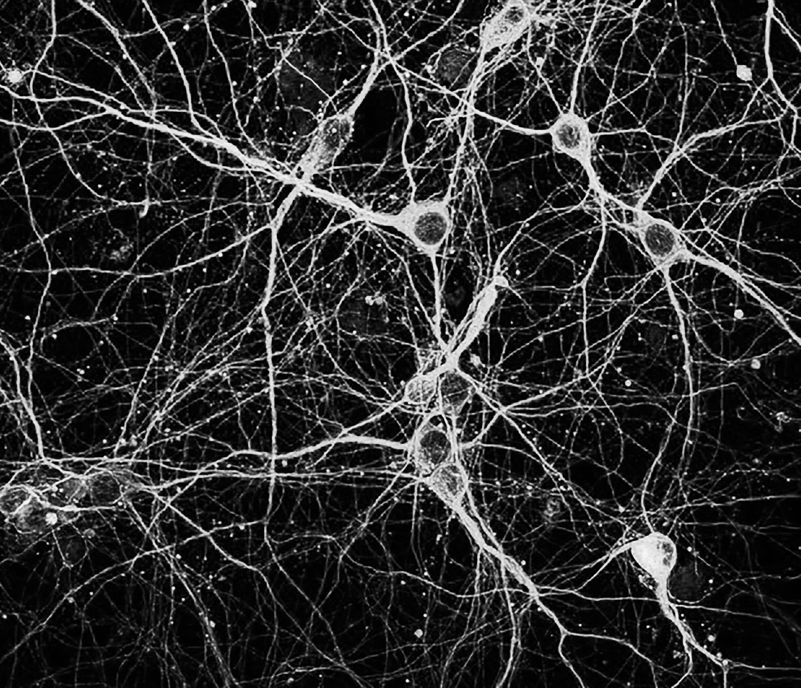
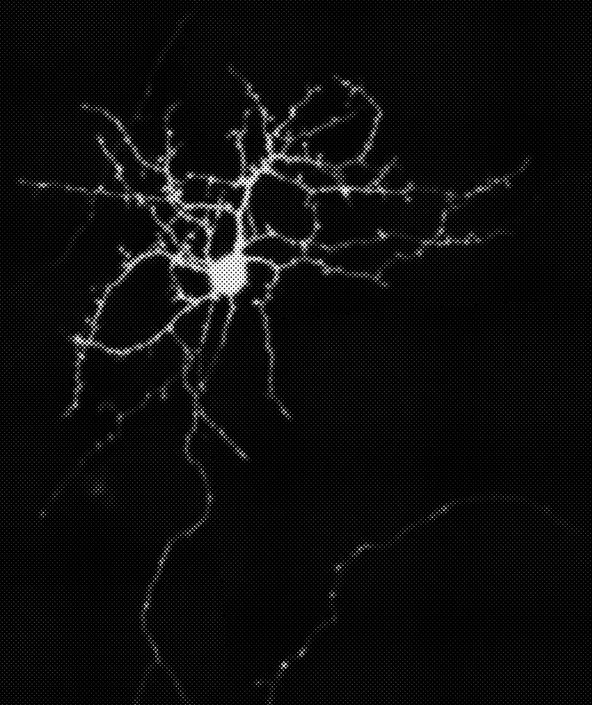
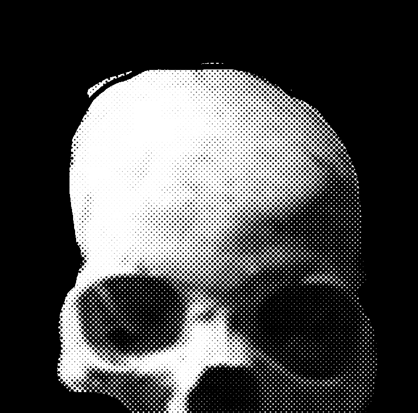
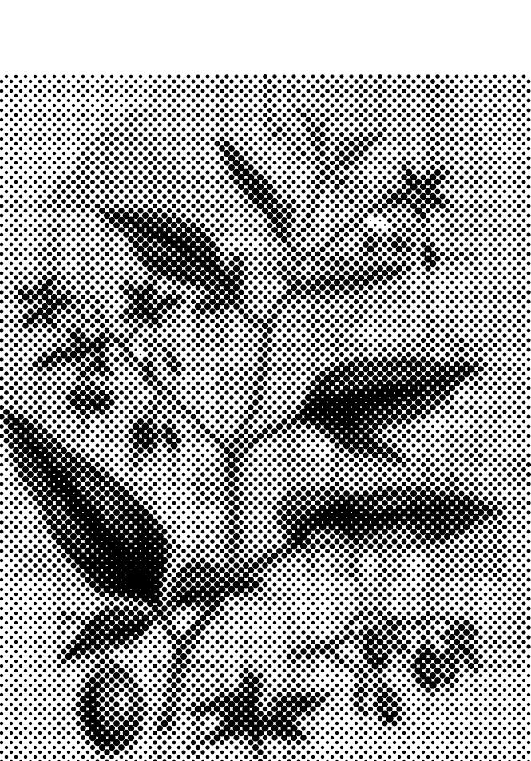
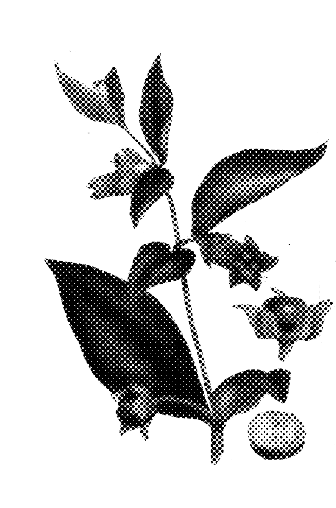
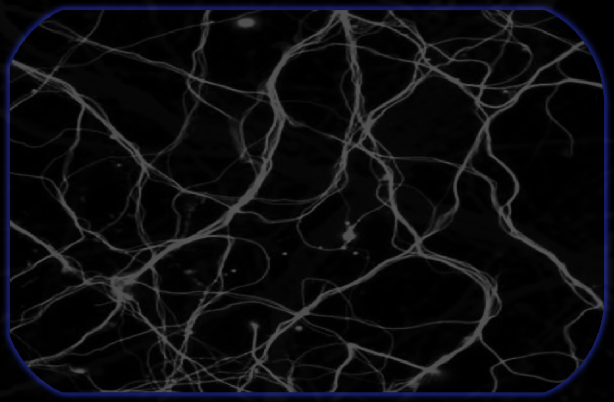

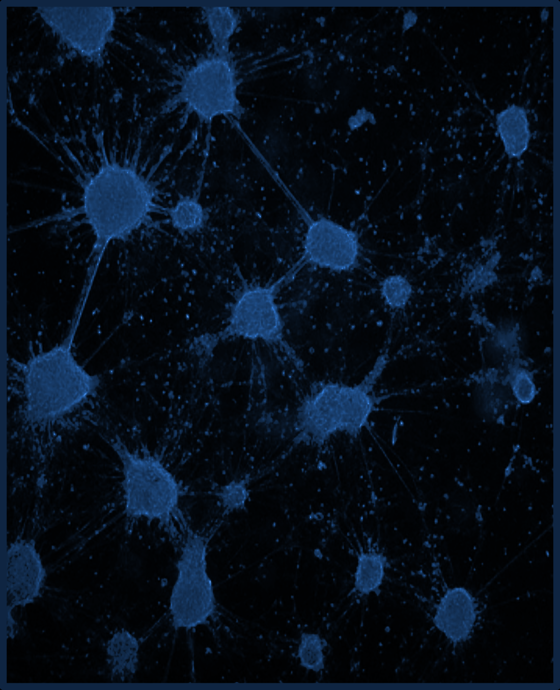

## High-Resolution Graphical Tables & Sheets

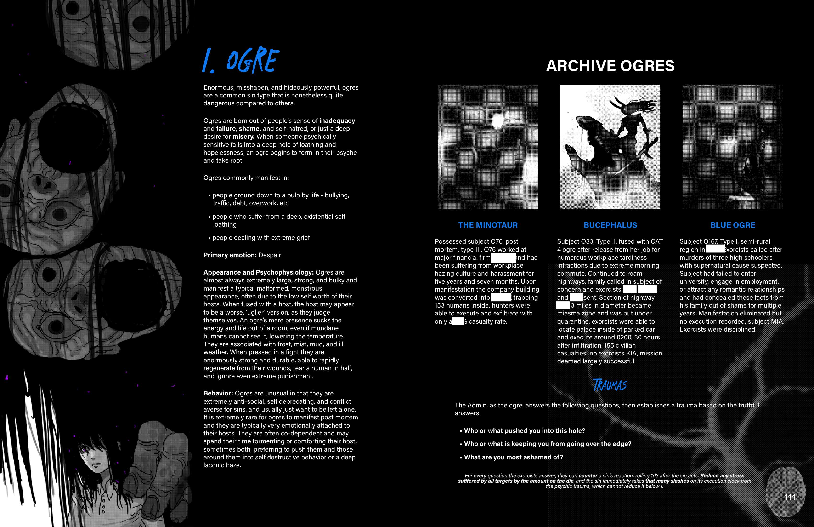

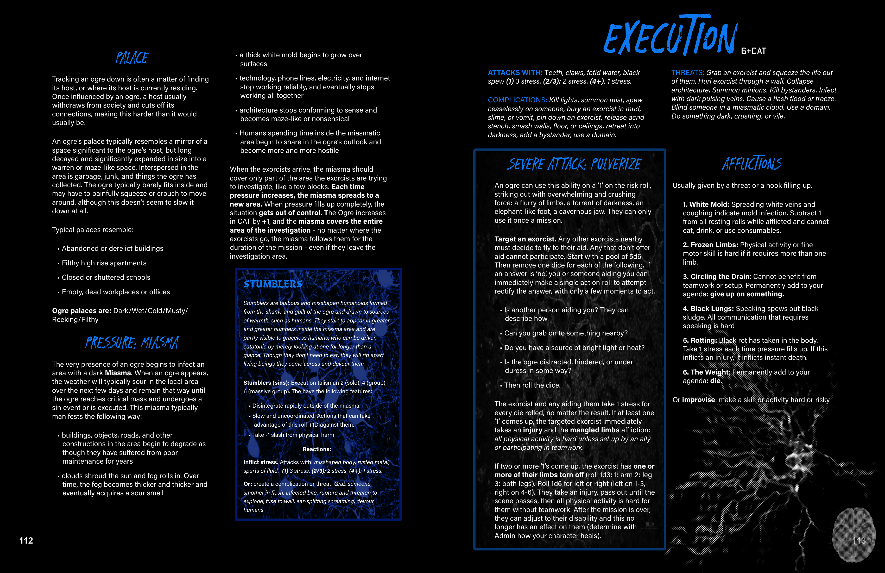

## Related Knowledge Nodes

- [[Designing_Sins]]
- [[Conflict_Scenes]]
- [[Divine_Agony_and_Talismans]]
