# Sin II: Idol - Hypnotic Vanity, Devotion & Aesthetic Mutilation

> Source: CAIN 1.0 Rulebook (Pages 59, 60, 61)

---
### Page 59 Source Content

# II. IDOL 

**Serene** and **charming** , idols radiate an otherworldly **beauty** and **poise.** Unlike other sins, they possess the unique ability to appear visible to the graceless, and often take humanlike form. 

Idols are born out of the basic human **desire to be wanted and loved** . In this way, they are sometimes regarded as the most generally benign in their intentions. However, much like other sins, their manifestation draws on the dark side of the human psyche and usually pulls their hosts into greater acts of **vanity** and **control.** 

Idols commonly manifest in: 

- failed actors, singers, or performers 

- people who suffer an extreme lack of fulfillment 

- people who have been abandoned or have lacked any human connection or love 

**Primary emotion** : Desire 

**Appearance and Psychophysiology** : Idols commonly appear as humanlike in form. They may appear as someone desired by their host: their hosts’ ideal romantic partner, a parental figure, or a best friend. When fused with their hosts, they may enhance their hosts into ‘ideal’, more perfect versions of themselves, usually enhancing features a host deems desirable, and eliminating those seen as undesirable. They have a godly, otherworldly beauty to them that can be stunning to humans, especially the graceless. When forced into a corner, or when they want to display their power, idols are capable of taking other, more terrible forms. 

**Behavior:** Idols radiate charisma, and unique among sins, draw other people to them, usually coalescing into a massive cult. Their voices and appearances are hypnotizing to the graceless and they are able to issue commands or suggestions that humans find nearly impossible to ignore. They can be charming, funny, and find it intolerable when they are not the center of attention. At their worst, they represent the worst aspects of love and desirability - absolute, almost sadistic control and selfishness. 

## **ARCHIVE IDOLS** 

### **BLOODY PRINCE** 

### **OUR FRIEND** 

### **THE LAUGHING MAN** 

Type I, manifested to subject I887, formerly popular idol group member XXxxxxXX. Sidelined by her talent agency, (later substantiated) allegations of abuse and stalking by management. Online speculation as to her disappearance substantiated investigation by SEER into cabaret club <mark>XXXxxxxxxxxX.</mark> Further records erased. 

Type II, fused to failed middle age businessman <mark>XXxxxxxXX.</mark> Subject recently divorced and estranged from adult children. Started populous cult Church of Family promising close family connections and revival through community events. Flourished for many years through <mark>XXxXX</mark> to <mark>XXxXX</mark> as a large and prosperous organization until detected by SEER after multiple kidnapping cases. Time to execution 3 hrs 35 minutes, 52 casualties. Deprogramming extensive. 

Type III manifestation, controlled by binder <mark>XXxxxXX (de</mark> ceased, ex. in captivity under the doctrine of John the Redeemer: record e3094). Popular online cult following would vote on targets for ‘prank’ video production posting on dark web, often choosing individuals of prestige and power including celebrities <mark>XxxxxXX</mark> and <mark>XXxxxxX.</mark> Located by seer after kidnapping of <mark>XXxxxxxxXX</mark> and death of well known actor <mark>XxxxxxXX. P</mark> alace located attached to laptop of subject and executed after 9 hours. 

TRAUMAS 

The Admin, as the idol, answers the following questions, then establishes a trauma based on the truthful answers. 

- What is your dream? 

- Why did you give up on your dream? 

- Why do you think you are you incapable of being loved? 

_For every question the exorcists answer, they can_ **_counter_** _a sin’s reaction, rolling 1d3 after the sin acts._ **_Reduce any stress suff ered by all targets by the amount on the die_** _, and the sin immediately takes_ **_that many slashes_** _on its execution clock from the psychic trauma, which cannot reduce it below 1._ 

**116** 

**117**

#### Extracted Visual Elements (Page 59)

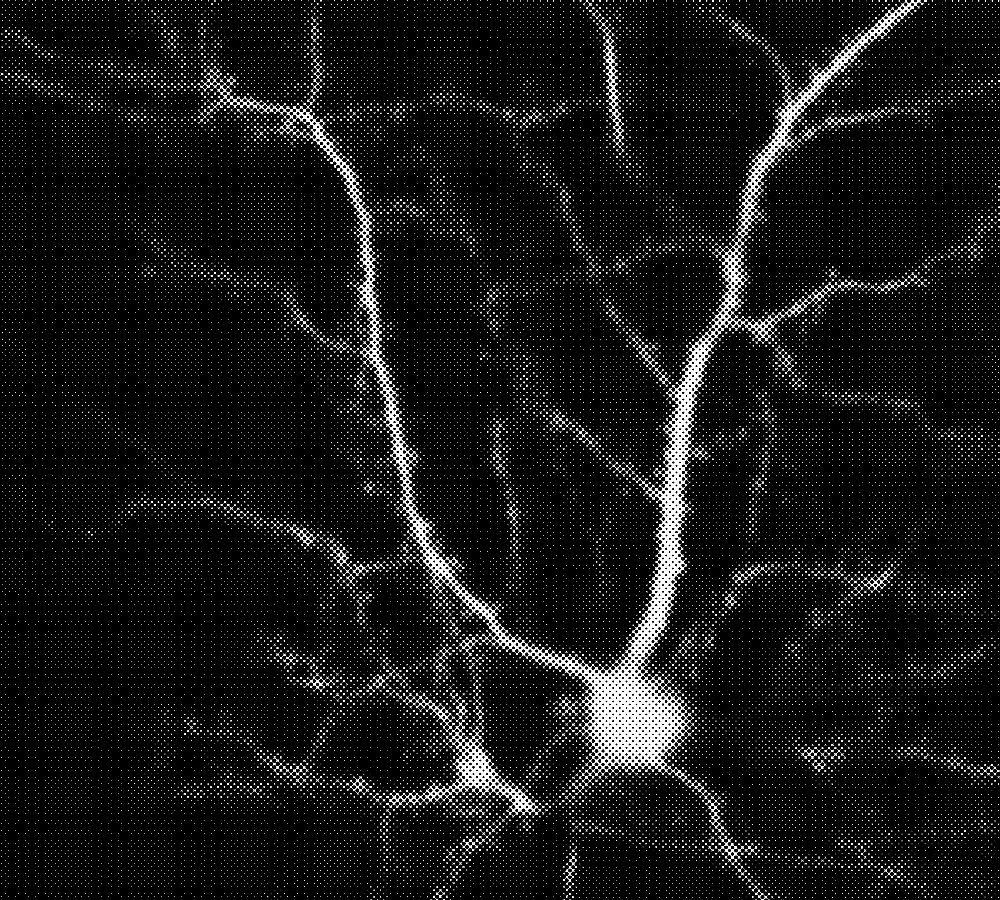

---
### Page 60 Source Content

## PALACE 

Idols tend to manifest their palace where their cult is located, typically in populated locations. They may have a front operation that covers the entrance to their palace and their cult in general - a news or internet program, a band, a concert hall, a religious gathering, etc. The true headquarters of their cult is typically more concealed and harder to access. At the center is usually an entrance to their palace, which the idol may invite select cult members in to visit in order to win them over. 

Depending on the aspiration of the sin, the interior of typical palaces is usually a monument to selfobsession and resembles: 

- Palatial estates 

- Nightclubs or concert halls 

- Beautiful high rise penthouse apartments 

- Religious halls or places of worship 

Idol palaces are typically: _Luxurious, gilded, airy, captivating, impressive, gaudy, holy_ 

## Pressure: CULT 

Idols gather **cults** around them, adding steadily to them over time. This varies from mundane admirers of the idol to people totally pulled under their spell. A lower category idol tends to pull people into a cult of a few dozen people, whereas a higher category one can pull in a cult that numbers in the hundreds or thousands. 

While the idol still lives, **cultists are completely and unflinchingly loyal to them and their host** , and will follow the commands and inclinations of their higher-ups in the cult without questioning. 

The idol is able to secretly add npcs to its cult. Every time pressure increases, the Admin chooses an NPC the players have met on the mission and adds them to the cult. They don’t have to reveal to this to the players. 

The NPC now follow the psychic commands and directives of the idol and abandon their former priorities and loyalties. 

When pressure fills up, the situation **goes out of control** . The Idol gains +1 Category and **adds every single NPC in the mission area to its cult** , including **any NPCs the exorcists encounter in the future.** 

## TRACES 

### CULTISTS 

_Cultists are mundane humans pulled under the supernatural influence of the Idol. They can behave normally when required but are functionally puppets, having their feeble will suppressed by the extremely powerful Grace of the sin. The idol will often deploy them for missions of importance or to infiltrate groups._ 

Defeating the idol will pull any cultists out of their brainwashing. They have no memory of their time when brainwashed. 

**Cultists (humans)** : Execution talisman 2 (solo), 4 (group), 6 (large group) 

**Reactions:** 

**Inflict stress.** Attacks with: _Bare hands, improvised melee weaponry._ **_(1)_** _3 stress,_ **_(2/3):_** _2 stress,_ **_(4+)_** _: 1 stress._ 

**Or** : create a complication or threat: _Draw unwanted attention, choke someone out, pull out a gun, draw in bystanders, making a shocking reveal._ 

# EXECUTION 

#### 6+CAT 

**ATTACKS WITH:** _Well honed blades, mundane firearms, thin and flexible claws, psychic voice commands._ **_(1)_** _3 stress,_ **_(2/3):_** _2 stress,_ **_(4+)_** _: 1 stress._ 

**THREATS:** _Summon cultists. Cause crippling pain. Overwhelm the senses. Force exorcists to sarifice something. Expose a weakness. Enthrall an exorcist. Take captives. Inflict a hook. Use a domain. Do something emotionally crushing, manipulative, or shocking._ 

**COMPLICATIONS** : _Rile up a crowd, enthrall someone, blind with glory, overwhelm with emotion, force out secrets, disarm someone, spew out hallucinations, add a bystander, use a domain._ 

## Severe Attack: Marriage 

The exorcist and any aiding them take 1 stress for every die rolled, no matter the result. 

An idol can use this ability on a ‘1’ on the risk roll. They can only use it once a mission. 

- If at least one ‘1’ comes up, the targeted exorcist must answer the question: Who in among their allies do they desire the most? This answer could be platonic, and the idol may give them a chance to reconsider. 

**Target an exorcist.** Any other exorcists nearby must decide to fly to their aid. Any that don’t offer aid cannot participate. 

- If the answer is ‘nobody’ or ‘myself’, the idol instantly inflicts an injury and knocks the targeted exorcist unconscious for the remainder of the scene. If the answer is another ally, the idol **forcibly fuses the flesh of the two together** . This has no immediate adverse effects, but the two victims **can only act with teamwork** with each other while fused. After the exorcists **rest,** they can remain fused or forcibly separate themselves. This inflicts an injury on each of them. It otherwise ends after the hunt as CAIN is able to safely separate them. 

Start with a pool of 5d6. Then remove one dice for each of the following questions you answer ‘yes’ to. If an answer is ‘no’, you or someone aiding you can immediately make a single action roll to attempt rectify the answer, with only a few moments to act, suffering consequences as normal if they fail. 

- Are you far from the idol? 

- Do you have love in your life? 

- Does someone aiding you care about you? They can describe how. 

   - If two or more ‘1’s come up, this effect instead lasts until the rest of the hunt, and can’t be ended early. 

- Is the idol hindered, distracted, or under duress in some way? 

- After two fused exorcists are un-fused (whichever way), they each take an agenda item from the other’s agenda as a **bold** item. 

Then roll the dice. 

## AFFLICTIONS 

**4. Violent Jealousy** : Pick an ally. Gain 1 stress if they roll any ‘6’. Permanently add to your agenda: **let nobody else outshine you.** 

Usually given by a hook filling up. 

   **5. Narcissi** : Powers that target only yourself gain +1 CAT. Powers that target at least one ally get -1 CAT. 

**1. Infatuated:** Pick an ally. If you act without their setup or teamwork, you take 1 stress. 

   **6. The Want:** Permanently add to your agenda: **show someone you are worthy of their attention** 

**2. Solipsism** : Take 2 stress if participating in teamwork or setup. 

**3. Violet Somnia:** You can roll a resting die any time. However, if you do, you fall asleep until pressure increases and can’t be woken. 

**Or Improvise:** Make something hard or risky 

**118** 

**119**

#### Extracted Visual Elements (Page 60)

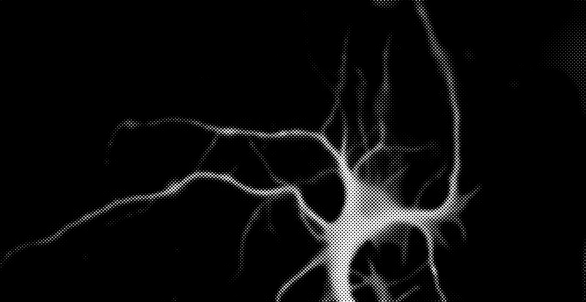
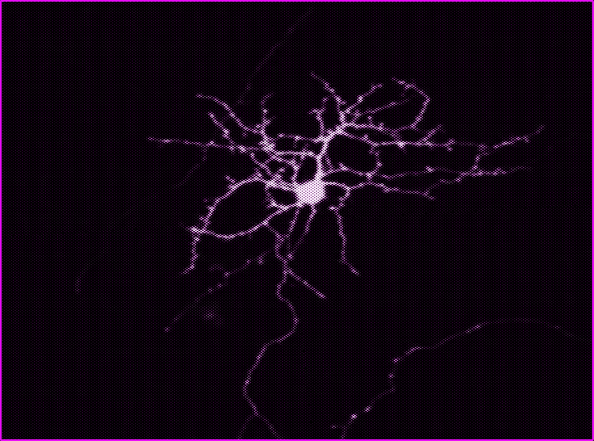
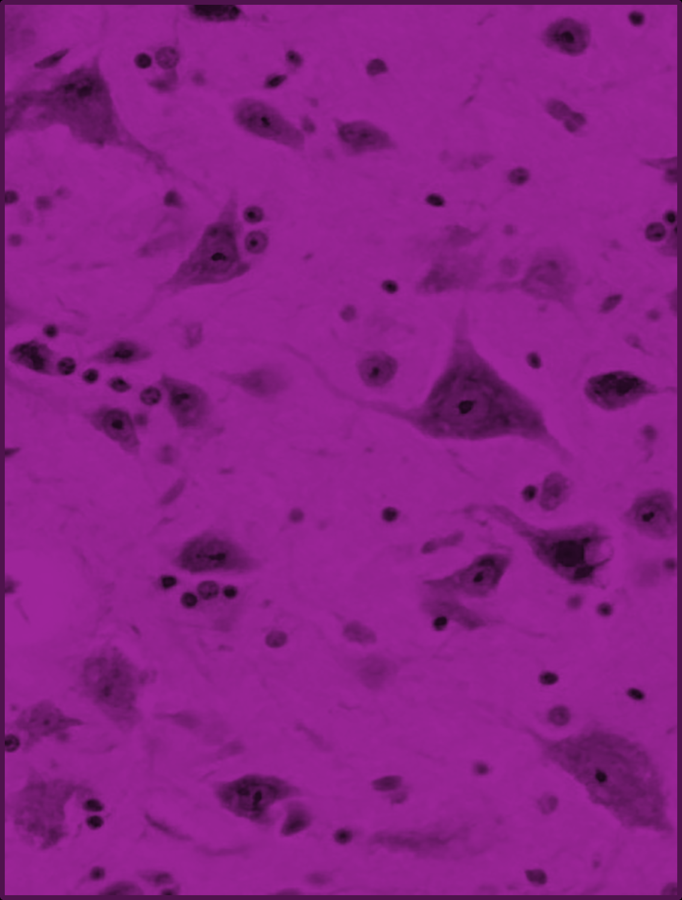
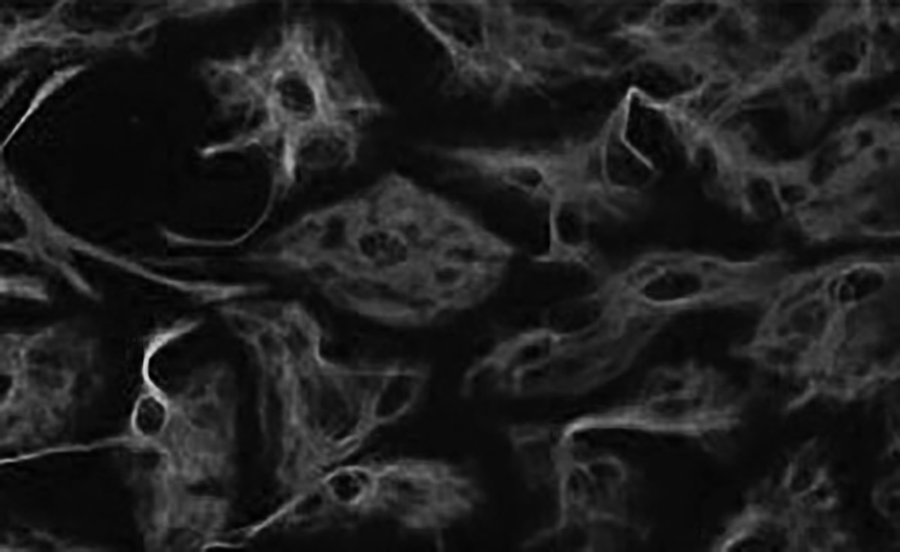

---
### Page 61 Source Content

# DOMAINS 

_Pick three._ 

## 1. Toys for Men 

The idol gains the ability to play with the flesh of others like marionettes. 

Cultists gain +1 segment on their execution talisman (so a lone cultist would have 3) as they can keep moving even while their body is broken, jerked by invisible strings. 

The idol gains a new affliction: 

COLLECT DOLL: When afflicted, the exorcist loses control of one of their arms. It becomes doll-like in texture and appearance. Once a scene, the idol can interfere with an action the exorcist is performing as the hand interferes, forcing them to either take 1 stress or make the action hard. 

## 2. Elevation of the Innumerable Mass 

The idol gains the ability to elevate members of its cult into minor sins. **One** of these can appear a scene when fighting the idol or its cult. 

## APOSTLE 

**Apostle (Sin)** . Execution talisman 4. Armed with supernatural strength and mutated blades. 

### **Reactions:** 

**Inflict stress** . Attacks with: _Mutated body, mundane firearms or blades._ **_(1)_** _3 stress,_ **_(2/3):_** _2 stress,_ **_(4+)_** _: 1 stress._ 

**Or** : create a **complication** or **threat** : _Create a fleshy clone of itself, unleash a flurry of attacks, mutate further, move impossibly fast_ 

**Or:** Exort **(1-3):** An ally of the apostle heals slashes on their execution clock depending on the risk die (1: 2 ticks, 2-3: 1 tick). The next time that ally inflicts stress on an exorcist, they inflict +1 stress. 

## 3. Hold My Darlings 

The idol cultivates a special, insidious bond to its cult members. 

- **Once a scene,** when the idol would take slashes on its execution talisman from an exorcist’s action, it can supernaturally transfer the harm to any cultist or group of cultists present in the scene instead. This includes any NPCs added the idol’s cult. 

- The idol can see through the eyes of any cult member as if they were its own, and can speak through the mouths of cult members with its voice. 

## 4. That Pliable Flesh 

The idol can twist its form rapidly and shape shift. 

- As a **tension move** , reveal in a scene at any point that someone the exorcists are talking to is actually the idol. All exorcists that witness this take 1 stress. This can force a conversation or a conflict scene. 

• As a **complication** in a conflict scene, the idol can rapidly shape shift into an exact copy of one of the exorcists. Until the complication is dealt with, when the idol would take slashes on its execution talisman, roll a d6. On a 1-2, reduce the slashes to 0 and the doubled exorcist takes 2 stress as it becomes impossible to distinguish between the two. 

## 5. Slumbering, I Saw a Shape in the Door 

The idol can enter the minds of the exorcists when they let their guard down. 

- When the exorcists **rest,** each makes a 1d6 fortune roll. On a 1, they immediately gain an idol affliction. 

**• Once a hunt** , as a **tension move** , the idol may immediately force the exorcists to rest for the next scene. This doesn’t tick tension, cannot progress pressure past 4, and the results of all their resting rolls are ‘1’ no matter what. During their rest they have disturbing daydreams. One exorcist may describe these to the group. 

## 6. Taking the Ears 

The idol’s voice and psychic presence is overwhelming, like an ocean battering down a rickety door. 

• As a **threat** or a **tension move** , the Idol can speak to to a group of mundane humans. If successful, they are immediately added to the cult and become a group of cultists. If cultists are already present, increase their execution talisman by 2 instead. 

• As a **threat,** the idol can begin to speak an unspeakable word. If the threat is successful, one exorcist that hears it takes 2 stress and the **deafened** affliction for the rest of the mission ( _can’t hear, may make activities reliant on hearing hard or impossible_ ). Characters that are already deaf are immune to this. At the end of the mission, roll a 1d6 fortune. On a 1 or 2, the character is **permanently deafened** but has time to adjust before the next mission, making it have no further deleterious effects. 

## 7. The Glory 

The idol is capable of taking a form that overwhelms the senses. 

- Once a scene, the Idol can take a glorious form as a **complication** . Non-cultist humans witnessing the form instantly become unconscious. Exorcists witnessing the form can either take 1 stress when acting against the idol and ignore it, or avert their gaze. If they avert their gaze, it becomes hard to do anything that relies on sight. 

- Cultists present in the scene are motivated by the idol and may re-roll the risk die when acting, taking the second result as final. 

- One exorcist sees this form as someone dear to them and must describe who to the group. They take 1 stress when harming the idol while the form is active. 

- This complication can be dealt with as normal. 

## 8. The Strong Scented Lips of a Whispering God 

The idol has major connections with the human world: fans, businessmen, or politicians. This presents an expanding problem for CAIN cleanup. 

Cultists are now armed with short ranged firearms and body armor, dealing +1 stress with reactions. Increase their execution talisman by +1. 

- Set out an **exposure talisman,** of 10 length. Whenever the exorcists engage in a conflict scene, tick it up by 1d3. If the exorcists do something else loud, violent, or with high exposure, tick it up by 1, but no more than once a scene. 

- If the talisman is 3 or more, local authorities will start to attempt to arrest the exorcists. If it’s 6 or more, the response becomes more severe in scale. 

Exorcists can attempt to untick this talisman with their actions. If the talisman fills up before the idol is dealt with, cleanup becomes catastrophic as the news spreads beyond CAIN control. The exorcists will receive **no scrip pa** y for the mission. 

**120** 

**121**

#### Extracted Visual Elements (Page 61)

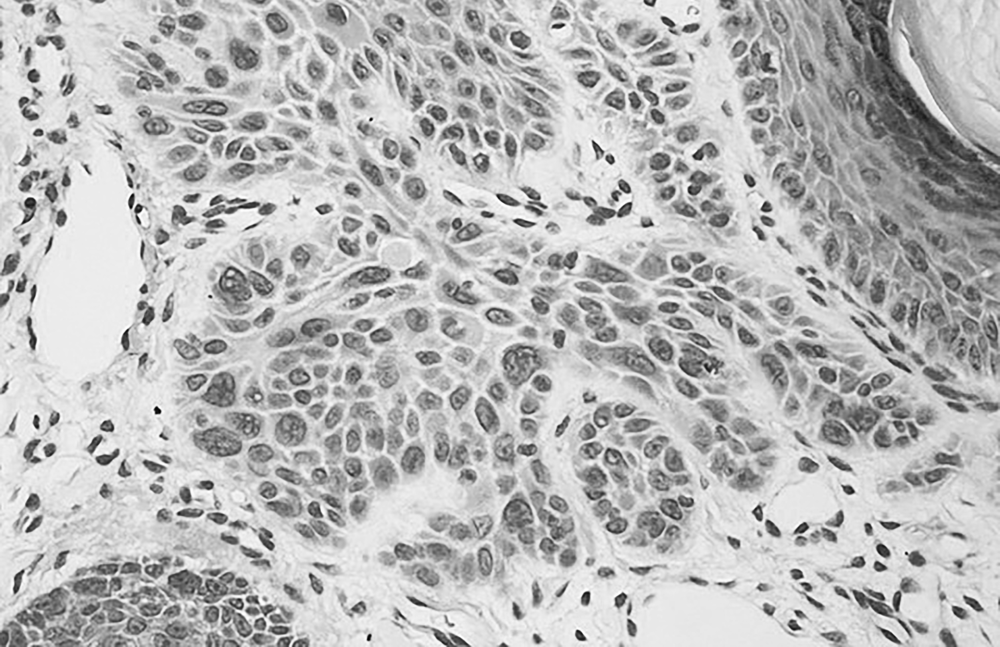
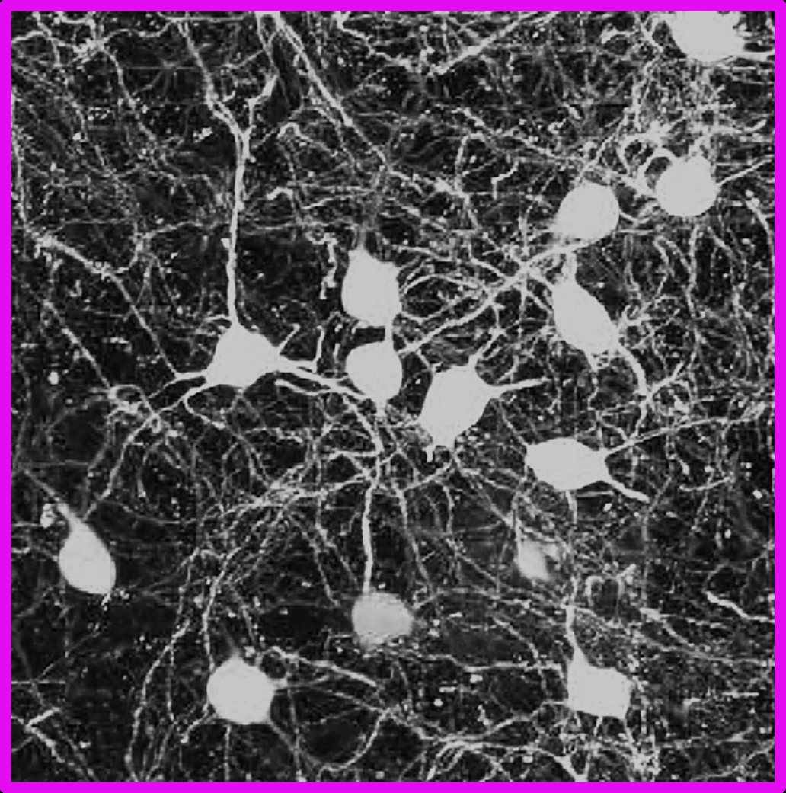
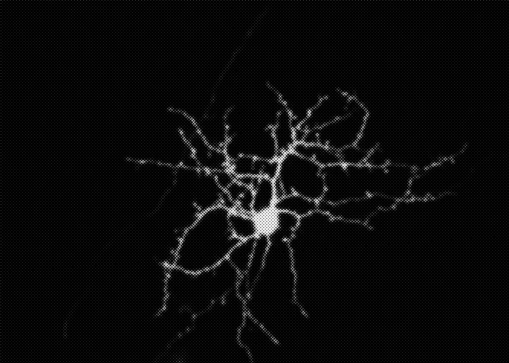
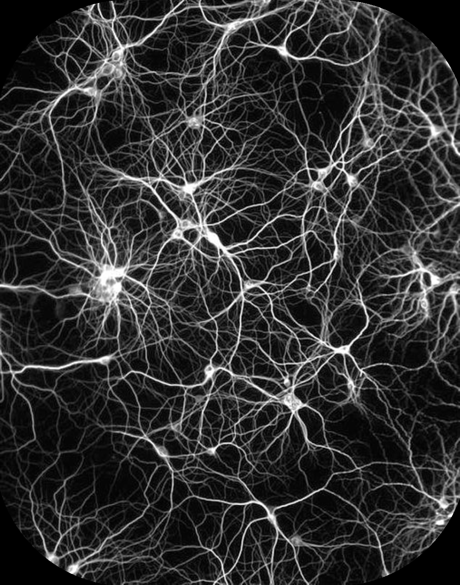
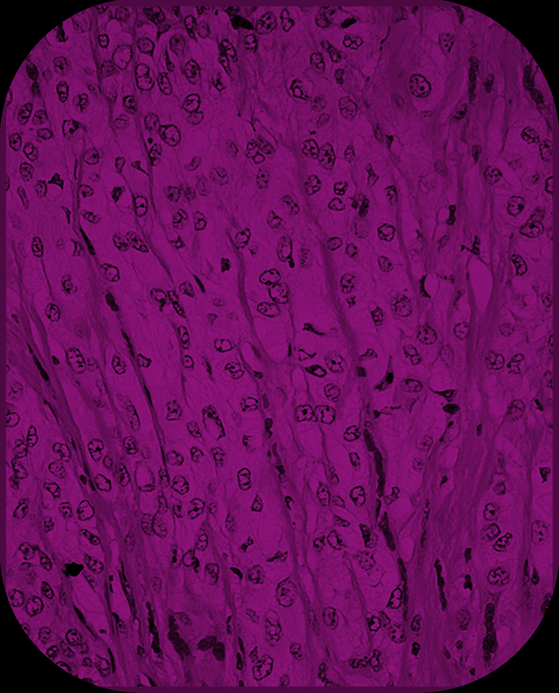

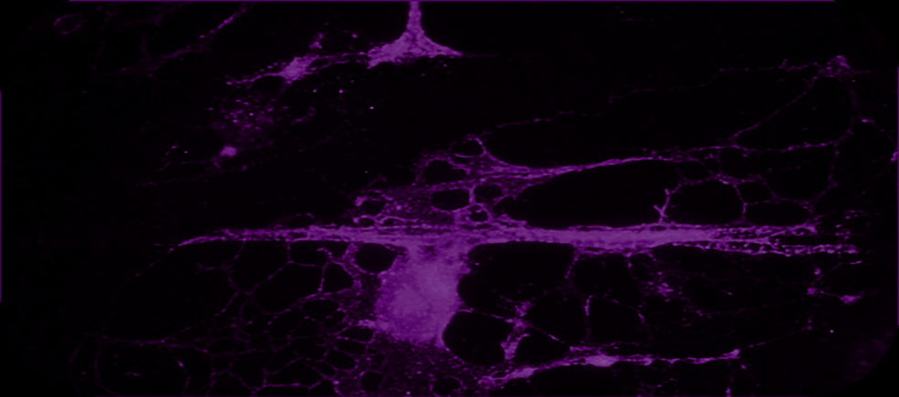

## High-Resolution Graphical Tables & Sheets

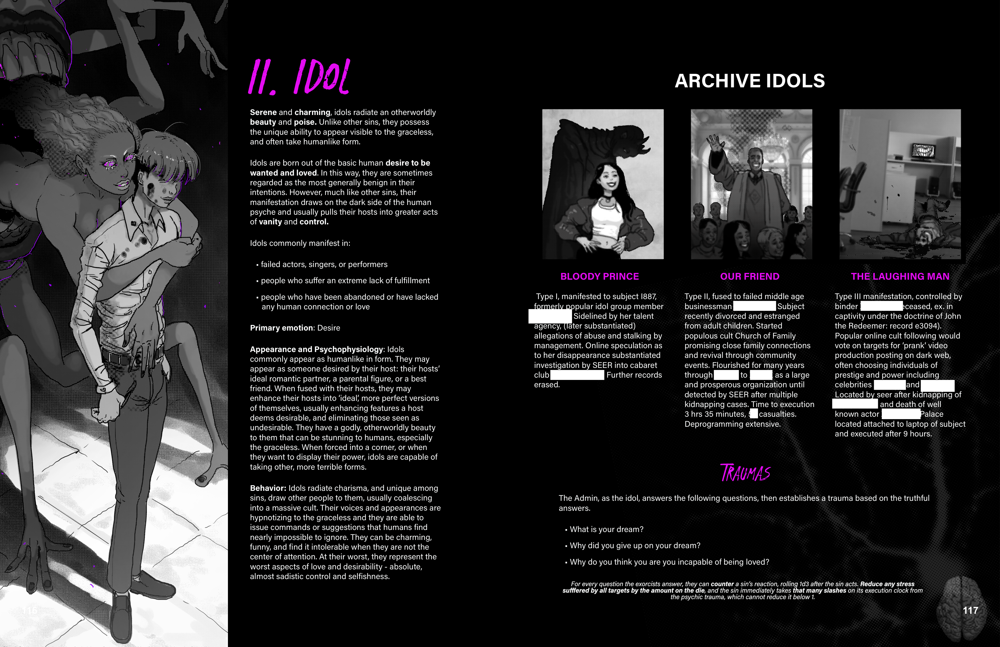

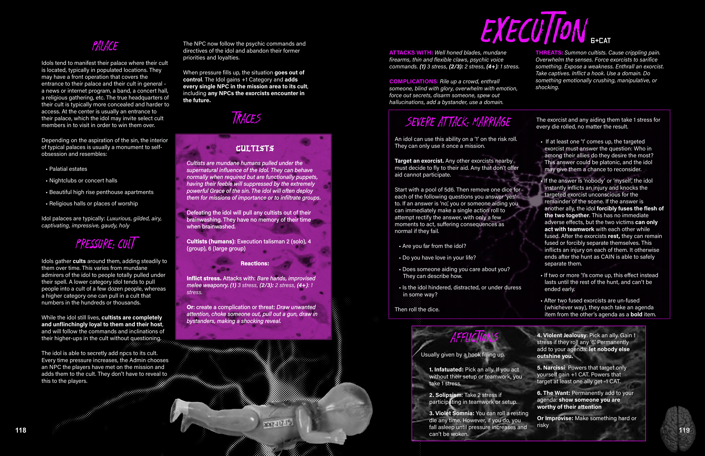

## Related Knowledge Nodes

- [[Designing_Sins]]
- [[Conflict_Scenes]]
- [[Investigation_and_Traumas]]
