# Sin III: Hound - Pursuit Predator, Blood Tracking & Ambush

> Source: CAIN 1.0 Rulebook (Pages 62, 63, 64)

---
### Page 62 Source Content

# III. HOUND 

**Ferocious** and **violent** , hounds are enormously dangerous, wild sins that are rage personified. 

Hounds are born out of a seething desire for **vengeance or justice** . They are primarily defined by a deep resentment or anger that is sometimes generalized, but more often directed towards a specific person or group of people in the form of a grudge. When a psychically sensitive person’s unprocessed anger boils over and can no longer be contained, a hound is born. 

Hounds commonly manifest in: 

- Murder victims 

- Someone who has suffered a deep injustice from someone who has power over them - like a landlord, bank or boss 

- Someone who has been deeply wronged, bullied, or abused by a specific person or group of people 

**Primary emotion:** Vengeance 

**Appearance and Psychophysiology** : Hounds are active, constantly moving sins that twitch or spasm with barely concealed rage. They often take an animalistic form and may exhibit animalistic behavior such as running on all fours and biting even if they are humanoid in form. They are typically lithe and extremely fast and strong. Humans have an innate fear of them and can sense their presence even if they can’t see a hound. Its surviving victims often describe feeling a primal dread, a sense of being hunted by a wild animal. 

**Behavior** : Hounds are by far the least communicative sins, sometimes exhibiting only animal-level intelligence, and exist mostly to hunt, maim, and kill. They will sometimes exhibit canniness and will stalk or wait to strike their victims until the opportunity arises, but more often than not when they site a victim they will simple barrel through all obstacles, tearing everything apart until their target is ripped into pieces or they expire. Hosts fused with hounds exhibit incredible strength, speed, and durability and often have extremely hot body temperatures. They may exhibit extreme mania, violent tendencies, and restlessness. 

## **ARCHIVE HOUNDS** 

### **SCATHER** 

### **DULLAHAN** 

### **MANHUNTER** 

Type I, CAT 3, manifested after subject H198 reached catastrophic levels of medical debt due to their chronic <mark>XXxxxxX.</mark> Subject traveled to 

Type I, CAT I, manifested in adolescent subject H19 (recruited, see record r9833) after suffering repeated schoolyard harassment. Repeated reports of ‘haunted’ closed factory building after dark drew interest from local teenagers and triggered standard SEER protocols. Executed after lengthy hunt, CASTLE team 23 KIA but no exorcist casualties. 

Type II, possessing decapitated corpse of subject H09, whistleblower for major arms manufacturing company 

conference center <mark>XXxxxxX in XXXxxxxxxxX</mark> specifically to release sin in order to exact revenge, center locked down for 48 hours due to incident, executed with 25 casualties, one exorcist KIA. 

<mark>XXXxxxXXX</mark> . First, second, and third teams sent KIA. Advanced to CAT 5, deemed high priority and Virtues were defrosted and dispatched via orbital rail. Time to execution 22 minutes, 2279 casualties. City <mark>XXXXX</mark> required 3 months of reconstruction and reprogramming. 

## TRAUMAS 

The Admin, as the hound, answers the following questions, then establishes a trauma based on the truthful answers. 

- Who wronged you? 

- How were you wronged? 

- What are you unwilling to sacrifice? 

_For every question the exorcists answer, they can_ **_counter_** _a sin’s reaction, rolling 1d3 after the sin acts._ **_Reduce any stress suff ered by all targets by the amount on the die_** _, and the sin immediately takes_ **_that many slashes_** _on its execution clock from the psychic trauma, which cannot reduce it below 1._ 

**122** 

**123**

#### Extracted Visual Elements (Page 62)

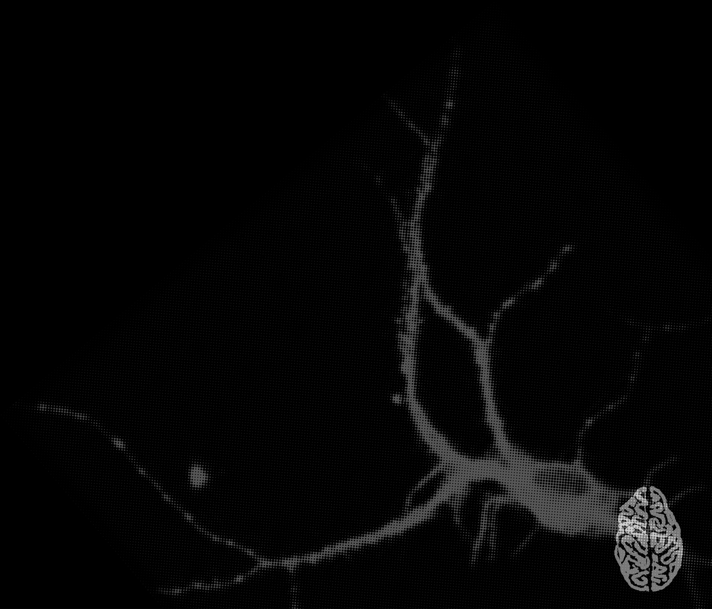
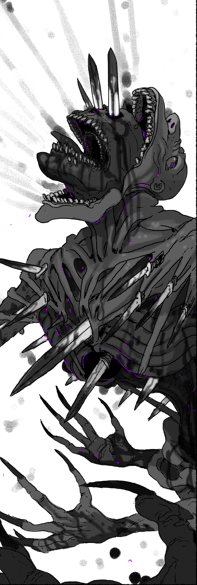
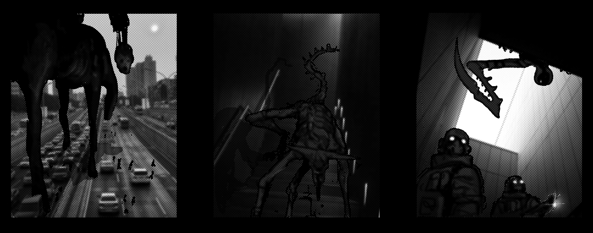

---
### Page 63 Source Content

## PALACE 

A hound’s palace is usually an extremely simple, barely coherent and indistinct landscape of whipping winds, boiling rain, unreal heat, and licking flames. 

Unlike other palaces, it can often change locations as the hound moves around on its hunt. The entrance is usually located somewhere derelict or wild like in abandoned buildings, drainage canals, junk yards, burnt out cars, or in tree hollows. 

**Hound palaces are typically** : _Hellish, gory, barren, inhospitable, ferocious, chaotic._ 

## Pressure: Grudge 

A hound harbors a **grudge** against a specific person or group of people. While its targets are alive, it does its best to track them down and kill them **violently and messily.** 

When setting up the mission, the Admin should designate **three specific peopl** e to be the hound’s grudge targets (which could have expanded from its original target, or could be examples from a group it has a grudge against). A grudge can easily expand to innocent people, such as family members, friends, or co-workers of the perpetrators. 

- When pressure increases, the hound will track down and attempt to kill one of its targets. If the exorcists are present, they can attempt to prevent this with a conflict scene. If not, the target is (brutally) slain! 

- If all targets are killed, the hound picks an NPC the exorcists have met and adds them to its grudge as a new target. 

If pressure goes to maximum, the hound gains +1 CAT and adds **all NPCs and the exorcists to its grudge.** 

## TRACES 

### MYRMIDONS 

_Some Hounds produce echoes of themselves, violent creatures arising from the dripping bodily fluids of the Hound or its vic�ms. They shudder uncontrollably and give off a bloody acidic steam when enraged, making them incredibly tough opponents. Fortunately, they are short lived, disintegra�ng in just a few hours._ 

**Myrmidons (sins):** Execution talisman 2 (solo), 4 (group), 6 (massive group). The have the following features: 

- Deal +1 stress to exorcists who already have an injury 

• Rip exorcists in half when inflicting injuries if it’s the last injury, inflicting instant death instead of putting them on the brink of death. 

##### **Reactions:** 

**Inflict stress.** Attacks with: _Teeth, claws, ear splitting screaming_ . **_(1)_** _3 stress,_ **_(2/3):_** _2 stress,_ **_(4+)_** _: 1 stress._ 

**Or:** create a complication or threat: _Grow spines, rake with claws, snap bones in jaws, grow a new limb or head._ 

**Or:** Bloody Steam (1-2): **Complication** . Steam gets in the lungs of nearby exorcists, making impossible to take an action to speak or perfrom strenuous activity (running, climbing, etc) without taking 1 stress first. 

# EXECUTION 

#### 6+CAT 

**ATTACKS WITH:** _Needle like teeth, razor claws, bone spurs, sickle-like blades, blood soaked weaponry._ **_(1)_** _3 stress,_ **_(2/3):_** _2 stress,_ **_(4+)_** _: 1 stress._ 

**THREATS:** _Cause massive collateral damage. Attempt to tear someone in half. Rip apart humans. Spit torrents of boiling blood. Hurl someone through a roof or wall. Cut everything into ribbons. Inflict a hook. Use a domain. Do something violent, obliterating, or manic._ 

**COMPLICATIONS** : _Move faster than the eye can see, set everything on fire, give off massive steam or heat, become enraged, expand with additional blades, increase in size and strength, add a bystander, use a domain._ 

## FLAYED SKIN 

## Severe Attack: Apoplexy 

1. Face, or ears 

4.  Legs 

A hound can use this ability on a ‘1’ on the risk roll. They can only use it once a mission. 

5. Chest 

2. Scalp 

3. Arms 

6. Back 

**Target an exorcist** . Any other exorcists nearby must decide to fly to their aid. Any that don’t offer aid cannot participate. 

##### AFFLICTIONS 

Start with a pool of 5d6. Then remove one dice for each of the following questions you answer ‘yes’ to. If an answer is ‘no’, you or someone aiding you can immediately make a single action roll to attempt rectify the answer, with only a few moments to act, suffering consequences as normal if they fail. 

Usually given by a threat or hook filling up. 

   **1. Blood Rage:** Afflicted exorcists roll +1D when inflicting harm, violence, or physical force, but must take 1 stress to take any other type of action. 

   **2. Bleeding Eyes:** While afflicted, the exorcist may gain a psyche burst by taking 1d3 stress. 

- Do you have a sword (or something like it) ? 

- Are you calm, collected, and focused? 

- Do you have a shield (or something like it)? 

   **3. Ganglia Fever:** Afflicted exorcists are feverish, hot, and roll one less resting die. 

- Is the hound hindered, distracted, or under duress in some way? 

**4. Boiling Resentment:** At the end of the mission, if you inflicted physical violence on a human, you may erase 2d3 sin. If you do, permanently add to your agenda: **make a human pay for their crimes.** 

Then roll the dice, one at a time. 

The hound immediately separates the chosen exorcist from the group (hurled into a pocket dimension, smashed through a wall, flung off a freeway,) then also begins attacking them with immeasurable fury, with each dice roll representing an attack. 

   **5. Blood Scent:** When any exorcist suffers an injury, you may gain a psyche burst. If you did this at least once during a mission, permanently add to your agenda: **taste blood.** 

- For every die rolled, the exorcist and anyone aiding them gains 1 stress, no matter what. 

   **6. The Urge:** Permanently add to your agenda: **kill** 

- For every ‘1’ rolled the targeted exorcist suffers 2 additional stress and has a piece of skin cut away, causing permanent scarring (roll). 

**Or improvise:** make something hard or risky 

**124** 

**125**

#### Extracted Visual Elements (Page 63)

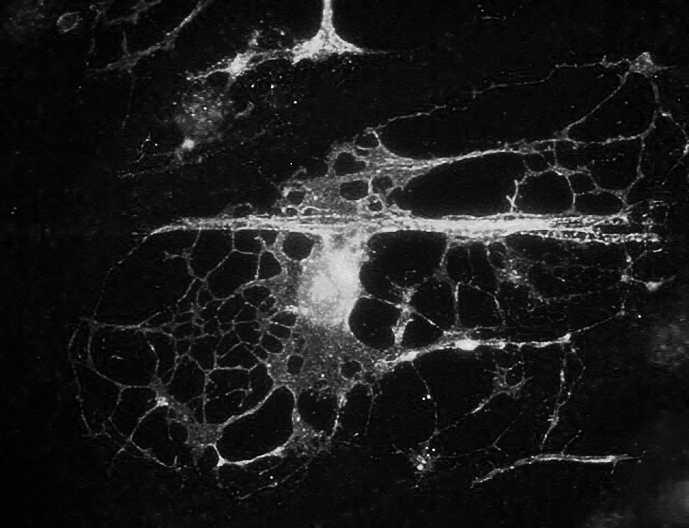
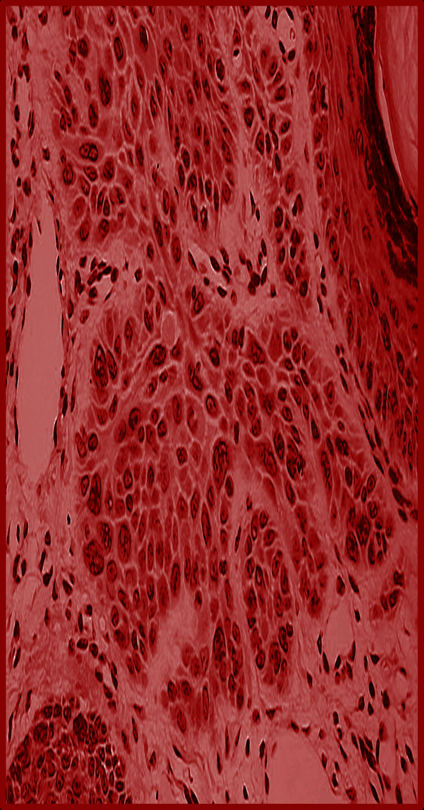
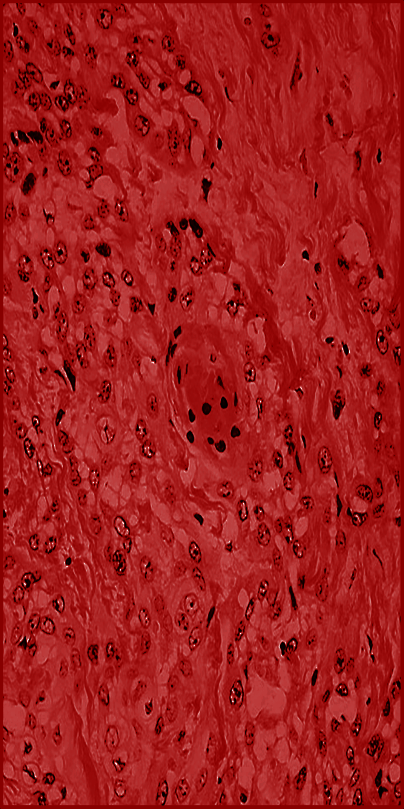
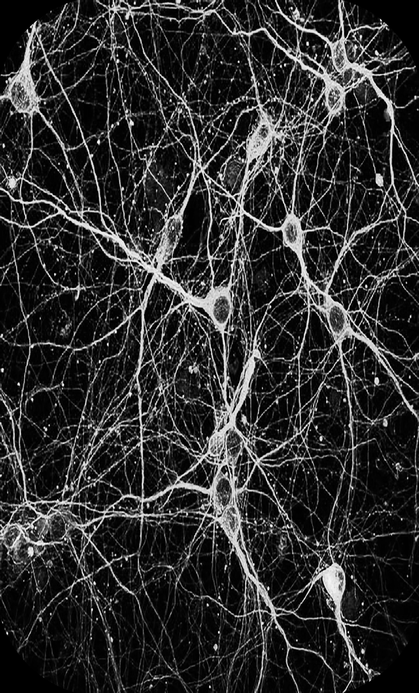
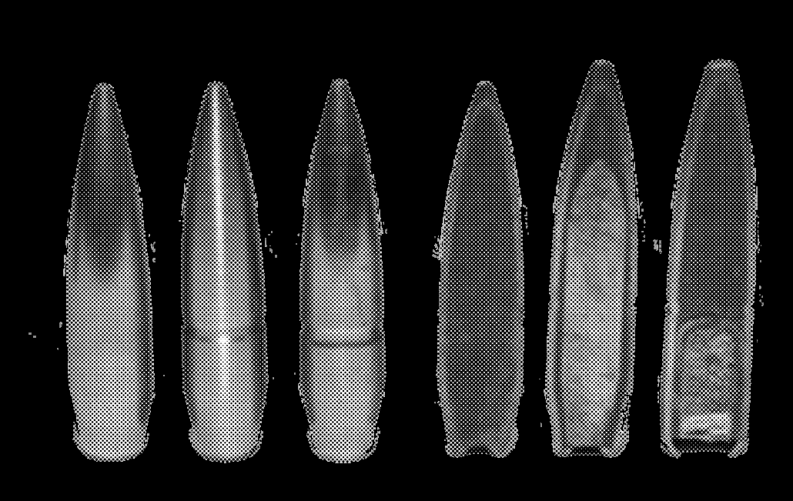

---
### Page 64 Source Content

# Domains 

_Pick three_ 

1. A Shuddering Thing Through a Dark Hall 

The hound feeds on fear, growing physically larger and stronger from the terror of weaker wills. 

Once a scene, if there are mundane humans within the local area, as a **complication** , the hound can manifest for them and start feeding off their fear. Until the exorcists calm the humans down or remove them from the situation, the hound takes -1 slash on its execution talisman from all sources and deals +1 more stress with reactions. 

Exorcists that attempt to harm the hound in any way must first spend 1 stress to suppress their fear. They can suppress this effect permanently as part of any action against the hound by answering the question, asked by the admin: **What is it you are most afraid of?** However, if they choose to answer, the Admin also rolls **two risk dice** and picks the **lowest result** for the triggering action. 

2. Turning Blades, I Laughed at their Brittleness 

The hound’s hide becomes incredibly tough and durable, like a beast’s. 

- Each time an action would slash the hound’s execution talisman, roll a 1d6 fortune roll. If the roll  is a 1 or 2, reduce all slashes suffered to 1. The hound’s armor has weak spots, however, and any action that is **set up** or part of **teamwork** can ignore this effect. 

## 3. The Catching of the Doe 

The hound suppresses its nature and becomes a stealthy hunter, able to stalk its prey. 

At the start of the hunt, pick an exorcist. **Once a scene** , during any scene, the Admin may declare that the exorcist gets a glimpse of the hound following them (though it may or may not be real), giving them 1 stress, which cannot inflict an injury. The Admin can trigger this **three times total** a hunt. 

In any conflict scene, the Hound gets a **free reaction** at the start (roll the risk die as normal), ta **rgeting the exorcist it is stalking** if possible. 

## 4. The Annihilation of the Wicked 

The hound gains a special affinity for firearms. It can attack at range with guns that it wields or, more often, are fused to its form, emerging when needed. 

- The hound’s attacks gain long range. 

- As a **complication** , the hound pins an exorcist down by bullets, bathes them in napalm, concusses them with grenades, etc. That exorcist takes 1 stress after acting until the complication is dealt with, or takes 2 stress if acting requires moving from their current position. 

- As a reaction **(1)** the hound can **permanently absorb all firearms** in the same immediate area as it, immediately disarming anyone wielding one, and healing 1 tick on the execution talisman if it absorbed at least one firearm. 

## 5. The Fattening of Rage 

The hound feeds on the power of its Grudge, strengthening it. 

- **Once a scene,** if the hound slays any mundane human as part of a reaction, it can heal 1 segment on its execution talisman. 

- If the hound has slain at least one of its grudge targets, it increases its execution clock by +2 segments. 

- If the hound has slain all its original grudge targets, it also inflicts +1 stress with all reactions. 

## 6. Rile Against Heaven 

The mere presence of the hound exacerbates the rifts between human and exorcist alike. 

Humans during this mission **never start friendly** to the exorcists and are often outwardly hostile. The Admin may make a **fortune roll** if they like (hostile on a 1-2, indifferent or annoyed otherwise). They may still become friendly through the exorcist’s actions. 

Any two exorcists that have a disagreement, no matter how minor, may declare it has **boiled over into a fight.** For the remainder of the hunt they cannot participate in teamwork with other and cannot set each other up. Any feuding exorcists regain a psyche burst if the other takes an injury or affliction, and both gain +1 xp at the end of the mission. 

## 7. The Measured Weight of Death 

The hound gains a supernatural resilience that can only be bypassed by specific methods. 

Often this draws on the superstitions of its host, often along mythological lines, and doesn’t have to conform to any real logic. 

- The hound takes -1 slash on its execution talisman. 

- This effect can be removed for a scene by the exorcists taking action to expose the hound to a specific weakness. The Admin can choose or roll from the list below: 

1. Silver 

4. Extreme Cold 

2. Iron 

5. Water 

6. Sunlight 

3. Extreme Heat 

## 8. Bloodying the Steel 

The rage of the Hound is infectious and can drive its victims into a vicious obsessive cycle. 

The hound gains the Infectious Grudge affliction. 

Infectious Grudge: While afflicted, the exorcist gains +1D on all actions that inflict physical violence, but also takes +1 stress when they take stress from an external source. 

Any exorcist can voluntarily take this affliction if they are harmed by the hound. 

- Mundane weapons are completely incapable of harming the hound unless they are extremely strong, like a tank cannon or a missile. 

**126** 

**127**

#### Extracted Visual Elements (Page 64)

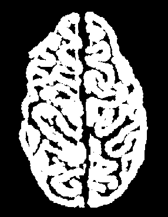
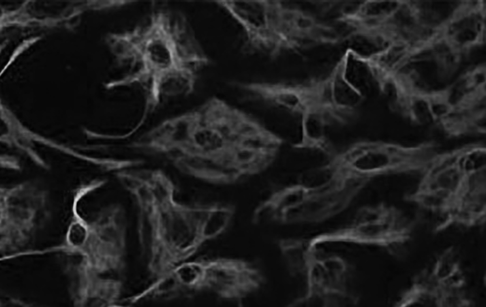
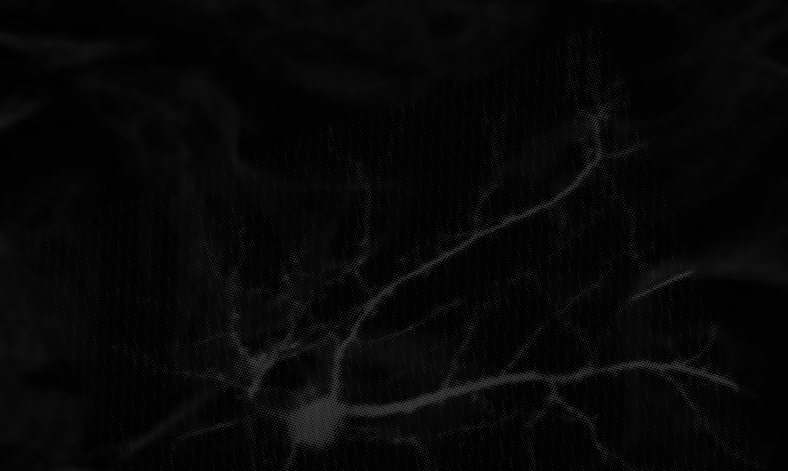
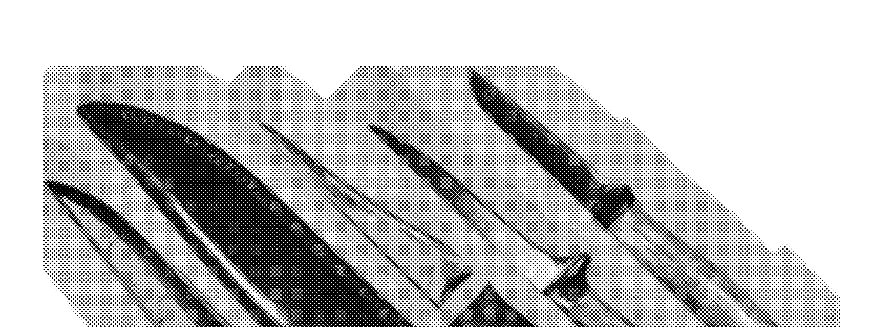
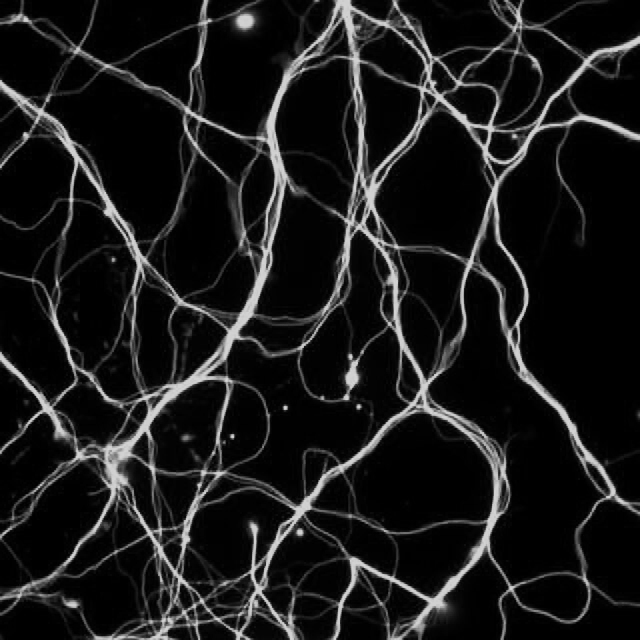
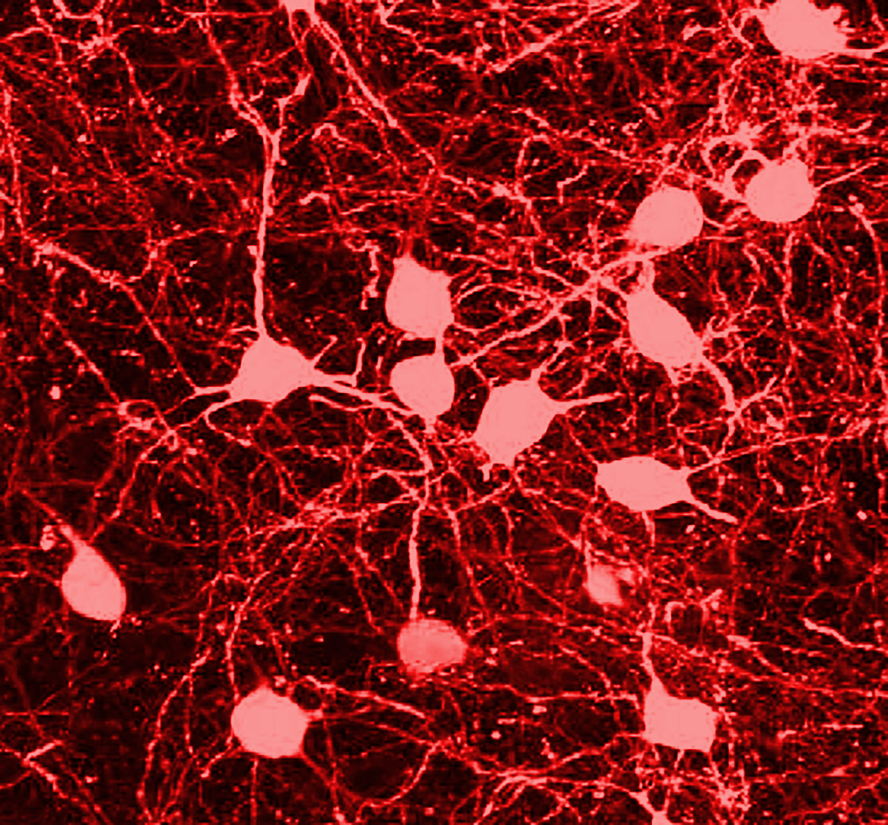
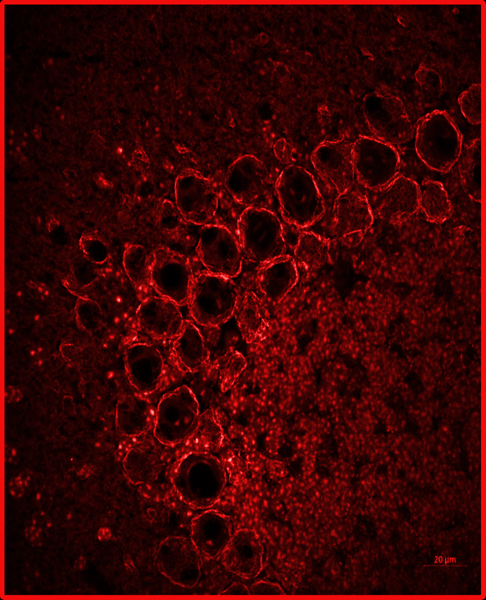
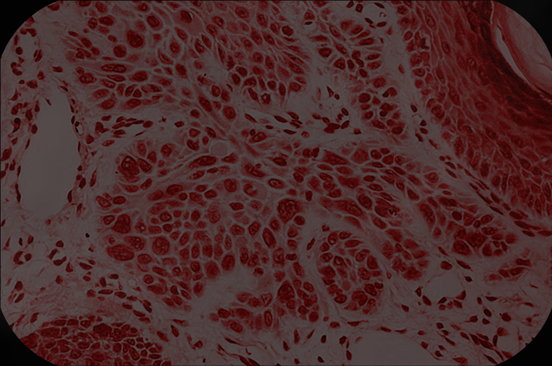

## High-Resolution Graphical Tables & Sheets

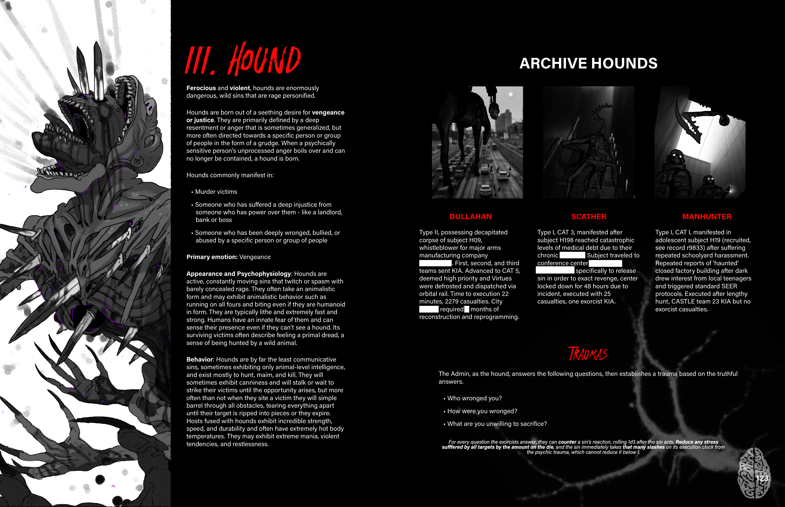

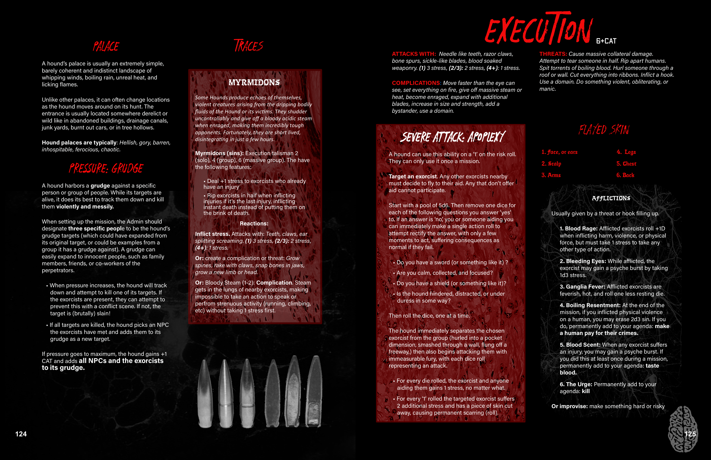

## Related Knowledge Nodes

- [[Designing_Sins]]
- [[Conflict_Scenes]]
- [[Phases_of_The_Hunt]]
