# Sin IV: Centipede - Segmented Infestation, Burrowing & Swarm

> Source: CAIN 1.0 Rulebook (Pages 65, 66, 67)

---
### Page 65 Source Content

# IV. CENTIPEDE 

Centipede sins have such a **horrific** and **putrid** reputation they are avoided when possible by most senior exorcists. Most infamously, they have extremely high potential to cause a mass death event even before a sin event happens. 

Centipedes are born out of born out people’s desire for **escapism through death** . They occur when a person has a been pushed into a place where they begin to fantasize a world where a disaster happens that is so bad it saves them from their circumstances. Often this desire is tinged with a deep misanthropy and hatred for society in general. 

Nobody can reliably trace their root, and they can manifest in nearly anybody - office workers, artists, students, the unhoused, bosses of major corporations, corner store owners - **anybody.** 

#### **Primary emotion** : Hatred 

**Appearance and Psychophysiology:** Centipedes are manifested catastrophes, born from the darkest images of their hosts psyche. They exist only to cause such horrific violence and death that the hosts’ previous worries evaporate. As their namesake, they typically manifest as insectile abominations, taking on all the characteristics of what a ‘monster’ should be. Their main identifying physical characteristic is their venom, which is inimical to human life and creates a (very) rapidly expanding problem for exorcists. 

**Behavior:** Centipedes are hatred manifest. They hate the world, they hate humans, and they hate their host especially for calling them into being with their petty desires and wishes. Everything they do is seeped in spite. They are, however, extremely protective of their hosts - wishing to have them live and witness the horrors that they have unleashed upon the world. Given enough time and space, a centipede will wipe all life from its domain, until only its host remains. It is theorized they would then, unlike other sins, demanifest on their own. This has never happened, as all centipede sins have a listed 100% execution rate. 

## **ARCHIVE CENTIPEDES** 

### **C284** 

### **CALAMITY IV** 

### **C155** 

Type I, manifested in subject C284 (ic: c576, awaiting indoctrination) after losing his housing and employment for the third time. Tunnels of <mark>XxxxxxXX q</mark> uarantined after disappearances and disturbing reports of ‘monsters’ by locals. Exorcists dispatched to investigate and were able to locate palace in sewer and execute after 1 day 13 hours with acceptable civilian casualties. Traumatic reconditioning necessary for all team members. 

Type II. Notable in CAIN archives for the <mark>XXxxxxxxxX inci</mark> dent in <mark>20XX.</mark> Manifested and fused with subject C623 (partly deceased and in TEMERITY custody, see note <mark>XXXxxxx).</mark> Subject lost court battle to her patent rights for potential broad spectrum cancer fighting drug XXxxxxxxX after announcing her intention to make it free. 10 exorcist teams including Virtues dispatched, 11,000 approx. casualties. Time to execution 2 days 6 hours 35 minutes. Required (previously) unprecedented deployment of broad spectrum SERAPH memory modification. 

Type I, manifested in subject C155 after failures, building debts, and rival gang activity in his narcotic distribution business. Warehouses in district <mark>XxxxxxXX o</mark> f city <mark>XXxxxX</mark> quarantined, trapping approximately 120 humans, including bystanders, armed warehouse guards, police officers, and gang members for 30 hours. Exorcists <mark>XXxxxxxxX</mark> and <mark>XxxXX K</mark> IA. Executed. 

## TRAUMAS 

The Admin, as the centipede, answers the following questions, then establishes a trauma based on the truthful answers. 

- What are you trying to escape? 

- What do you hate the most about humanity? 

- What do you regret the most? 

_For every question the exorcists answer, they can_ **_counter_** _a sin’s reaction, rolling 1d3 after the sin acts._ **_Reduce any stress suff ered by all targets by the amount on the die_** _, and the sin immediately takes_ **_that many slashes_** _on its execution clock from the psychic trauma, which cannot reduce it below 1._ 

**128** 

**129**

#### Extracted Visual Elements (Page 65)

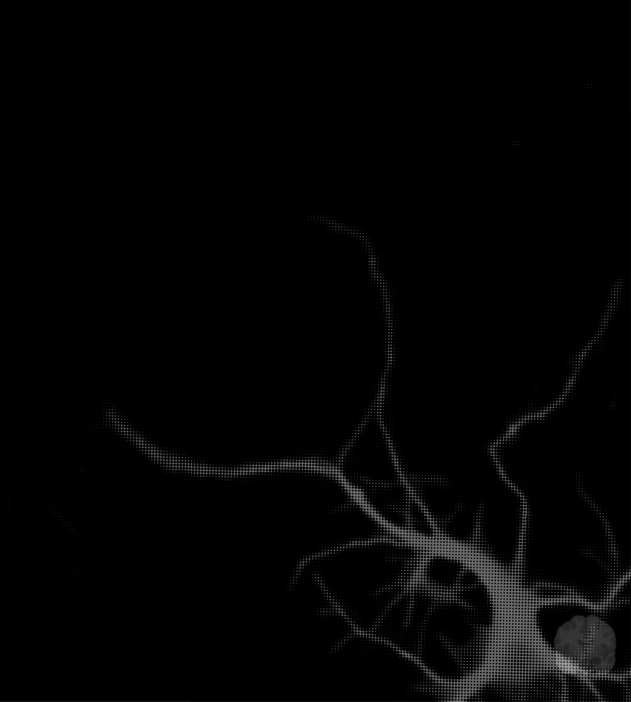
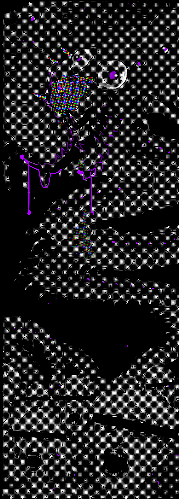
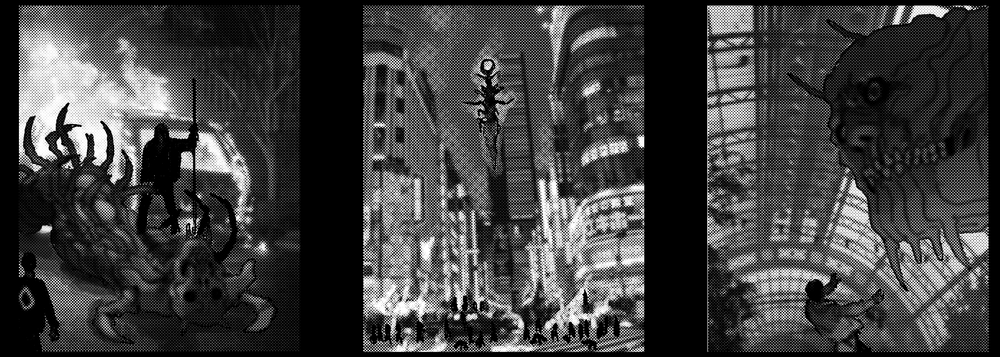

---
### Page 66 Source Content

## PALACE 

A centipede’s palace is usually located in a protected location at the center of horde activity, usually somewhere significant to the host or close to the inciting incident. 

The interior of a centipede’s palace often resembles a prison or a dungeon, built to capture the centipede’s host and force them to remain witness to the horrors they have unwittingly (or otherwise) unleashed. This prison can be sterile, cold, or laboratory-like, or medieval and full of barbed hooks and rusted chains. It often manifests horrors or traps to drive out, capture, or kill invaders. 

**Centipede palaces are typically** _: hostile, resentful, grotesque, gory, prison-like, chthonic_ 

## Pressure: Infestation 

A centipede’s venom, when injected into the human bloodstream, causes a catalyzing psychobiotic reaction that within the space of about an hour mutates that human into an extremely strong, aggressive, and violent monster, a mindless drone that is under the centipede’s control as a queen controls a colony of ants. These infested are able to produce their own centipede venom that they can inject into bitten humans, creating a catalyzing exponential reaction that rapidly creates a horde of these monsters. 

- A human infected with centipede venom will chrysalize, transform, and mutate within exactly 44 minutes. An exorcist gains the centipede bite **affliction** instead. 

- **There is no cure** to centipede venom, but it can be **delayed.** 

- The only reliable way to end an infestation is to **kill the centipede.** Executing a centipede causes its venom to lose its transformative effect and evaporate. This saves any infected exorcists and any infected but untransformed victims, who can typically recover in a few weeks. Remaining infested victims are dealt with in cleanup and should be considered deceased. 

**Each time pressure increases** , 10% of the local population in the affected area is infected and transformed (so at 3 ticks, 30% of the population is affected). If pressure reaches maximum, the centipede increases in CAT by +1 and this goes up to 90% population loss. 

##### **Delaying Centipede Venom** 

Exorcists that are dispatched to Centipede missions are each automatically given one dose of Centipede Antivenom. An exorcist can mark 1 KP to pull out their dose and inject it into someone in hand’s reach. 

- NPCS have their venom suppressed until the exorcists rest, at which time they will need another dose. 

- Exorcists, if they have the Centipede Bite hook, can erase all segments on it. This doesn’t remove the hook, as normal. 

## Infested 

_These mutated humans are essentially minor type II sins, who have been affected by the psycho-biotic poison in their bloodstream. They form into large, animalistic, hive swarms that the centipede can mentally control. Though starting off relatively human in appearance, over time they become more and more mutated and insect like.They typically roam around affected areas in large hordes._ 

**Infested (traces):** Execution talisman 1 (solo), 3 (group), 5 (large group), 7 (full horde). Only appear in large group or horde size at pressure 4+. 

- Slow, clumsy, and unintelligent, but extremely numerous and resilient. 

- Powers that can hit a large area gain +1D against groups of infested. 

**Reactions:** 

**Inflict stress.** Attacks with: _Mutated claws, teeth, mandibles._ **_(1)_** _3 stress,_ **_(2/3):_** _2 stress,_ **_(4+)_** _: 1 stress._ 

**Or:** create a complication or threat: _Eject venomous spines, knock someone down, alert a bigger horde, explode with caustic bile, jump out from somewhere surprising._ 

**Or: Endless (1)** : More infested arrive on the scene, adding to the execution talisman by 1d3. 

**Or: Infected bite (1)** : Inflict the Centipede Bite affliction on an exorcist. 

# EXECUTION 

### 6+CAT 

**ATTACKS WITH:** _Dripping fangs, numerous claws, sinuous body, pressurized spit (short range)._ **_(1)_** _3 stress,_ **_(2/3):_** _2 stress,_ **_(4+)_** _: 1 stress._ 

**THREATS:** _Summon the horde. Rip into an exorcist. Unveil rows of hypnotic eyespots. Explode a caustic bubo. Dissolve something with acid. Commit a massacre. Inflict a hook. Use a domain. Do something messy, spiteful, or dripping with venom._ 

**COMPLICATIONS** : _Burrow into the ground or walls, spit poisonous webbing, release swarms of flies, spray pools of poison, reveal hidden burrows, collapse the floor, scuttle hidden into darkness, add a bystander, use a domain._ 

## SEVERE ATTACK: VITRIOL 

#### Vitriol Scars 

1. Missing eye, fused shut 

The Sin can use this ability on a ‘1’ on the risk roll. They can only use it once a mission. 

2. Large bleached patch of skin 

3. Fingers on one hand melted together 

**Target an exorcist.** Any other exorcists nearby must decide to fly to their aid. Any that don’t offer aid cannot participate.Start with a pool of 5d6. Then remove one dice for each of the following. If an answer is ‘no’, you or someone aiding you can immediately make a single action roll to attempt rectify the answer, with only a few moments to act, suffering consequences as normal if they fail. 

4. Missing hair, burn scar on scalp 

5. Massive burn scar over both arms 

6. Rippling acid burn from neck to groin 

## Afflictions 

- Can you move quickly and unencumbered? 

   **1. Seethe:** Pick another exorcist. For every ‘6’ that exorcist rolls on an action, gain 1 stress. 

- Is someone aiding you able to push or grab you? 

- Can you forgive the centipede’s host? 

   **2. Limb Necrosis:** Limb starts swelling and rotting from the inside (1-2: Arm, 3-4: leg, 6: hand or foot). Activity that would require it is hard. 

- Is the centipede hindered, distracted, or under duress in some way? 

Then roll the dice. 

**3. Acid Degradation** : Mark off 1d3 KP immediately, then mark off 1 more when you rest. 

The centipede shoots a pressurized stream of mutagenic venom at the targeted exorcist, dissolving all obstacles and flesh in its way with incredible force. The exorcist and any aiding them take 1 stress for every die rolled, no matter the result. 

**4. Alienation:** Permanently add to your agenda: **ignore a plea for aid.** 

**5. Hive Brain:** Hallucination from aerosol poison. Performing complicated mental activity such as research or investigation is hard. 

If at least one ‘1’ comes up, the targeted exorcist suffers an injury and rolls on the table for a permanent scar. If two or more ‘1’s come up, the exorcist targeted either: 

**6. Let it End:** Permanently add to your agenda: **Kill Needlessly.** 

**Or improvise:** make a skill hard or risky 

- suffers instant death. 

- suffers sin overflow to avoid instant death 

- suffers an injury and rolls three times on the table instead for permanent scars 

**130** 

**131**

#### Extracted Visual Elements (Page 66)

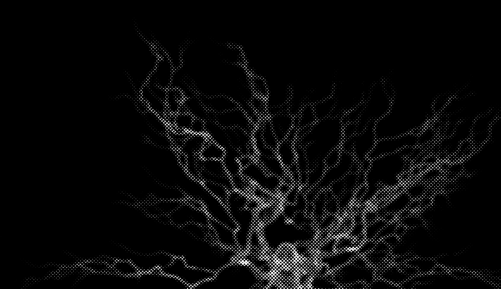
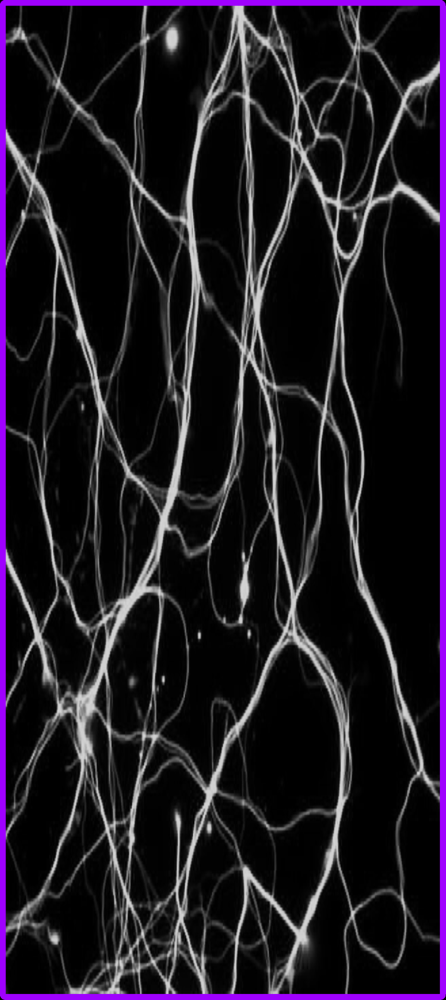
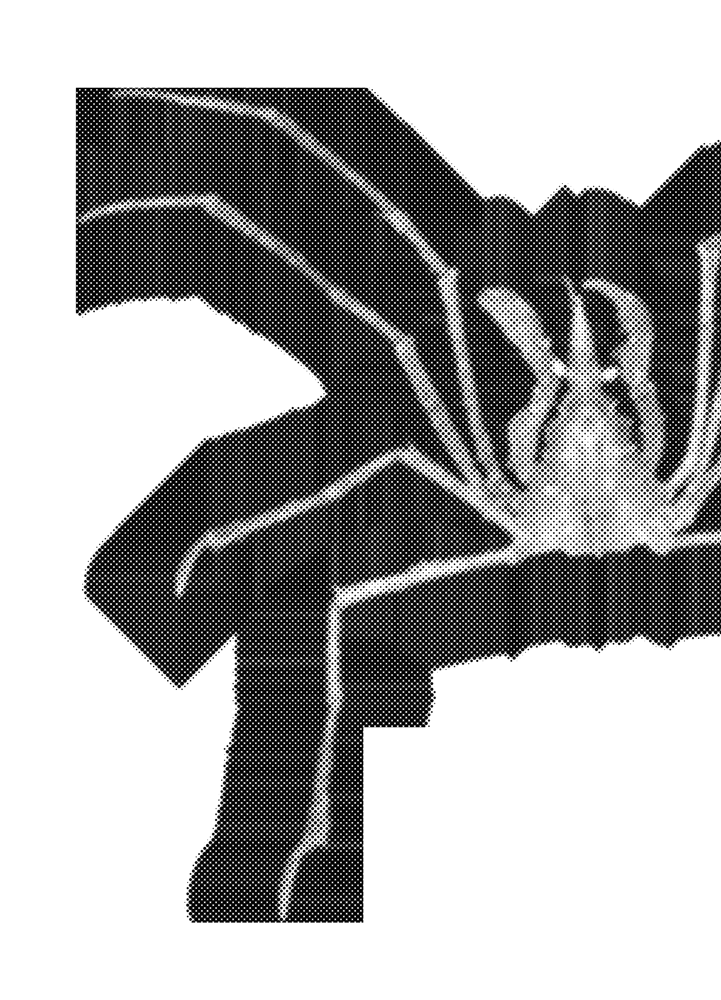
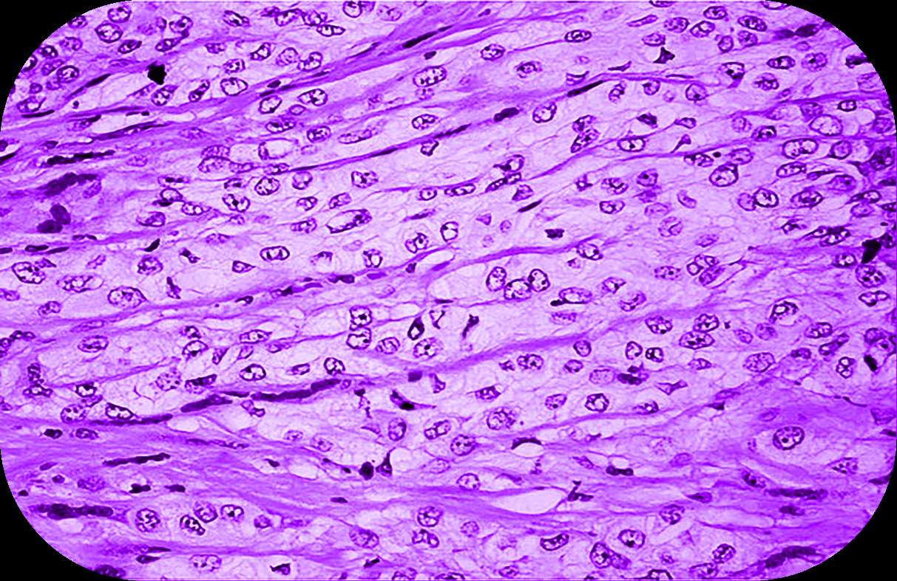
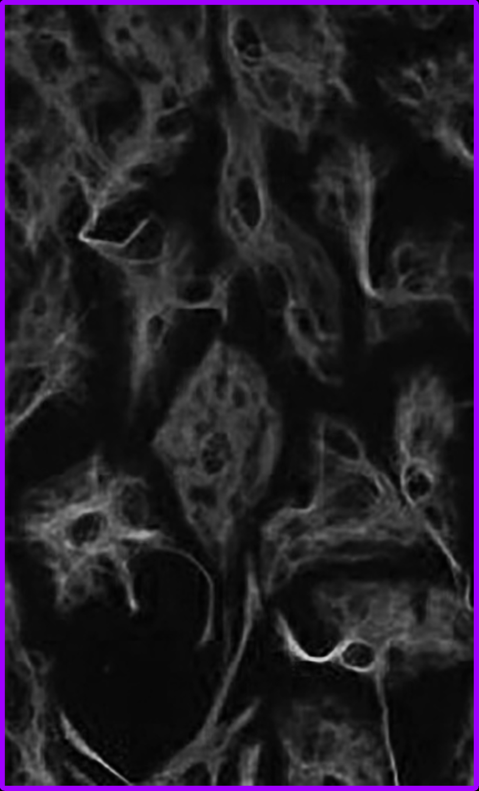
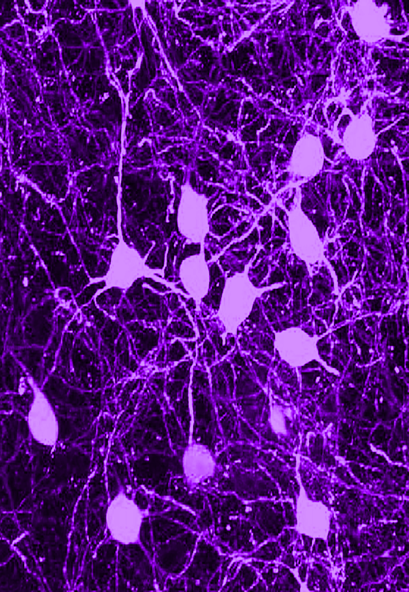

---
### Page 67 Source Content

# DOMAINS 

Choose three: 

## 1. The Heralds of Venom 

The venom in the centipede and its horde becomes boiling and pressurized. 

• The horde can spit venom at short range when inflicting stress. The centipede can spit it at extreme range, like a sniper rifle. 

- The centipede gains a new affliction: 

**BLINDING AGUE:** Can be inflicted as a threat or from a hook. When filled up, eyes become milky white and exorcist becomes unable to see, making activities that rely on sight hard. At the end of mission, roll 1d6, on a ‘1’ this becomes permanent, but exorcist has time to adjust to disability at the start of next mission and it has no further efect. f Blind exorcists are immune to this af f liction. 

## 2. Crumbling Into the Darkling Womb 

The venom exuded by the centipede becomes an environmental aerosol that starts to degrade everything in the investigation area. 

- Traversing normally safe structures in the area becomes risky or hard as floors start to fall apart, windows melt, and walls collapse 

- Any mundane item the exorcists have pulled out from their kit degrades and becomes unusable when they rest. 

- When pressure increases, 10% of the structures in the area are destroyed. If pressure fills up, 90% of the structures in the area are destroyed. 

## 3. The Knights of Decay 

The horde gains dangerous, armored infested. When the infested appear in a scene, one of these usually appear. 

### JUGGERNAUT 

**Juggernaut: Sin/human** . Execution talisman 3. At 4+ pressure, increase to 5. 

- Practically immune to mundane weapons unless its armor is exposed. 

- Blind and easily distracted 

#### **Reactions:** 

**Inflict stress** . Attacks with: _Armored bulk, spines, mandibles_ 

**Or** : create a **complication** or **threat** : _Grab someone with a mutated claw, charge someone through a wall or floor, knock someone out or daze someone._ 

**Or** : **Hive shroud (1/2): Complication:** Start releasing acidic clouds that obscure and burn. All its allies take -1 slash on execution talismans until the Juggernaut is dealt with. Does not stack. 

## 4. Gently Rolling Down the Slope of the Abyss 

The Centipede’s venom is so potent and fast spreading that it begins to cause catastrophic spread. 

- Double the casualties per pressure (to 20%). At full segments (6), the spread begins to go outside of the quarantine zone, requiring cleanup from CAIN and docking the exorcists 2 scrip. 

- When the players meet an NPC, the Admin makes a 1d6 fortune roll. On a ‘1-3’, they have already been bitten but are trying to hide it. 

- As a **tension move** , the Admin can choose an uninfected exorcist or NPC who has fought the infested at least once this mission. The Admin reveals they have been bitten, giving them a Centipede Bite. 

## 5. My Children Crawl Quietly 

The horde gains dangerous, stealthy infested with chameleonic skin. When the infested appear, these appear, always in pairs. 

### STALKERS 

**Stalkers: Sin/human** . Appear as a pair. Execution talisman 3 in a scene between the two of them. At 4+ pressure, increase to 5. 

- Deal +1 stress to exorcists who are alone or afraid 

- Focus on one target to the exclusion of all others 

#### **Reactions:** 

- **Inflict stress.** Attacks with: _Scythe claws, venomous spines_ 

- **Or:** create a **complication** or **threat** : _Kidnap someone, drag someone into darkness, start jumping or flying on locust-like wings_ 

- **Or: Chameleonic Scales (1/2):** Becomes nearly invisible, making it **hard** to fight or find them when relying on sight. Next reaction deals +1 stress and ends this effect. 

## 6. At the Core, My Rot Unfurls 

The Centipede is so fueled by spite it refuses to die and instead takes a momentarily more powerful form. 

When the centipede’s execution clock is filled up, it instead reduces by 4. The centipede then takes on a terrifying final form. 

- End the current round and start a new round 

- In this form, roll the risk die twice and choose the lower result, the centipede takes -1 slash on its talisman and deals +1 stress with all its actions. 

- However, this form is extremely unstable. At the end of the round, after all exorcists have acted, no matter what, the centipede’s form destabilizes, instantly defeating it and allowing the exorcists the opportunity to finish it off. 

## 7. I Hide My Knife in the Soft Supple Walls 

The Centipede is able to set festering traps for the exorcists, extruding parts of its body or using the transformed flesh of its infested horde. 

As a **tension move** , the Admin can declare that for the next scene, the exorcists are about to enter a trapped area (even if they have already explored it). Moving through the area becomes risky by default. Traps can: inflict 1 stress to one or two exorcists, make an area dangerous or hard to move through, afflict an exorcist, inflict a hook. In addition, in any **conflict scene** with the Centipede, on a ‘1’ risk result a trap also goes off, with the above effects, in addition to any other reactions. 

## 8. Making Friends With the Abattoir 

The Centipede gains power from spite, gaining the following benefits: 

- **Once a scene,** when it or its minions is able to slaughter an innocent person or bystander in view of the exorcists, permanently increase the centipede’s execution clock by 1, to a maximum of four times total. 

- **Once a hunt** , as a **tension move,** the centipede can reveal a group of human survivors under threat from its forces. If the exorcists rest without aiding the survivors, they are slaughtered and the centipede permanently adds +3 segments to its execution clock. 

**132** 

**133**

#### Extracted Visual Elements (Page 67)

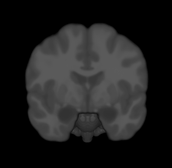
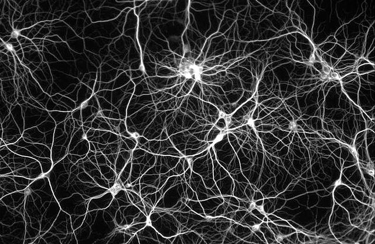
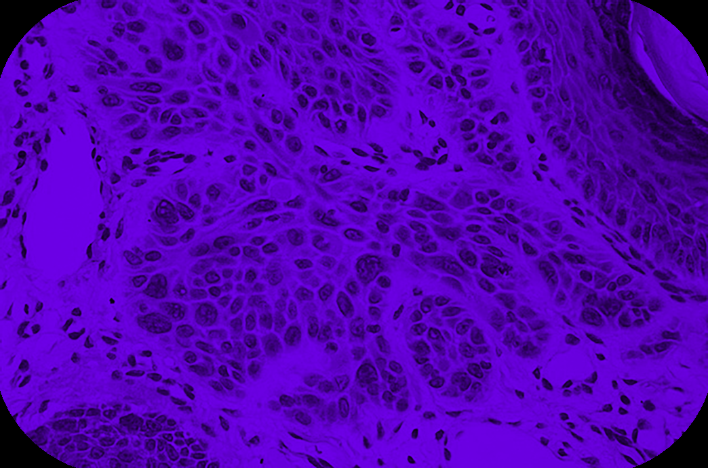
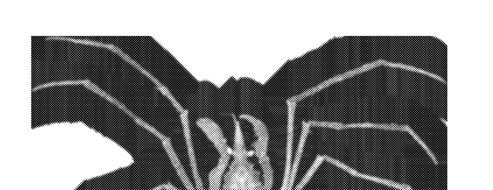
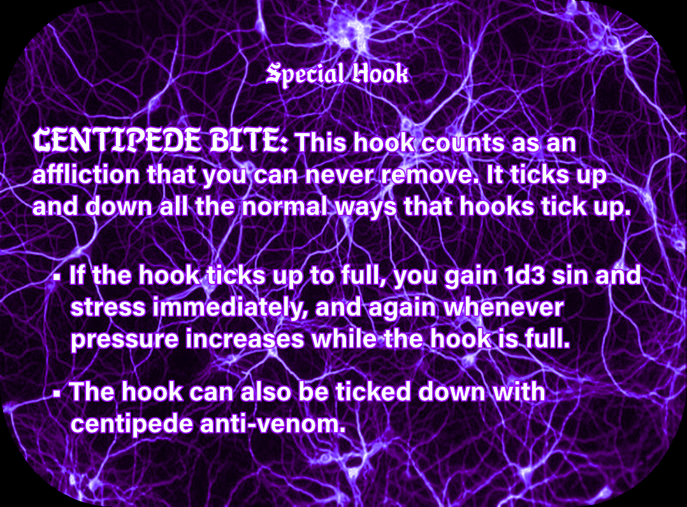
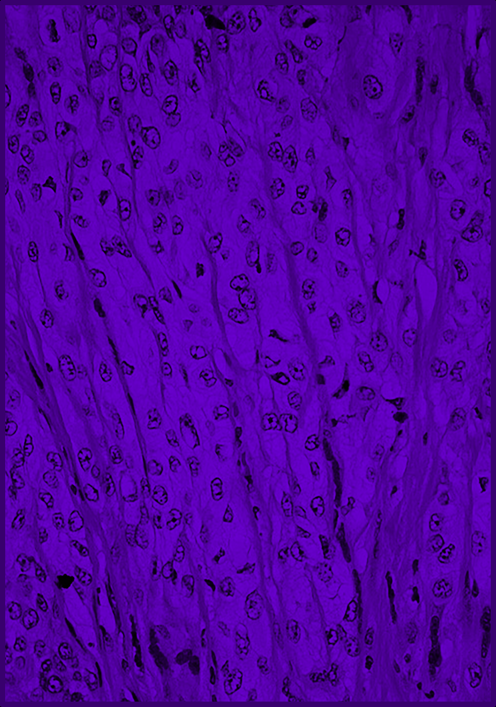
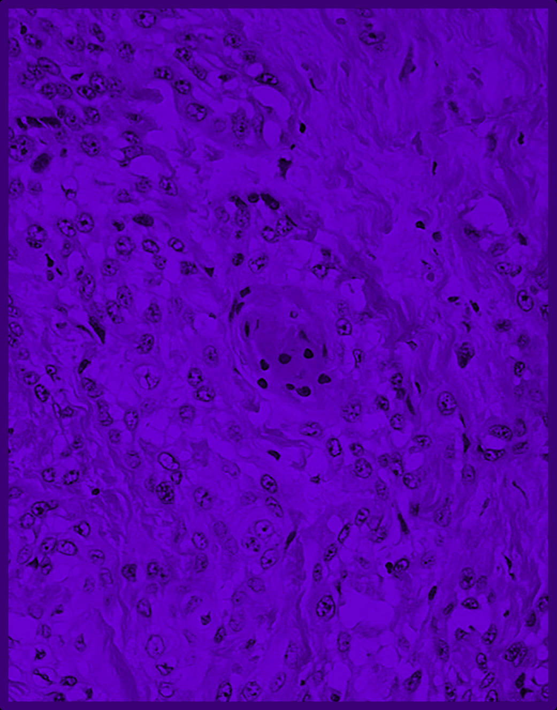

## High-Resolution Graphical Tables & Sheets

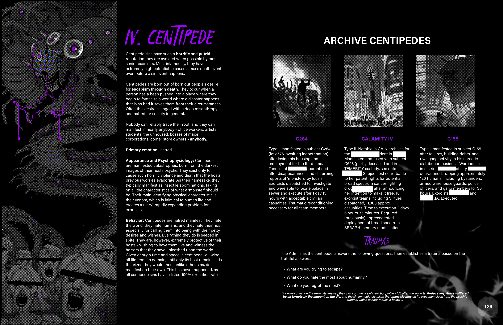

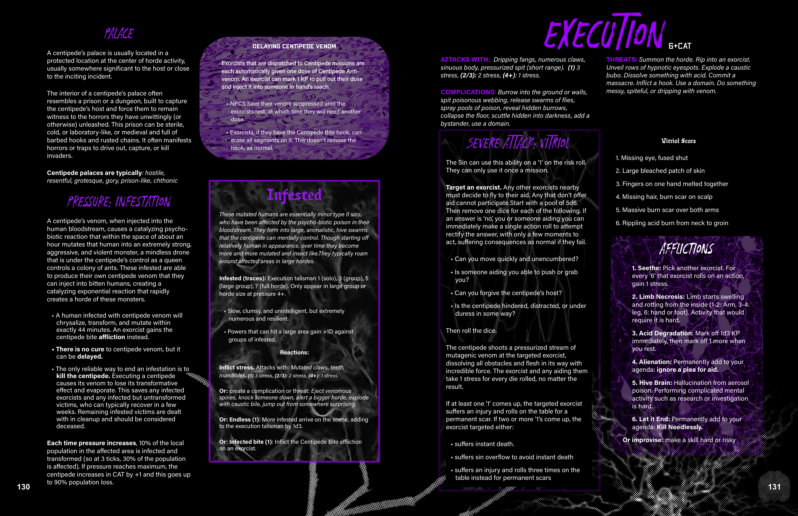

## Related Knowledge Nodes

- [[Designing_Sins]]
- [[Conflict_Scenes]]
- [[Investigation_and_Traumas]]
