# Sin V: Toad - Gluttony, Corrosive Bile & Swallowing Maw

> Source: CAIN 1.0 Rulebook (Pages 68, 69, 70)

---
### Page 68 Source Content

# V. TOAD 

Toads are **crafty** and **avaricious** sins with a very unique behavior pattern. They are by far the most intelligent sins, and present puzzling opponents to most exorcists. 

Toads are born out of deprivation and unfulfilled material needs. Therefore, unlike most other sins, they are extremely goal oriented. Once manifested, their primary need is to **acquire as much material wealth as possible** for their hosts. They revel in greed, driving their hosts to more spectacular heights of **excess.** 

Toads commonly manifest in: 

- people suffering from major housing, job, or food insecurity 

- people who are exploited at work 

- people in crushing financial debt 

**Primary emotion** : Indulgence 

**Appearance and Psychophysiology:** Toads are bulky but surprisingly fast sins with a great degree of manual dexterity. They often have prehensile tongues or double jointed limbs, and convey these features onto any hosts they are fused with. They are capable of squeezing through tiny spaces and leaping great distances. The gaping mouths of toads have space extending properties and are capable of storing an unreal amount of physical material - many rooms worth in some cases. All toads have a strong, not entirely unpleasant odor about them - something between carpet cleaner and expensive cologne. 

**Behavior:** Unlike other sins, who typically want to fight or escape exorcists, toads are fond of catching them in conversation to gloat or verbally spar. Toads are cunning, sharp tongued sins with a fondness for speech and tend to be witty or charming, with a good sense of humor. They seem to enjoy what they do and revel in excess as much as their hosts - although they are typically extremely impatient and may be cruel to slow or unwilling hosts. 

## **ARCHIVE TOADS** 

### **POCKETS** 

### **DRACUL** 

### **MR WORLDWIDE** 

Type I, CAT I. Manifested in rare cooperative arrangement by host <mark>XxxxxxxxxXX</mark> acting as ‘lone wolf’ cat burglar after his repeated conflicts with repossession companies and repeat incarceration. Accumulated treasure hoard of estimated worth of <mark>XXXX</mark> million in eight days, including thirty five luxury vehicles, mostly kept inside palace located in the garage of host <mark>XXXxxx</mark> ’s apartment residence in <mark>XXxxxxxX</mark> . No record of execution, manifestation was dispersed. Exorcists <mark>XXxxxX a</mark> nd <mark>XxxxxxXX</mark> disciplined. 

Type III, CAT III. Variant form of type III that bound itself to its owner (see TEMERITY record <mark>XXX),</mark> host T493, in unwilling marriage to well known billionaire <mark>XXxxxxxxX</mark> (deceased, see record <mark>XXX).</mark> Gradually formed advanced palace and treasure vault in <mark>XXxxxxxX</mark> ’s penthouse apartment building and took over operations of his holdings including hiring of a private mercenary company. Executed. Time to execution 2 days 34 minutes, no losses, 25 casualties. Notable: net losses from company <mark>XXxxxxxxxxX</mark> led to minor stock market drop in <mark>XXXxX.</mark> 

Type II. Manifested in host T777 (deceased, see note <mark>: XXX)</mark> after he experienced extreme gambling loss and was evicted from his residence in <mark>XxxxxXX</mark> . Over three months host <mark>XxxxxxxxXX</mark> formed criminal syndicate that attained complete control over the <mark>XxxxxXX c</mark> asino in XXxxxX, XxxxxXX and pulled power from its operations. Attained category IV before execution. Time to execution: 6 hrs 55 minutes, exorcist <mark>XxxxxXX, XxxxxXX,</mark> and <mark>XXXxxx K</mark> IA. 

## TRAUMAS 

The Admin, as the toad, answers the following questions, then establishes a trauma based on the truthful answers. 

- What do you deserve that was denied to you? 

- While you were starving, who was feasting? 

- Where do you draw the line? 

_For every question the exorcists answer, they can_ **_counter_** _a sin’s reaction, rolling 1d3 after the sin acts._ **_Reduce any stress suff ered by all targets by the amount on the die_** _, and the sin immediately takes_ **_that many slashes_** _on its execution clock from the psychic trauma, which cannot reduce it below 1._ 

**134** 

**135**

#### Extracted Visual Elements (Page 68)

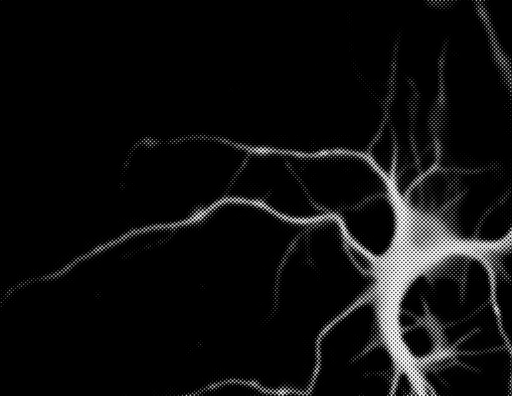

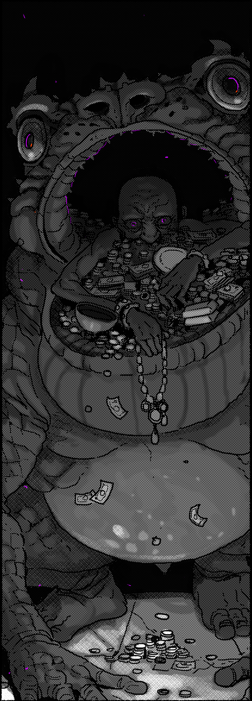
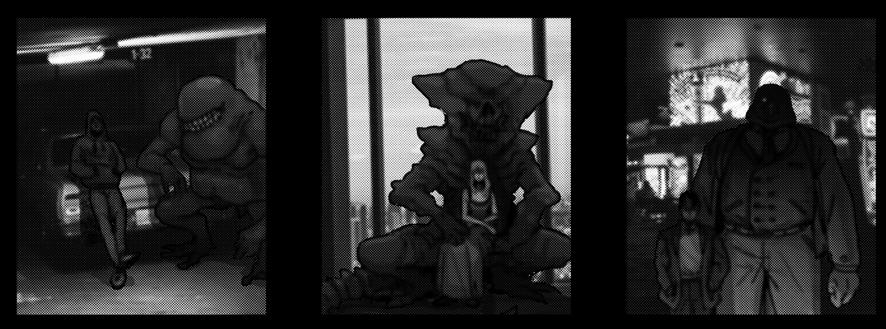

---
### Page 69 Source Content

## PALACE 

A toad’s palace represents a monument to wealth, often as envisioned by its host. On the outside it may be located inside a cramped building or in a tiny apartment block, but on the inside it is typically an opulent, sprawling extravaganza. 

Toad palaces typically take the form of summer mansions, luxury residences, resorts, casinos, or other places that mix pleasure and commerce. The host may reside at least part time inside the palace due to its space and comfort. Over time the space becomes crammed almost to bursting with the wealth that the toad accumulates, transforming partly into treasure vaults or galleries to either protect or display their largesse. 

**Toad palaces are typically:** _Opulent, gaudy, glitzy, spacious, extravagant, luxurious, comfortable_ 

## Pressure: HOARD 

A toad’s main driving desire is to **acquire as much material wealth as possible** for its host. It steals as much as it can, by various means, based on its host’s desires, storing its prizes inside of its expansive gullet and regurgitating them later inside its palace. 

A toad’s larceny can start small, but as time goes on its appetites, both literal and figurative, become more expansive. A host that wanted a faster car in the past, for example, will eventually draw a toad to find the fastest car in town and swallow it, then the next fastest car too, and so on. As time goes on, the amount of material the toad swallows and its avarice inevitably starts to grow out of control, to unreal proportions. Instead of stealing food for its host, for example, it may swallow an entire restaurant, staff and all. In theory a high enough category toad would swallow an entire town, given time. 

The toad gains power from its hoard. Every time pressure increases, its greed increases too, describing the kind of things it can steal: 

- 0-2: High worth but mundane items. Money, cars, guns, medicine, food, fashion, high art. 

- 3-4: Unreal amounts of the above. 

- 5+: Entire stores, shops, restaurants, yachts, buses, celebrities. 

At 6+, the toad’s CAT increase by 1 and it gains the ability to steal **conceptual** or **intangible items** like **abstract wealth, stocks** in a **company, light, artistic skill,** or **happiness.** 

## TRACES 

### TOADSPAWN 

_These humans follow the toad or its host through the (very real) promise of the incredible wealth that it accumulates. They can range in anything from regular gangsters to privately hired security. They are often oblivious, brainwashed, or simply willfully ignorant of their paymaster’s true nature._ 

**Toadspawn (humans):** Execution talisman 1 (solo) 3 (Group) 5 (large group). Mundane humans armed with mundane weaponry - no less deadly. Often has access to cars or security vans. 

#### **Reactions:** 

**Inflict stress** . Attacks with: _Firearms, close quarters combat techniques._ **_(1)_** _3 stress,_ **_(2/3):_** _2 stress,_ **_(4+)_** _: 1 stress._ 

**Or:** create a **complication** or **threat:** _Fire a stun gun, charge an exorcist, get in a martial arts hold, pin down with a barrage of gunfire, get in a vehicle, throw a grenade._ 

**Or: Threat: call reinforcements (1)** . _Someone gets on the radio or punches an alarm. Add 1d3 to the execution clock if allowed to follow through._ 

# EXECUTION 

### 6+CAT 

**ATTACKS WITH:** _Crushing punches and kicks, muscular tongue, pressurized blood spray from eyes (short ranged)._ **_(1)_** _3 stress,_ **_(2/3):_** _2 stress,_ **_(4+)_** _: 1 stress._ 

**THREATS:** _Summon bodyguards. Steal something from the exorcists, collapse or throw something from the environment. Set off a bomb. Kick someone with powerful legs. Swallow something or someone whole. Inflict a hook. Use a domain. Do something crafty, flashy, or shocking._ 

**COMPLICATIONS** : _Leap out of reach on muscular legs or squeeze into a tight space. Entangle in traps. Reveal hidden explosives. Trigger security, or alarms. Vomit slime or disgorge stomach contents. Add a bystander, use a domain._ 

## SEVERE ATTACK: Grand Finesse 

## Afflictions 

The Sin can use this ability on a ‘1’ on the risk roll. They can only use it once a mission. 

**1. Absent Minded:** Whenever you roll a ‘1’ on risk, erase 1 KP. 

**2. Wasting Sickness:** Reduce max stress by 1 each time you rest. If reduced to 0, you suffer instant death. 

**Target an exorcist.** Any other exorcists nearby must decide to fly to their aid. Any that don’t offer aid cannot participate. Start with a pool of 5d6. Then remove one dice for each of the following. If an answer is ‘no’, you or someone aiding you can immediately make a single action roll to attempt rectify the answer, with only a few moments to act, suffering consequences as normal if they fail. 

   **3. Starvation:** All actions are hard until you or an ally mark 1 KP and allow you to eat something. This effect resets and you must eat again after you rest. 

   **4. Itchy Fingers:** Once a scene, stealing something (anything) gives you 1 psyche burst and 1d3 sin. Permanently add to your agenda: **steal.** 

- Are you accepting of your powers? 

- Are your allies close enough to touch you skin to skin? 

**5. Dreaming Desire** : When pressure increases, spend 1 psyche burst to daydream about things you want or take 2 stress. 

• Are you willing to part with your kit? If you answer yes to this, the Toad is distracted by stealing every item of gear from you you currently have ticked. They disappear until the Toad is defeated. 

**6. The Want:** Permanently add to your agenda: **take more than you need.** 

**Or improvise:** make a something hard or risky 

Is the Toad hindered, distracted, or under duress in some way? 

Then **roll the dice.** The exorcist and any aiding them take 1 stress for every die rolled, no matter the result. 

- If at least one ‘1’ comes up, the Toad steals the **ability to use psychic powers** from the targeted exorcist. These coalesce into a **psychic shadow,** which runs off. It is a **sin** with an **execution talisman of 3** and it uses reactions to attempt to flee. If it is destroyed, captured, or the scene ends, it fuses with its host again, **ending this effect.** 

- If two or more ‘1’s come up, the execution talisman of the shadow is 5 instead. 

**136** 

**137**

#### Extracted Visual Elements (Page 69)

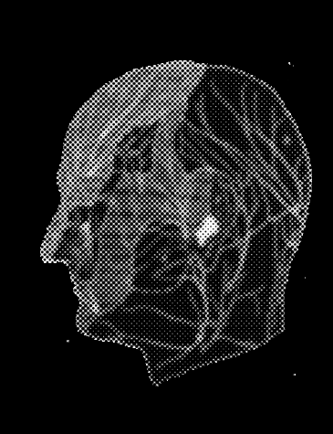
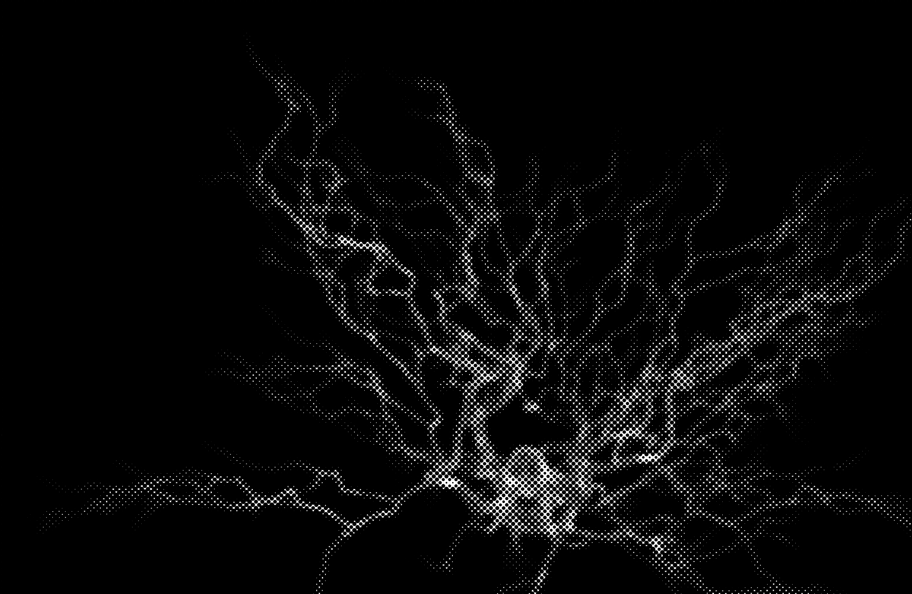
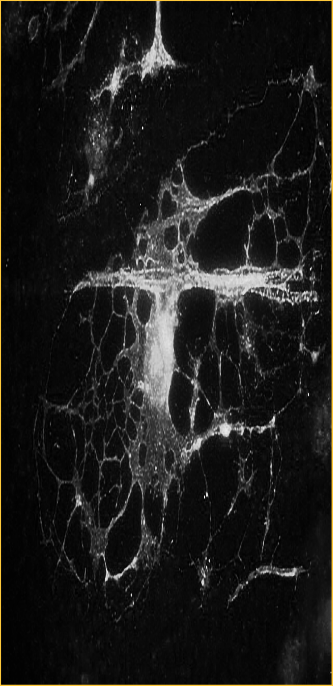
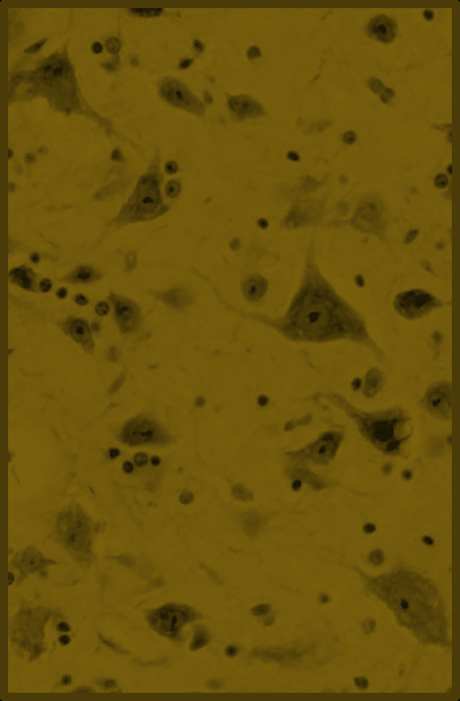
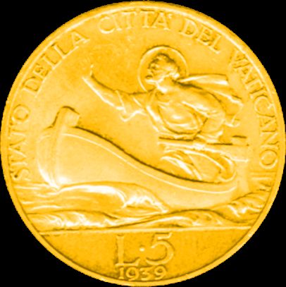

---
### Page 70 Source Content

# DOMAINS 

_Pick three:_ 

## 1. Hotel for One 

The toad is able to use its powerful lungs to suck people into its maw, where they are shunted into a tiny prison-space inside its gullet. 

## 3. The Granting of Gifts 

The toad is an especially powerful hoarder, and keeps quantitites of strange items to regurgitate in an emergency. 

As a **reaction** (1-3), the Toad can forcibly regurgitate items from its gullet. This can inflict stress, cause a threat or cause a complication as normal. However, roll randomly for the category of item it produces, which may affect the outcome: 

## 5. Sticky Fingers 

The Toad is artful at lifting items from the exorcists.  When an exorcist takes stress from the Toad, they also (the Toad chooses 1): 

- tick 1 KP. If they don’t have KP to spend, they take +1 more stress 

- lose a piece of gear instead of taking stress. The KP of the item must equal the stress suffered or less 

## 8. The Great Glittering Adversary 

The Toad is able to transform matter into material wealth, such as precious gemstones or gold. 

By touching any surface or living matter, it can transform it into gemstone or gold. It can use this as a **threat** or **complication** to inflict stress, block the exorcists, or inflict the below affliction. 

1. Vehicle, drivable. 

As a **complication** the Toad can suck in an exorcist it is fighting. That exorcist is trapped inside a tiny cage-like extra-dimensional room inside the toad and takes 1 stress before acting while imprisoned until they can escape or their allies can help them escape (set out a talisman for the complication as normal). They are vomited out when they are able to break out of their cage. 

As a **tension move,** the Toad can kidnap any NPC the exorcists have met off-screen and imprison them in its oubliette, mostly unharmed. Freeing them requires fighting the Toad and may take a talisman. 

## 2. Greasing the Palms 

A vile alchemy churns in the toad’s gut. 

As a **complication** or **threat** , the toad is able to vomit up a thick, nauseating slime that reeks of expensive perfume. It can be incredibly sticky, incredibly slippery (the toad chooses), and carpets the area of about a large room. 

- Actions that require concentration, quick movement, or manual dexterity become hard in the area. 

- It becomes incredibly hard to keep your footing in the area. Any action that requires moving around by the exorcists rolls two risk dice and picks the lowest. 

2. Explosives 

3. Weapons, ammunition 

4. Narcotics 

5. Material wealth (gold bars, jewels, etc) 

6. Alcohol (in liquid or bottle form) 

Then roll randomly for the size or volume (1d3). Adjust stress suffered by the amount shown if dealing stress. 

1. Comically smaller than expected (-1 stress) 

2. Expected 

3. Unbelievably larger than expected (+1 stress) 

## 4. Wolf Down the Earth 

The Toad is able to unhinge its jaw to a void-like space and swallow huge chunks of the scenery. 

- It can burrow through solid rock when moving around. 

- The toad inflicts +1 more stress to its target if it is slowed, off balance, immobile, or entangled in some way. 

• Once a scene, as a **threat,** it can attempt to devour an area close to it, obliterating all inanimate matter, no matter its toughness. The size of this area depends on the Toad’s CAT. One or two exorcists caught in the area take 2d3 stress if the toad is allowed to execute on the threat. 

## 6. The Artful Dodger 

The Toad is especially careful and crafty, setting up contingency plans. 

**Three times a hunt,** when the exorcists take action, the Admin can narrate a flashback of the Toad setting up a contingency plan, fallback, or trap that it is able to spring. Roll a 3d6 fortune roll. For every 3+, the toad may either inflict 1 stress on the exorcist triggering this domain or reduce any stress suffered from the triggering action by 1. 

## 7. Keeper of the Ludic Menagerie 

The Toad stores brainwashed humans inside its gullet, and pulls them out as needed. Humans stored this way are freed when the toad is defeated and have no memory of the incident. 

• The Toad can pull out a human to perform any mundane servile task for it, such as cooking, cleaning, driving, etc. They are completely obedient to the toad and always come out with something convenient to the current situation, such as a guard with a door key, a taxi driver, etc. 

- It can pull out a goon as a (1-3) r **eaction** in a conflict scene. This creates a **toadspawn** trace with an execution talisman of 1, or adds +1 to an existing trace’s execution talisman. 

- As a **threat** in any conflict scene, the toad can kidnap a mundane human or NPC present, brainwashing them and adding to its collection. 

Midan Touch: Inflict this on the exorcists with a **threat** or a **hook.** The skin of an arm or leg of the afflicted exorcist slowly becomes turning into gemstone or rock, usually starting from the contact area. Actions that require speed or dexterity from them become hard. When the exorcists finish a rest, they take 3 stress. If this stress would inflict an injury, they instead suffer instant death and turn into a jeweled statue. 

**138** 

**139**

#### Extracted Visual Elements (Page 70)

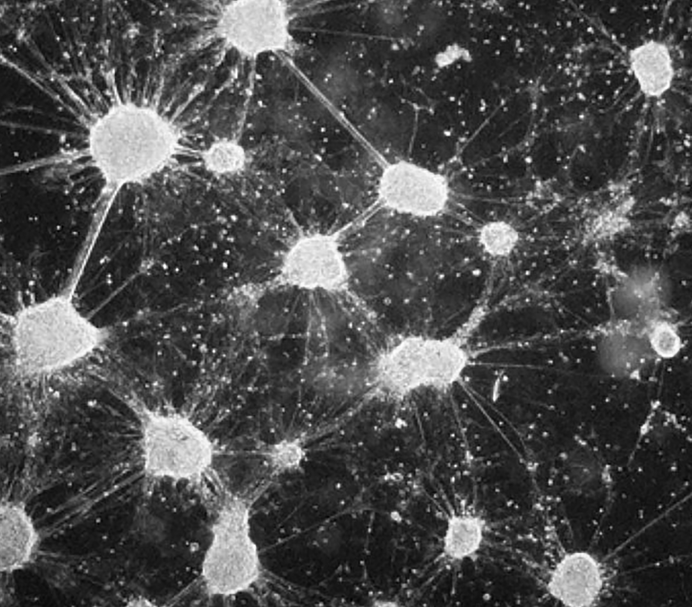
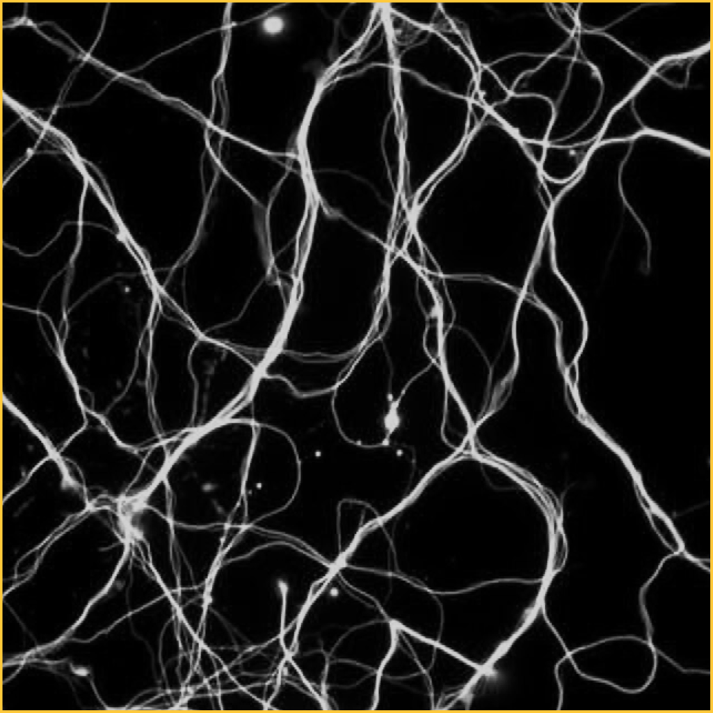
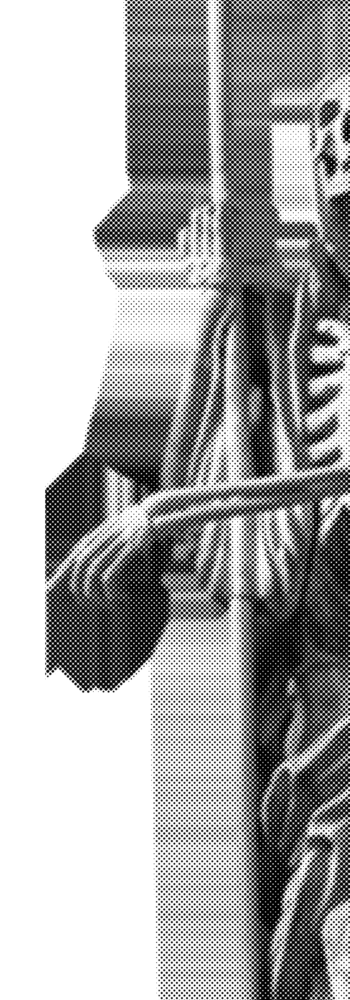
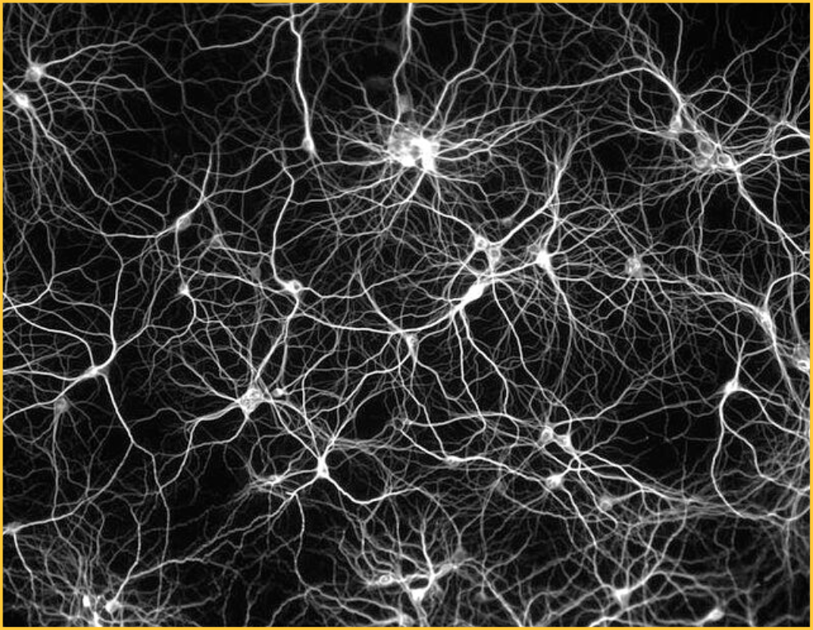
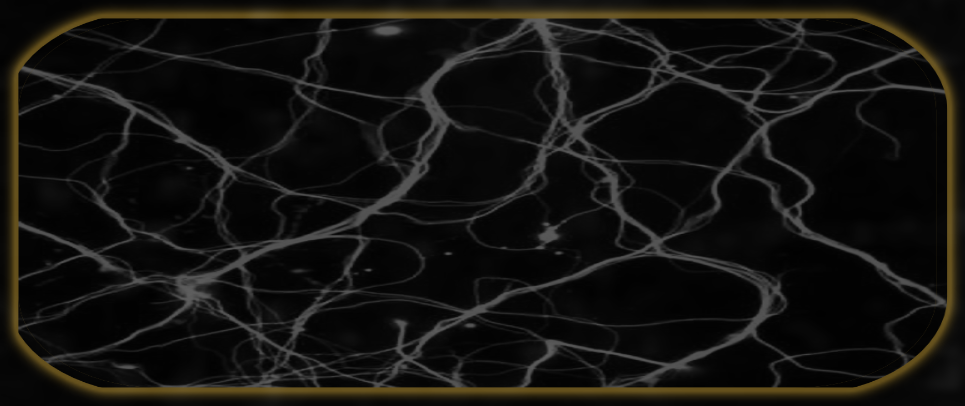
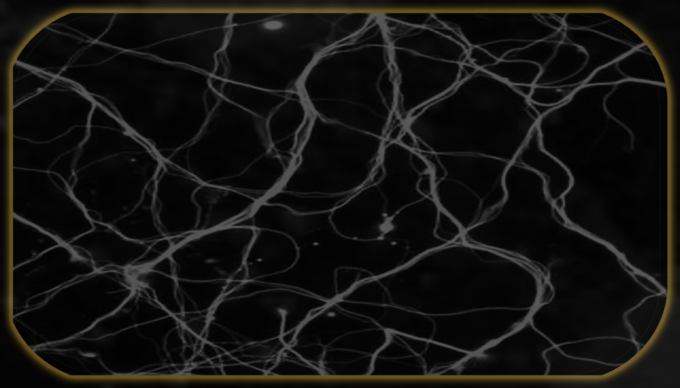
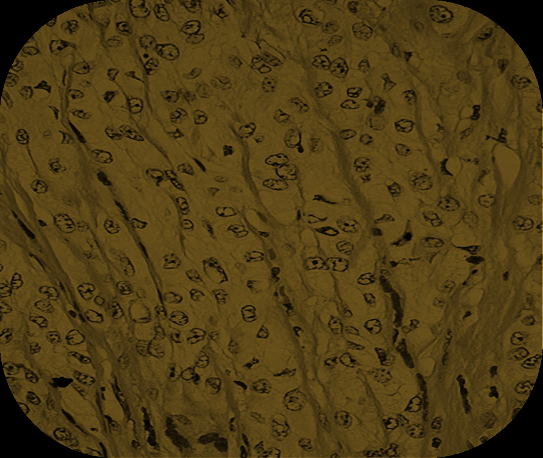
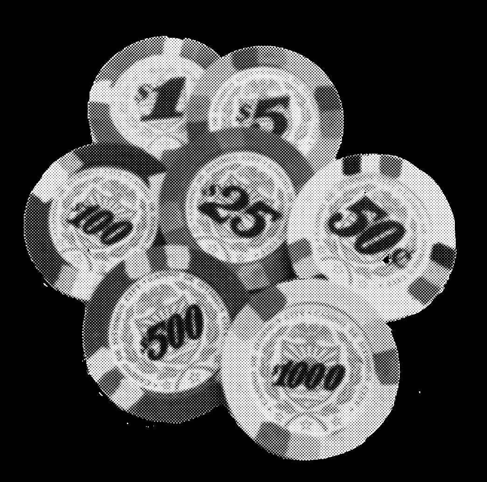

## High-Resolution Graphical Tables & Sheets

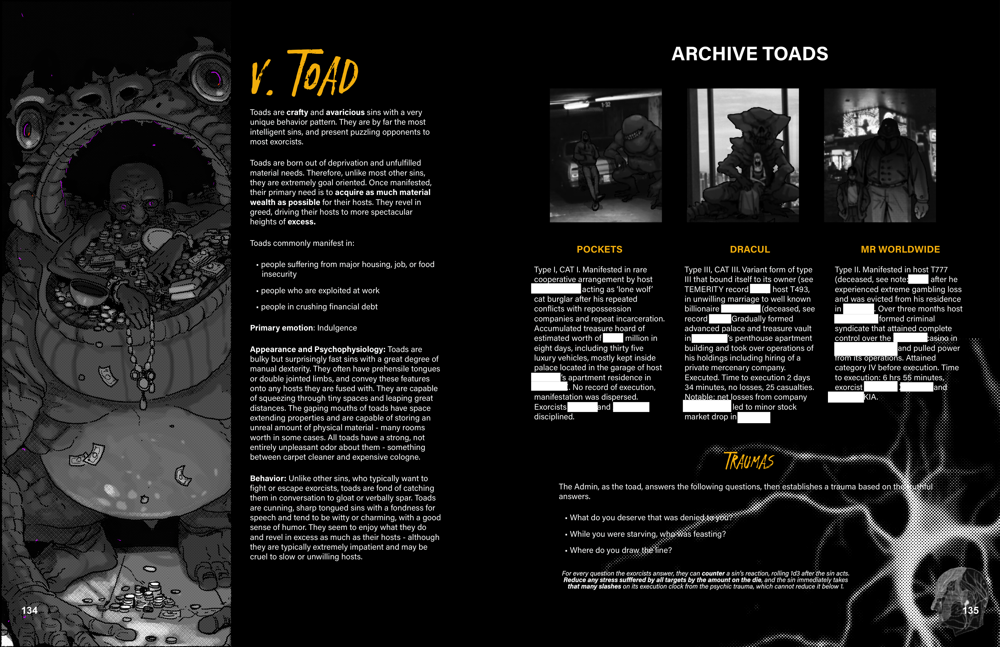

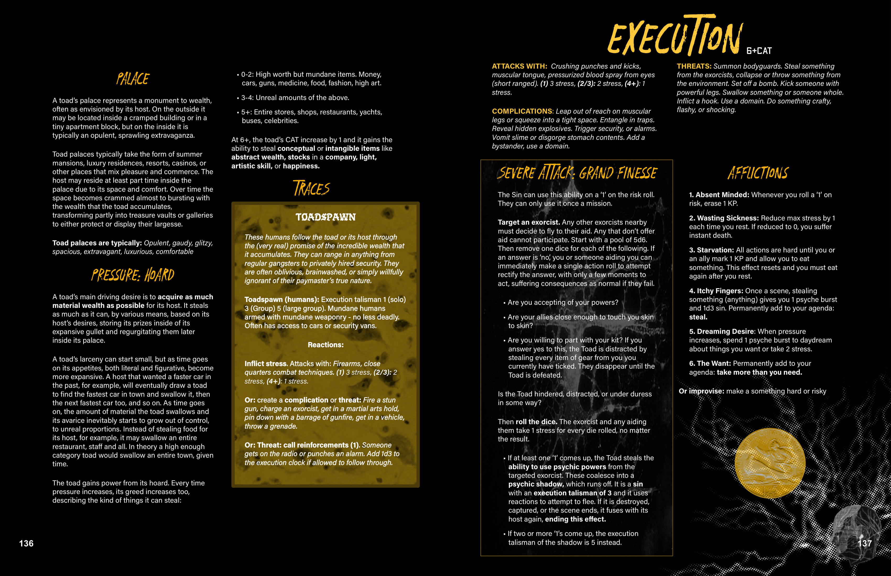

## Related Knowledge Nodes

- [[Designing_Sins]]
- [[Conflict_Scenes]]
- [[The_Body_Stress_and_Injuries]]
