# Sin VI: Lord - Psychic Domination, Puppetry & Royal Blasphemy

> Source: CAIN 1.0 Rulebook (Pages 71, 72, 73)

---
### Page 71 Source Content

# VI. LORD 

Lords are **righteous** and **moralistic** sins driven by a deep and irrational sense of purpose and moral injury. 

Lords are born out of a **profound sense of loss** . This often occurs when someone’s life is irreversibly altered by tragedy or misfortune - such as illness, death, or accident. The Lord is the manifested desire to rewind time and return to the world as it was before the tragedy. They construct a kingdom, an elaborate prison dimension, where reality inside alters to to hosts’ whims, often returning them to a time or place before the tragedy occurred, but eventually driving them to greater acts of **paranoia** and **cruelty** to those trapped inside in an effort to never allow their life to change again. 

## **ARCHIVE LORDS** 

Lords commonly manifest in: 

### **DECURION** 

### **PALE QUEEN** 

### **BALDUR** 

- people who have lost loved ones to illness or accident 

Type I. Manifested in host L99 after his discharge from the military of <mark>XXXxxxxX</mark> , subsequent to multiple diagnoses of <mark>XXXxxxxX d</mark> isorder following campaigns <mark>XXXxxxxX</mark> and XXxxxXX. Kingdom manifested as a 

Manifested from Host L545 who was then able to bind it as a type III. Took the form of a basset hound. Kingdom manifested as a typical 1930s city noir narrative where the host was a hardboiled detected in search of his missing wife. In reality, host’s wife had been deceased for 6 months due to advanced bone cancer. Executed. TTE: 2 days, 2 hrs, 34 mins. L545 taken under observation (see Temerity record <mark>XXxxxXX)</mark> . 

Manifested and fused with host L44 who had retreated into a world of video game playing after a sports injury left her without the use of her legs. Kingdom manifested as a typical pseudo-medieval video game fantasy world based on property XXxxxxxxxxxxxxxxxxX, which consumed up to 60% of city <mark>XXxxxxxX</mark> before dispersal by the dispatched team. 3 exorcists KIA, reinforcements sent by helicopter. Executed. TTE 9 hours 54 minutes. 

- people whose fortunes and stations in life have drastically changed 

- people who have themselves been impacted and permanently altered by illness, injury, or accident 

perfect recreation of childhood 

hometown in the <mark>XXxxxxxxxxxX</mark> mountains where L99 was a beloved member of the church and community who had never went to war. Executed (TTE: approx 500 mins, 50 casualties) 

**Primary emotion:** Fear 

**Appearance and Psychophysiology:** Lords are powerful, imposing figures that present an archetypical ‘guardian’ figure to their hosts, sometimes manifesting as an authority figure like a soldier or policeman, and sometimes as something more divine, like a god or an angel. They have extremely tough armor and are excellent combatants, able to fight off any perceived threats to the new order they impose with ease. 

## TRAUMAS 

**Behavior:** Lords are righteous and moralistic to the extreme. Unlike other sins, justifying their own behavior is important to them. To the Lord, their kingdom is a better and more just version of reality, and their construction of it is a gift to its new inhabitants. They may couch their behavior and the rules of the new kingdom in the language of religion or law, as seen fit by their hosts. They are usually measured, polite and refined in their manner and speech and regard their hosts as the rightful liege of master of the new kingdom, and any intruders as a nuisance. In the case of an unwilling host, they often ‘graciously’ accept the role of regent and govern in their hosts’ place. 

The Admin, as the lord, answers the following questions, then establishes a trauma based on the truthful answers. 

- What did you lose? 

- What is the main thing you would fix about the world? 

- Who did you regret leaving behind when you ascended to your Kingdom? 

_For every question the exorcists answer, they can_ **_counter_** _a sin’s reaction, rolling 1d3 after the sin acts._ **_Reduce any stress suff ered by all targets by the amount on the die_** _, and the sin immediately takes_ **_that many slashes_** _on its execution clock from the psychic trauma, which cannot reduce it below 1._ 

**140** 

**141**

#### Extracted Visual Elements (Page 71)

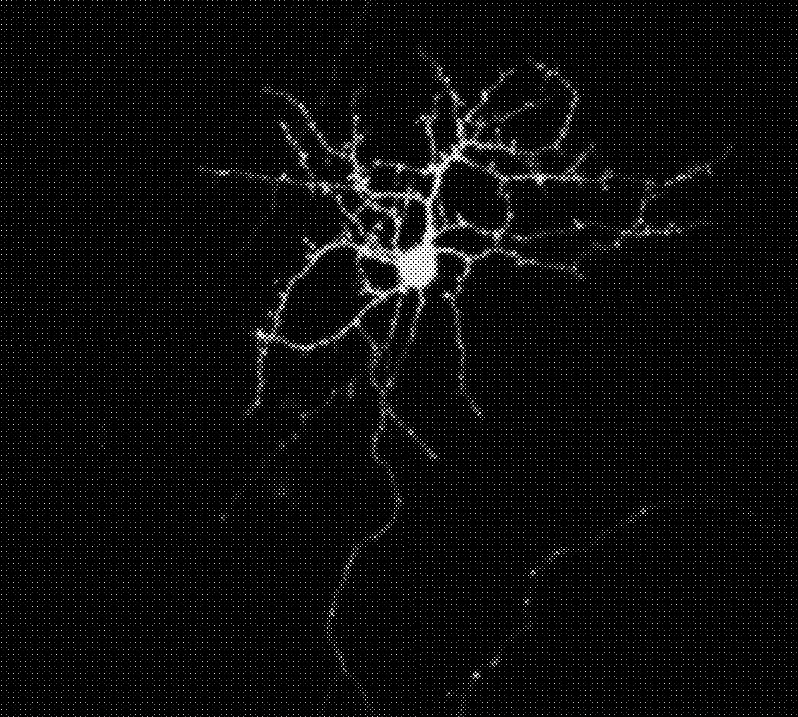

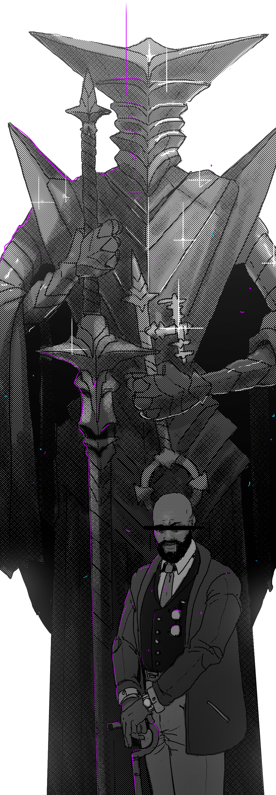
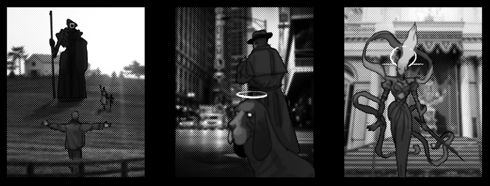
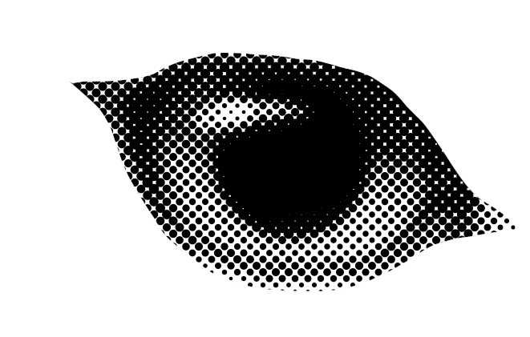
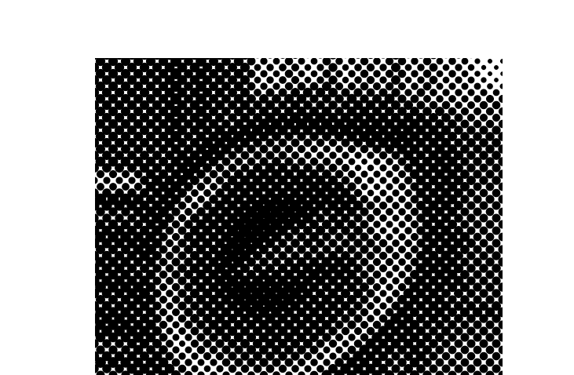
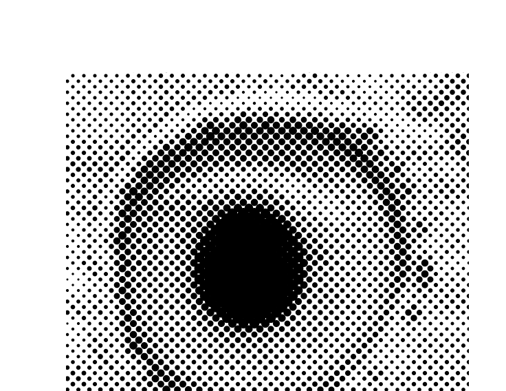
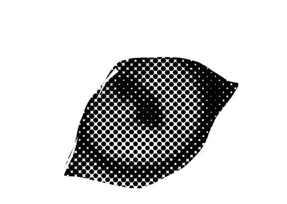

---
### Page 72 Source Content

## PALACE 

A lord’s palace is always nestled in the center of their kingdom, and therefore always requires traversing the kingdom itself to reach. More often than not, it resembles an actual palace in size and form - or something similarly important and imposing, such as a high rise skyscraper, corporate headquarters, government office, or temple. 

The palace of a lord is typically a bustling place full of servants or subsidiaries going about their business - minor sins, figments of the host’s imagination, or captive humans that have been absorbed into the narrative of the kingdom. 

**Lord’s palaces are typically:** _Imposing, grandiose, august, monumental, stony, hallow_ 

## Pressure: Kingdom 

The archetypical Lord creates a Kingdom, an alternate parasite reality growing outward from its palace that overlaps our own. The kingdom can be accessed freely by the lord and its host, and can be squirreled away in impossible spaces - accessible through closet doors, hallways, restaurant back alleys, etc. Eventually it starts to bleed over and pull parts of the real world into it, consuming space and the unwitting humans inside. From the outside, humans cannot see the kingdom even as it consumes the real world, and may merely walk down a street and unwittingly pass into an alternate reality. 

Inside the Kingdom, the world may appear as the world currently does, or a historical or even fantastical version of the world, such as a futuristic city, a glittering heaven, or a medieval castle - dependent on the latent desires of the host. In this world, all that the host has lost is returned to them and more. It presents an alternate reality that is both more convenient and fulfilling to the host and also conforms to their beliefs and outlook, coddling and supporting them. 

Events, history, and even humans may be altered drastically inside. Therefore humans that on the outside of the kingdom may be hostile to the host might be their friends inside, mistakes the host has made in the past or their own failings might be papered over or made whole - or even celebrated. 

In this world, the host is the absolute ruler (or the Lord as their regent if they are unwilling) and may change the laws of reality as they wish. These strictures completely consume mundane humans and are strong enough to even effect exorcists. 

**Each time pressure increases** , the kingdom expands to a new area of the real world, increasingly rapidly in size. Humans consumed by it are unaware of the change. If pressure is 6+, the **kingdom consumes the whole investigation area,** and the Lord’s CAT increases by +1. 

A kingdom collapses when the host or the Lord is defeated, ejecting anything brought into it, including humans - who typically have no memory of their time inside. 

## TRACES 

### Guards 

_A lord’s kingdom always has guards patrolling it. These guards are sins that typically take the form of authority figures or soldiers. They are completely subservient to the Lord and their appearance and behavior is shaped at their whim. Some kingdoms may have guards that are imposing human soldiers with their face shaded under security caps or helms, while others may have beast-like demons wielding medieval weaponry that punish unbelievers._ 

**Guards (sins):** Execution talisman 2 (solo), 4 (squad), 6 (small army) 

- Armed with cruel weaponry and outstanding senses. 

- Incapable of existing outside the kingdom 

**Reactions:** 

**Inflict stress.** Attacks with: _Cruel close combat weaponry, fists and kicks._ **_(1)_** _3 stress,_ **_(2/3):_** _2 stress,_ **_(4+)_** _: 1 stress._ 

**Or:** create a **complicatio** n or **threat** : _Trap an exorcist and pile on, pull an exorcist away in chains, disable an exorcist with a painful strike, threaten bystanders as collaborators, call in a prison vehicle, produce a heavy weapon_ 

**Or:** **_Sound the Alarm (threat, 1-2)_** _: Alert the Lord or any other nearby guards to the exorcists’ current position. If more guards show up, refresh the execution talisman by 1d3._ 

# EXECUTION 

#### 6+CAT 

**THREATS:** _Smite with fire, pass judgement from the heavens, hurl into a psychic prison, force an exorcist to confront their own crimes, grasp with an armored fist, impale with holy spikes, Inflict a hook. Use a domain. Do something righteous, scathing, or dominating._ 

**ATTACKS WITH:** _Shimmering blades, armored gauntlets, shining medieval weaponry, beams of fire (long range)._ **_(1)_** _3 stress,_ **_(2/3):_** _2 stress,_ **_(4+)_** _: 1 stress._ 

**COMPLICATIONS** : _Twist the world or landscape, extend the Kingdom, throw false accusations, bind an exorcist in chains, blind with scorching light, extend shining armor plating, raise a glittering shield, add a bystander, use a domain._ 

## SEVERE ATTACK: JUdgement 

## AFFLICTIONS 

The Sin can use this ability on a ‘1’ on the risk roll. They can only use it once a scene. 

**1. Reality Control:** Must spend 1 stress to spend any amount of KP in the kingdom. 

**2. Pain of Loss:** Forced to psychically experience the same catastrophe as the Lord’s host. When the lord or its host is harmed, also take 1 stress. Ends if exorcist takes an injury. 

**Target an exorcist** . Any other exorcists nearby must decide to fly to their aid. Any that don’t offer aid cannot participate. The lord binds the targeted exorcist with divine chains, then begins a summary trial. 

**3. Kingdom infection:** Mark off 1 KP when pressure increases, then manifest something comforting and small for your exorcist, like a treat or book. 

Start with a pool of 5d6. Then remove one dice for each of the following. If an answer is ‘no’, you or someone aiding you can immediately make a single action roll to attempt rectify the answer, with only a few moments to act, suffering consequences as normal if they fail. 

**4. Hitchhiker:** Always count as in the Kingdom for the purposes of the Lord’s powers. 

**5. Welcome Home:** Gain +1 max psyche burst in the kingdom, regain max psyche burst when resting in the kingdom, but become unable to use blasphemies outside. 

Uniquely, this may take the form of a verbal argument from any aiding exorcist 

   **6. Justiciar:** Permanently add to your agenda **punish wickedness.** 

- Are you innocent of crimes? 

- Are you a liar or a cheat? 

**Or improvise** : make a skill hard or risky. 

- Have you lived a life by your ideals? 

- Is the lord hindered, distracted, or under duress in any way? 

Then roll the dice as the Lord passes judgement, smiting the chosen exorcist with fire. The exorcist and any aiding them take 1 stress for every die rolled, no matter the result. 

For every ‘1’ that comes up, the targeted exorcist is forced to confront their inadequacy and additionally gains **1d6 sin.** This could occur **multiple times.** 

**142** 

**143**

#### Extracted Visual Elements (Page 72)

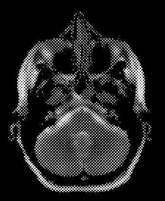
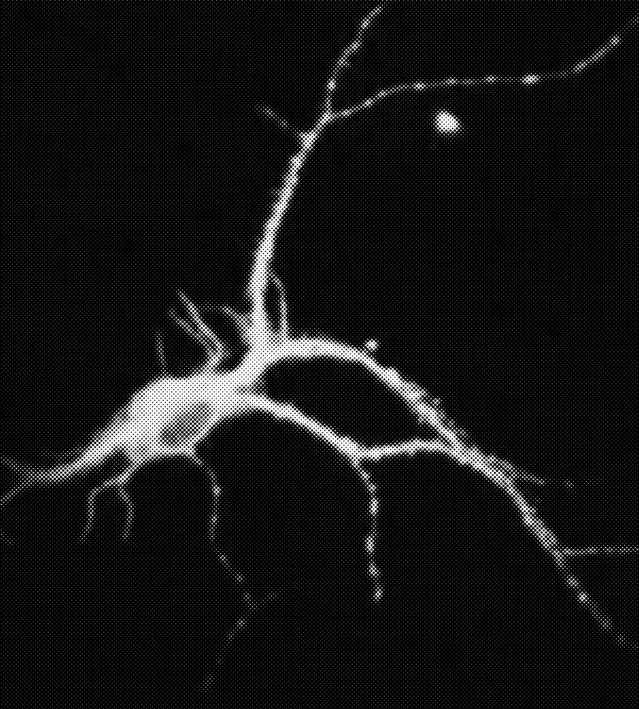
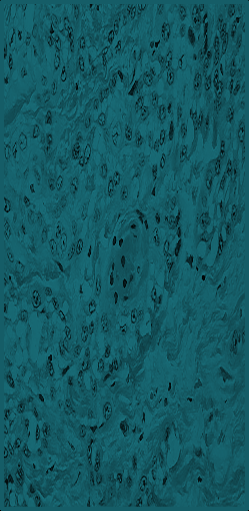
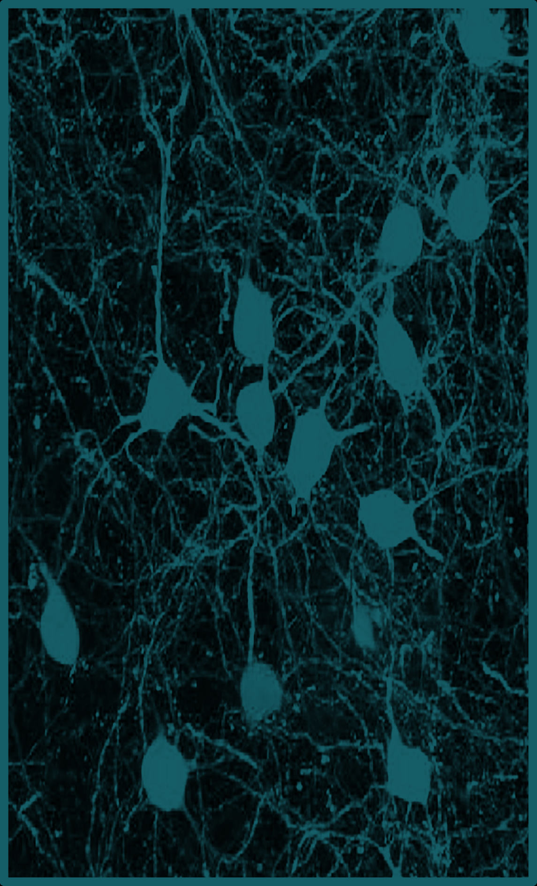

---
### Page 73 Source Content

# DOMAINS 

_Pick three_ 

### 1. Stricture of Manifestation 

The Lord or its host gain increased control over reality inside its Kingdom, granting them the following powers. It can use these as **threats** or **complications:** 

- Cause any object up to the size of a small building to coalesce and appear in a few moments. 

- Invert or choose the direction and strength of gravity, or even make space curved 

- Change the weather or change the biome of an area, such as from sunny to snowy 

- Rearrange the interiors and layouts of buildings, streets, or corridors 

In addition, as a **threat** or a **tension** move, the Lord can dismiss any psychic power caused by the exorcists that has a sustained effect (like a summon or curse). This only works inside the kingdom. 

### 2. Stricture of Superiority 

The Lord fights more fiercely the less exorcists play by the rules of the Kingdom. At the start of the round in a **conflict scene** , the Lord can take one of the following stances. Exorcists that don’t fulfill the requirements are punished. It must switch to a different stance each round. 

- **Honorable Fighting** : Exorcists that participate in teamwork or setup take 1 stress. 

- **Grand Melee** : Exorcists acting without benefiting from teamwork or setup find it **hard** . 

- **Duel:** The Lord chooses an exorcist. That exorcist deals +2 more slashes on the Lord’s execution talisman, but all other exorcists deal 1 less slash to the Lord this round. 

### 3. Stricture of Banishment 

The lord can banish exorcists, making them gradually phase out of reality while inside the kingdom. As a **tension move** or a **threat,** the Lord can give an exorcist the following affliction: 

**BANISHED** : Starting to fade from reality, with the following effects: 

- Interacting with the physical world inside the kingdom without using psychic powers becomes hard. However, can also slip through walls and objects like a ghost. 

- When pressure increases, take 1 stress. If this stress inflicts an injury, suffer instant death instead and disappear completely. 

### 4. Stricture of Control 

The lord’s power is intense and bleeds out over the investigation area like an iron net. On this mission, the Admin, choosing for the Lord can forbid three items from the following list: 

- Swearing 

- Speaking the name of the Lord or its host (in vain or otherwise) 

- Uncovering skin between the ankles, wrists, and neck in view of the opposite sex 

- Drinking, eating, or smoking anything not blessed by the Lord 

- Touching another person skin to skin without consent of the Lord 

- Entering the palace of the Lord without praying first 

These rules become known instantly to anyone upon entering the kingdom. Once a scene, when an exorcist would break one of these rules, they take 1d3 stress. If the Admin misses an occurrence of one of these rules being broken but an exorcist reminds them, that exorcist can gain 1 xp. This can only trigger once a session per exorcist. 

### 5. Stricture of Memory 

The lord’s power is regressive and nostalgic. Inside its Kingdom, it returns everything to a **previous era** (real or imagined) desirable to its host, such as the European middle ages, Edo Japan, 1950s America, or 1st century Judea. Weapons, gear, and technology that would not exist in that era are converted into similar equivalents inside the Kingdom, or simply do not exist while inside the Kingdom. For example firearms becoming crossbows, or a GPS system becoming a hand drawn map. If the Admin judges this would affect a roll, they can make it **hard** . All clothing, hairstyles, etc also changes to fit. They revert upon exiting. 

### 7. Stricture of Alignment 

As a **tension move** , the Lord can give a randomly rolled role **affliction** to one of the exorcists inside its kingdom, as the kingdom attempts to absorb them. A role, once given, gives a new (temporary) agenda item to the afflicted exorcist until the end of the mission, as well as forbidden activities, which become **hard** for the afflicted inside the kingdom. An exorcist can only have one role at once. 

**1. Peasant:** Agenda: _Act in extreme deference to others._ Forbidden: _Acting in defiance of an order._ 

**2. Priest:** Agenda: _Obey the Lord._ Forbidden: _Lying, Cheating, taking the Lord’s name in vain._ 

**3. Bandit:** Agenda: _Steal something._ Forbidden: _Setup actions or teamwork._ 

**4. Sage** : Agenda: _Demonstrate your erudition and knowledge_ . Forbidden: _Any physically demanding activity._ 

**5. Knight** : Agenda: _Protect the residents of the kingdom._ Forbidden: _Striking a woman. Lying, cheating, or dirty fighting._ 

**6. Noble** : Agenda: _Humiliate your inferiors_ . _Forbidden: Deferring to an inferior. Dirtying your hands._ 

### 6. Stricture of Narrative 

The lord and its host gain control over reality to the point of being able to reverse causality. 

- **Three times a hunt** , when an exorcist rolls an action roll and sees the final result, the lord or its host can declare that events did not actually play out that way, as though they were narrating a story. This completely un-does the outcome of the roll. 

- The targeted exorcist gains 1 psyche burst. They can then either **re-roll** the action, taking the second result as final, or lose the outcome and gain an additional **1d3 psyche burst** . 

### 8. Stricture of The Flaming Sword 

The Lord has a **Guardian** , a sin-construct that patrols the Kingdom with a careful eye and an iron fist. It may take the form of an officer of the law, a winged, beautiful humanoid, or a metallic, geometric construct. If destroyed, it reforms in the Lord’s palace when pressure increases. 

## GUARDIAN 

**Guardian (sin)** . Execution talisman 3+CAT. 

- Heavily armored and immune to mundane weaponry 

- The guardian can move around rapidly while inside the kingdom. It can’t exist outside the kingdom. 

- The guardian is axiomatic and is incapable of deceit or lying. It always know when someone is lying in its presence. 

**Reactions:** 

**Inflict stress.** Attacks with: _Long ranged weapon (extreme range), brutal melee strikes._ **_(1)_** _3 stress,_ **_(2/3):_** _2 stress,_ **_(4+)_** _: 1 stress._ 

**Or:** create a **complication** or **threat:** _Imprison someone in a cage of light, blind with glaring beams, swoop high into the air, summon searing blades, impale with shining spear._ 

**144** 

**145**

#### Extracted Visual Elements (Page 73)

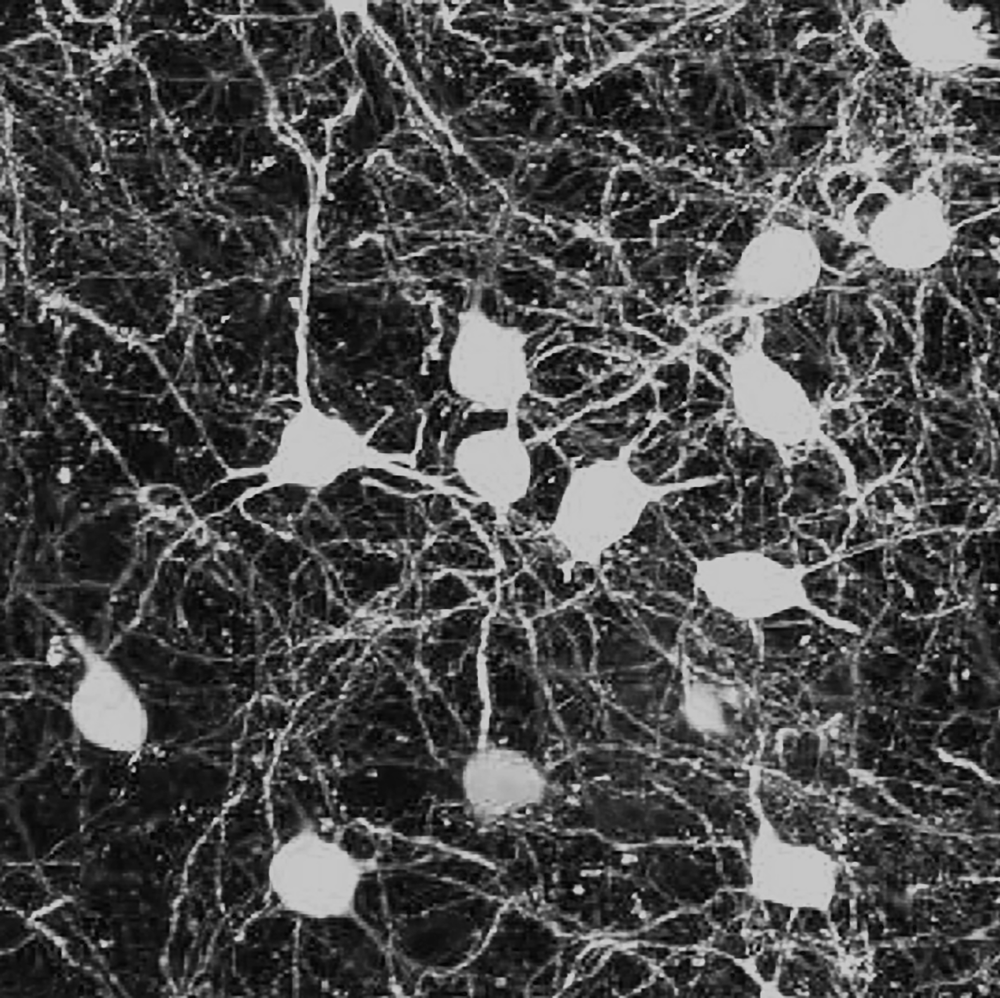
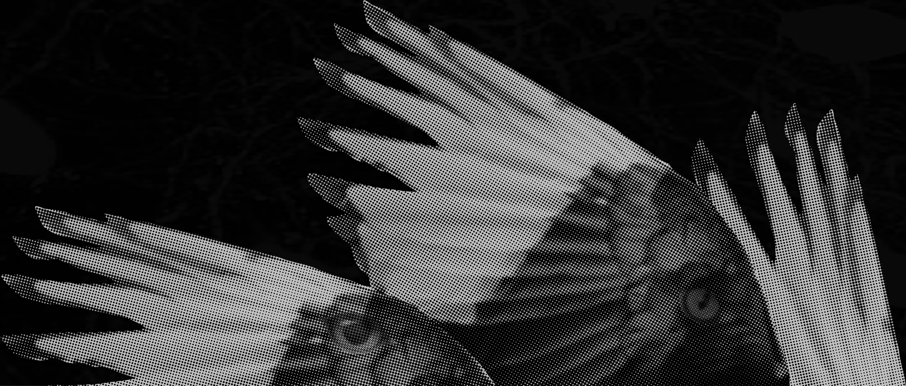
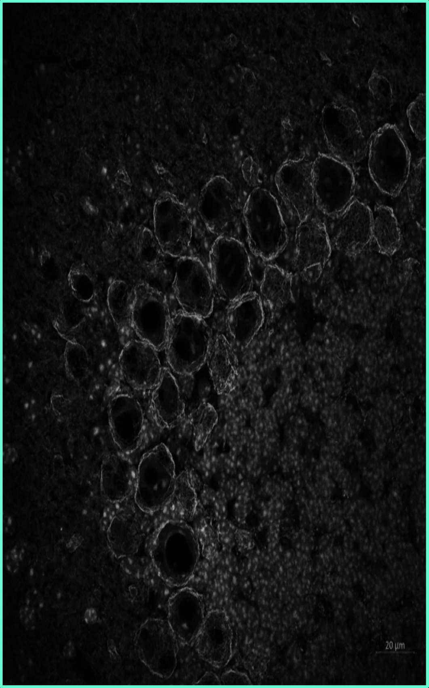
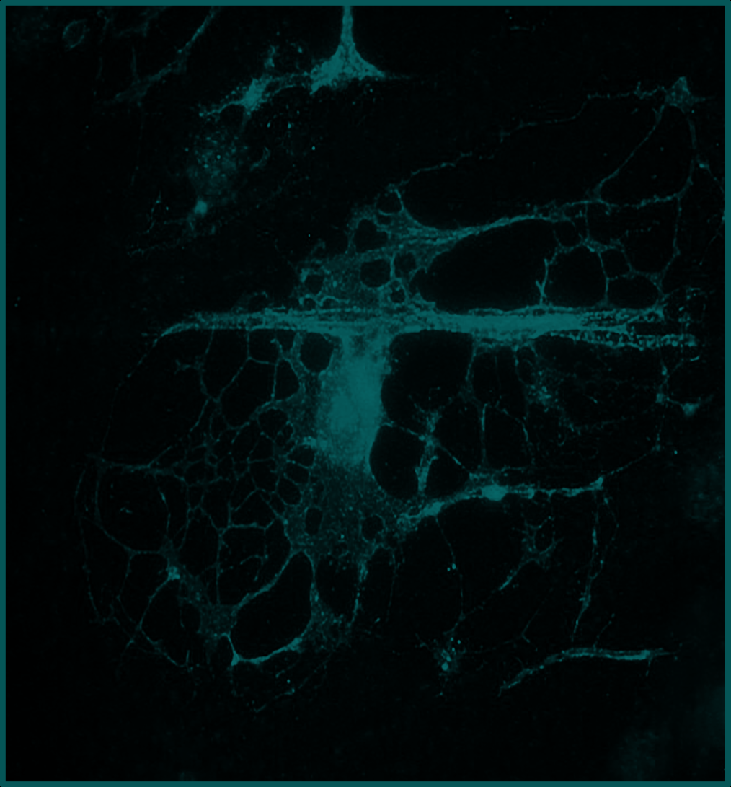
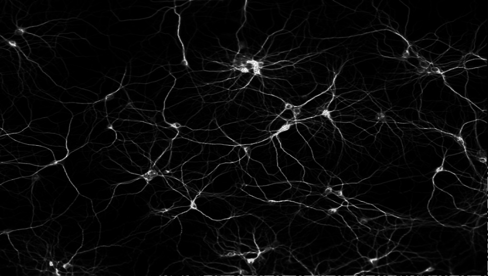

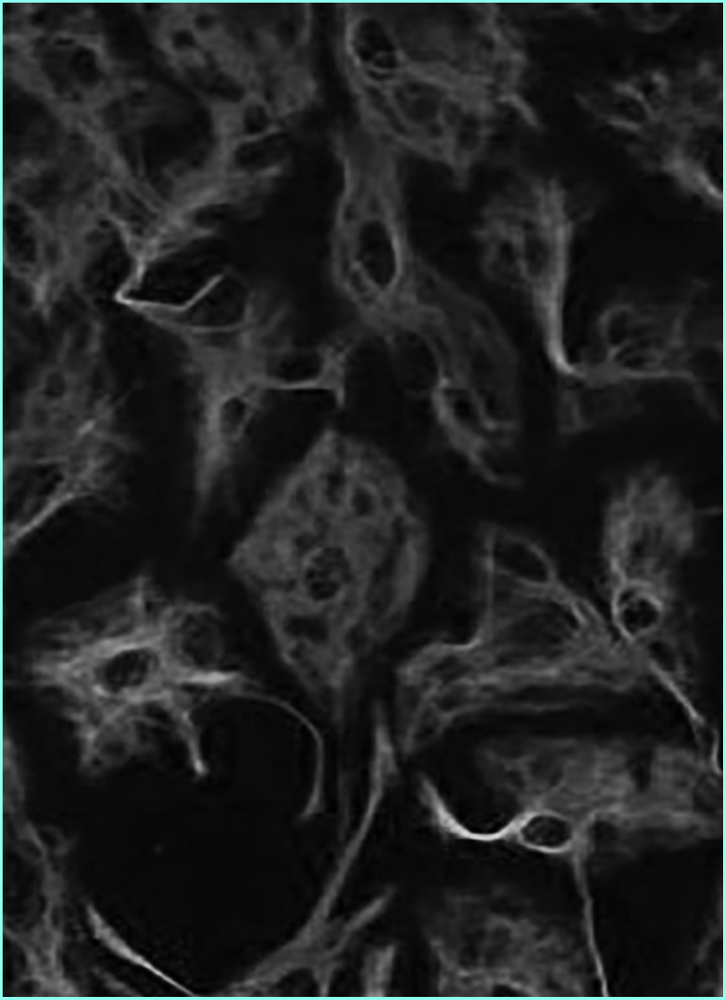

## High-Resolution Graphical Tables & Sheets

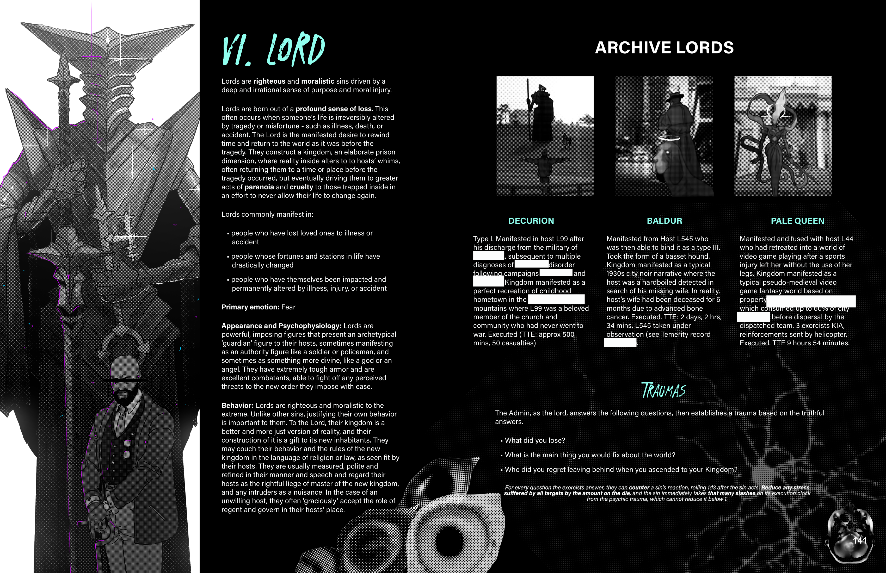

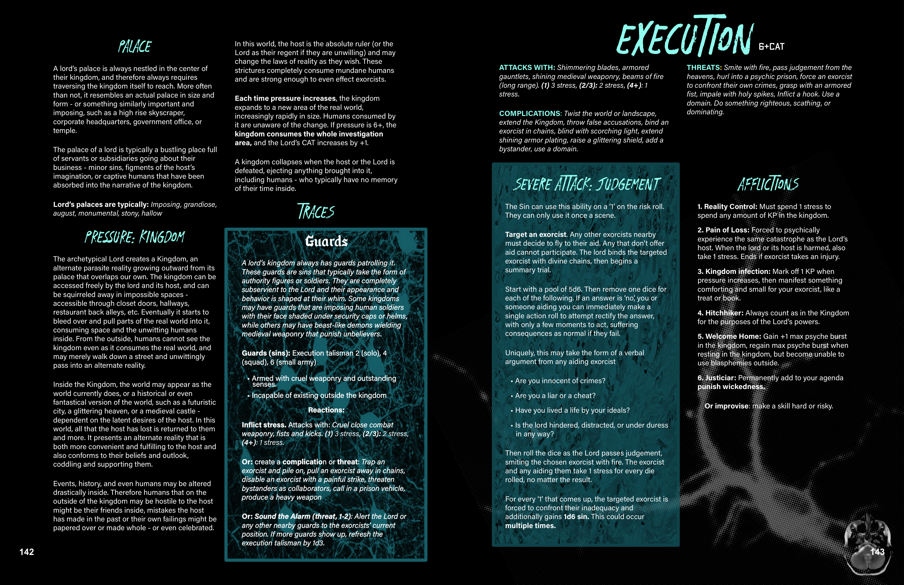

## Related Knowledge Nodes

- [[Designing_Sins]]
- [[Conflict_Scenes]]
- [[08_Whisper]]
