# Mundane Opponents, Security Operatives & Binders (Human Occultists)

> Source: CAIN 1.0 Rulebook (Pages 74, 75, 76, 77)

---
### Page 74 Source Content

# **Other Opponents** 

Sins are not the only oppositional force that exorcists can be expected to encounter during a hunt. 

#### **Writing an opponent** 

Opponents (and sins) are simply storytelling shorthand that is available for easy reference. It’s better not to think about them as a ‘stat block’ but rather quick reference material for conflict scenes. 

In a conflict scene, opponents can inflict **stress, threaten** exorcists, or cause a **complication.** The Admin can use the following steps to write any opponent: 

##### 1. Write down a name and description 

2. Determine if the opponent is a sin, human, or exorcist. This determines what kinds of powers can be used on them. Foes can also be mechanical (like an unmanned drone), or an anomaly (an untyped or mysterious supernatural force). 

3. Determine category. Use the CAT table on pg. XX. In general, humans are CAT 0, groups of humans, vehicles, and supernatural forces are higher. Category is an easy shorthand for how effective exorcist powers are. 

4. Write down the execution talisman: short (2 segments), medium (3/4) or long (5/6). This typically determines how tough an opponent is. 

5. Write some facts about the opponent - what are their general capabilities? This can determine fictional moves and also whether certain actions taken against them are generally hard or risky. 

6. Write reactions: 

7. Write how much stress an opponent inflicts. Typically an opponent should inflict 1-2 stress, with +1 more stress on a ‘1’ risk result. 

8. Write some typical complications or threats 

**Optional:** write a unique threat or a unique affliction that the opponent can inflict. Gate this with the reaction die to a 1-2. 

Here’s an example of some opponents: 

## Mundane Opponents 

Exorcists are often in the position of crossing law enforcement due to the time sensitive and clandestine nature of their activities. Aside from this, however, they often tangle with high level, deeply entrenched forces beyond public knowledge: secret societies, shadow governments, private military companies and the like. Sins themselves and their hosts are also able to hire mundane humans to do their bidding, especially Toads. 

- Most mundane humans, individually: 

- are incapacitated by any amount of stress and are usually instantly killed by 4+ stress 

- go catatonic if they directly witness a sin 

- The humans listed here are made of tougher stuff. 

### Security 

**Humans.** Execution talisman: 2 (solo), 4 (group),  6 (large group.) 

These graceless humans are blissfully unaware of the world of psychic phenomena around them. They are often dispatched to deal with disturbances or guard facilities. 

- General human capabilities 

- Usually alert and can raise some kind of alarm 

###### **Reactions:** 

**Inflict stress.** Attacks with: Batons, close quarters combat techniques. **_(1)_** _3 stress,_ **_(2/3):_** _2 stress,_ **_(4+)_** _: 1 stress._ 

**Or:** create a complication or threat: _Fire a stun gun, punch an alarm, pull out a firearm, pin down an exorcist_ 

**Or: Threat** (1-2): Beatdown: Inflict Broken Arm or Broken Leg affliction _(activities using the affected limb are hard)._ 

### Mercenaries 

**Human.** Execution talisman: 2 (solo), 4 (group) 

Graceless human mercenaries, highly skilled and sometimes hired by sin hosts or world governments for defense or wetwork. 

- Well armed and compensated 

- Armored well against small arms and has thermal and night vision. 

###### **Reactions:** 

**Inflict stress.** Attacks with: Disciplined gunfire (long range). **_(1)_** _3 stress,_ **_(2/3):_** _2 stress,_ **_(4+)_** _: 1 stress._ 

**Or:** create a complication or threat: Throw a stun grenade, take heavy cover, throw down a barrage of suppressing fire. 

**Or: Threat (1-2):** Flechette Shot: Take a disabling shot at an exorcist. If enacted, deal 2 stress and that exorcist is in so much pain they cannot act without teamwork for the rest of combat. 

### Illuminati 

**Humans.** Execution talisman: 1 (solo), 3 (group), (5) large group. 

Brainwashed or fanatical humans formed around the manipulation and worship of sins, often formed and puppeted by shadowy organizations or a sin themselves. 

- Often hide their faces under masks 

###### **Reactions:** 

**Inflict stress.** Overwhelming but crude attacks. **_(1)_** _3 stress,_ **_(2/3):_** _2 stress,_ **_(4+)_** _: 1 stress._ 

**Or:** create a complication or threat: _Corner an exorcist, attack with fervor (+1 stress), start chanting ominously (- 1 slash taken)_ 

**Or: Complication (1-2)** : Sacrifice: Pin down an exorcist, who finds it hard to do anything, can’t move, and takes +1 stress. Set out a 3 talisman to end this grab or ends when the illuminati are defeated. 

**146** 

**147**

#### Extracted Visual Elements (Page 74)

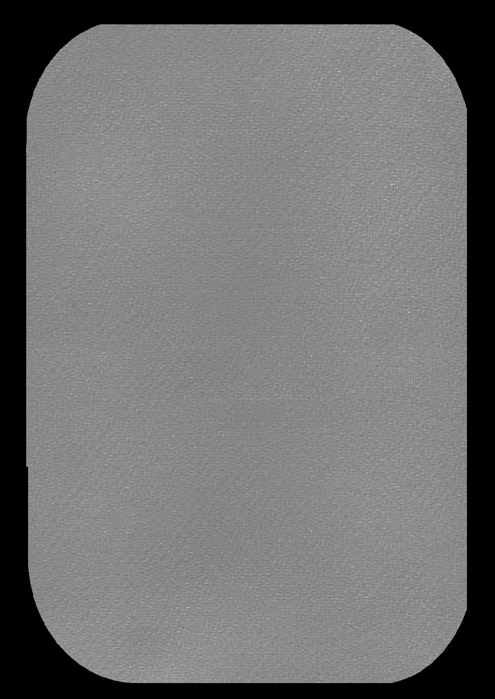
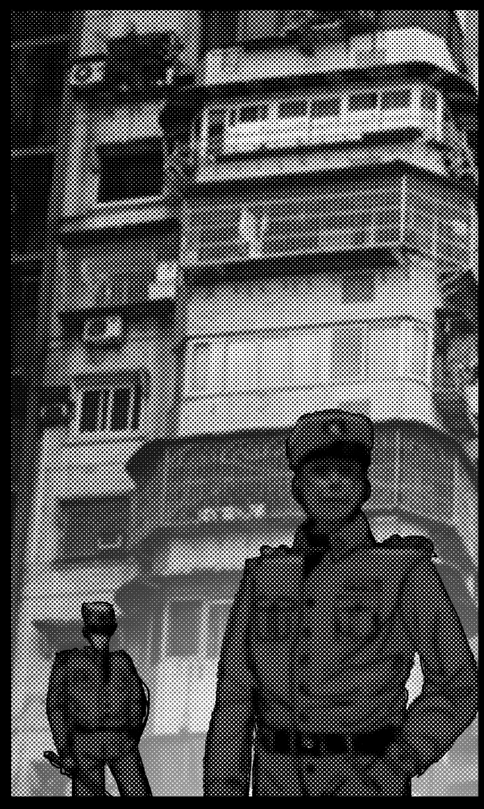
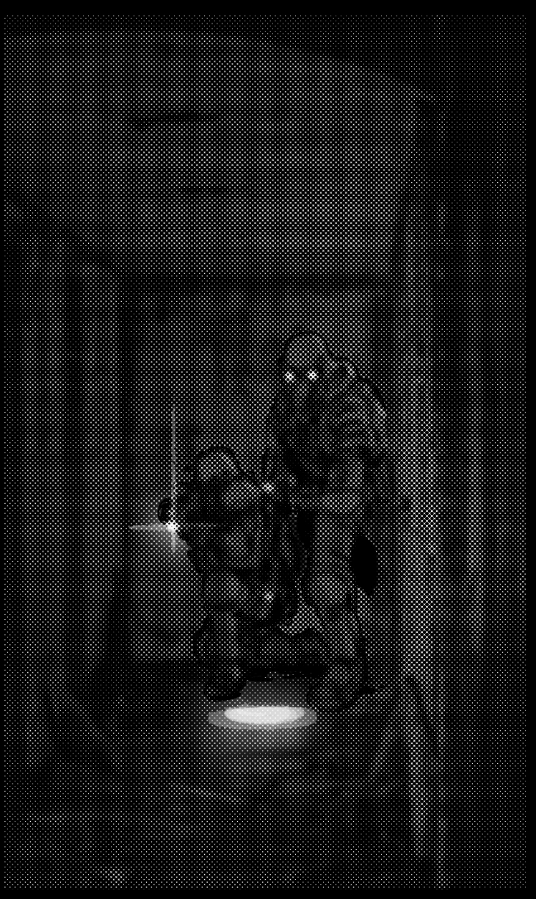
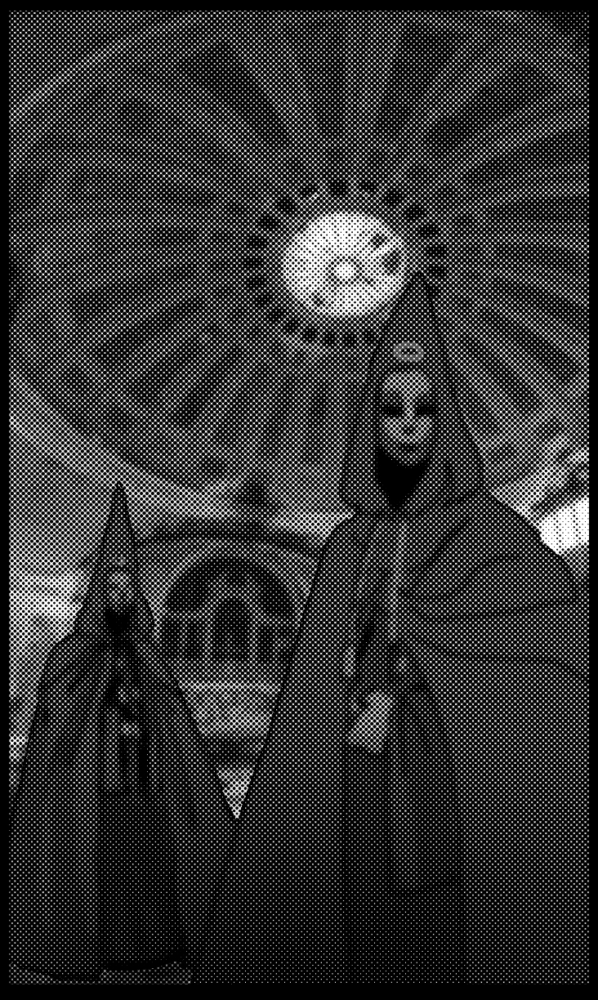

---
### Page 75 Source Content

## Pseudo Sins 

Not all sins are created by natural, spontaneous events. Some are caused by Sin Events through the steady buildup of negative energy in exorcists themselves, called Imago. Still others are created in secret processes by world governments seeking to unlock their potential as weapons of war or control. 

# Mass Produced Sin 

**Sin.** CAT 0-4, depending on strength 

**Execution talisman:** 3 (solo), 5 (group), 7 (army) 

_A weak sin, produced through unspeakable methods by shadowy private military companies or secret world government projects, sometimes from human stock._ 

- Barely intelligent, but armed with brute strength 

- Has a control unit implanted in it. Destroying it usually makes the sin berserk (see the threat below) 

### **Reactions:** 

I **nflict stress** . Attacks with: Claws, teeth, whipping tendrils. **_(1)_** _3 stress,_ **_(2/3):_** _2 stress,_ **_(4+)_** _: 1 stress._ 

Or: create a **complication** or **threat** : Spew black, corruptive fluid, ear splitting screaming, hurl an exorcist through a wall or floor 

Or: **Threat (1-2): Berserk** : Break the control unit and go berserk, dripping ichor, dealing **+1 stress** and **+1 sin** with reactions for the rest of combat. Can only be used once. 

Artificial Sins sometimes have typing, giving them additional abilities: 

- **Type A: Shock troop.** Fighting them in close combat is **hard** . Able to easily smash through buildings and materials. 

- **Type B: Infiltration.** Can go invisible as a **complication** , making actions relying on sight **hard** until complication is ended. 

- **Type C: Control** . Can control mundane humans present as a **complication** , using them to body block (-1 stress suffered) or attack (+1 stress dealt) while complication is active. 

## Imago 

**Sin.** CAT 1-5, based on exorcist 

**Execution talisman: 6** +CAT 

A nascent true sin, created when an exorcist suffers sin overflow and chooses to give up (see pg. 30). Imagos are neither type I, II, or III sins, but a worse type created from an exorcist transforming directly. The sins they create are always more intelligent, spiteful, and vengeful based on their past are are hunted with extreme prejudice by CAIN. 

- Acts based on the worst impulses of the exorcist it was created from 

- Nearly always has a strong instinct to flee and become stronger, where it will mature into a true sin and begin creating a palace, triggering a new hunt. Will usually fight to run away. 

### **Reactions:** 

**Inflict stress.** Attacks with: Claws, teeth, dripping appendages, psychic powers. **_(1)_** _3 stress_ **_+1 sin, (2/3):_** _2 stress_ **_+1 sin, (4+)_** _: 1 stress._ 

**Or:** create a **complication** or **threat:** _Make appeals to the exorcists’ humanity, show a little of their former self, demonstrate a new surprising ability, outpace the exorcists_ 

**Or: Threat (1-2): Flee:** Flee the scene to pupate and become a full sin, perpetuating the cycle and the stain. Imagos have a basic type which the transformed exorcist can choose based on their personality This gives them some basic cues as to their appearance, behavior, and abilities when choosing attacks, complications, or threats. 

- **Ogre Type:** Appearance: _huge, swollen, twisted, waterlogged._ Abilities: _Spewing sludge, freezing cold, brute strength, regeneration_ 

- **Idol Type:** Appearance: _Enhanced, coldly beautiful, graceful._ Abilities: _Vocal control, superhuman agility, flesh melding_ 

- **Hound Type:** Appearance: _Warped, enraged, blistering with spines._ Abilities: _Berserk rage, animalistic speed, spitting blood_ 

- **Centipede Type** : Appearance: _Insectile, alien, carapace._ Abilities: _Dripping with venom, create minions from nearby humans, dissolve with acid_ 

- **Toad Type:** Appearance: _Double jointed, long limbed, jester-like._ Abilities: _Incredible feats of dexterity or agility, long powerful tongue, exuding slime_ 

- **Lord Type:** Appearance: _Armored, imposing, angelic._ Abilities: _Warping the world to their liking, fiery shining weaponry, heavy armor_ 

Nobody in (recorded) archival CAIN history has recovered from becoming an Imago, but it might be possible depending on the tone of your game. 

**148** 

**149**

#### Extracted Visual Elements (Page 75)

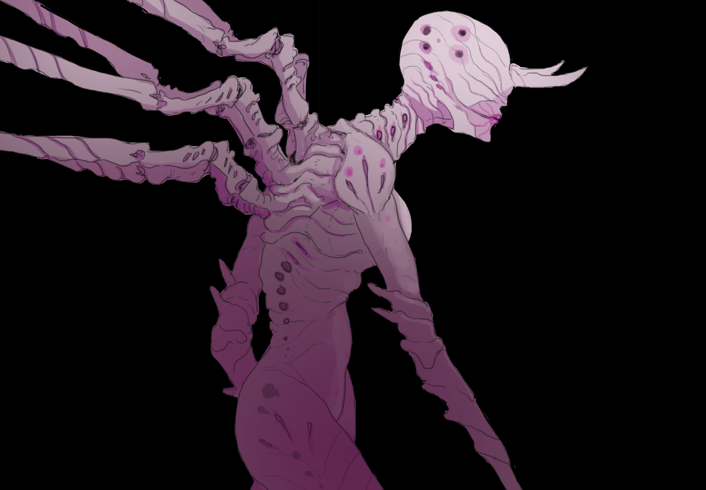
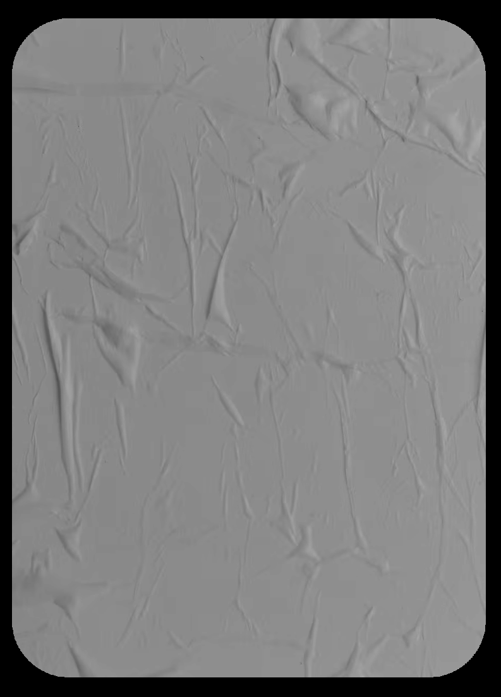

---
### Page 76 Source Content

# Drifter 

The forces created by blasphemies and sin events are (still) largely beyond human comprehension. Occasionally these forces break the psychic veil in a way that breaches mundane reality, allowing other beings momentary entry. These beings cannot be classified as sins but defy any classification as life. Their attachment to our reality is fleeting and they typically move on after a few hours - hence the moniker - but they are no less dangerous to human life. 

## Pest 

**Anomaly.** Execution talisman: 2 (solo), 5 (group) 

_A broad category of drifter - a common manifestation that could be categorized as animal-like, the fauna of a place beyond human understanding._ 

- Tends to break conventional reality around it - changing things like light refraction, gravity, space. May create sucking holes in things, reflective surfaces, crystalline splinters, etc. 

- Consumes inanimate matter like glass, paper, or stone. 

### **Reactions:** 

**Inflict stress.** Attacks with: Whipping tendrils, extreme forces. **_(1)_** _3 stress,_ **_(2/3):_** _2 stress,_ **_(4+)_** _: 1 stress._ 

**Or:** create a **complication** o **r threat:** Kill all the lights, impale with strands, warp space in some way, suck the oxygen out of a room 

## Poltergeist 

**Anomaly.** Execution talisman: 3 

A barely visible shape in the darkness. 

- May adopt human face or form. Never looks right 

- Can mimic speech. Sometimes comprehensible. Sometimes appears to tell the future. Do not listen to it. 

### **Reactions:** 

**Inflict stress.** Attacks with: Telekinetic shove, thrown objects, ghostly flames. **_(1)_** _3 stress,_ **_(2/3):_** _2 stress,_ **_(4+)_** _: 1 stress._ 

**Or:** create a complication or threat: _Speak something into someone’s ear, emerge suddenly from darkness, disappear completely_ 

**Or: Threat (1-2): Feed** : Deal 1d6 stress, but also reduce target’s sin by the same amount. Once per scene only. 

## Titan 

**Anomaly.** Execution talisman: 6 

_An incredibly large drifter, usually thirty to forty meters or larger at the shoulder. Sometimes anthropomorphic, sometimes animalistic in form. Has a tenuous relation to reality and may occasionally phase through matter, though large enough to cause shocking destruction._ 

- So large it is immune to small arms fire and doesn’t seem to regard humans much at all. 

- Barely intelligent. Lumbers along slowly with little regard for obstacles. 

#### **Reactions:** 

**Inflict stress.** Attacks with: Casual swats of an appendage, an unintentional footstep **_(1)_** _3 stress,_ **_(2/3):_** _2 stress,_ **_(4+)_** _: 1 stress._ 

**Or:** create a **complication** or t **hreat** : _Speed up, suddenly notice the exorcists, become irate or enraged, cause massive collateral damage._ 

**Or: Threat (1-2):** Swat insect: The titan attempts a real blow against the last exorcist to deal stress to it, dealing 2d3 stress. If inflicts an injury, inflicts instant death instead. 

## Pale Man 

**Anomaly.** Execution talisman: 5 

_Intelligent drifter that seems interested in the psychically sensitive and is drawn to them like an insect to flame. Prefers to observe from a distance. Completely peaceful if left alone. Fights like an animal if provoked or approached in_ **_any way_** _, with no regard for its own safety._ 

- Watches at a distance 

- Don’t look at it for too long. 

#### **Reactions:** 

**Inflict stress.** _Attacks with:_ Bone cracking limbs, terrifying jaws. **_(1)_** _3 stress,_ **_(2/3):_** _2 stress,_ **_(4+)_** _: 1 stress._ 

**Or:** create a **complication** or t **hreat** : _Retreat into darkness, wail loud enough to shatter glass, lick exorcist with numbing tongue._ 

**Or: Shrieking Rage. (1):** Deal +1 more slash and take +1 more slash on talismans for the rest of combat. This effect stacks. 

## Gatherer 

**Anomaly.** Execution talisman: 2 (solo), 5 (group), 7 (horde) 

_Bulbous humanoid that exhibits the unusual behavior of collecting and enveloping humans alive to carry them off to parts unknown. Sometime appear in groups_ 

- Has a fleshy, saclike structure it will store fresh humans in, carrying them off. 

- Capable of communicating subsonically. 

#### **Reactions:** 

**Inflict stress.** Attacks with: Extended spines, acid spray, subsonic vibrations. **_(1)_** _3 stress,_ **_(2/3):_** _2 stress,_ **_(4+)_** _: 1 stress._ 

**Or:** create a **complication** or t **hreat** : _Disgorge stomach contents, impale with arm blades, vomit acidic bile_ 

**Or: Kidnap (1): Complication:** Grab an exorcist and shove them into its fleshy interior. That exorcist finds it hard to do anything and is practically immobilized. They go comatose and suffers an injury if the Gatherer is not defeated or they are not freed at the end of 3 rounds (counting this one). 

**150** 

**151**

#### Extracted Visual Elements (Page 76)

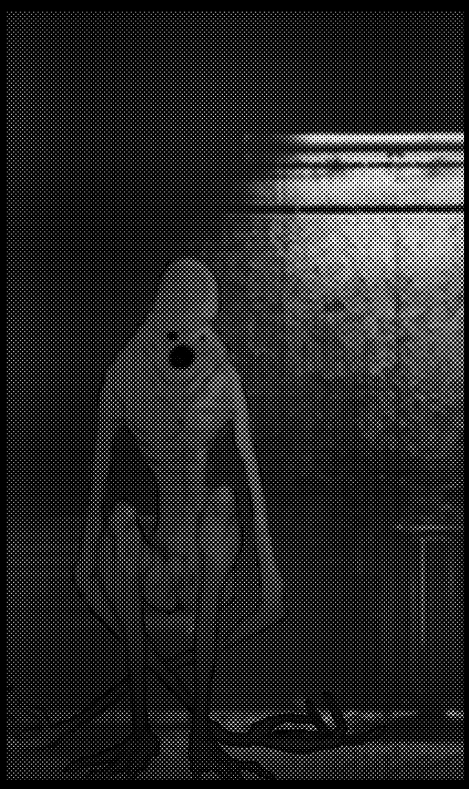
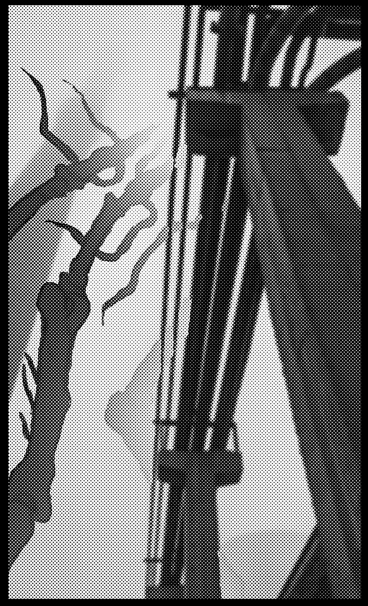
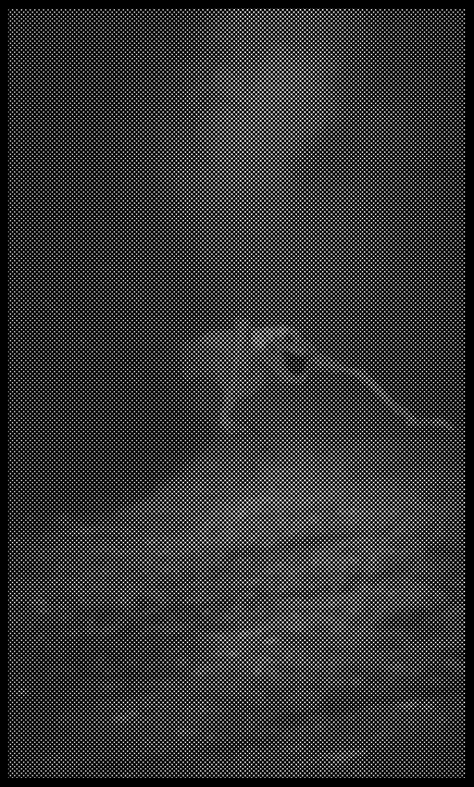
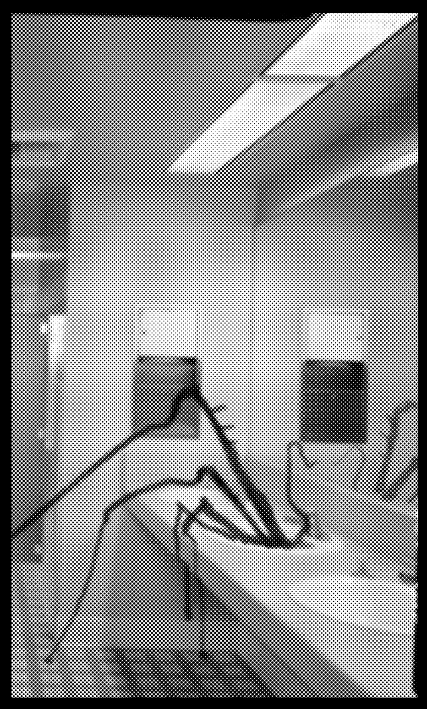

---
### Page 77 Source Content

## BINDER 

# BINDERS 

It is possible to bind lesser sins or their traces into servitude, an art that was officially banned by the Doctrine of Katherine the Meek in 1736 and is punishable by instant execution. Binding sins, especially powerful ones, provides an incredible boost in ability to an exorcist, as they can use them as servants, attack dogs, and living wells of psychic power. Exorcists that manifest this blasphemy are kept under strict observation and granted a stay of execution as long as they are employed by CAIN. 

The term ‘binder’ has since become a catchall term for all rogue exorcists. It is occasionally recorded that CAIN encounters and comes into conflict with outside individuals manifesting blasphemies that are external to official CAIN employment or record. These individuals are able to tap into and control their powers without CAIN conditioning, something that the organization deems extremely dangerous - as they still present a significant degradation risk of sin overflow. 

# UNDER//HEAVEN 

Amongst those employed by CAIN and amidst field reports, there are rumors of **another clandestine organization** - one that does not seek to wipe out sins, but rather to control them, as weapons and a source of power, or even to cultivate them. They even instigate the creation of sins- sometimes through artificial means, as a way of furthering their goals. The doctrine of this organization, as far as it has supposedly been encountered, is that individuals with grace, such as exorcists, are naturally superior to graceless humans, presenting a next step in evolution. This evolution should both be cultivated and those that are ‘dead ends’ (base humans) should be left behind -  or worse, culled. 

Officially, **Under//Heaven** does not exist. At minimum, any organized exorcist group outside of CAIN’s control would present an **extreme threat to the world order** . The organization’s ranks (if it exists) are mostly made up of mundane mercenary groups and illuminati, mass produced sins (see pg.148), and **Binders** at the top. 

**Exorcist.** CAT 0-6, depending on strength 

**Execution talisman:** 2+CAT (rank and file), 4+CAT (Upper rank), 6+CAT (Elites) 

_A rogue exorcist, either self taught or organized. Manifests blasphemies that are typically more wild, creative, and sometimes more powerful than more restrictive CAIN training provides. CAIN doctrine demands they be immediately subdued and that they submit to authority on pain of execution._ 

- Uses blasphemies that mirror those of the exorcists, but stranger and wilder 

- May work in formation with other binders or control a mass produced sin. 

### **Reactions:** 

**Inflict stress.** Attacks with: Psychic bursts of power, mundane weaponry (both short range). **_(1)_** _3 stress,_ **_(2/3):_** _2 stress,_ **_(4+)_** _: 1 stress._ 

**Or:** create a **complication** or **threat:** _Entrap, slow, or snare with psychic powers. Create a hazard or a shield. Start charging up a massive attack. Rapidly heal (regain one or two slashes on execution talisman). Reveal a surprising use of powers. Escalate the situation._ 

**Or: Attack (1): Psy clash:** Can use once a scene. Choose an exorcist. The exorcist rolls PSYCHE, the binder rolls half their CAT, rounded up. The targeted exorcist and the Admin can each describe how they lock into a fierce clash with their powers. The targeted exorcist takes stress equal to the difference between the result of their final roll and the binder’s. If the binder loses, they are pushed back, take 1 slash and can use this ability again this scene. 

**Or Fuse (1-2) Threat:** Fuse with a sin or another allied Binder into a gestalt being if the threat is successful. Destroy the target but then increase this binder’s execution clock by 2,. They deal +1 stress with all actions and increase in CAT by 1 for the rest of the scene. This can only be used once. 

When creating theming for the abilities for the binders, the Admin can look to the base twelve blasphemies. 

**1. Tension:** Slice, trap, or create force fields 

**2. Ardence:** Blast with fire or cold, create massive destruction 

**3. Flux:** Reverse or speed up the flow of time to heal or hinder 

**4. Vector:** Fly, hurl objects, move with unnatural speed 

**5. Gate:** Teleport, manipulate space 

**6. Smother:** Turn invisible, make no sound, turn off friction or light 

**7. Whisper:** Know about things before they happen. Reveal hidden plans. 

**8. Edit:** Blend into a crowd, alter the equipment, body, or outfits of others. 

**9. Bind:** Attack with bound sins, fuse with bound sins. 

**10. Jaunt:** Paralyze, possess, or puppet someone or something 

**11. Palace:** Pull someone into the palace, pull something or someone out of the palace 

**12. Sympathy:** Demonstrate supernatural proficiency with tools or weapons 

Mimes, in the form of God on high, 

And hither and thither fly— 

**152** 

**153** 

Mutter and mumble low,

#### Extracted Visual Elements (Page 77)

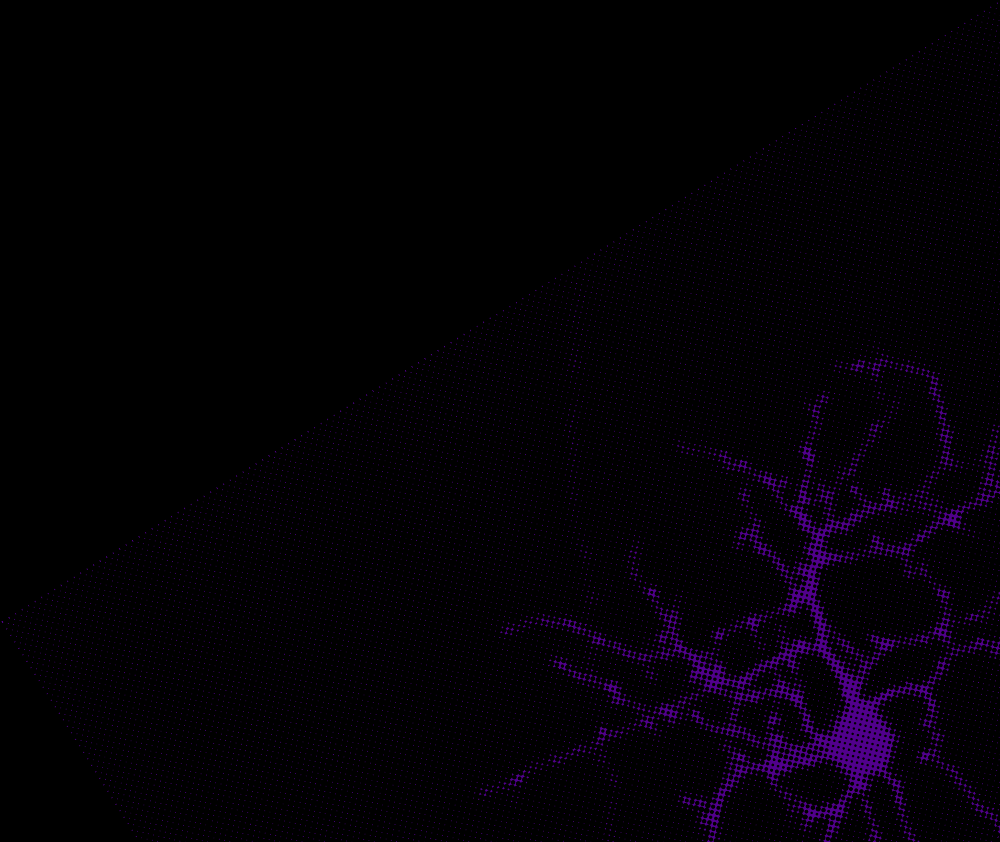

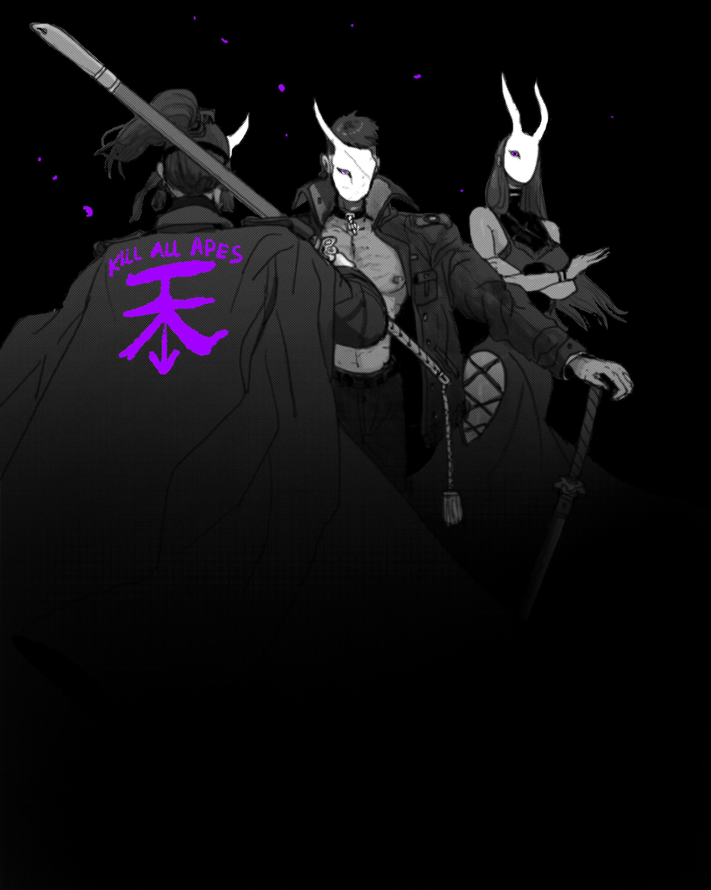

## High-Resolution Graphical Tables & Sheets

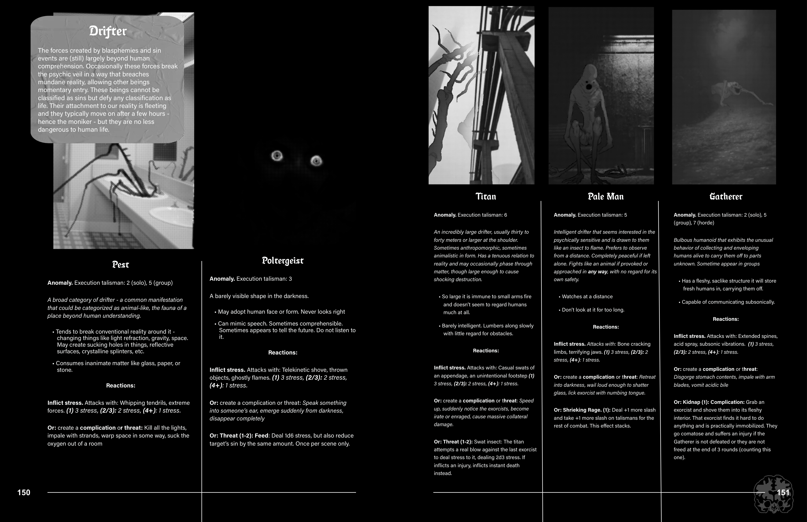

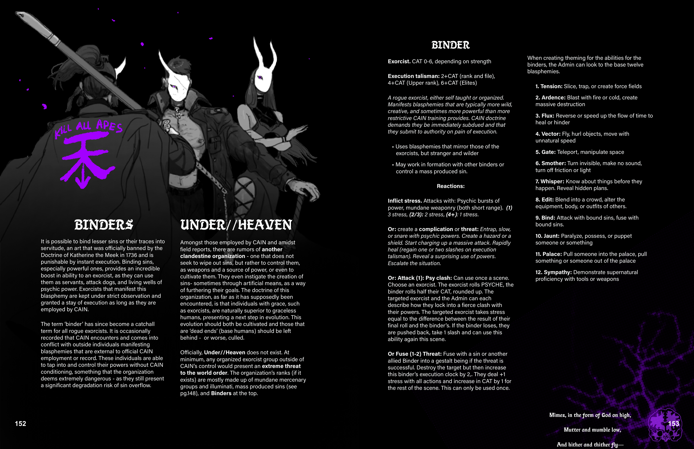

## Related Knowledge Nodes

- [[Conflict_Scenes]]
- [[The_Shadow_War_and_The_Legion]]
