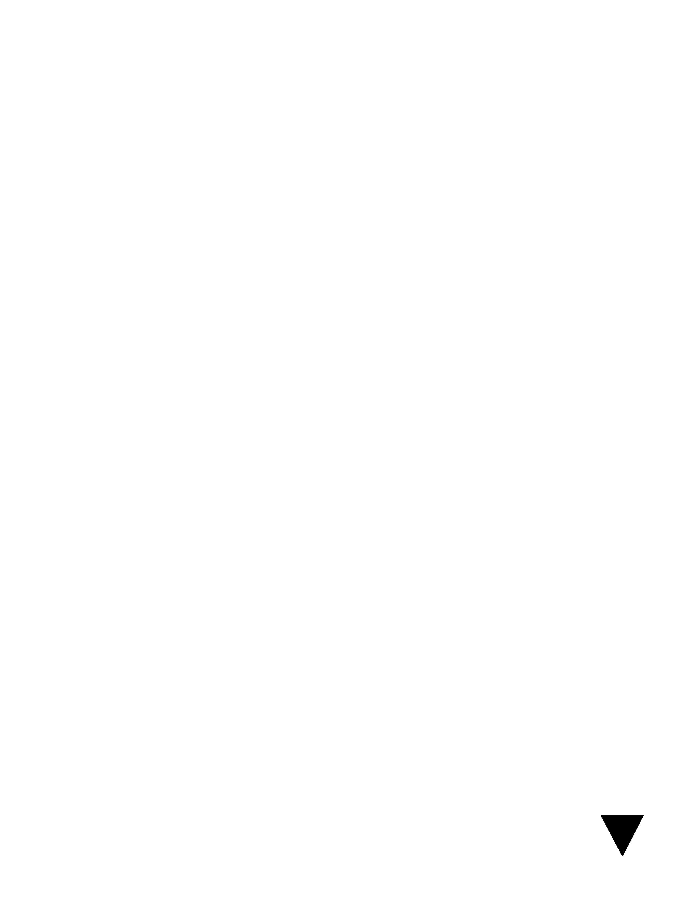
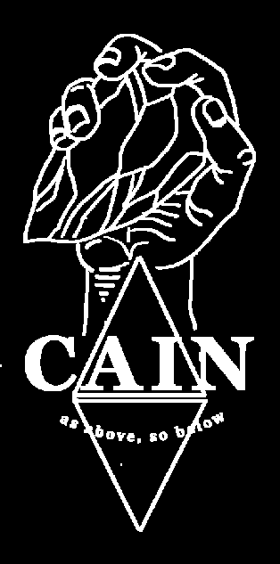

# CAIN Credits & Overview Pitch

> Source: CAIN 1.0 Rulebook (Pages 82)

---
### Page 82 Source Content

# C AIN 

**Humanity is cursed** , host to a roiling psychic sea barely understood or controlled, a phenomenon arising purely from the darkest portions of the human soul. While most humans are blissfully unaware of its presence, others are more sensitive. When it grows wild in these hosts, **SINS** appear, terrifying supernatural monsters that are anathema to reality itself. 

**CAIN is the solution** , the global supranational shadow organization dedicated solely to the hunting and execution of sins. It’s mission is clear, its purpose steadfast. Is there anything better than a good hunt? Just think, you’re all set to slaughter to your heart’s content. 

**YOU are an exorcist** , a powerful psychic soldier and tool of CAIN, honed and wielded for one purpose: 

## **WIPE OUT THE STAIN** 

**$9.99** 

© Tom Bloom 2024

#### Extracted Visual Elements (Page 82)

## Related Knowledge Nodes

- [[01_As_Above_So_Below]]
- [[Quick_Reference_Guide]]
